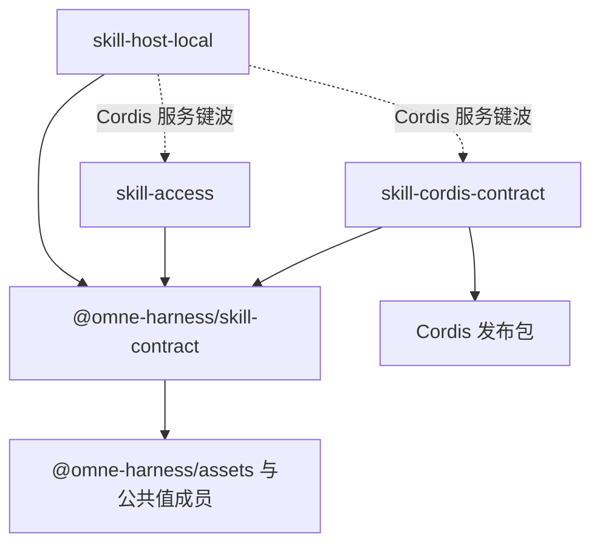

# Skill能力组

状态：唯一的 workspace 成员是 `@omne-harness/skill-contract`，它提供已接受的 `skill` 类别端口。组的分解、模型、端口与服务是工程设计草案，全部为候选决定，尚未取得技术接受。发现、读取、导出和发布仍没有成员实现。脚本执行不归本组。

## 责任与范围

本组承接Skill专有工程责任，领域边界沿[已接受领域责任](../../docs/domains/skills/README.md)。产品规则、阶段及政策沿[产品第四章](../../.meta_harness/design/product/skills/design.md#未决问题与待定事项)。许可、原消息、工具执行、环境资源和逻辑工作继续由相邻拥有者承担，不能因组合在本组中集中改写。本组认识谁、不认识谁、需要什么与提供什么，见[工程设计「边界」](docs/architecture.md#边界)。

## 成员与依赖

真实 workspace 成员只有一个。它是本组的纯契约成员，由原 `@omne-harness/skill` 改名为 `@omne-harness/skill-contract`，与 Tool 组的 `tool-contract` 和 MCP 组的 `mcp-contract` 命名一致：

| 成员 | 当前状态 | 阅读入口 |
| --- | --- | --- |
| `@omne-harness/skill-contract`（`packages/skills/skill-contract`） | 已实现已接受的 `skill` 类别端口 `skillBodyContract`。依赖 `@omne-harness/assets`，不依赖 Tool。不提供发现、读取、导出或发布 | [成员入口](skill-contract/README.md)与[规格](skill-contract/SPEC.md) |

作为纯契约成员，`@omne-harness/skill-contract` 在组设计中还要承接值、纯函数、端口与服务接口。它的 `./testing` 入口导出符合性设施：`SkillPackageSource`、`SkillAccess`、`SkillReadCheck` 与 `SkillResolution` 的符合性套件，以及内存来源。`SkillReadCheck` 与 `SkillResolution` 的套件核对：对无权主体，答复不随该身份是否存在而变。这些都是候选，尚未实现。它允许的生产依赖逐个列出：`@omne-harness/assets`、`@omne-harness/operation-result`、`@omne-harness/legal-identity`、`@omne-harness/content-block` 与 `@omne-harness/json-text`。

组设计另有三个具名文档目标。它们都尚非 workspace 成员：没有包、源码或运行实例。名字、职责与依赖都是候选决定，尚未取得技术接受。建包时随成员规格确定。分波只有三种：第一波、第一波之后、Cordis 服务键波，见[成员承接表](docs/architecture.md#完整行为候选的正式承接缺口)。

| 具名文档目标 | 状态 | 职责 | 允许的生产依赖 |
| --- | --- | --- | --- |
| `skill-access`（通用实现） | 尚非 workspace 成员 | 三个应用服务：`PackageInspection`、`SkillCatalog`、`SkillAccess`。名字对应领域的「方法与资源取用」。只依赖本组纯契约与公共值成员，不依赖 Cordis，也不依赖任何调用方的成员 | `@omne-harness/skill-contract`，以及 `@omne-harness/skill-contract` 允许的公共值成员 |
| `skill-cordis-contract`（Cordis 契约） | 尚非 workspace 成员 | 服务键与抽象 Service。不含实现。暂不进应用插件树。在 Cordis 服务键波 | `@omne-harness/skill-contract` 与 Cordis 发布包 4.0.4，版本依据[技术基础](../../docs/architecture/technical-foundations.md#共同技术选择)「产品与工程运行时」 |
| `skill-host-local`（本地宿主） | 尚非 workspace 成员 | 两部分。目录来源部分：本机目录来源 `DirectorySource`，在第一波。Cordis 插件部分：本组的 Cordis 插件，在 Cordis 服务键波。内容存储来源等存储契约就绪后再加 | 目录来源部分：`@omne-harness/skill-contract` 与宿主依赖。Cordis 插件部分另加 `skill-access` 与 `skill-cordis-contract` |

依赖方向照 Tool 能力组的先例：`skill-host-local` 指向 `skill-access`、`skill-cordis-contract` 与 `@omne-harness/skill-contract`。其中指向 `skill-access` 与 `skill-cordis-contract` 的两条随 Cordis 插件部分在 Cordis 服务键波加入，图中用虚线。第一波的目录来源部分只指向 `@omne-harness/skill-contract`。`skill-access` 与 `skill-cordis-contract` 各自指向 `@omne-harness/skill-contract`，彼此不依赖。依赖方向在建包时写入架构约束，本页不改约束文件。

各成员与目标的模型、端口、服务、失败种类与分波见[工程设计](docs/architecture.md)。各候选由哪个成员承接，见[成员承接表](docs/architecture.md#完整行为候选的正式承接缺口)。定义拥有者维护自己的公开形状。调用方显式给出访问上下文与作用域。本组不创建组根统一 SPEC。

## 关键协作

[组内流程](docs/key-flows.md)表达本组服务与端口的协作。[领域流程](../../docs/domains/skills/key-flows.md)与[领域交接设计](../../docs/domains/skills/architecture.md)表达跨领域交接。[工程设计](docs/architecture.md)维护模型、失败与技术处置，不在本入口复制。

## 组合验证

组技术拥有者协调方法定义、取用与导出，以及需求端口的真实实现，验证授权、版本一致、未知与取消。证据须绑定成员与端口实现的精确版本与故障前提。第一波的验证候选见[工程设计「验证」](docs/architecture.md#验证)。目前没有核实行为、攻击、资源或耐久。替身与结构检查不代替真实组合验证。

## 维护

具名组维护者尚待指定。成员边界与实际公开形状明确并取得技术采用后，维护者完整承接行为，同步本入口、局部登记、产品技术导航与真实消费者，不能以搬迁薄化条件或把候选升级为采用。包创建沿[成员文档规范](../../docs/member-documentation.md)及[开发入口](../../docs/development.md#创建和整改产品包)。具名文档目标建成 workspace 成员后，从具名文档目标表移到成员表。
