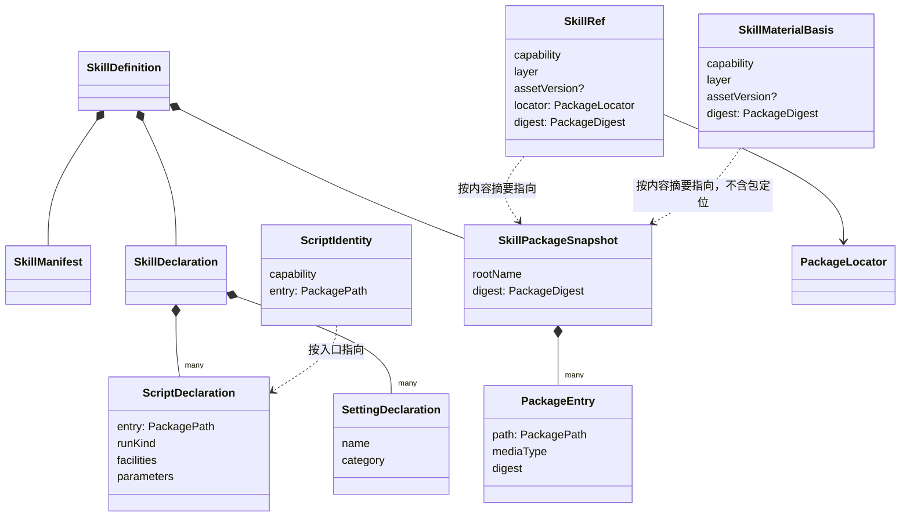

# Skill能力组工程设计

状态：工程设计草案。本页的成员、模型、端口、应用服务、失败种类与技术处置都是候选决定，尚未取得技术接受。`@omne-harness/skill-contract`、`@omne-harness/skill`、`@omne-harness/skill-host-local` 与 `@omne-harness/skill-cordis-contract` 都已有实现（候选，尚未取得技术接受）。各成员的行为以成员规格为准：[skill-contract](../skill-contract/SPEC.md)、[skill](../skill/SPEC.md)、[skill-host-local](../skill-host-local/SPEC.md)、[skill-cordis-contract](../skill-cordis-contract/SPEC.md)。`@omne-harness/skill` 实现 `PackageInspection`、`SkillCatalog` 与 `SkillAccess`。三个服务只对内存替身与 `SkillAccess`、`SkillCatalog` 的符合性套件验证过。另有有限范围的模型与探索器结果，见[性质账本](../skill/verification/README.md#ledger)。`DirectorySource` 在真实临时目录上通过来源的符合性套件。真实的读取判定与对应都还没有验证过。新公开承诺在实施交付时走技术接受。

本页只写组内的分解、模型、端口形状、应用服务、失败种类与技术处置。跨领域交接见[领域交接设计](../../../docs/domains/skills/architecture.md)。成员与允许依赖见[组入口](../README.md#成员与依赖)。

## 设计守则

本页的决定遵守下面七条守则。各节的决定表写明它守的守则与依据层。

| 守则 | 规则 | 依据层 |
| --- | --- | --- |
| G1 一个事实一个拥有者 | Skill 不求值，不保存采用，不判定工具准入。Skill 只经端口读取其他拥有者的结论。 | 架构 [外域概念的进入方式](../../../docs/architecture/layers-and-dependencies.md#外域概念的进入方式)；研发品味 [维度分解与正交](../../../.meta_harness/agents/roles/engineering-taste.md#维度分解与正交) |
| G2 只用自己的词 | 本组契约只用本领域的词。契约不点名任何调用方，也不引入调用方体系的概念。契约只声明本组提供什么、需要什么。 | 架构 [外域概念的进入方式](../../../docs/architecture/layers-and-dependencies.md#外域概念的进入方式)「集成方知道被集成方」 |
| G3 按用途切窄接口 | 每种用途只取得自己用的接口：检查包、摘要与检索、描述与读取、导出。 | 架构 [外域概念的进入方式](../../../docs/architecture/layers-and-dependencies.md#外域概念的进入方式)第一行 |
| G4 形态与含义分开 | 字节从哪里来（云端内容存储、本机目录）与字节表示什么（解析、校验）是两条轴。 | 研发品味 [维度分解与正交](../../../.meta_harness/agents/roles/engineering-taste.md#维度分解与正交) |
| G5 不变式先于机制 | Skill 包快照不可变，资源按包内路径寻址，不拼版本，未知不压成失败，秘密不进上下文。机制可以换，这些不变。 | 产品 [J-SK03](../../../.meta_harness/design/product/skills/design.md#j-sk03-按需读取正文或指定资源)；架构 [隔离语义，不隐藏责任](../../../docs/architecture/layers-and-dependencies.md#隔离语义不隐藏责任)；要求 [SYS-DATA-PROTECTION](../../../docs/requirements.md#数据保护sys-data-protection) |
| G6 概念最少 | 复用公共值 `Outcome`、`Access<P>`、`JsonValue`，不另包一层。读取内容只有文本与字节两种，内容块的组装归接收方。没有不可替代理由的部件不建，或者后放。 | 架构 [隔离语义，不隐藏责任](../../../docs/architecture/layers-and-dependencies.md#隔离语义不隐藏责任)「已有公开契约……直接复用」 |
| G7 沿用仓库写法 | 契约用接口、纯函数与判别联合。类只用于有状态的聚合，以及 Cordis Service 必需的抽象类。 | 架构 [IC-2](../../../docs/architecture/cordis-integration-conventions.md#ic-2)；成员先例 [Tool 能力组](../../tool/README.md#包与依赖) |

## 边界

本节写本组认识谁、不认识谁、向外要什么、向外给什么。本组只设计并交付领域内部，以及用 Skill 自己的词表达的服务、数据与接口。调用方怎样把这些接入自己的体系，是调用方一侧的适配，不写进本组正文。外域只出现在下面需求端口的问题、答复与失败里。依据层：架构 [外域概念的进入方式](../../../docs/architecture/layers-and-dependencies.md#外域概念的进入方式)「集成方知道被集成方」；领域 [范围与边界](../../../docs/domains/skills/README.md#范围与边界)。

### 知道谁

本组只导入下列公开契约。

| 公开契约 | 本组取用什么 |
| --- | --- |
| `@omne-harness/assets` | 能力标识 `CapabilityId`、类别端口 `BodyContract`。必需工具名也用类别为 `tool` 的 `CapabilityId` 表示，本组不导入 Tool 的成员 |
| `@omne-harness/operation-result` | `Outcome` |
| `@omne-harness/legal-identity` | 访问上下文 `Access<P>` |
| `@omne-harness/json-text` | `.omne/skill.json` 的严格读取 |
| 官方 Agent Skills 规格 | `SKILL.md` 的格式。它是外部格式，不是代码依赖 |

本组不导入 `@omne-harness/content-block`。读取交出文本或字节，内容块的组装归接收方，见成员规格[读取的形状规则](../skill-contract/SPEC.md#read-shape)。

### 不知道谁

- 本组不知道调用方是谁。本组也不知道调用方怎样接入交出的数据，例如作为工具返回、进入提示词、展开为命令内容，或物化后执行脚本。这些适配归集成方。
- 本组不知道端口由谁实现。端口只用本组的词提出问题。
- 本组不解释主体、作用域与来源层。主体是 `Access<P>` 的类型参数 `P`。作用域是类型参数 `S`，由调用方给出。来源层由 `SkillResolution` 交来。本组把三者原样交给端口或交回调用方。
- 本组不知道脚本怎样执行。准入、执行环境、进程、结果与控制都不在本组。
- 本组不判定依赖在不在场，也不判定一份 Skill 此刻能不能用、脚本有没有所需的设施。这些归调用方。本组只交依赖声明与脚本声明。
- 本组不知道常驻、排序、集合修订与呈现规则。

### 需求端口

| 端口 | 问题 | 答复 | 失败 |
| --- | --- | --- | --- |
| `SkillPackageSource` | 按包定位交出包的当前快照。按包定位、内容摘要与包内路径交出一个条目的字节 | Skill 包快照（含包根目录名），或条目字节 | 找不到包、包里没有该条目、字节与条目内容摘要不符、条目落在包根之外、来源此刻不可达 |
| `SkillResolution` | 这个能力标识此刻对这个主体、在这个作用域合法对应哪一份材料。带Skill 材料依据时，依据所指的材料是否合法。当前合法集合里有哪些身份 | 合法已知但此刻不可用（带原因与最后合法的 name、说明），或对应的材料，或确定没有对应。集合里每个身份各带一个答复。当前合法集合为空时答空集合，这不是失败 | 依据不合法（只在身份合法对应、所带依据的版本不合法时），此刻无法判定 |
| `SkillReadCheck` | 这个主体此刻能不能读这个能力标识 | 准许 | 拒绝，此刻无法判定 |

精确形状见[端口](#端口)。

### 对外提供

本组对外只用本领域的词：能力标识、name、说明、Skill 材料依据、包内路径、媒体类型、字节范围、替换件原因、依赖声明、脚本声明、设置声明与脚本身份。

- 值：见[模型](#模型)。
- 纯函数：见[应用服务](#应用服务)末尾。
- 服务：`PackageInspection`、`SkillCatalog` 与 `SkillAccess`，见[应用服务](#应用服务)。
- Cordis 服务键：`@omne-harness/skill-cordis-contract` 的 `./cordis` 为三个服务给出键 `skillPackageInspection`、`skillCatalog`、`skillAccess`，为两个他域端口给出键 `skillReadCheck`、`skillResolution`，每个键一个抽象 Service 与一个键常量（[IC-2](../../../docs/architecture/cordis-integration-conventions.md#ic-2)）。`skill-host-local` 的 `./cordis` 插件 `skillPlugin` 在三个服务键上提供服务，从两个端口键取用端口，规则见各自的成员规格。
- 实现方入口：`@omne-harness/skill-contract/provider` 导出三个需求端口及其答复类型、`PackageInspection` 接口、`SkillRef`、`PackageLocator`、`sealSnapshot` 与 `SnapshotDefect`。公开根不导出这些。调用方用公开根，拿不到 `SkillRef` 与包定位。这沿 `tool-contract` 的先例。各入口的内容见成员规格[入口](../skill-contract/SPEC.md#entries)。
- 符合性设施：`@omne-harness/skill-contract/testing` 导出 `SkillPackageSource`、`SkillReadCheck` 与 `SkillResolution` 的符合性套件，以及这三个端口的内存替身。`SkillReadCheck` 与 `SkillResolution` 的套件核对：对无权主体，答复不随该身份是否存在而变。`./testing` 另有 `SkillAccess` 与 `SkillCatalog` 的符合性套件。每个套件是不依赖测试框架的用例列表，实现方在自己的测试框架里逐个登记并运行。夹具缺少用例需要的东西时，用例抛出 `NotApplicable`，这不算通过也不算失败，实现方单独计数。套件见成员规格[符合性套件](../skill-contract/SPEC.md#conformance)。

## 模型

Skill 领域没有有状态的聚合。Skill 包快照算出后不变。读出去的内容归接收方。持有、选择和采用的状态都在其他拥有者那里（G1）。依据层：领域 [范围与边界](../../../docs/domains/skills/README.md#范围与边界)「定义持有及求值复用资产，实际内容采用归消费者」。

下表的值都是不可变值。英文名是候选标识。精确类型在纯契约成员 `@omne-harness/skill-contract` 的 `src/values.ts`，词法与授予规则见成员规格[值与守卫](../skill-contract/SPEC.md#values)。

| 值 | 含义与不变式 | 依据层 |
| --- | --- | --- |
| `SkillName` | Skill 的 name。长 1 到 64 个字符，只含小写字母、数字与连字符，不以连字符开头或结尾，不含连续的连字符。它等于能力标识里的 name。包根目录名与它不同时，`inspect` 接受这个包并带兼容提示，不拒绝。`name-mismatch` 只在调用方给出期望名字、而 name 不等于它时出现，见[包格式规则](#包格式规则)。 | 官方规格 [`name` field](https://agentskills.io/specification#name-field)「Must match the parent directory name」（本设计有意放宽，见[兼容策略](#包格式规则)）；成员规格 [skill-contract](../skill-contract/SPEC.md#rejection-order) 的 `name-mismatch` |
| `PackagePath` | 规范化的包内相对路径。它拒绝绝对路径、`..` 段与反斜杠。 | 产品 [J-SK03](../../../.meta_harness/design/product/skills/design.md#j-sk03-按需读取正文或指定资源)「错误资源地址、包外目标」；官方规格 [File references](https://agentskills.io/specification#file-references) |
| `PackageEntry` | Skill 包快照里的一个条目：包内路径、文本或二进制、大小、媒体类型，以及它自己的内容摘要。媒体类型由检查从扩展名与内容推断（`inferMediaType`），推断规则见成员规格[媒体类型](../skill-contract/SPEC.md#media-type)。媒体类型缺席不表示文本。 | 统一语言 [Skill 包快照](../../../.meta_harness/design/ubiquitous_language/terms/capabilities-and-composition.md#ul-package-snapshot--skill-包快照--skill-package-snapshot)；产品 J-SK03「资源与版本边界」 |
| `SkillPackageSnapshot` | Skill 包快照：全部条目、包根目录名，以及按排序后的包内路径与条目内容摘要算出的一个内容摘要。包根目录名由来源交出，不进入内容摘要。快照只能经纯函数 `sealSnapshot` 构造，来源实现交出快照时必须用它。`sealSnapshot` 收每个文件的全部字节，由它算出每个条目的事实与快照的内容摘要，来源不自己算。代价是来源须把整包读入内存才能交出快照。`sealSnapshot` 核对路径不重复、没有文件与目录的前缀冲突，并拒绝空的或含 `/` 的包根目录名（`invalid-root-name`）。快照凭证只在进程内有效：快照不能序列化后交给另一个进程使用，装配方必须保证本成员在一个进程里只加载一份。规则见成员规格[快照](../skill-contract/SPEC.md#snapshot)。 | 统一语言 [Skill 包快照](../../../.meta_harness/design/ubiquitous_language/terms/capabilities-and-composition.md#ul-package-snapshot--skill-包快照--skill-package-snapshot) |
| `PackageDigest` | Skill 包快照的内容摘要。它是散列值，不是文字摘要。 | 统一语言 [Skill 包快照](../../../.meta_harness/design/ubiquitous_language/terms/capabilities-and-composition.md#ul-package-snapshot--skill-包快照--skill-package-snapshot)「注意 ①」 |
| `PackageLocator` | 包定位：一个包在某种来源里的位置。它与来源相关，对 Skill 不透明。判别联合候选是目录 `{ kind: 'directory', root }` 与内容存储 `{ kind: 'content-store', digest }`。 | 统一语言 [Skill 包来源](../../../.meta_harness/design/ubiquitous_language/terms/grounding-and-isolation.md#ul-package-source--skill-包来源--skill-package-source) |
| `SkillManifest` | `SKILL.md` 头部字段的解释：name、description、license、compatibility、metadata 与 `allowed-tools`。description 长 1 到 16384 个字符（`DESCRIPTION_LIMIT`，见成员规格[值与守卫](../skill-contract/SPEC.md#values)）。官方规格写 1024，这是有意的偏离：超过 1024 个字符时检查带兼容提示。`metadata` 是映射但有非文本值时只保留文本值，不是映射时不保留，两种都带兼容提示。不认识的字段原样保留，不解释。 | 官方规格 [Frontmatter](https://agentskills.io/specification#frontmatter)、[`description` field](https://agentskills.io/specification#description-field) |
| `SkillDeclaration` | `.omne/skill.json` 中本系统认的声明，分三部分。依赖声明：必需的名字。脚本声明：每个脚本的入口（包内路径）、运行种类、设施需要（环境设施的名字）与参数形状。设置声明：每项设置的名字与类别。声明不含设置值。 | 统一语言 [Skill 包](../../../.meta_harness/design/ubiquitous_language/terms/capabilities-and-composition.md#ul-skill-package--skill-包--skill-package)、[依赖声明](../../../.meta_harness/design/ubiquitous_language/terms/reach-and-availability.md#ul-dependency-declaration--依赖声明--dependency-declaration)、[环境设施](../../../.meta_harness/design/ubiquitous_language/terms/grounding-and-isolation.md#ul-environment-facility--环境设施--environment-facility)；产品 [J-SK04](../../../.meta_harness/design/product/skills/design.md#j-sk04-让配置到达正确的消费者)、[J-SK05](../../../.meta_harness/design/product/skills/design.md#j-sk05-显式运行方法携带的脚本) |
| `ScriptIdentity` | 脚本身份：能力标识加脚本入口的包内路径。许可规则可以引用它。是否准许执行不由 Skill 判定。 | 产品 J-SK05「脚本执行权随该 Skill 的适用许可判断」；G1 |
| `SkillDefinition` | 一次检查的结果：清单 `SkillManifest`、声明 `SkillDeclaration` 与Skill 包快照 `SkillPackageSnapshot`（条目与内容摘要）。包有被接受的软偏离时，另带兼容提示 `compatibilityHints`，见[包格式规则](#包格式规则)。它不含正文。正文只经 `SkillAccess.read` 取得。 | 产品 [J-SK01](../../../.meta_harness/design/product/skills/design.md#j-sk01-将合法方法来源交给消费者)；产品 J-SK03「恢复重新核验当前读取权」 |
| `SkillRef` | 一份具体材料的内部引用：能力标识、来源层、资产版本引用、包定位 `locator`，以及Skill 包快照的内容摘要 `digest`。`locator` 与 `digest` 由 `SkillResolution.resolve` 给出。`SkillRef` 只在 Skill 与 `SkillResolution` 之间传递，不交给调用方。`SkillRef` 不带作用域。工作区来源没有发布版本，这时资产版本引用缺席。不带依据时，旧资产正文没有 `package.digest`，`digest` 缺席。带依据时，引用总带依据的内容摘要，没有可读包的材料也一样。 | 统一语言 [Skill 包快照](../../../.meta_harness/design/ubiquitous_language/terms/capabilities-and-composition.md#ul-package-snapshot--skill-包快照--skill-package-snapshot)「注意 ②」；产品 J-SK01「来源、能力身份与具体实现版本分别显示」 |
| `SkillMaterialBasis` | Skill 材料依据：对外交出的、指明一份具体材料的值。它含能力标识、来源层、资产版本与Skill 包快照的内容摘要，不含包定位。资产版本可以缺省：工作区目录中的 Skill 没有发布版本，所以工作区来源的Skill 材料依据不带资产版本。这时能力标识、来源层与内容摘要确定材料，内容摘要已经钉住字节。`describe`、`read`、`list` 与 `export` 的结果带它。不带依据、且资产正文缺 `package.digest` 时，`describe` 的结果不带它，见[资产正文与 Skill 包](#资产正文与-skill-包)。调用方可以在后续操作中带回它，见[读取](#读取)。它不授予访问。 | 产品 [J-SK03](../../../.meta_harness/design/product/skills/design.md#j-sk03-按需读取正文或指定资源)「历史可见性不授予新的访问」；要求 [SYS-TENANT](../../../docs/requirements.md#从第一天支持隔离sys-tenant)；统一语言 [Skill 包快照](../../../.meta_harness/design/ubiquitous_language/terms/capabilities-and-composition.md#ul-package-snapshot--skill-包快照--skill-package-snapshot)「内容摘要相同的两个快照指同一份内容」 |
| `SafeReason` | 安全原因：可以向该主体说明的不可用原因。它不含秘密，也不披露该主体无权知道的内容。形状见成员规格[值与守卫](../skill-contract/SPEC.md#values)。守卫只核对词形，不披露的义务归 `SkillResolution` 的实现。 | 产品 J-SK03「对合法已知身份返回替换件及安全原因」；G5 |
| `Bytes` | 一段字节，候选表示是 `Uint8Array`。 | G6 |

来源层的取值集合是统一语言[来源层](../../../.meta_harness/design/ubiquitous_language/terms/scope-and-resolution.md#ul-source-layer--来源层--source-layer)的四格：官方、组织、租户、工作区。Skill 只把 `SkillResolution` 交来的来源层放进 `SkillRef` 与Skill 材料依据，不解释它。

下图只表达值之间的组成关系。



`SkillRef` 是 Skill 内部用来找字节的引用。`SkillMaterialBasis` 是交给调用方的依据。两者分开，所以调用方不能借依据指定包的位置：位置总是由 `SkillResolution.resolve` 当场给出。

### 资产正文与 Skill 包

资产正文仍是 JSON 文本，由 `skill` 类别端口 `skillBodyContract` 判断。它是 Skill 包的声明投影：

```text
资产正文 = { name, description?, tools: [{ category: "tool", name }], scripts?: [...], settings?: [...], package?: { digest } }
```

1. 纯函数 `projectAssetBody` 从 `SkillDefinition` 派生 name、description、tools、scripts、settings 与 `package.digest`。`scripts` 是脚本声明，`settings` 是设置声明，形状同 `SkillDeclaration`。
2. `package.digest` 是Skill 包快照的内容摘要，它指向包字节。`projectAssetBody` 从 `SkillDefinition` 中Skill 包快照的内容摘要取得它。
3. 云端来源按内容摘要存放包字节。
4. 工作区来源的包字节就是工作区目录本身。它没有发布版本，材料由能力标识、来源层与内容摘要确定。

`skillBodyContract` 只做可加的扩展：增加 `description`、`scripts`、`settings` 与 `package.digest`，它们都可以缺省。没有这些字段的旧正文仍然合法。正文缺 `package.digest` 时，`describe` 照常交出声明。不带依据时，结果不带Skill 材料依据，并标明「没有可读的包」。带依据时，`describe` 交出依据所指的材料，不标「没有可读的包」，因为端口对带依据的引用总带依据的内容摘要。不带依据时，`read` 与 `list` 返回 `unsupported`，因为没有内容摘要就无法固定包字节。带依据时（`export` 总带依据）不答 `unsupported`，见[读取](#读取)第 5 步。设置声明经 `deriveDeclarations` 交给资产的设置求值。

类别端口另有两条规则：

- `name` 必须合 `SkillName` 的词法，否则拒绝为 `name-invalid`。这收紧了资产规格中 `skill` 一段，同步是 [Q-SK02](#q-sk02-方法资源寻址与来源版本公开契约) 的剩余义务。
- `description`、`scripts`、`settings` 与 `package` 是 `skill` 资产正文的保留字段。它们在场时必须合规则，否则拒绝。

各字段的规则与判断次序见成员规格[`skill` 类别端口](../skill-contract/SPEC.md#category-port)。

资产规格的 [Skill 样例](../../assets/assets/SPEC.md#skill-样例)写「正文是该 Skill 的任务指令」。本设计的资产正文是声明投影，指引正文在 Skill 包里，并按内容摘要固定。这是对资产规格样例措辞的偏离，由资产规格拥有者同步，见 [Q-SK02](#q-sk02-方法资源寻址与来源版本公开契约) 的剩余义务。本设计不把该样例引作依据。

| 决定 | 守则 | 依据层 |
| --- | --- | --- |
| 资产正文是 Skill 包的声明投影，包字节按内容摘要另存 | G1、G4 | 领域 [范围与边界](../../../docs/domains/skills/README.md#范围与边界)；资产规格 [类别提供方](../../assets/assets/SPEC.md#category-provider) |
| 声明投影带依赖、脚本与设置声明，所以 `describe` 不读包字节 | G4、G6 | 资产规格 [已接受的公开类型](../../assets/assets/SPEC.md#accepted-public-types)「`deriveDeclarations`」；产品 J-SK04、J-SK05 |
| `skillBodyContract` 只做可加扩展。新字段可以缺省，旧正文仍然合法 | G6 | 资产规格 [已接受的公开类型](../../assets/assets/SPEC.md#accepted-public-types)；工程 [里程碑内的规则](../../../docs/engineering/integration.md#里程碑内的规则)第 2 条 |
| 类别端口要求 `name` 合 `SkillName` 的词法，否则拒绝为 `name-invalid`。四个扩展字段名是保留字段 | G5 | 成员规格 [`skill` 类别端口](../skill-contract/SPEC.md#category-port) |
| `projectAssetBody` 写入 `package.digest`，取自Skill 包快照的内容摘要。正文与包字节由同一份快照对上 | G1、G5 | 统一语言 [Skill 包快照](../../../.meta_harness/design/ubiquitous_language/terms/capabilities-and-composition.md#ul-package-snapshot--skill-包快照--skill-package-snapshot)「内容摘要相同的两个快照指同一份内容」 |
| 不带依据时，旧正文缺 `package.digest` 的 `describe` 照常交出声明，不带Skill 材料依据，标明「没有可读的包」，`read` 与 `list` 返回 `unsupported`。带依据时，`describe` 交出依据所指的材料，读取照常走后续步骤 | G5 | 产品 [J-SK03](../../../.meta_harness/design/product/skills/design.md#j-sk03-按需读取正文或指定资源)「按实际支持能力说明」；工程 [里程碑内的规则](../../../docs/engineering/integration.md#里程碑内的规则)第 2 条 |

## 端口

下面的端口由 Skill 作为需求方声明，由集成方实现。下面的代码是形状摘要。签名以成员的 `src/ports.ts` 为准，要求以成员规格[需求端口](../skill-contract/SPEC.md#ports)为准。所有 `SkillPackageSource` 实现遵守同一套符合性测试。

```ts
// 只交字节。locator 来自 SkillRef，对 Skill 不透明。快照带包根目录名。
interface SkillPackageSource {
  snapshot(locator: PackageLocator): Promise<Outcome<SkillPackageSnapshot, SourceFailure>>
  open(locator: PackageLocator, digest: PackageDigest, path: PackagePath): Promise<Outcome<Bytes, SourceFailure>>
}
type SourceFailure =
  | 'package-not-found' // 按 locator 找不到包
  | 'entry-not-found' // 包里没有该条目
  | 'bytes-mismatch' // 交出的字节与条目内容摘要不符
  | 'outside-package' // 条目或包内链接解析后落在包根之外
  | 'unavailable' // 来源此刻不可达
  | 'entry-unreadable' // snapshot 时：设备、管道、套接字，或无法解析、成环的链接

// 不带依据：这个能力标识此刻对这个主体合法对应哪一份材料。
// 带依据：依据所指的材料是不是这个主体在此作用域可读的、该能力的合法材料。
interface SkillResolution<P, S> {
  resolve(access: Access<P>, scope: S, capability: CapabilityId, options?: { basis?: SkillMaterialBasis }): Promise<Resolution>
  // 摘要与检索用：当前合法集合中每个身份的 adopted 或 known-unavailable 答复。集合为空时答空数组，不是失败。
  adopted(access: Access<P>, scope: S): Reply<readonly CatalogResolution[]>
}
// resolve 的答复次序：先判 known-unavailable，再判 adopted，见下文「各端口的要求」。
type Resolution =
  | { kind: 'known-unavailable'; capability: CapabilityId; reason: SafeReason; name: SkillName; description?: string } // 最后合法的 name 与说明
  | { kind: 'adopted'; ref: SkillRef; declared: DeclaredProjection }
  | { kind: 'basis-not-lawful' } // 只在身份 adopted 且所带依据的版本不合法时出现
  | { kind: 'none' }
  | { kind: 'unknown' }
// 当前合法集合里只有这两种答复。
type CatalogResolution = Extract<Resolution, { kind: 'adopted' | 'known-unavailable' }>
// 资产正文的声明投影。tools 是类别为 tool 的能力标识。
type DeclaredProjection = {
  name: SkillName
  description?: string
  tools: readonly CapabilityId[]
  scripts: readonly ScriptDeclaration[]
  settings: readonly SettingDeclaration[]
}

// 这个主体此刻能不能读这个能力标识。对无权主体，答复不得随该身份是否存在而变。
// ./testing 的符合性套件核对这一要求。
interface SkillReadCheck<P, S> {
  check(access: Access<P>, scope: S, capability: CapabilityId): Promise<ReadVerdict>
}
type ReadVerdict = { kind: 'granted' } | { kind: 'refused' } | { kind: 'unknown' }

// 唯一的失败是此刻无法判定。
type Reply<T> = Promise<Outcome<T, 'unknown'>>
```

`Reply<T>` 是一个异步的 `Outcome`。它只有一种失败：此刻无法判定，Skill 把它映射为 `unknown`。「确定没有」不是失败：`adopted` 答空集合，表示当前合法集合为空。作用域 `S` 是类型参数，由调用方给出。Skill 不解释它，只原样交给端口（G2）。

各端口的要求以成员规格[需求端口](../skill-contract/SPEC.md#ports)为现行源。其中带用例编号的要求由 `./testing` 的符合性套件核对。本页只写摘要：

- `SkillReadCheck.check` 只按能力标识判定，不需要 `SkillRef`。对无权主体，答复不得随该身份是否存在而变。所以 Skill 把 `refused` 映射成 `not-available-to-you` 时，不泄露身份是否存在。
- `SkillResolution.resolve` 按下列次序答复：先 `known-unavailable`，再 `adopted` 或 `basis-not-lawful`，再 `none`，再 `unknown`。带不带Skill 材料依据，次序都相同。没有已知集合的端口实现不答 `known-unavailable`，这时不出现替换件。
- 带Skill 材料依据时，`resolve` 不比较内容摘要。内容摘要由 Skill 在读取时与当前快照比较。依据带资产版本时，`resolve` 核对该资产版本。依据不带资产版本时，`resolve` 核对该能力在依据的来源层对这个主体合法可读。依据合法时答 `adopted`，其中的 `SkillRef` 指向依据所指的材料，而不是当前采用的材料。依据不合法时答 `basis-not-lawful`。
- 资产版本不合 `AssetVersion` 的词法时，Skill 无法表示这份材料。这时 `resolve` 答 `known-unavailable`，原因是「资产版本不可表示」。
- 包定位总是由端口实现当场给出，不取自调用方。
- `resolve` 答 `adopted` 时，引用必须指向所请求的身份。带依据时，引用的来源层、资产版本（依据带资产版本时）与内容摘要必须等于依据的：引用总带内容摘要，没有可读包的材料也一样。答 `known-unavailable` 时，能力标识必须是所请求的身份。不合的答复算端口没有作答，Skill 当作 `unknown`，不调用来源。边界上的完整解析见成员规格[端口答复的统一处置](../skill-contract/SPEC.md#port-answer-closed)。
- `SkillResolution.adopted` 交出当前合法集合，每个身份一个 `adopted` 或 `known-unavailable` 答复。集合为空时答空集合，不是失败。集合修订号不进入本组契约。需要修订号的调用方从 `SkillResolution` 的实现一侧直接取得。
- `SkillPackageSource.snapshot` 交出 `sealSnapshot` 造出的快照，快照带包根目录名，`inspect` 用它核对 name。`snapshot` 分开答找不到包、来源不可达、条目不可读（`entry-unreadable`），以及包内链接解析后落在包根之外（`outside-package`）。有这种链接的包整包不可读，这是包的缺陷。
- `SkillPackageSource.open` 交出 `path` 所指条目的字节。`digest` 是调用方已经核对过的Skill 包快照内容摘要。`open` 分开答找不到包、条目不在、条目解析后落在包根之外，以及来源自己发现的字节不符。来源不核对字节时，Skill 也会核对，见[读取](#读取)。

`DirectorySource` 的行为归成员规格 [skill-host-local](../skill-host-local/SPEC.md)。它的失败映射以成员入口[「Behavior」](../skill-host-local/README.md#behavior)（[中文「行为」](../skill-host-local/README_ZH.md#行为)）为准。本页只写摘要。`DirectorySource` 这样实现两个操作：

1. `snapshot` 先用 `realpath` 解析 `locator` 的根目录，再遍历根下全部目录，读出全部条目的字节，交给 `sealSnapshot`。`sealSnapshot` 算出每个条目的事实与Skill 包快照的内容摘要。包根目录名是解析后根目录的最后一段。根目录不在或不是目录时返回 `package-not-found`。每个条目一律按 `realpath`、根内判定、`lstat` 的次序处理，与列出时报告的种类无关，见成员规格[快照](../skill-host-local/SPEC.md#snapshot)。来源读文件时不跟随最后一段的链接（`O_NOFOLLOW`）。解析后落在根目录之外时返回 `outside-package`。下列情形返回 `entry-unreadable`：名字或解析后的路径不是严格的 UTF-8；设备、管道、套接字；悬空或成环的链接；一次遍历访问超过 65536 个名字，见成员规格[访问预算](../skill-host-local/SPEC.md#budget)。
2. `open` 读出根目录下 `path` 所指文件此刻的字节。它不读 `digest` 参数，因为本来源不按内容摘要存放字节，见成员规格[读条目](../skill-host-local/SPEC.md#open)。文件不在时返回 `entry-not-found`。解析后的位置落在根目录之外时返回 `outside-package`。

来源不保护包免受读取期间修改包目录的写者影响。核对之后、打开之前仍有一个残余窗口，见成员规格[残余窗口](../skill-host-local/SPEC.md#residual-window)。

`DirectorySource` 只读当前目录，不用内存索引或缓存代替当前目录。所以进程重启不改变判定。目录在内容摘要记下之后被改，当前快照的内容摘要就不等于所钉材料的内容摘要。这时读取带Skill 材料依据，Skill 报 `basis-unavailable`。读取不带Skill 材料依据，Skill 报 `adopted-material-changed`。条目在取快照之后、读字节之前被改，字节就与快照中的条目内容摘要不符，Skill 报 `version-changed`。

| 端口答复 | 映射到的服务失败种类 |
| --- | --- |
| `SkillReadCheck` 答 `refused` | `not-available-to-you` |
| `SkillReadCheck` 答 `unknown` | `unknown` |
| `SkillResolution` 答 `none` | `not-available-to-you` |
| `SkillResolution` 答 `known-unavailable` | `unavailable-stand-in`。替换件由 Skill 用 `resolve` 交来的最后合法 name、说明与原因组装 |
| `SkillResolution` 答 `basis-not-lawful` | `basis-unavailable`。该主体对该能力的读取已由 `SkillReadCheck` 准许。没有准许时，`SkillReadCheck` 先挡下，返回 `not-available-to-you` |
| `SkillResolution` 答 `unknown`，或 `adopted` 此刻无法判定 | `unknown` |
| `SkillResolution.adopted` 答空集合 | 不是失败。`SkillCatalog` 返回空的摘要列表 |
| `SkillPackageSource` 的 `package-not-found`，操作带Skill 材料依据 | `basis-unavailable` |
| `SkillPackageSource` 的 `package-not-found`，操作不带Skill 材料依据 | `source-unavailable` |
| `SkillPackageSource.open` 的 `entry-not-found` | `resource-missing` |
| `SkillPackageSource.open` 的 `bytes-mismatch` | `version-changed` |
| `SkillPackageSource.snapshot` 的 `entry-not-found` 或 `bytes-mismatch`。快照不对单个条目作答，这样作答的来源不守端口契约 | `read`、`list`、`export` 与 `inspect` 都为 `source-unavailable`，见[检查与发现](#检查与发现)。映射表的唯一实现见成员规格[映射](../skill/SPEC.md#mapping) |
| `SkillPackageSource.open` 的 `outside-package` | `outside-package` |
| `SkillPackageSource.snapshot` 的 `outside-package` | `read`、`list` 与 `export` 为 `outside-package`。`inspect` 拒绝为 `outside-package` |
| `SkillPackageSource.snapshot` 的 `entry-unreadable` | `read`、`list` 与 `export` 为 `source-unavailable`。`inspect` 拒绝为 `malformed` |
| `SkillPackageSource.open` 的 `entry-unreadable`。端口的要求只为 `snapshot` 定义这一种，这一行是防御性的映射 | `read` 与 `export` 为 `source-unavailable`。`inspect` 读控制文件时拒绝为 `malformed`，检查以这个原因结束。`list` 不调用 `open` |
| `SkillPackageSource` 的 `unavailable` | `source-unavailable` |

Skill 自己的核对也映射到同一组失败种类，见[读取](#读取)的顺序。`inspect` 的映射另见[检查与发现](#检查与发现)。

## 应用服务

本组对外提供三个窄接口，按用途切分（G3）。

| 接口 | 用途 | 操作 | 关键保证 |
| --- | --- | --- | --- |
| `PackageInspection` | 检查一个包是否是合法的 Skill 包。接口在 `./provider` 入口，它的调用方是来源与资产登记一侧，不是读者 | `inspect(locator, { expectedName? })` 返回 `SkillDefinition`（清单、声明与Skill 包快照），或拒绝原因，或 `source-unavailable`、`version-changed` | 结果不含正文。正文只经 `SkillAccess.read` 取得。失败集合封闭，见[检查与发现](#检查与发现)。来源错误与「没有候选」分开。非法包不当作空包。拒绝原因按[包格式规则](#包格式规则)的次序给出。`inspect` 不带访问上下文，不核验读取权，结果不授予读取。 |
| `SkillCatalog` | 取得当前合法集合中身份的摘要，或按说明检索 | `summaries(access, scope, capabilities?)`、`search(access, scope, query)`。两者都返回摘要条目：能力标识、name、说明。合法对应材料的身份另带依赖声明，合法已知但此刻不可用的身份另带替换件原因 | 只在当前合法集合里取。先按 `capabilities` 过滤或按查询匹配，再对留下的每个身份经 `SkillReadCheck` 核验，只有 `granted` 的身份进入结果。`refused` 的身份不出现，也不说明原因。留下的身份中任一个答 `unknown` 时，整次操作返回 `unknown`。给出 `capabilities` 时，只交其中属于当前合法集合的身份，其余不交，也不说明原因。给出空的 `capabilities` 时，不调用任何端口，返回空列表。不按常驻筛选。条目顺序不承载含义。排序、集合修订与呈现归调用方。端口无法判定时返回 `unknown`，不返回空集合。当前合法集合为空时返回空列表。 |
| `SkillAccess` | 描述、读取与导出一份 Skill | `describe(access, scope, capability, { basis? })`、`read(access, scope, target, { basis?, range?, signal? })`、`list(access, scope, capability, { basis?, signal? })`、`export(access, scope, capability, basis, { signal? })`。`basis` 是 `SkillMaterialBasis`，`range` 是字节范围。`read`、`list` 与 `export` 收 `signal`，中止时答 `aborted` | 每个操作都显式带作用域。每次操作现场核验，不用缓存代替。不带Skill 材料依据时读当时的合法版本，带Skill 材料依据时固定该版本。Skill 材料依据不授予访问，也不指定包的位置。资源按包内路径寻址。不拼版本。不激活，不执行。 |

本组不为「Skill 取用」新增统一语言词条：领域页已用「方法与资源取用」称呼这一责任，`SkillAccess` 只是服务接口名。

纯函数没有端口，可以穷举测试：`parseSkillPackage`、`toPackagePath`、`computeDigest`、`sealSnapshot`、`inferMediaType`、`projectAssetBody`、`bodyOffsetOf`。`sealSnapshot` 在 `./provider` 入口，其余在公开根，见成员规格[入口](../skill-contract/SPEC.md#entries)。`projectAssetBody` 从 `SkillDefinition` 派生资产正文的声明投影，包括 `package.digest`，见[资产正文与 Skill 包](#资产正文与-skill-包)。

Skill 与脚本的关系只有数据：`describe` 交出脚本声明，`export` 交出包字节，脚本身份是能力标识加入口的包内路径。本组没有执行脚本的服务，见 [Q-SK04](#q-sk04-脚本桥接的发起控制和原结果协议)。

### 检查与发现

`PackageInspection` 经 `SkillPackageSource` 取得一次一致的Skill 包快照，再解析和校验。完整实现替换不逐文件拼包。Skill 包内的 `.omne/skill.json` 不被识别成另一个工作区。来源怎样发现候选包，例如怎样对待软链接，归工作区来源，不在本组。

`inspect` 读控制文件的字节，用来解析和校验。它交出清单、声明与Skill 包快照（条目与内容摘要），不交正文。正文只经 `SkillAccess.read` 取得，`read` 现场核验读取权。`inspect` 的结果只有下面三类，集合封闭：

1. 检查通过：`SkillDefinition`。
2. 拒绝：[包格式规则](#包格式规则)中的一个拒绝原因，按其次序给出。只有调用方给出 `expectedName`、头部能读出 name、且 name 不等于它时，才拒绝为 `name-mismatch`。name 与包根目录名不同时不拒绝：包以头部的 name 为准并带兼容提示，见[包格式规则](#包格式规则)。`snapshot` 或 `open` 答 `outside-package` 时，拒绝为 `outside-package`。`snapshot` 或 `open` 答 `entry-unreadable` 时，拒绝为 `malformed`。
3. 失败：`snapshot` 答 `package-not-found`、`entry-not-found`、`bytes-mismatch` 或 `unavailable`，或 `open` 答 `package-not-found`、`entry-not-found` 或 `unavailable` 时，返回 `source-unavailable`。快照不对单个条目作答，所以快照阶段答 `entry-not-found` 或 `bytes-mismatch` 的来源不守端口契约，当作此刻不可用。读控制文件途中，`open` 答 `bytes-mismatch`，或 Skill 自己核对字节与快照的条目内容摘要不符时，返回 `version-changed`：快照列出的条目的字节变了。

`SkillCatalog` 只读 `SkillResolution.adopted` 给出的当前合法集合。集合为空时返回空列表，这不是失败。合法集合本身无法判定时，整次操作返回 `unknown`。`SkillCatalog` 先按 `capabilities` 过滤，或按 `search` 的查询匹配，再只对留下的身份经 `SkillReadCheck.check` 核验该主体能读它。给出空的 `capabilities` 时，直接返回空列表，不调用任何端口。答 `refused` 的身份不进入结果，不披露它存在。留下的身份中任一个答 `unknown` 时，整次操作返回 `unknown`，不把未知压成空。请求之外或查询不匹配的身份不核验，所以它们的 `unknown` 不使整次操作返回 `unknown`。过滤与匹配的规则见成员规格[目录的匹配规则](../skill-contract/SPEC.md#catalog-search)。

核验之后，`SkillCatalog` 按 `SkillResolution.adopted` 的答复组装摘要条目。答 `adopted` 的身份带资产正文声明投影中的依赖声明。答 `known-unavailable` 的身份保留，带最后合法的 name、说明与替换件原因。从未取得的身份不出现。`SkillCatalog` 不判定依赖在不在场，也不求可用性。这些归调用方。常驻不归本组，本组不按常驻筛选。`search` 按 name 与说明找当前合法集合中该主体可读的身份。MCP 动作不进入 Skill 的能力标识组合。可有可无的条件不进依赖声明，在使用时探测。

| 决定 | 守则 | 依据层 |
| --- | --- | --- |
| `inspect` 交出清单、声明与Skill 包快照，不交正文。正文只经 `read` 取得，`read` 现场核验读取权 | G3、G5 | 产品 [J-SK03](../../../.meta_harness/design/product/skills/design.md#j-sk03-按需读取正文或指定资源)「恢复重新核验当前读取权，历史可见性不授予新的访问」 |
| `inspect` 的失败集合封闭：来源失败为 `source-unavailable`，读控制文件时字节不符为 `version-changed`，快照阶段的 `bytes-mismatch` 为 `source-unavailable`，其余为拒绝原因 | G5 | 产品 [J-SK01](../../../.meta_harness/design/product/skills/design.md#j-sk01-将合法方法来源交给消费者)「来源不可读……不能当作空方法」 |
| `SkillCatalog` 先过滤与匹配，再对留下的每个身份经 `SkillReadCheck`。`refused` 的身份不出现，不披露它存在。留下的身份中任一个 `unknown` 时整次返回 `unknown` | G5 | 要求 [SYS-TENANT](../../../docs/requirements.md#从第一天支持隔离sys-tenant)「跨租户访问默认拒绝」；架构 [隔离语义，不隐藏责任](../../../docs/architecture/layers-and-dependencies.md#隔离语义不隐藏责任)「不能把未知压成失败」 |

#### 包格式规则

本小节参考旧材料，按现行架构筛选。旧材料是 `packages.0.0.1.legacy/core/skill-package` 的 `SPEC.md` 与 `README_ZH.md`。它们只作参考，不是依据。下表每一条都写明现行依据层。与现行架构冲突的旧规则不采用。拒绝只带原因码与 `detail`。`detail` 是给包作者看的说明，调用方不得据它分支，见成员规格[检查 Skill 包](../skill-contract/SPEC.md#parse)。预算数值见成员规格 [`SKILL.md`](../skill-contract/SPEC.md#manifest) 与 [`.omne/skill.json`](../skill-contract/SPEC.md#declaration)。

兼容策略：社区的 Skill 与主流宿主接受一些原生格式拒绝的写法，检查也接受下面四种软偏离，并在 `SkillDefinition` 的兼容提示里逐项写明：头部的 YAML 读不出、但能逐行读出 name 与说明；说明超过 1024 个字符；`metadata` 不是文本映射；name 与包根目录名不同。真正读不了的包仍然拒绝，拒绝原因的集合不变。兼容提示是结果中的数据，不是日志，调用方可以据它分支。各提示的含义与集合见成员规格[兼容提示](../skill-contract/SPEC.md#compatibility-hints)。依据：成员规格[兼容提示](../skill-contract/SPEC.md#compatibility-hints)。

| 规则 | 候选决定 | 依据层 |
| --- | --- | --- |
| `SKILL.md` 文本 | 字节按严格 UTF-8 解码，不带 BOM。接受 LF 与 CRLF。开头定界行与闭合定界行都逐字为 `---`。头部到第一个只含 `---` 的闭合行结束。头部的 YAML 映射在整个图中键唯一，包括原样保留、不解释的值内部。重复键是解析错误。YAML 解析有错误或警告时，检查改为逐行读取头部，只读 name 与说明两个顶层字段：两者都读得出且合规则时接受，带兼容提示，否则是格式错误。核心字段不强转类型。说明长 1 到 16384 个字符，`metadata` 是映射但有非文本值时只保留文本值，不是映射时不保留，两种都带兼容提示。 | 架构 [表示与校验](../../../docs/architecture/cross-cutting-concepts.md#表示与校验)「外部输入在边界完成表示校验」「拒绝解码后的重名键等歧义表示」「校验不默认coercion」 |
| 正文原字 | 正文是闭合行的行终止符之后的全部字符，保留空白与 LF、CRLF 的原写法。Skill 不展开占位符（例如 `$ARGUMENTS`），不替换命令，不解释 Markdown，只按请求的字节范围截取。所有调用方取得同一份正文原字。 | 产品 [J-SK03](../../../.meta_harness/design/product/skills/design.md#j-sk03-按需读取正文或指定资源)；领域流程 [F-SK06](../../../docs/domains/skills/key-flows.md#f-sk06-绑定命令读取与用户消息承接) |
| `.omne/skill.json` 文本 | 经 `@omne-harness/json-text` 的 `readJsonBytes` 读取。预算有默认值，调用方可以给出另一份预算。注释、尾逗号、空输入、重名键和超出预算都整份拒绝。`SkillDeclaration` 的形状只有一个拥有源，即 `@omne-harness/skill-contract`。TS 类型从该源派生。校验不强转、不填默认值、不删字段。 | 技术基础 [共同技术选择](../../../docs/architecture/technical-foundations.md#共同技术选择)「严格JSON与数值」「配置与数据Schema」（RFC-0001 revision 4 已接受）；架构 [公共 JSON 文本读取](../../../docs/architecture/cross-cutting-concepts.md#json-text-reader) |
| name 与身份 | 头部的 name 必须合乎 `SkillName` 的词法。头部能读出 name 时，name 与包根目录名不同不拒绝：包以头部的 name 为准，带兼容提示 `name-differs-from-root`。带 `expectedName` 时，name 必须与它逐字相等，否则拒绝为 `name-mismatch`。头部的 YAML 与逐行读取都读不出 name 时，不判 `name-mismatch`，头部的问题判为 `malformed`。包根目录名由来源随Skill 包快照交出。身份来自能力标识，目录名不授予身份。 | 官方规格 [`name` field](https://agentskills.io/specification#name-field)「Must match the parent directory name」（本设计有意放宽，见兼容策略）；成员规格 [skill-contract](../skill-contract/SPEC.md#rejection-order) 的 `name-mismatch`；资产规格 [类别提供方](../../assets/assets/SPEC.md#category-provider)「身份是类别加 name」 |
| 控制文件 | `SKILL.md` 与 `.omne/skill.json` 是控制文件，不是资源。正文经正文目标读取。`.omne/skill.json` 只经解析进入 `SkillDeclaration`。按资源路径请求控制文件时返回 `bad-path`。Skill 包快照的内容摘要仍覆盖控制文件。`export` 交出全部条目，包括控制文件。 | G4；产品 J-SK03「错误资源地址」 |
| 资源路径 | 资源是规范化的包内相对路径。同一快照中路径不重复，也不出现文件与目录的前缀冲突（`a` 是文件时不能有 `a/b`）。媒体类型缺席不表示文本。 | 统一语言 [Skill 包快照](../../../.meta_harness/design/ubiquitous_language/terms/capabilities-and-composition.md#ul-package-snapshot--skill-包快照--skill-package-snapshot)；产品 J-SK03「错误资源地址」 |
| 链接与非常规文件 | 包内链接读取所指文件的原字节。链接解析后落在包根之外时，来源在快照阶段答 `outside-package`，`inspect` 拒绝为 `outside-package`。有这种链接的包整包不可读，这是包的缺陷。无法解析或成环的链接，以及设备、管道、套接字等非常规文件，使来源在快照阶段答 `entry-unreadable`，`inspect` 拒绝为 `malformed`。这两种情形下没有快照可判，检查以对应的原因结束，不按拒绝次序判其余原因。包根范围由持有目录的来源在实际读取时判定，只判断路径字符串不能代替实际读取。 | 产品 J-SK03「包外目标」；架构 [隔离语义，不隐藏责任](../../../docs/architecture/layers-and-dependencies.md#隔离语义不隐藏责任) |
| 内容不授予运行属性 | 包内容不决定常驻、调用面开关、模型选择或预先批准。设置声明不产生权限项。`allowed-tools` 只作元数据，见 [Q-SK04](#q-sk04-脚本桥接的发起控制和原结果协议)。文件执行位不进入定义的含义。列为脚本不等于执行许可。 | 资产产品 [在项目工作区协作，保留每个租户的私有边界](../../../.meta_harness/design/product/assets-and-rules/design.md#在项目工作区协作保留每个租户的私有边界)「不能贡献授权或权限配值」；G1 |
| 拒绝次序 | `inspect` 按下列次序给出第一个拒绝原因：`manifest-missing`（缺 `SKILL.md`）、`name-mismatch`（只在给出 `expectedName` 且 name 不等于它时）、`declaration-format-unsupported`（`.omne/skill.json` 的格式版本不受支持）、`outside-package`、`tool-ref-invalid`、`setting-category-unknown`、`malformed`。声明格式版本不受支持时，停止其余内部判断。`outside-package` 指脚本入口不是包内相对路径（绝对路径），或包内链接解析后落在包根之外。含 `..` 段的入口判为 `malformed`。次序有一个例外：来源在快照阶段答 `entry-unreadable` 或 `outside-package` 时，检查以对应的原因结束。头部的 YAML 与逐行读取都读不出 name 时，`name-mismatch` 不适用，判为 `malformed`。拒绝的包不折成不可用替换件。各原因何时出现见成员规格[拒绝次序](../skill-contract/SPEC.md#rejection-order)。 | 产品 [J-SK01](../../../.meta_harness/design/product/skills/design.md#j-sk01-将合法方法来源交给消费者)「来源不可读……不能当作空方法」；G5 |

下列旧规则不采用：

- 旧材料丢弃未知头部字段并报告。现行决定是原样保留、不解释，依据见 [Q-SK05](#q-sk05-原生及兼容来源格式支持与成员归属)。
- 旧材料的固定环境要求与 `binding_layer_unknown` 拒绝。现行模型没有这一声明。现行脚本声明带设施需要，设施是否齐备不由 Skill 判定。
- 旧材料把脚本定为 `scripts/` 目录下的资源。现行的 `SkillDeclaration` 带脚本声明。脚本声明的规则见成员规格 [`.omne/skill.json`](../skill-contract/SPEC.md#declaration)。
- 旧材料说设置声明不产生治理项或保留项。设置类别的集合归资产设置拥有者，本组不另定。
- 旧材料 `/v2` 正文端口的 Schema 编译复用。现行缓存规则归[缓存机制](../../../docs/architecture/data-and-state.md#缓存懒加载与预热)。

### 读取

`SkillAccess` 的四个操作都现场核验。`read` 的字节范围起点或长度为负数或非整数时，是调用方的错误：`read` 在调用任何端口之前抛出 `TypeError`，不进入下面的步骤。其他失败都是返回值。顺序如下。任一步返回失败时，本次操作在该步结束。

1. 调用方带了Skill 材料依据时，Skill 先比较依据中的能力标识与目标能力标识。两者不等时，Skill 在内部判为 `bad-basis`，对外返回 `not-available-to-you`，不披露差异原因。这一步不调用端口。
2. 经 `SkillReadCheck.check` 核验该主体此刻能读这个能力标识。历史依据、缓存或此前的成功都不代替这次核验。
3. 经 `SkillResolution.resolve` 确认对应的材料。`resolve` 的答复次序见[端口](#端口)：先判 `known-unavailable`，再判 `adopted`。带Skill 材料依据时，把依据交给 `resolve` 核对，答 `basis-not-lawful` 时返回 `basis-unavailable`。包定位只取自 `resolve` 交来的 `SkillRef`。`SkillRef` 必须指向所请求的身份，带依据时还必须与依据的来源层、资产版本与内容摘要一致。不合即当作端口没有作答，返回 `unknown`，不调用来源，见[端口](#端口)。
4. `describe` 到此为止，不读字节。它交出 `resolve` 交来的声明投影。不带依据且 `SkillRef` 没有内容摘要时，`describe` 的结果不带Skill 材料依据，并标明「没有可读的包」。带依据时，`describe` 交出依据所指的材料，不标「没有可读的包」。
5. `read`、`list` 与 `export` 先定下所钉的材料。带Skill 材料依据时，所钉材料就是依据本身，所钉材料的内容摘要是依据中的内容摘要。这一步总是通过：端口对带依据的引用总带回依据的内容摘要，没有可读包的材料也一样，结果由第 6、7 步决定。来源在引用的定位处没有包时，返回 `basis-unavailable`。不带依据时，所钉材料是 `SkillRef` 的材料，内容摘要是 `SkillRef` 的内容摘要。这时 `SkillRef` 没有内容摘要（资产正文缺 `package.digest`）就返回 `unsupported`。`describe` 结果的 `material.basis` 用同一规则，见成员规格[依据所指的材料](../skill/SPEC.md#basis)。
6. `read` 经 `toPackagePath` 校验目标。目标不是合法的包内路径时返回 `bad-path`。
7. 经 `SkillPackageSource.snapshot(locator)` 取得当前快照。快照的内容摘要不等于所钉材料的内容摘要时：带Skill 材料依据返回 `basis-unavailable`，不带Skill 材料依据返回 `adopted-material-changed`。
8. `list` 到此为止。只有内容摘要相符后，`list` 才交出快照条目。
9. `read` 在快照条目里找目标路径。路径不在快照条目里时，返回 `resource-missing`。
10. 经 `SkillPackageSource.open(locator, digest, path)` 取得条目字节。`digest` 是所钉材料的内容摘要。Skill 算出字节的内容摘要，与快照中该条目的内容摘要比较。不符时返回 `version-changed`，不交新内容。`export` 对快照中的每个条目都做这一步。
11. 核对通过后，`read` 按请求的字节范围截取内容。请求终点是请求起点加请求长度。读正文时，第 10 步核对整个 `SKILL.md` 条目的内容摘要，字节范围从正文起点算起，不含头部。正文起点由 `bodyOffsetOf` 给出。所钉材料的 `SKILL.md` 没有合法的头部定界时，`read` 的正文答 `source-unavailable`，不交内容：正文起点不明的字节不是已知的正文。检查拒绝没有合法头部的 `SKILL.md`，所以这只在资产记下的内容摘要不来自检查通过的包时可达。同一材料的资源不受影响。见成员规格[正文与范围](../skill/SPEC.md#body)。字节范围的其余规则见成员规格[读取的形状规则](../skill-contract/SPEC.md#read-shape)。

第 7 步与第 10 步的端口失败按[端口](#端口)的映射表转换。依赖在不在场、脚本有没有所需的设施，都不进入上面的步骤，依据见[负责人的裁定](#q-sk08-依赖或设施不足时的正文读取)。

`read`、`list` 与 `export` 收 `signal`，`describe` 不收。这三个操作在每次调用端口之前与每次端口返回之后各检查一次 `signal`，包括第 2、3 步的两个判定端口 `SkillReadCheck` 与 `SkillResolution`。调用方中止后，操作答 `aborted`，不再调用端口，也不交部分内容，见成员规格[读取的形状规则](../skill-contract/SPEC.md#read-shape)。中止的活性有一个前提：每次端口调用都会结束（返回或 reject）。端口收不到 `signal`，已经发出的端口调用由端口跑完，所以中止的响应时间受端口时间限制。端口不结束时，操作不答复。

一次分页读取是一次独立的操作，重走上面全部步骤。带同一Skill 材料依据的各页都对同一Skill 包快照的内容摘要核对，所以各页不会拼成两个版本。不带Skill 材料依据的各页可能读到不同的合法版本。每页结果的Skill 材料依据如实标出它读的版本。

`describe` 返回能力标识、来源层、Skill 材料依据、依赖声明、脚本声明（入口、运行种类、设施需要、参数形状）、设置声明（名字、类别），以及资源寻址规则。这些声明都来自资产正文的声明投影，所以 `describe` 不读包字节，也不报 `source-unavailable`。不带依据且资产正文缺 `package.digest` 时，`describe` 照常交出声明，结果不带Skill 材料依据，并标明「没有可读的包」。`describe` 带Skill 材料依据时，交出依据所指材料的声明，不标「没有可读的包」。`describe` 只交设置声明，不交设置值，也不收「用途」参数。设置值的求值与交付、依赖在不在场、脚本的执行资格都不归本组。

`read` 的 `target` 指明能力标识，以及正文或一个资源的包内路径。`read` 返回内容、Skill 材料依据、包内路径、媒体类型、实际字节范围、总长与 `complete` 标记。正文与资源分开读取。

`list` 返回所钉材料的Skill 包快照中的资源条目：包内路径、文本或二进制、大小、媒体类型。控制文件不列为资源，见[包格式规则](#包格式规则)。

`export` 必须带Skill 材料依据，调用方先从 `describe` 取得它。`export` 按依据交出所钉Skill 包快照的全部条目，包括控制文件。每个条目带包内路径、媒体类型、大小、内容摘要与字节。结果还带Skill 包快照的内容摘要与Skill 材料依据。任一条目的字节核对不符时，`export` 返回 `version-changed`，不交部分包。`export` 供调用方物化包。物化的落点与之后的使用不归本组。

`describe`、`read`、`list` 与 `export` 都不把 `SkillRef` 或包定位交给调用方。

读取的版本语义：

- 不带Skill 材料依据的 `read` 与 `list` 经 `SkillResolution` 现场解析当时的合法版本。尚未取用的正文读当时的合法版本。
- Skill 材料依据 `basis` 是此前 `describe` 或 `read` 结果给出的 `SkillMaterialBasis`。只有调用方显式带上它时，才固定该版本。依据里的内容摘要可以不同于当前对应的内容摘要。读取仍按依据交出旧材料，或者报 `basis-unavailable`，不改交新材料。
- 不带Skill 材料依据时，`SkillRef` 的内容摘要是资产记下的内容摘要。来源当前的快照与它不符，说明已采用的材料已经变了。Skill 报 `adopted-material-changed`，不报 `basis-unavailable`，因为调用方没有带依据。
- 依据只指明要哪一份材料，不授予访问。每次读取仍由 `SkillReadCheck` 核验读取，由 `SkillResolution` 核对依据所指的材料是否合法，并给出包定位。
- 已记录的正文由接收方保管。上层要求「后续读取仍是这份记录」，这由接收方兑现。Skill 重读时取不到旧材料就报 `basis-unavailable`，不削弱上层的要求。

| 决定 | 守则 | 依据层 |
| --- | --- | --- |
| 不带Skill 材料依据的读取现场解析当时的合法版本 | G1 | 架构 [工作区与能力变化](../../../docs/architecture/runtime/assembly-and-change.md#工作区与能力变化)「尚未取用的 Skill 正文，后续取用读取当时的合法版本」 |
| 只有调用方显式带上Skill 材料依据时，读取才固定该版本 | G5 | 独立消费者的需求 SK-D03；产品 [J-SK03](../../../.meta_harness/design/product/skills/design.md#j-sk03-按需读取正文或指定资源)「不能将旧正文与新资源拼成成功」 |
| `read`、`list` 与 `export` 先取快照并比较Skill 包快照的内容摘要。`read` 再查条目，不在报 `resource-missing`。读出字节后按条目内容摘要核对，不符报 `version-changed`。`list` 只在内容摘要相符后交出条目 | G5 | 产品 J-SK03「不能将旧正文与新资源拼成成功」「读取与更新竞争」；独立消费者的需求 SK-D03 |
| 快照的内容摘要不符时，带Skill 材料依据报 `basis-unavailable`，不带Skill 材料依据报 `adopted-material-changed` | G5 | 产品 [Q-SK02](../../../.meta_harness/design/product/skills/design.md#q-sk02-方法资源寻址与来源版本公开契约)「消费者必须辨认实际版本、范围和缺失」；产品 J-SK03「读取与更新竞争」 |
| 来源找不到包时，带Skill 材料依据报 `basis-unavailable`，不带Skill 材料依据报 `source-unavailable` | G5 | 产品 J-SK03「不能将旧正文与新资源拼成成功」；产品 [J-SK01](../../../.meta_harness/design/product/skills/design.md#j-sk01-将合法方法来源交给消费者)「来源不可读……不能当作空方法」 |
| 对外的Skill 材料依据含能力标识、来源层、资产版本与内容摘要，不含包定位。`SkillRef` 只在 Skill 与 `SkillResolution` 之间传递 | G2、G5 | 产品 J-SK03「历史可见性不授予新的访问」；要求 [SYS-TENANT](../../../docs/requirements.md#从第一天支持隔离sys-tenant)；独立消费者的需求 SK-D04 |
| 工作区来源的Skill 材料依据可以不带资产版本。能力标识、来源层与内容摘要确定材料 | G5、G6 | 统一语言 [Skill 包快照](../../../.meta_harness/design/ubiquitous_language/terms/capabilities-and-composition.md#ul-package-snapshot--skill-包快照--skill-package-snapshot)「内容摘要相同的两个快照指同一份内容」；资产规格 [类别提供方](../../assets/assets/SPEC.md#category-provider)「来源层的层值」 |
| 依据的能力标识不等于目标能力标识时，内部判为 `bad-basis`，对外返回 `not-available-to-you`，不披露差异原因 | G5 | 产品 J-SK03「历史可见性不授予新的访问」；要求 SYS-TENANT |
| 带Skill 材料依据时，由 `SkillResolution.resolve` 核对依据所指的材料是否是该主体在此作用域可读的该能力的合法材料，并当场给出包定位。不合法时答 `basis-not-lawful`，Skill 报 `basis-unavailable` | G1、G5 | 产品 J-SK03「历史可见性不授予新的访问」；要求 SYS-TENANT；独立消费者的需求 SK-D04 |
| `resolve` 先判 `known-unavailable`，再判 `adopted`。替换件与是否带依据无关。只有身份 `adopted` 且所带依据的版本不合法时，才答 `basis-not-lawful` | G5 | 产品 J-SK03「对合法已知身份返回替换件及安全原因」「历史可见性不授予新的访问」 |
| 已记录的正文由接收方保管。Skill 重读取不到旧材料时报 `basis-unavailable` | G1 | 架构 [工作区与能力变化](../../../docs/architecture/runtime/assembly-and-change.md#工作区与能力变化)「Skill 已记录的正文保持不变」；领域 [协作与依赖](../../../docs/domains/skills/README.md#协作与依赖)「接收方按自己的规则保存或组装」 |
| `describe` 只交设置声明，不交设置值，也不收用途参数 | G1 | 领域 [范围与边界](../../../docs/domains/skills/README.md#范围与边界)「定义持有及求值复用资产」 |
| `export` 按Skill 材料依据交出全部条目，逐条核对，不交部分包 | G5 | 产品 J-SK03「不能将旧正文与新资源拼成成功」；产品 [J-SK05](../../../.meta_harness/design/product/skills/design.md#j-sk05-显式运行方法携带的脚本)「确认脚本属于所选包及版本」 |
| `SkillResolution` 一个端口承接所有调用方。Skill 不区分调用方 | G2、G3 | 产品 [J-SK02](../../../.meta_harness/design/product/skills/design.md#j-sk02-找到方法并理解当下能否使用)「独立读取方法时，每次核验当前访问资格，无须先有会话」 |
| 每次操作现场核验，不缓存读取权。先 `SkillReadCheck`，再 `SkillResolution` | G5 | 产品 J-SK03「恢复重新核验当前读取权，历史可见性不授予新的访问」 |
| 对无权主体，「无权」与「身份不存在」不可区分 | G5 | 要求 [SYS-TENANT](../../../docs/requirements.md#从第一天支持隔离sys-tenant)「跨租户访问默认拒绝」 |
| 条目或包内链接解析后落在包根之外时报 `outside-package`。来源在快照阶段发现这种链接时，整包不可读 | G5 | 产品 J-SK03「包外目标」；成员规格[需求端口](../skill-contract/SPEC.md#ports) |
| 作用域是类型参数，由调用方给出，Skill 不解释。`SkillRef` 不带作用域 | G2 | 架构 [外域概念的进入方式](../../../docs/architecture/layers-and-dependencies.md#外域概念的进入方式)「只需关联、追溯或交回原位置」一行 |

## 失败种类

`SkillFailure` 是下表的判别联合。部分结果不是失败：成功结果用 `complete` 与实际字节范围标出。

| 种类 | 何时出现 | 依据层 |
| --- | --- | --- |
| `not-available-to-you` | `SkillReadCheck` 答 `refused`，或 `SkillResolution` 答 `none`，或Skill 材料依据的能力标识不等于目标能力标识（内部 `bad-basis`，对外不披露差异原因）。对无权主体，「无权」与「身份不存在」不可区分。 | 要求 [SYS-TENANT](../../../docs/requirements.md#从第一天支持隔离sys-tenant) |
| `unavailable-stand-in` | `SkillResolution` 答 `known-unavailable`：身份对该主体合法已知，但此刻不可用，例如禁用、卸载或选入失效。结果带替换件与安全原因。没有已知集合的端口实现不答 `known-unavailable`，这时不出现替换件。 | 产品 J-SK03「对合法已知身份返回替换件及安全原因」；统一语言 [替换件](../../../.meta_harness/design/ubiquitous_language/terms/reach-and-availability.md#ul-stand-in--替换件--stand-in) |
| `bad-path` | 目标不是合法的包内路径。 | 产品 J-SK03「错误资源地址」 |
| `outside-package` | 来源答 `outside-package`：目标条目或包内链接解析后落在包根之外。目标不是合法的包内路径（例如绝对路径或含 `..` 段）是 `bad-path`，不是这一种。 | 产品 J-SK03「包外目标」 |
| `resource-missing` | 所钉材料的Skill 包快照中没有该条目，或 `open` 答 `entry-not-found`。不用别的包补齐。 | 产品 J-SK03「缺少请求的资源不能用别的同名包补齐」 |
| `basis-unavailable` | 只在带Skill 材料依据时出现：依据所指的材料已经取不到。当前快照的内容摘要不等于依据中的内容摘要，或来源找不到包，或 `SkillResolution` 答 `basis-not-lawful`。 | 产品 J-SK03「不能将旧正文与新资源拼成成功」 |
| `adopted-material-changed` | 只在不带Skill 材料依据时出现：已采用材料已变。当前快照的内容摘要不等于 `SkillRef` 中记下的内容摘要。不交新内容。 | 产品 [Q-SK02](../../../.meta_harness/design/product/skills/design.md#q-sk02-方法资源寻址与来源版本公开契约)「消费者必须辨认实际版本、范围和缺失」；产品 J-SK03「读取与更新竞争」 |
| `version-changed` | 来源交出的字节与快照中的条目内容摘要不符，或 `open` 答 `bytes-mismatch`。`inspect` 读控制文件途中，`open` 答 `bytes-mismatch` 或字节与快照的条目内容摘要不符，也是这一种。快照阶段的 `bytes-mismatch` 不是这一种，它是 `source-unavailable`。不交新内容。 | 产品 J-SK03「读取与更新竞争」 |
| `source-unavailable` | Skill 包来源此刻不可达，或不带Skill 材料依据时来源找不到包。`read`、`list` 或 `export` 途中来源在快照阶段答 `entry-unreadable`、`entry-not-found` 或 `bytes-mismatch` 也是这一种，`read` 与 `export` 的 `open` 答 `entry-unreadable` 也是。`inspect` 途中来源在快照阶段答 `package-not-found`、`entry-not-found`、`bytes-mismatch` 或 `unavailable`，或 `open` 答 `package-not-found`、`entry-not-found` 或 `unavailable`，也是这一种。 | 产品 [J-SK01](../../../.meta_harness/design/product/skills/design.md#j-sk01-将合法方法来源交给消费者)「来源不可读……不能当作空方法」 |
| `unsupported` | 本版本只有一种不支持之处 `no-readable-package`：不带依据时，资产正文缺 `package.digest` 的 `read` 与 `list`。带依据时（`export` 总带依据）不答 `unsupported`，见[读取](#读取)第 5 步。文本与字节都能表示，检查没有方言，所以没有别的情形，见成员规格[读取的形状规则](../skill-contract/SPEC.md#read-shape)。 | 产品 J-SK03「按实际支持能力说明」 |
| `aborted` | 调用方经 `signal` 中止了 `read`、`list` 或 `export`。不交部分内容。中止的响应时间受端口时间限制，见[读取](#读取)。 | 成员规格[读取的形状规则](../skill-contract/SPEC.md#read-shape) |
| `unknown` | 端口此刻无法判定读取权或对应。`SkillCatalog` 中留下的身份有任一个读取权无法判定时，整次操作也是这一种。请求之外或查询不匹配的身份不核验，不在此列。不压成拒绝，不压成空集合，也不压成成功。 | 架构 [隔离语义，不隐藏责任](../../../docs/architecture/layers-and-dependencies.md#隔离语义不隐藏责任)「不能把未知压成失败」 |

拒绝不回退为另一份 Skill、任意 Shell 或更弱的落点。

## SOLID 落点

| 原则 | 落点 |
| --- | --- |
| 单一职责 | 来源只取字节。解析只解释。`PackagePath` 只管寻址。`SkillAccess` 只编排核验与字节范围。 |
| 开闭 | 增加 marketplace 或 Git 仓库来源，就增加一个 `SkillPackageSource` 实现。增加兼容格式，就增加一种方言。 |
| 里氏替换 | 所有来源共用一套符合性测试：内容摘要相同则内容相同，失败种类相同。 |
| 接口隔离 | `PackageInspection`、`SkillCatalog`、`SkillAccess` 分开。 |
| 依赖倒置 | 领域代码只依赖端口。本机目录来源的实现在本地宿主成员。 |

依据层：架构 [方法依据与采用范围](../../../docs/architecture/layers-and-dependencies.md#方法依据与采用范围)。

## 独立消费者的需求承接

下表说明本组公开契约怎样满足独立消费者的需求 SK-D01 至 SK-D07。本组契约不点名该消费者（G2）。Skill 不持有按调用方划分的状态，所以释放一个调用方不会卸载共享的 Skill。

| 需求 | 服务含义 | 失败种类 | 交接边界 |
| --- | --- | --- | --- |
| SK-D01 | `describe` 返回能力标识、来源层、Skill 材料依据、依赖声明、脚本声明、设置声明、资源寻址规则，不加载正文，不读包字节。不带依据且资产正文缺 `package.digest` 时，结果不带Skill 材料依据，并标明「没有可读的包」 | `not-available-to-you`、`unavailable-stand-in`、`unknown` | 描述是当前事实的一次读取，不授予后续读取 |
| SK-D02 | `read` 返回Skill 材料依据、包内路径、媒体类型、实际字节范围、总长与 `complete`。正文与资源分开读。不带依据且资产正文缺 `package.digest` 时返回 `unsupported` | `bad-path`、`outside-package`、`resource-missing`、`unsupported` | 只交请求的内容，不自动读全部资源，不执行脚本 |
| SK-D03 | 调用方带上此前结果给出的Skill 材料依据时，`read` 与 `list` 固定该版本。每次读取先比较Skill 包快照的内容摘要，再按条目内容摘要核对字节 | `basis-unavailable`、`adopted-material-changed`、`version-changed`、`not-available-to-you` | 能保留旧材料的来源交出旧材料，保留不了的报失败，不用新材料冒充 |
| SK-D04 | 每个操作都经 `SkillReadCheck` 与 `SkillResolution` 现场判定。调用方带回的Skill 材料依据也由 `SkillResolution` 核对，包定位由它当场给出 | `not-available-to-you`、`unavailable-stand-in`、`basis-unavailable`、`unknown` | 读取权不缓存，历史依据不代替判定，也不授予访问 |
| SK-D05 | 内容随成功结果内联交出，交出后归接收方。大内容按字节范围分页 | 不新增失败种类 | Skill 不做临时保管。Skill 材料依据加包内路径只是重读句柄，不是保管引用：重读重新核验读取权，来源不再保留时失败 |
| SK-D06 | 见[失败种类](#失败种类) | 全部种类 | 对无权主体不披露身份是否存在。部分结果不是失败 |
| SK-D07 | `@omne-harness/skill` 的应用服务只依赖本组纯契约与公共值成员，不依赖 Cordis。`@omne-harness/skill-contract/testing` 导出 `SkillPackageSource`、`SkillReadCheck` 与 `SkillResolution` 的符合性套件，以及这三个端口的内存替身。`./testing` 另有 `SkillAccess` 与 `SkillCatalog` 的符合性套件 | 不新增失败种类 | 访问上下文与作用域由调用方显式传入，依据层：要求 [SYS-OPEN](../../../docs/requirements.md#独立使用与替换sys-open) |

表中各决定的产品与架构依据层，见上文[读取](#读取)、[失败种类](#失败种类)与 [Q-SK03](#q-sk03-两条内容采用路径与可靠交接协议)的决定表。

### 剩余义务与拥有者

| 未支持或待做 | 拥有者 | 第一波怎样处理 |
| --- | --- | --- |
| 与独立消费者内容交接类型的字段与行为映射页 | 集成方，即消费者一侧，依据层：架构[外域概念的进入方式](../../../docs/architecture/layers-and-dependencies.md#外域概念的进入方式)「集成方知道被集成方」。候选决定 | Skill 只维护自己的公开契约 |
| 三个需求端口的真实实现，包括能交出旧版本的内容存储来源 | 端口的实现一侧，由谁实现见[领域交接设计](../../../docs/domains/skills/architecture.md) | 只交端口与符合性测试。替身通过不说成读取权、解析或耐久已验证。第一波的真实来源只有本机目录 |
| `SkillResolution` 的实现让 `SkillRef` 带Skill 包快照的内容摘要。具名剩余义务，见[领域交接设计「剩余义务」](../../../docs/domains/skills/architecture.md#剩余义务) | 端口的实现一侧 | 带依据时，引用总带依据的内容摘要。不带依据且没有内容摘要时，`describe` 不带Skill 材料依据，`read` 与 `list` 返回 `unsupported` |
| 摘要怎样排序、怎样进入提示词，集合修订与常驻 | 不归本组，归集成方 | Skill 只交摘要数据 |
| 合法更新、显式增量装载与版本变化观察（P1） | 不归本组。变化事件首版不做 | 调用方重新 `describe` 观察变化 |

P1 各项来自独立消费者的需求。版本变化观察的首版范围是：调用方能明确重读当前依据，不要求新增耐久订阅服务。

## 验证

本组验证定义、资源寻址、一致读取与导出。端口的真实实现验证各自的答复。调用方怎样承接交出的内容，由调用方验证。

第一波的验证候选：

1. 值与纯函数的单元测试。
2. `SkillPackageSource` 的符合性测试，所有来源共用。`SkillAccess` 的符合性套件 `skillAccessConformance()` 在 `./testing`，有 15 条用例（A1–A11、A12a、A12b、A13、A14），由 `@omne-harness/skill` 的测试在两个夹具世界运行：一个世界里对应端口对无权主体隐藏身份，另一个世界里对应端口对所有主体作答。A1–A3 只在后一个世界里能看出读取判定被跳过，见成员规格[符合性套件](../skill-contract/SPEC.md#conformance)。`SkillReadCheck` 与 `SkillResolution` 的符合性测试，所有端口实现共用：对无权主体，答复不随该身份是否存在而变。`SkillResolution` 的答复次序：先 `known-unavailable`，再 `adopted`，只有身份 `adopted` 且依据版本不合法时才答 `basis-not-lawful`。
3. 真实临时目录上的 `DirectorySource` 测试：软链接、记下内容摘要后改文件（不带Skill 材料依据报 `adopted-material-changed`，带Skill 材料依据报 `basis-unavailable`）、取快照后改条目报 `version-changed`、目录被删时带Skill 材料依据报 `basis-unavailable`、不带Skill 材料依据报 `source-unavailable`、包外路径、进程重启后判定不变。
4. 读取中来源变化：返回一致版本或失败，不出现混拼的成功。带Skill 材料依据读取时，源已变化则交出旧材料或报 `basis-unavailable`，不改交新材料。
5. 撤权、跨租户与缓存命中：每次操作的当前核验仍然生效，不泄露内容，也不向无权主体披露身份是否存在。
6. 伪造或借用的Skill 材料依据：依据的能力标识与目标不等时返回 `not-available-to-you`。依据所指的材料对该主体不合法时返回 `basis-unavailable`。两种情况都不交内容，也不读调用方能指定的任何位置。不带资产版本的工作区依据按来源层与内容摘要核对。
7. 部分读取、缺资源与来源故障：实际字节范围、`resource-missing` 与 `source-unavailable` 可辨，不伪造完整材料。
8. 重读与重试：不产生执行副作用。不带Skill 材料依据的重读按当时的合法版本解析，结果的Skill 材料依据如实标出版本变化。
9. 检查：`inspect` 的结果不含正文。name 与包根目录名不同时接受并带兼容提示，只有给出的 `expectedName` 不等于 name 时拒绝为 `name-mismatch`。四种软偏离都带兼容提示。检查途中来源失败报 `source-unavailable`，读控制文件时字节不符报 `version-changed`。
10. 旧资产正文缺 `package.digest`：不带依据时，`describe` 交出声明，不带Skill 材料依据，标明「没有可读的包」，`read` 与 `list` 返回 `unsupported`。带依据时，`describe` 交出依据所指的材料，读取按第 5 步照常走后续步骤。

第 4、5、7、8 项对应独立消费者的需求列出的 Skill 主验证场景。第 6 项验证Skill 材料依据的核验。第 5 项与第 6 项需要端口的真实实现一起验证。`export` 的逐条核对与「不交部分包」由导出的用例验证。`SkillCatalog` 的读取权过滤由摘要与检索的用例验证：`refused` 的身份不出现，留下的身份中任一个答 `unknown` 时整次 `unknown`。

替身通过不证明真实读取权、真实求值或耐久。`@omne-harness/skill` 的读取与目录有一个 TLA+ 模型 `ReadGate.tla`，以及一个驱动真实服务的有界探索器。七条关键性质的结论与证据状态见[性质账本](../skill/verification/README.md#ledger)。两者都是有限范围的结果，不是无条件证明。共同前提是每次端口调用都会结束。无披露（S1）另要求两个判定端口对无权主体的答复不随身份是否存在而变。真实端口与 `skill` 的组合没有验证。其余已执行的行为验证是成员测试：三个服务对内存替身，`DirectorySource` 对真实临时目录，见各成员规格「组合与验证」。攻击、资源与耐久没有核实。结构自检不授予任何保证。

## 技术后续设计与承接缺项

以下各节是产品第四章导航到本组的技术义务。每节写技术处置：候选决定、依据层、剩余义务与拥有者。这些决定都是候选决定，尚未取得技术接受。

### Q-SK02 方法、资源寻址与来源/版本公开契约

技术处置：候选决定，尚未取得技术接受。

| 候选决定 | 依据层 |
| --- | --- |
| 资源按 `PackagePath` 寻址，规则见[模型](#模型) | 产品 J-SK03；官方规格 [File references](https://agentskills.io/specification#file-references) |
| 不带Skill 材料依据的读取读当时的合法版本。只有调用方显式带上Skill 材料依据时，读取才固定该版本。规则见[读取](#读取) | 架构 [工作区与能力变化](../../../docs/architecture/runtime/assembly-and-change.md#工作区与能力变化)；独立消费者的需求 SK-D03；产品 J-SK03 |
| `SkillRef` 带包定位与内容摘要，`SkillPackageSource` 按两者交出字节，见[端口](#端口)。对外只交Skill 材料依据 `SkillMaterialBasis`，它不含包定位 | 统一语言 [Skill 包来源](../../../.meta_harness/design/ubiquitous_language/terms/grounding-and-isolation.md#ul-package-source--skill-包来源--skill-package-source)；G4 |
| 读取结果带Skill 材料依据、包内路径、媒体类型、实际字节范围、总长与 `complete` | 产品 J-SK03「不能把遗漏、截断或资源不可取伪装成完整方法」 |
| 失败种类见[失败种类](#失败种类) | 产品 J-SK03 |
| 资产正文是声明投影，`skillBodyContract` 只做可加扩展，见[资产正文与 Skill 包](#资产正文与-skill-包) | 资产规格 [类别提供方](../../assets/assets/SPEC.md#category-provider) |
| 精确类型、读取目标的形状、字节范围的单位与每页上限、按 UTF-8 切页的规则、中止的表示、`export` 不分批、内容摘要的算法、媒体类型推断的规则与 `SafeReason` 的形状，由成员规格封闭。读取内容是文本或字节，不用 `ContentBlock` 表示 | 成员规格[值与守卫](../skill-contract/SPEC.md#values)、[内容摘要](../skill-contract/SPEC.md#digest)、[媒体类型](../skill-contract/SPEC.md#media-type)、[读取的形状规则](../skill-contract/SPEC.md#read-shape) |

| 剩余义务 | 拥有者 |
| --- | --- |
| `skillBodyContract` 扩展的技术接受，并同步资产规格「已接受的公开类型」中 `skill` 一段：四个保留扩展字段，以及 `name` 合 `SkillName` 词法（`name-invalid`）的收紧 | [资产 SPEC](../../assets/assets/SPEC.md) |
| 资产规格「Skill 样例」写「正文是该 Skill 的任务指令」。本设计对该措辞的偏离见[资产正文与 Skill 包](#资产正文与-skill-包)，交资产规格拥有者同步 | 资产规格拥有者 |

### Q-SK03 两条内容采用路径与可靠交接协议

技术处置：候选决定，尚未取得技术接受。

| 候选决定 | 依据层 |
| --- | --- |
| Skill 不做临时保管。内容随成功结果内联交出，交出后归接收方 | 领域 [协作与依赖](../../../docs/domains/skills/README.md#协作与依赖)「接收方按自己的规则保存或组装」 |
| Skill 材料依据加包内路径只是重读句柄，不是保管引用 | 产品 J-SK03「不能假定 Skill 内藏一份永久激活副本」 |
| Skill 没有「已加载」状态，也不建统一的读取日志 | 领域 [协作与依赖](../../../docs/domains/skills/README.md#协作与依赖)「Skill不规定统一的日志形状」 |

接收方怎样保存、承接与恢复交出的内容，不归本组。本组不维护这些协议。

### Q-SK04 脚本桥接的发起、控制和原结果协议

技术处置：候选决定，尚未取得技术接受。本小节只维护 Skill 一侧的数据部分。

| 候选决定 | 依据层 |
| --- | --- |
| Skill 与脚本的关系只有数据。`describe` 交出脚本声明（入口、运行种类、设施需要、参数形状）。`export` 按Skill 材料依据交出包字节。脚本身份是能力标识加入口的包内路径 | 产品 [产品需求描述](../../../.meta_harness/design/product/skills/design.md#产品需求描述)「Skill 自身没有持续执行运行时；执行脚本的工作和结果由原工具调用承接」；G1 |
| 本组没有执行脚本的服务，也没有脚本启动接口。准入、执行环境、进程、结果与控制都不归本组 | 产品 [产品需求描述](../../../.meta_harness/design/product/skills/design.md#产品需求描述)「Skill 自身没有持续执行运行时」；G1 |
| 许可规则可以引用脚本身份。是否准许执行不由 Skill 判定 | 产品 [J-SK05](../../../.meta_harness/design/product/skills/design.md#j-sk05-显式运行方法携带的脚本)「脚本执行权随该 Skill 的适用许可判断」；G1 |
| Skill 已在工作区、执行一方有自己的执行权限时，它直接执行，不经本组服务 | 产品 J-SK05「文件或 Shell 路径可以按自己的权限访问工作区资源，不能借用 Skill 许可」 |
| 脚本声明的字段规则（入口、运行种类、设施需要、参数形状）由成员规格封闭。Skill 不解释运行种类与设施名，也不判定设施是否齐备 | 成员规格 [`.omne/skill.json`](../skill-contract/SPEC.md#declaration)；G1 |
| `allowed-tools` 与 `compatibility` 只作元数据，不授予任何许可 | 资产产品 [在项目工作区协作，保留每个租户的私有边界](../../../.meta_harness/design/product/assets-and-rules/design.md#在项目工作区协作保留每个租户的私有边界)「不能贡献授权或权限配值」；官方规格 [`allowed-tools` field](https://agentskills.io/specification#allowed-tools-field)「Experimental」 |

产品的显式脚本运行能力由发起执行的一方实现。发起、控制与原结果协议不在本组。

| 剩余义务 | 拥有者 |
| --- | --- |
| 发起、控制与原结果协议的技术唯一位置。产品页 Q-SK04 的「技术唯一位置」链接仍指向本小节，需要改指 | 脚本执行的拥有者；产品页拥有者改指链接 |

### Q-SK05 原生及兼容来源格式支持与成员归属

技术处置：候选决定，尚未取得技术接受。

| 候选决定 | 依据层 |
| --- | --- |
| 原生格式是 `SKILL.md`（头部字段按官方规格）加可选的 `.omne/skill.json` | 产品 J-SK01「已有 `SKILL.md`、可选 `.omne/skill.json` 和按需资源的包形式」；官方规格 [Specification](https://agentskills.io/specification) |
| 不认识的头部字段原样保留，不解释 | 产品 [Q-SK05](../../../.meta_harness/design/product/skills/design.md#q-sk05-原生及兼容来源格式支持与成员归属)「识别成功不能承诺全部字段……兼容」 |
| 兼容格式作为解析方言增加，不另造目录协议 | 产品 J-SK01「工作区原生方法使用已有……包形式」；G6 |
| 本版本只支持原生格式，没有兼容方言，也不做格式转换。主流宿主接受、而原生格式拒绝的四种写法，检查接受并带兼容提示，见[包格式规则](#包格式规则)。其余不符合原生格式的包按包格式规则拒绝，不另报「方言不受支持」。增加方言时，成员规格增加支持范围与转换限制 | 成员规格[方言与支持范围](../skill-contract/SPEC.md#dialects) |
| 现有纯契约成员由 `@omne-harness/skill` 改名为 `@omne-harness/skill-contract`，与 Tool 组的 `tool-contract` 和 MCP 组的 `mcp-contract` 命名一致。通用实现使用包名 `@omne-harness/skill`。另加 Cordis 契约 `skill-cordis-contract` 与本地宿主 `@omne-harness/skill-host-local`。成员状态见[组入口](../README.md#成员与依赖) | 能力组先例 [Tool 能力组](../../tool/README.md#包与依赖)；工程 [里程碑内的规则](../../../docs/engineering/integration.md#里程碑内的规则) |

| 剩余义务 | 拥有者 |
| --- | --- |
| marketplace 与 Git 仓库来源 | 各自的 `SkillPackageSource` 实现，后续另定 |

### Q-SK06 dummy 逻辑执行的记录、统计和查询形状

技术处置：候选决定，尚未取得技术接受。

| 候选决定 | 依据层 |
| --- | --- |
| Skill 不持有执行记录。Skill 只给出 `unavailable-stand-in` 及安全原因 | G1；架构 [不可用应答的分类边界](../../../docs/architecture/runtime/tool-runtime.md#不可用应答的分类边界) |

| 剩余义务 | 拥有者 |
| --- | --- |
| 记录、统计与查询的精确字段和相称验证 | 记录归 Tool |

### Q-SK08 依赖或设施不足时的正文读取

技术处置：负责人已裁定（2026-11-03），读取与工具、脚本所需的设施无关。产品 Q-SK08 随[产品页](../../../.meta_harness/design/product/skills/design.md)修订关闭。

| 候选决定 | 依据层 |
| --- | --- |
| 读取只受读取权、`SkillResolution` 的答复与材料一致性约束。`SkillResolution` 答 `known-unavailable`（禁用、卸载或失去选入）时，Skill 返回 `unavailable-stand-in`。依赖在不在场、脚本有没有所需的设施，不改变读取结果 | 负责人裁定（2026-11-03）；G1 |
| 本组没有回答依赖在不在场的需求端口，不求可用性，也没有待裁的失败种类。`describe` 与 `SkillCatalog` 只交依赖声明。依赖在不在场、一份 Skill 此刻能不能用，由调用方判定 | 负责人裁定（2026-11-03）；G1、G2 |

## 完整行为候选的正式承接缺口

原任务的完整行为候选尚未采用。下表写明每份候选由哪个成员或拥有者承接。波次只有三种：第一波、第一波之后、Cordis 服务键波。`@omne-harness/skill-contract` 是已实现的 workspace 成员。`@omne-harness/skill`、`@omne-harness/skill-host-local` 与 `skill-cordis-contract` 是 workspace 成员，已有实现（候选），包括 `SkillCatalog` 与 `skill-host-local` 的 Cordis 插件部分。逐条不变式与验证义务在实施时随成员规格分配。过程稿不作为正式导航依赖。

| 原候选 | 承接者 | 承接方式 | 状态 |
| --- | --- | --- | --- |
| `method-and-resource-access.md` | `@omne-harness/skill-contract`：值、端口、服务接口与符合性设施。`@omne-harness/skill`：`PackageInspection`、`SkillCatalog`、`SkillAccess`。`skill-host-local` 的目录来源部分：`DirectorySource` | 成员规格，第一波随实施写。`DirectorySource` 在第一波。`SkillCatalog` 与 `export` 在第一波之后 | 候选，已有实现，尚未取得技术接受 |
| `content-adoption-and-evolution.md` | 不归本组成员。由承接内容的各方维护，见 [Q-SK03](#q-sk03-两条内容采用路径与可靠交接协议) | 各拥有者的契约 | 尚未承接 |
| `script-execution-bridge.md` | 不归本组成员。本组只承接脚本声明、包导出与脚本身份，见 [Q-SK04](#q-sk04-脚本桥接的发起控制和原结果协议)。执行与控制归 Tool 与执行环境 | 各拥有者的契约 | 尚未承接 |
| 总览、完整不变式及持续验证范围 | 组维护者。各成员规格承接本成员的不变式。`@omne-harness/skill-contract/testing` 的符合性套件承接来源与读取的共同验证，以及 `SkillReadCheck` 与 `SkillResolution` 的不披露要求 | 实施时 | 尚未承接 |
| Cordis 服务键与抽象 Service | `skill-cordis-contract`，暂不进应用插件树 | Cordis 服务键波，见[成员规格](../skill-cordis-contract/SPEC.md) | 候选，已有实现，尚未取得技术接受 |
| Cordis 插件 | `skill-host-local` 的 Cordis 插件部分（`./cordis` 的 `skillPlugin`），依赖 `skill-cordis-contract` | Cordis 服务键波，见[成员规格「Cordis 插件」](../skill-host-local/SPEC.md#cordis-插件) | 候选，已有实现，尚未取得技术接受。应用插件树中的装配没有执行 |
