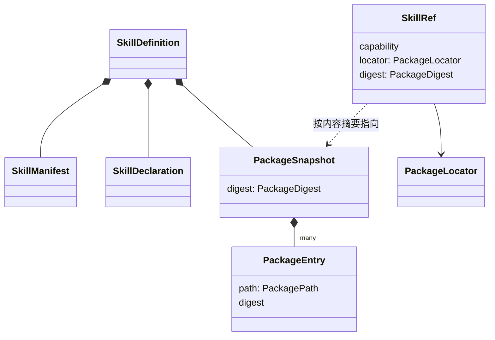

# Skill能力组工程设计

状态：工程设计草案。本页的成员、模型、端口、应用服务、失败种类与技术处置都是候选决定，尚未取得技术接受。它们尚未实现，也尚未验证。新公开承诺在实施交付时走技术接受。

本页只写组内的分解、模型、端口形状、应用服务、失败种类与技术处置。端口由谁实现、跨领域怎样交接，见[领域交接设计](../../../docs/domains/skills/architecture.md#端口与实现方)。成员、具名文档目标与允许依赖见[组入口](../README.md#成员与依赖)。

## 设计守则

本页的决定遵守下面七条守则。各节的决定表写明它守的守则与依据层。

| 守则 | 规则 | 依据层 |
| --- | --- | --- |
| G1 一个事实一个拥有者 | Skill 不求值，不保存采用，不判定工具准入。Skill 只经端口读取其他拥有者的结论。 | 架构 [外域概念的进入方式](../../../docs/architecture/layers-and-dependencies.md#外域概念的进入方式)；研发品味 [维度分解与正交](../../../.meta_harness/agents/roles/engineering-taste.md#维度分解与正交) |
| G2 只用自己的词 | 本组契约不出现 Session、Agent、Run，也不点名任何调用方。契约只声明本组提供什么、需要什么。 | 架构 [外域概念的进入方式](../../../docs/architecture/layers-and-dependencies.md#外域概念的进入方式)「集成方知道被集成方」 |
| G3 按消费者切窄接口 | 每类消费者只取得自己用的接口。Context 取概览，读取入口取读取，资产取类别端口。 | 架构 [外域概念的进入方式](../../../docs/architecture/layers-and-dependencies.md#外域概念的进入方式)第一行 |
| G4 形态与含义分开 | 字节从哪里来（云端内容存储、本机目录）与字节表示什么（解析、校验）是两条轴。 | 研发品味 [维度分解与正交](../../../.meta_harness/agents/roles/engineering-taste.md#维度分解与正交) |
| G5 不变式先于机制 | 包快照不可变，资源按包内路径寻址，不拼版本，未知不压成失败，秘密不进上下文。机制可以换，这些不变。 | 产品 [J-SK03](../../../.meta_harness/design/product/skills/design.md#j-sk03-按需读取正文或指定资源)；架构 [隔离语义，不隐藏责任](../../../docs/architecture/layers-and-dependencies.md#隔离语义不隐藏责任)；要求 [SYS-DATA-PROTECTION](../../../docs/requirements.md#数据保护sys-data-protection) |
| G6 概念最少 | 复用公共值 `Outcome`、`Access<P>`、`ContentBlock`、`JsonValue`，不另包一层。没有不可替代理由的部件不建，或者后放。 | 架构 [隔离语义，不隐藏责任](../../../docs/architecture/layers-and-dependencies.md#隔离语义不隐藏责任)「已有公开契约……直接复用」 |
| G7 沿用仓库写法 | 契约用接口、纯函数与判别联合。类只用于有状态的聚合，以及 Cordis Service 必需的抽象类。 | 架构 [IC-2](../../../docs/architecture/cordis-integration-conventions.md#ic-2)；成员先例 [Tool 能力组](../../tool/README.md#包与依赖) |

## 模型

Skill 领域没有有状态的聚合。包快照算出后不变。读出去的内容归接收方。持有、选择和采用的状态都在其他拥有者那里（G1）。依据层：领域 [范围与边界](../../../docs/domains/skills/README.md#范围与边界)「定义持有及求值复用资产，实际内容采用归消费者」。

下表的值都是不可变值。英文名是候选标识，精确类型随纯契约成员 `@omne-harness/skill` 的规格确定。

| 值 | 含义与不变式 | 依据层 |
| --- | --- | --- |
| `SkillName` | Skill 的 name。长 1 到 64 个字符，只含小写字母、数字与连字符，不以连字符开头或结尾，不含连续的连字符。它等于能力标识里的 name，也等于包根目录名。 | 官方规格 [`name` field](https://agentskills.io/specification#name-field)；成员规格 [skill](../skill/SPEC.md) 的 `name-mismatch` |
| `PackagePath` | 规范化的包内相对路径。它拒绝绝对路径、`..` 段与反斜杠。 | 产品 [J-SK03](../../../.meta_harness/design/product/skills/design.md#j-sk03-按需读取正文或指定资源)「错误资源地址、包外目标」；官方规格 [File references](https://agentskills.io/specification#file-references) |
| `PackageEntry` | 包快照里的一个条目：包内路径、文本或二进制、大小，以及它自己的内容摘要。 | 统一语言 [包快照](../../../.meta_harness/design/ubiquitous_language/terms/capabilities-and-composition.md#ul-package-snapshot--包快照--package-snapshot) |
| `PackageSnapshot` | 包快照：全部条目，以及按排序后的包内路径与条目内容摘要算出的一个内容摘要。 | 统一语言 [包快照](../../../.meta_harness/design/ubiquitous_language/terms/capabilities-and-composition.md#ul-package-snapshot--包快照--package-snapshot) |
| `PackageDigest` | 包快照的内容摘要。它是散列值，不是文字摘要。 | 统一语言 [包快照](../../../.meta_harness/design/ubiquitous_language/terms/capabilities-and-composition.md#ul-package-snapshot--包快照--package-snapshot)「注意 ①」 |
| `PackageLocator` | 包定位：一个包在某种来源里的位置。它与来源相关，对 Skill 不透明。判别联合候选是目录 `{ kind: 'directory', root }` 与内容存储 `{ kind: 'content-store', digest }`。 | 统一语言 [包来源](../../../.meta_harness/design/ubiquitous_language/terms/grounding-and-isolation.md#ul-package-source--包来源--package-source) |
| `SkillManifest` | `SKILL.md` 头部字段的解释：name、description、license、compatibility、metadata 与 `allowed-tools`。不认识的字段原样保留，不解释。 | 官方规格 [Frontmatter](https://agentskills.io/specification#frontmatter) |
| `SkillDeclaration` | `.omne/skill.json` 中本系统认的声明：依赖声明里的必需名字、脚本声明与设置声明。 | 统一语言 [Skill 包](../../../.meta_harness/design/ubiquitous_language/terms/capabilities-and-composition.md#ul-skill-package--skill-包--skill-package)、[依赖声明](../../../.meta_harness/design/ubiquitous_language/terms/reach-and-availability.md#ul-dependency-declaration--依赖声明--dependency-declaration) |
| `SkillDefinition` | 一次解析的结果：`SkillManifest`、`SkillDeclaration`、Markdown 正文与 `PackageSnapshot`。 | 产品 [J-SK01](../../../.meta_harness/design/product/skills/design.md#j-sk01-将合法方法来源交给消费者) |
| `SkillRef` | 一份具体材料的引用：能力标识、来源层、资产版本引用、包定位 `locator`、包快照的内容摘要 `digest`，以及是否常驻。`locator` 与 `digest` 由 `SkillResolution.resolve` 给出。`SkillRef` 不带作用域。旧资产正文没有 `package.digest` 时，`digest` 缺席。 | 统一语言 [包快照](../../../.meta_harness/design/ubiquitous_language/terms/capabilities-and-composition.md#ul-package-snapshot--包快照--package-snapshot)「注意 ②」；产品 J-SK01「来源、能力身份与具体实现版本分别显示」 |
| `Availability` | 可用，或者不可用并带缺项列表。 | 统一语言 [当下可用性](../../../.meta_harness/design/ubiquitous_language/terms/reach-and-availability.md#ul-current-availability--当下可用性--current-availability) |

下图只表达值之间的组成关系。



### 资产正文与 Skill 包

资产正文仍是 JSON 文本，由 `skill` 类别端口 `skillBodyContract` 判断。它是 Skill 包的声明投影：

```text
资产正文 = { name, description?, tools: [{ category: "tool", name }], package?: { digest } }
```

1. `PackageInspection` 从 Skill 包派生 name、description 与 tools。
2. `package.digest` 是包快照的内容摘要，它指向包字节。
3. 云端来源按内容摘要存放包字节。
4. 工作区来源的包字节就是工作区目录本身。装配时算出内容摘要，并记入采用依据。

`skillBodyContract` 只做可加的扩展：增加 `description` 与 `package.digest`，两者都可以缺省。没有这两个字段的旧正文仍然合法。正文缺 `package.digest` 时，`describe` 照常返回。`read` 与 `list` 返回 `unsupported`，因为没有内容摘要就无法固定包字节。

资产规格的 [Skill 样例](../../assets/assets/SPEC.md#skill-样例)写「正文是该 Skill 的任务指令」。本设计的资产正文是声明投影，指引正文在 Skill 包里，并按内容摘要固定。这是对资产规格样例措辞的偏离，由资产规格拥有者同步，见 [Q-SK02](#q-sk02-方法资源寻址与来源版本公开契约) 的剩余义务。本设计不把该样例引作依据。

| 决定 | 守则 | 依据层 |
| --- | --- | --- |
| 资产正文是 Skill 包的声明投影，包字节按内容摘要另存 | G1、G4 | 领域 [范围与边界](../../../docs/domains/skills/README.md#范围与边界)；资产规格 [类别提供方](../../assets/assets/SPEC.md#category-provider) |
| `skillBodyContract` 只做可加扩展。新字段可以缺省，旧正文仍然合法 | G6 | 资产规格 [已接受的公开类型](../../assets/assets/SPEC.md#accepted-public-types)；工程 [里程碑内的规则](../../../docs/engineering/integration.md#里程碑内的规则)第 2 条 |

## 端口

下面的端口由 Skill 作为需求方声明，由集成方实现。签名是候选形状。实现方与失败交接见[领域交接设计](../../../docs/domains/skills/architecture.md#端口与实现方)。所有 `PackageSource` 实现遵守同一套符合性测试。

```ts
// 只交字节。locator 来自 SkillRef，对 Skill 不透明。
interface PackageSource {
  snapshot(locator: PackageLocator): Promise<Outcome<PackageSnapshot, SourceFailure>>
  open(locator: PackageLocator, digest: PackageDigest, path: PackagePath): Promise<Outcome<Bytes, SourceFailure>>
}
// SourceFailure: 'not-found' | 'version-changed' | 'outside-package' | 'unavailable'

// 这个能力标识此刻对这个主体合法对应哪一份材料。
interface SkillResolution<P> {
  resolve(access: Access<P>, scope: Scope, capability: CapabilityId): Promise<Resolution>
  // 概览与检索用：采用集合中每个身份的 adopted 或 known-unavailable 答复。
  adopted(access: Access<P>, scope: Scope): Reply<readonly Resolution[]>
}
type Resolution =
  | { kind: 'adopted'; ref: SkillRef; declared: { name: SkillName; description?: string; tools: readonly ToolRef[] } }
  | { kind: 'known-unavailable'; reason: SafeReason; name: SkillName; description?: string } // 最后合法的 name 与说明
  | { kind: 'none' }
  | { kind: 'unknown' }

// 这个主体此刻能不能读这个能力标识。答复不得依赖该身份是否存在。
interface SkillReadCheck<P> {
  check(access: Access<P>, scope: Scope, capability: CapabilityId): Promise<'granted' | 'refused' | 'unknown'>
}

// 必需工具名此刻是否在场。只要名字，不要提供者对象。
interface RequirementFacts<P> {
  present(access: Access<P>, scope: Scope, names: readonly string[]): Reply<ReadonlySet<string>>
}
```

`Reply<T>` 指一个异步的 `Outcome`。它的失败分两类：确定没有结果，或此刻无法判定。`scope` 是调用方给出的求值作用域。Skill 不解释它，只原样交给端口（G2）。

各端口的要求：

- `SkillReadCheck.check` 只按能力标识判定，不需要 `SkillRef`。实现方给出的答复不得依赖该身份是否存在。所以 Skill 把 `refused` 映射成 `not-available-to-you` 时，不泄露身份是否存在。
- `SkillResolution.resolve` 的 `adopted` 带上 `SkillRef` 与资产正文的声明投影（name、说明与 `tools`）。`known-unavailable` 带上原因，以及该身份最后合法的 name 与说明。没有已知集合的实现方只答 `adopted`、`none` 或 `unknown`。
- `RequirementFacts.present` 只回答必需工具名是否在场，不回答脚本设施。脚本设施由第三波的 `ScriptPreparation` 核验。
- `PackageSource.open` 按 `locator` 找到包，按 `digest` 核对包快照，再交出 `path` 所指条目的字节。

`skill-host-local` 的 `DirectorySource` 这样实现 `open`：

1. 按 `locator` 取得目录当前的包快照。
2. 当前快照的内容摘要不等于请求的 `digest` 时，返回 `not-found`：旧材料已不在目录里。
3. 内容摘要相同，但读出的条目字节与条目内容摘要对不上时，返回 `version-changed`：条目在读取途中被改。

这两种判定都只比较当前目录与请求的 `digest`，不依赖内存索引，所以进程重启不改变判定。

| 端口答复 | 映射到的服务失败种类 |
| --- | --- |
| `SkillReadCheck` 答 `refused` | `not-available-to-you` |
| `SkillReadCheck` 答 `unknown` | `unknown` |
| `SkillResolution` 答 `none` | `not-available-to-you` |
| `SkillResolution` 答 `known-unavailable` | `unavailable-stand-in`。替换件由 Skill 用 `resolve` 交来的最后合法 name、说明与原因组装 |
| `SkillResolution` 答 `unknown` | `unknown` |
| `RequirementFacts` 此刻无法判定 | `unknown` |
| `PackageSource` 的 `not-found`：快照取不到，包括目录当前的内容摘要不等于请求的 `digest` | `basis-unavailable` |
| `PackageSource` 的 `not-found`：快照中没有该条目 | `resource-missing` |
| `PackageSource` 的 `version-changed` | `version-changed` |
| `PackageSource` 的 `outside-package` | `outside-package` |
| `PackageSource` 的 `unavailable` | `source-unavailable` |

## 应用服务

本组对外提供四个窄接口，按消费者切分（G3）。

| 接口 | 消费者 | 操作 | 关键保证 |
| --- | --- | --- | --- |
| `PackageInspection` | 资产候选校验、工作区扫描 | `inspect(locator, expectedName)` 返回 `SkillDefinition` 或拒绝原因 | 来源错误与「没有候选」分开。非法包不当作空包。 |
| `SkillCatalog` | Context 的常驻概览、`Skills().search` | `overview(access, scope)`、`search(access, scope, query)` | 只在采用集合里找。顺序确定。搜索失败不返回空集合。 |
| `SkillAccess` | `Skills().read`、Slash Command、独立程序 | `describe(access, scope, capability)`、`read(access, scope, target, { basis?, byteRange? })`、`list(access, scope, capability, { basis? })` | 每个操作都显式带作用域。每次操作现场核验，不用缓存代替。不带材料依据时读当时的合法版本，带材料依据时固定该版本。资源按包内路径寻址。不拼版本。不激活，不执行。 |
| `ScriptPreparation`（第三波） | `Skills().exec_script` | `prepare(access, ref, script, args)` 返回一份固定的执行请求 | 只认包内声明的脚本。执行交给 Tool。 |

本组不为「Skill 取用」新增统一语言词条：领域页已用「方法与资源取用」称呼这一责任，`SkillAccess` 只是服务接口名。

纯函数没有端口，可以穷举测试：`parseSkillPackage`、`toPackagePath`、`computeDigest`、`evaluateAvailability`、`orderOverview`。

### 检查与发现

`PackageInspection` 经 `PackageSource` 取得一次一致的包快照，再解析和校验。完整实现替换不逐文件拼包。Skill 包内的 `.omne/skill.json` 不被识别成另一个工作区。工作区来源在默认、显式与通配符发现中排除软链接及经过软链接的路径。这是来源发现规则。已识别包的内部资源不因此增加公开限制。

`SkillCatalog` 只读 `SkillResolution.adopted` 给出的采用集合。常驻与可用性分别求值：装配引用决定概览呈现，合法已知集合决定可发现的身份，当前选入、治理与必需依赖决定可用性。已知不可用的身份保留，并带替换件与安全原因。从未取得的身份不显示。MCP 动作不进入 Skill 的能力标识组合。可有可无的条件不进依赖声明，在使用时探测。

### 读取

`SkillAccess` 的三个操作都现场核验。顺序如下：

1. 经 `SkillReadCheck.check` 核验该主体此刻能读这个能力标识。历史依据、缓存或此前的成功都不代替这次核验。
2. 经 `SkillResolution.resolve` 确认能力标识此刻对该主体合法对应哪一份材料。
3. `describe` 到此为止，不读字节。它用 `resolve` 交来的声明投影，经 `RequirementFacts` 求出缺项。
4. `read` 与 `list` 选定材料：调用方带了材料依据 `basis` 时用该依据，否则用 `resolve` 交来的 `SkillRef`。材料没有内容摘要时返回 `unsupported`。
5. `read` 经 `toPackagePath` 校验目标，再经 `PackageSource` 取字节，并逐段按条目内容摘要核验。`list` 经 `PackageSource` 取包快照。
6. 只有 `read` 读正文、来源正常交出正文时，才经 `RequirementFacts` 核对必需工具名，见 [Q-SK08 分支](#q-sk08-分支)。

`describe` 返回能力标识、来源层、`SkillRef`、可用性、依赖声明与缺项，以及资源寻址规则。依赖声明来自资产正文的声明投影，所以 `describe` 不读包字节，也不报 `source-unavailable`。

`read` 的 `target` 指明能力标识，以及正文或一个资源的包内路径。`read` 返回内容、`SkillRef`、包内路径、媒体类型、实际字节范围、总长与 `complete` 标记。正文与资源分开读取。

`list` 返回所选材料的包快照条目：包内路径、文本或二进制、大小。

读取的版本语义：

- 不带材料依据的 `read` 与 `list` 经 `SkillResolution` 现场解析当时的合法版本。尚未取用的正文读当时的合法版本。
- 材料依据 `basis` 是此前结果给出的 `SkillRef`。只有调用方显式带上它时，才固定该版本。依据里的内容摘要可以不同于当前对应的内容摘要。读取仍按依据交出旧材料，或者报 `basis-unavailable`，不改交新材料。
- 已记录的正文由消费者保管，交接后归接收方。上层要求「后续读取仍是这份记录」，这由消费者兑现。Skill 重读时取不到旧材料就报 `basis-unavailable`，不削弱上层的要求。

| 决定 | 守则 | 依据层 |
| --- | --- | --- |
| 不带材料依据的读取现场解析当时的合法版本 | G1 | 架构 [工作区与能力变化](../../../docs/architecture/runtime/assembly-and-change.md#工作区与能力变化)「尚未取用的 Skill 正文，后续取用读取当时的合法版本」 |
| 只有调用方显式带上材料依据时，读取才固定该版本。字节与条目内容摘要对不上报 `version-changed`。依据所指的包快照取不到报 `basis-unavailable` | G5 | 独立消费者的需求 SK-D03；产品 [J-SK03](../../../.meta_harness/design/product/skills/design.md#j-sk03-按需读取正文或指定资源)「不能将旧正文与新资源拼成成功」 |
| 已记录的正文由消费者保管。Skill 重读取不到旧材料时报 `basis-unavailable` | G1 | 架构 [工作区与能力变化](../../../docs/architecture/runtime/assembly-and-change.md#工作区与能力变化)「Skill 已记录的正文保持不变」；领域 [协作与依赖](../../../docs/domains/skills/README.md#协作与依赖)「Context或消息消费者按各自规则保存/组装」 |
| `SkillResolution` 一个端口承接会话路径与独立路径 | G2、G3 | 产品 [J-SK02](../../../.meta_harness/design/product/skills/design.md#j-sk02-找到方法并理解当下能否使用)「独立读取方法时，每次核验当前访问资格，无须先有会话」 |
| 每次操作现场核验，不缓存资格。先 `SkillReadCheck`，再 `SkillResolution` | G5 | 产品 J-SK03「恢复重新核验当前读取权，历史可见性不授予新的访问」 |
| 对无权主体，「无权」与「身份不存在」不可区分 | G5 | 要求 [SYS-TENANT](../../../docs/requirements.md#从第一天支持隔离sys-tenant)「跨租户访问默认拒绝」 |
| 包内链接解析后落在包根之外时报 `outside-package` | G5 | 产品 J-SK03「包外目标」 |
| 作用域由调用方给出，Skill 不解释。`SkillRef` 不带作用域 | G2 | 架构 [外域概念的进入方式](../../../docs/architecture/layers-and-dependencies.md#外域概念的进入方式)「只需关联、追溯或交回原位置」一行 |

### Q-SK08 分支

下列条件同时成立时，读取正文的 `read` 返回 `undecided`：

- `SkillReadCheck` 给出 `granted`。
- `SkillResolution` 给出 `adopted`：能力标识对该主体合法对应，未禁用，未卸载。
- 包来源正常交出正文。
- `RequirementFacts` 表明有必需工具缺席。

第一波只按必需工具依赖判定这一条件。脚本设施由第三波的 `ScriptPreparation` 核验，不进入这一判断。

`undecided` 既不交正文，也不交替换件。它说明这一分支等待产品负责人裁定 [Q-SK08](../../../.meta_harness/design/product/skills/design.md#q-sk08-只有依赖或脚本设施不足时正文是否仍可读取)。本组不选默认。资源读取与 `list` 在同一条件下照常返回。`describe` 照常返回缺项。裁定之后，`undecided` 退出，结果改为裁定的那一种。

| 决定 | 守则 | 依据层 |
| --- | --- | --- |
| 定案前该分支返回 `undecided`，不交正文，也不交替换件 | G5 | 产品 [J-SK03](../../../.meta_harness/design/product/skills/design.md#j-sk03-按需读取正文或指定资源)「不以默认结果补齐缺口」 |
| 只有正文读取返回 `undecided`。资源读取、`list` 与 `describe` 照常，不扩大待裁范围 | G5 | 产品 Q-SK08 只问正文是否仍可读取；Q-SK08 已知约束「发现仍保留已知身份并说明缺项」 |

## 失败种类

`SkillFailure` 是下表的判别联合。部分结果不是失败：成功结果用 `complete` 与实际字节范围标出。

| 种类 | 何时出现 | 依据层 |
| --- | --- | --- |
| `not-available-to-you` | `SkillReadCheck` 答 `refused`，或 `SkillResolution` 答 `none`。对该主体，「无权」与「身份不存在」不可区分。 | 要求 [SYS-TENANT](../../../docs/requirements.md#从第一天支持隔离sys-tenant) |
| `unavailable-stand-in` | `SkillResolution` 答 `known-unavailable`：身份对该主体合法已知，但此刻不可用，例如禁用、卸载或选入失效。结果带替换件与安全原因。会话路径的实现方掌握已知集合。独立路径的实现方没有已知集合时不答 `known-unavailable`，所以独立路径通常不出现替换件。 | 产品 J-SK03「对合法已知身份返回替换件及安全原因」；统一语言 [替换件](../../../.meta_harness/design/ubiquitous_language/terms/reach-and-availability.md#ul-stand-in--替换件--stand-in) |
| `bad-path` | 目标不是合法的包内路径。 | 产品 J-SK03「错误资源地址」 |
| `outside-package` | 目标解析后落在包根之外。 | 产品 J-SK03「包外目标」 |
| `resource-missing` | 所选材料的包快照中没有该条目。不用别的包补齐。 | 产品 J-SK03「缺少请求的资源不能用别的同名包补齐」 |
| `basis-unavailable` | 所选材料的包快照已经取不到。 | 产品 J-SK03「不能将旧正文与新资源拼成成功」 |
| `version-changed` | 来源交出的字节与条目内容摘要对不上。不交新内容。 | 产品 J-SK03「读取与更新竞争」 |
| `source-unavailable` | 包来源此刻不可达。 | 产品 [J-SK01](../../../.meta_harness/design/product/skills/design.md#j-sk01-将合法方法来源交给消费者)「来源不可读……不能当作空方法」 |
| `unsupported` | 请求超出支持范围，例如无法表示的二进制条目、尚未支持的格式方言，或资产正文缺 `package.digest` 时的 `read` 与 `list`。 | 产品 J-SK03「按实际支持能力说明」 |
| `undecided` | 只用于正文读取：满足 [Q-SK08 分支](#q-sk08-分支)的全部条件。等待产品裁定，不交正文，也不交替换件。 | 产品 [Q-SK08](../../../.meta_harness/design/product/skills/design.md#q-sk08-只有依赖或脚本设施不足时正文是否仍可读取) |
| `unknown` | 端口此刻无法判定资格、对应或依赖事实。不压成拒绝，也不压成成功。 | 架构 [隔离语义，不隐藏责任](../../../docs/architecture/layers-and-dependencies.md#隔离语义不隐藏责任)「不能把未知压成失败」 |

拒绝不回退为另一份 Skill、任意 Shell 或更弱的落点。

## SOLID 落点

| 原则 | 落点 |
| --- | --- |
| 单一职责 | 来源只取字节。解析只解释。`PackagePath` 只管寻址。`SkillAccess` 只编排核验与字节范围。 |
| 开闭 | 增加 marketplace 或 Git 仓库来源，就增加一个 `PackageSource` 实现。增加兼容格式，就增加一种方言。 |
| 里氏替换 | 所有来源共用一套符合性测试：内容摘要相同则内容相同，失败种类相同。 |
| 接口隔离 | `PackageInspection`、`SkillCatalog`、`SkillAccess`、`ScriptPreparation` 分开。 |
| 依赖倒置 | 领域代码只依赖端口。本机目录来源的实现在本地宿主成员。 |

依据层：架构 [方法依据与采用范围](../../../docs/architecture/layers-and-dependencies.md#方法依据与采用范围)。

## 独立消费者的需求承接

下表说明本组公开契约怎样满足独立消费者的需求 SK-D01 至 SK-D07。本组契约不点名该消费者（G2）。Skill 不持有按消费者划分的状态，所以释放一个消费者不会卸载共享的 Skill。

| 需求 | 服务含义 | 失败种类 | 交接边界 |
| --- | --- | --- | --- |
| SK-D01 | `describe` 返回能力标识、来源层、`SkillRef`、可用性、依赖声明与缺项、资源寻址规则，不加载正文，不读包字节 | `not-available-to-you`、`unavailable-stand-in`、`unknown` | 描述是当前事实的一次读取，不授予后续读取 |
| SK-D02 | `read` 返回 `SkillRef`、包内路径、媒体类型、实际字节范围、总长与 `complete`。正文与资源分开读 | `bad-path`、`outside-package`、`resource-missing`、`unsupported` | 只交请求的内容，不自动读全部资源，不执行脚本 |
| SK-D03 | 调用方带上此前结果给出的 `SkillRef` 作为材料依据时，`read` 与 `list` 固定该版本。每段字节按条目内容摘要核验 | `basis-unavailable`、`version-changed` | 能保留旧材料的来源交出旧材料，保留不了的报失败，不用新材料冒充 |
| SK-D04 | 三个操作每次都经 `SkillReadCheck` 与 `SkillResolution` 现场判定 | `not-available-to-you`、`unavailable-stand-in`、`unknown` | 资格不缓存，历史依据不代替判定 |
| SK-D05 | 内容随成功结果内联交出，交出后归接收方。大内容按字节范围分页 | 不新增失败种类 | Skill 不做临时保管。`SkillRef` 加包内路径只是重读句柄，不是保管引用：重读重新核验资格，来源不再保留时失败 |
| SK-D06 | 见[失败种类](#失败种类) | 全部种类 | 对无权主体不披露身份是否存在。部分结果不是失败 |
| SK-D07 | `skill-access` 的应用服务不依赖 Session、Agent 与 Cordis。`@omne-harness/skill/testing` 导出 `PackageSource` 与 `SkillAccess` 的符合性套件和内存来源 | 不新增失败种类 | 访问上下文与作用域由调用方显式传入，依据层：要求 [SYS-OPEN](../../../docs/requirements.md#独立使用与替换sys-open) |

表中各决定的产品与架构依据层，见上文[读取](#读取)、[失败种类](#失败种类)与 [Q-SK03](#q-sk03-两条内容采用路径与可靠交接协议)的决定表。Q-SK08 那一支见 [Q-SK08 分支](#q-sk08-分支)。在裁定之前，独立消费者的首条组合验收只走依赖齐备的路径。

### 剩余义务与拥有者

| 未支持或待做 | 拥有者 | 第一波怎样处理 |
| --- | --- | --- |
| 与独立消费者内容交接类型的字段与行为映射页 | 集成方，即消费者一侧，依据层：架构[外域概念的进入方式](../../../docs/architecture/layers-and-dependencies.md#外域概念的进入方式)「集成方知道被集成方」。候选决定 | Skill 只维护自己的公开契约 |
| 真实的读取核验（`SkillReadCheck`） | 身份与授权 | 只交端口与符合性测试。替身通过不说成资格已验证 |
| 独立路径上「这个能力标识此刻对应哪一份」的真实解析（`SkillResolution`） | 资产求值，见资产产品 [CAP-AR05](../../../.meta_harness/design/product/assets-and-rules/design.md#cap-ar05-多层合法来源与同标识替换)，尚未实现 | 同上 |
| 会话路径上采用依据记下 Skill 的内容摘要 | 装配，见采用协调 [已知限制与剩余](../../../docs/domains/assembly-and-handoff/adoption-coordination.md#5-已知限制与剩余) 的 KL-9 | 会话路径的 `SkillResolution` 等它就绪 |
| 云端内容存储来源，能交出旧版本 | 存储能力组。对象或文件存储契约尚不存在 | 第一波的真实来源只有本机目录。目录当前的内容摘要不等于依据时报 `basis-unavailable`。内容摘要相同但条目在读取途中被改时报 `version-changed` |
| 发现与搜索（P1） | 本组 `SkillCatalog`，第一波之后的 1b | 不阻塞已知精确引用的首条旅程 |
| 合法更新与显式增量装载（P1） | 装配 | Skill 不承担装载 |
| 版本变化观察（P1） | 装配。变化事件首版不做 | 消费者重新 `describe` 观察变化 |
| 脚本桥接（P1） | 本组第三波，加上 Tool 与执行环境 | 不在 P0 |
| 消费适配：`Skills()` 的检索与读取、命令展开 | 成员归属尚未分配，由 Skill 技术拥有者在后接波确定。Context 概览贡献归 Runtime Context | 第一波不交。独立程序直接消费 `SkillAccess` |

拥有者沿[领域交接设计](../../../docs/domains/skills/architecture.md#端口与实现方)的实现方确定。P1 各项来自独立消费者的需求。版本变化观察的首版范围是：消费者能明确重读当前依据，不要求新增耐久订阅服务。

## 验证

方法提供者验证定义、资源寻址与一致读取。资产与装配验证过滤、依赖、替换与采用竞争。工具、消息与 Context 验证两条内容路径、耐久与旧请求不被改写。桥接、工具与环境验证原参数、实际资源、控制与迟到的宿主结果。

第一波的验证候选：

1. 值与纯函数的单元测试。
2. `PackageSource` 与 `SkillAccess` 的符合性测试，所有来源共用。
3. 真实临时目录上的 `DirectorySource` 测试：软链接、改文件后版本已变、包外路径、进程重启后判定不变。
4. 读取中来源变化：返回一致版本或失败，不出现混拼的成功。带材料依据读取时，源已变化则交出旧材料或报 `basis-unavailable`，不改交新材料。
5. 撤权、跨租户与缓存命中：每次操作的当前核验仍然生效，不泄露内容，也不向无权主体披露身份是否存在。
6. 部分读取、缺资源与来源故障：实际字节范围、`resource-missing` 与 `source-unavailable` 可辨，不伪造完整材料。
7. 重读与重试：不产生执行副作用。不带材料依据的重读按当时的合法版本解析，`SkillRef` 如实标出版本变化。

第 4 至 7 项对应独立消费者的需求列出的 Skill 主验证场景。撤权与跨租户一项需要身份适配一起验证。

替身通过不证明真实资格、真实求值或耐久。当前没有选定的机制，没有行为模型，也没有执行过行为验证。结构自检不授予任何保证。

## 技术后续设计与承接缺项

以下各节是产品第四章导航到本组的技术义务。每节写技术处置：候选决定、依据层、剩余义务与拥有者。这些决定都是候选决定，尚未取得技术接受。

### Q-SK02 方法、资源寻址与来源/版本公开契约

技术处置：候选决定，尚未取得技术接受。

| 候选决定 | 依据层 |
| --- | --- |
| 资源按 `PackagePath` 寻址，规则见[模型](#模型) | 产品 J-SK03；官方规格 [File references](https://agentskills.io/specification#file-references) |
| 不带材料依据的读取读当时的合法版本。只有调用方显式带上材料依据时，读取才固定该版本。规则见[读取](#读取) | 架构 [工作区与能力变化](../../../docs/architecture/runtime/assembly-and-change.md#工作区与能力变化)；独立消费者的需求 SK-D03；产品 J-SK03 |
| `SkillRef` 带包定位与内容摘要，`PackageSource` 按两者交出字节，见[端口](#端口) | 统一语言 [包来源](../../../.meta_harness/design/ubiquitous_language/terms/grounding-and-isolation.md#ul-package-source--包来源--package-source)；G4 |
| 读取结果带 `SkillRef`、包内路径、媒体类型、实际字节范围、总长与 `complete` | 产品 J-SK03「不能把遗漏、截断或资源不可取伪装成完整方法」 |
| 失败种类见[失败种类](#失败种类) | 产品 J-SK03 |
| 资产正文是声明投影，`skillBodyContract` 只做可加扩展，见[资产正文与 Skill 包](#资产正文与-skill-包) | 资产规格 [类别提供方](../../assets/assets/SPEC.md#category-provider) |

| 剩余义务 | 拥有者 |
| --- | --- |
| 精确类型、`target` 的形状、字节范围的单位、内容摘要的算法、二进制条目在 `ContentBlock` 中的表示 | `@omne-harness/skill` 的规格，第一波随实施扩写 |
| `skillBodyContract` 扩展的技术接受，并同步资产规格「已接受的公开类型」中 `skill` 一段 | `@omne-harness/skill` 的实施者；资产规格拥有者 |
| 资产规格「Skill 样例」写「正文是该 Skill 的任务指令」。本设计对该措辞的偏离见[资产正文与 Skill 包](#资产正文与-skill-包)，交资产规格拥有者同步 | 资产规格拥有者 |

### Q-SK03 两条内容采用路径与可靠交接协议

技术处置：候选决定，尚未取得技术接受。

| 候选决定 | 依据层 |
| --- | --- |
| Skill 不做临时保管。内容随成功结果内联交出，交出后归接收方 | 领域 [协作与依赖](../../../docs/domains/skills/README.md#协作与依赖)「Context或消息消费者按各自规则保存/组装」 |
| `SkillRef` 加包内路径只是重读句柄，不是保管引用 | 产品 J-SK03「不能假定 Skill 内藏一份永久激活副本」 |
| Skill 没有「已加载」状态，也不建统一的读取日志 | 领域 [协作与依赖](../../../docs/domains/skills/README.md#协作与依赖)「不能统一改成一个日志形状」 |

工具路径由原工具调用保存实际返回和消费位置。命令路径由命令与入站消费者保存本次展开内容和用户消息关联。Context 按自身权限与来源规则消费。模型请求一经发起，就固定原输入。后续正文更新不回写它。采用成功须与所用内容、来源、字节范围和原位置一致。成功返回、入队和通知都不代替耐久确认。

| 剩余义务 | 拥有者 |
| --- | --- |
| 各消费者的完整提交与承接协议，以及无法同提交时的恢复拥有者 | 工具、消息、Context 与装配的实际协调者 |
| 候选校验、当前选择、撤权与推进资格之间的竞争 | 装配协调者 |

### Q-SK04 脚本桥接的发起、控制和原结果协议

技术处置：候选决定，尚未取得技术接受。

| 候选决定 | 依据层 |
| --- | --- |
| `ScriptPreparation` 只认包内声明的脚本，只产出一份固定的执行请求。执行、等待、结果与控制都交给 Tool | 产品 [J-SK05](../../../.meta_harness/design/product/skills/design.md#j-sk05-显式运行方法携带的脚本)「不由 Skill 新造一套收场」 |
| `ScriptPreparation` 核验脚本设施。`RequirementFacts` 不回答脚本设施 | G1、G3 |
| 为脚本物化的 Skill 包只进该次执行的私有落点 | 产品 J-SK03 读取权；J-SK05「文件或 Shell 路径……不能借用 Skill 许可」 |
| `allowed-tools` 与 `compatibility` 只作元数据，不授予任何许可 | 资产产品 [在项目工作区协作，保留每个租户的私有边界](../../../.meta_harness/design/product/assets-and-rules/design.md#在项目工作区协作保留每个租户的私有边界)「不能贡献授权或权限配值」；官方规格 [`allowed-tools` field](https://agentskills.io/specification#allowed-tools-field)「Experimental」 |

脚本执行权随 Skill 的合法许可。通用文件与 Shell 访问走自己的许可。脚本内对其他工具、文件、网络、凭据与宿主桥接的访问，仍按实际主体和用途核验。受限执行域按[执行隔离](../../../docs/architecture/security/execution-isolation.md)承接不可信代码。入口撤除和读句柄释放不停止原执行。停止代码域不停止已准入的宿主工作。

| 剩余义务 | 拥有者 |
| --- | --- |
| 固定匹配版本与最终发起条件，查询与控制，把迟到的宿主结果交回原消费者 | Tool |
| 包的私有挂载与落点、设施准备 | 执行环境 |
| `ScriptPreparation` 的纯部分 | 本组第三波 |

### Q-SK05 原生及兼容来源格式支持与成员归属

技术处置：候选决定，尚未取得技术接受。

| 候选决定 | 依据层 |
| --- | --- |
| 原生格式是 `SKILL.md`（头部字段按官方规格）加可选的 `.omne/skill.json` | 产品 J-SK01「已有 `SKILL.md`、可选 `.omne/skill.json` 和按需资源的包形式」；官方规格 [Specification](https://agentskills.io/specification) |
| 不认识的头部字段原样保留，不解释 | 产品 [Q-SK05](../../../.meta_harness/design/product/skills/design.md#q-sk05-原生及兼容来源格式支持与成员归属)「识别成功不能承诺全部字段……兼容」 |
| 兼容格式作为解析方言增加，不另造目录协议 | 产品 J-SK01「工作区原生方法使用已有……包形式」；G6 |
| 现有 `@omne-harness/skill` 就是纯契约成员，不改名。另加三个具名文档目标：`skill-access`、`skill-cordis-contract`、`skill-host-local`，见[组入口](../README.md#成员与依赖) | 能力组先例 [Tool 能力组](../../tool/README.md#包与依赖)；工程 [里程碑内的规则](../../../docs/engineering/integration.md#里程碑内的规则) |

| 剩余义务 | 拥有者 |
| --- | --- |
| 受支持方言、转换限制与真实支持矩阵 | `@omne-harness/skill` 的规格 |
| marketplace 与 Git 仓库来源 | 各自的 `PackageSource` 实现，后续另定 |

### Q-SK06 dummy 逻辑执行的记录、统计和查询形状

技术处置：候选决定，尚未取得技术接受。

| 候选决定 | 依据层 |
| --- | --- |
| Skill 不持有执行记录。Skill 只给出 `unavailable-stand-in` 及安全原因 | G1；架构 [不可用应答的分类边界](../../../docs/architecture/runtime/tool-runtime.md#不可用应答的分类边界) |

dummy tool execution 与真实执行同属一次逻辑调用。真实原工具未物理执行，不建立其真实资源，不虚构耗时或效果。替换件自身的实际开销按事实记录。Session Log 保存逻辑治理事实。

| 剩余义务 | 拥有者 |
| --- | --- |
| 记录、统计与查询的精确字段和相称验证 | 工具与 Session 逻辑治理拥有者 |

## 完整行为候选的正式承接缺口

原任务的完整行为候选尚未采用。下表写明每份候选由哪个成员或拥有者承接。`@omne-harness/skill` 是现有 workspace 成员，其余成员都是具名文档目标，尚非 workspace 成员。逐条不变式与验证义务在实施时随成员规格分配。过程稿不作为正式导航依赖。

| 原候选 | 承接者 | 承接方式 | 状态 |
| --- | --- | --- | --- |
| `method-and-resource-access.md` | `@omne-harness/skill`：值、端口、服务接口与符合性设施。`skill-access`：`PackageInspection`、`SkillCatalog`、`SkillAccess`。`skill-host-local`：`DirectorySource` | 成员规格，第一波随实施写 | 候选，尚未承接 |
| `content-adoption-and-evolution.md` | 不归本组成员。工具、消息、Context 与装配的实际协调者承接，见 [Q-SK03](#q-sk03-两条内容采用路径与可靠交接协议) | 各拥有者的契约 | 尚未承接 |
| `script-execution-bridge.md` | `skill-access` 的 `ScriptPreparation`，纯部分在 `@omne-harness/skill`。执行与控制归 Tool 与执行环境，见 [Q-SK04](#q-sk04-脚本桥接的发起控制和原结果协议) | 第三波 | 尚未承接 |
| 总览、完整不变式及持续验证范围 | 组维护者。各成员规格承接本成员的不变式。`@omne-harness/skill/testing` 的符合性套件承接来源与读取的共同验证 | 实施时 | 尚未承接 |
| Cordis 服务键与抽象 Service | `skill-cordis-contract`，暂不进应用插件树 | 第三波 | 尚未承接 |
| Cordis 插件 | `skill-host-local`，依赖 `skill-cordis-contract` | 与 Cordis 服务键同波 | 尚未承接 |
