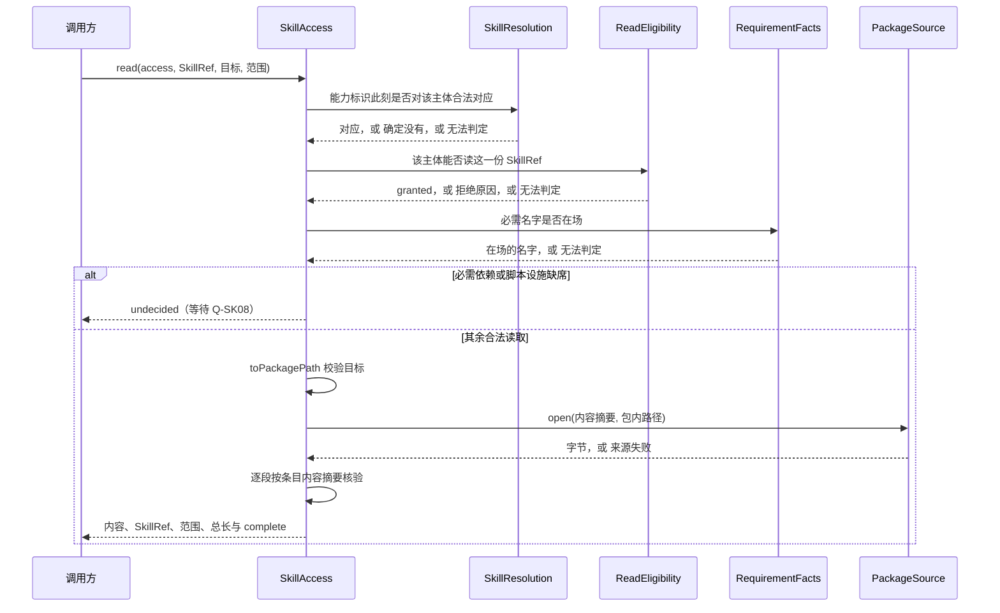

# Skill组内逻辑责任流程

状态：工程设计草案。流程中的服务与端口都是候选，尚非 workspace 成员，见[组入口](../README.md#成员与依赖)。流程只说明本组服务与端口怎样协作，不能因流程落位认为已采用。服务含义与失败种类见[工程设计](architecture.md)。端口的实现方见[领域交接设计](../../../docs/domains/skills/architecture.md#端口与实现方)。

## F-SK02 分层发现与不可用解释

对应 J-SK02；INV-SK02、INV-SK03、INV-SK04。

在会话与 Agent 集成中，运行方在装配、确认当前采用、为执行建立新挂接及必需提供者变化时，取得当前选入、治理及依赖事实。独立 Skill 读取在每次读取时核验当前访问资格，不要求存在 attempt。

`SkillCatalog` 经 `SkillResolution.adopted` 取得采用集合，经 `RequirementFacts` 取得必需名字是否在场，再用 `evaluateAvailability` 与 `orderOverview` 求出有序概览。全部必需项满足才投影为可用。引用常驻决定是否直接呈现概览。搜索按说明找已知身份，常驻条目同样可查。

发现已知不可用身份时，呈现同名替换件及安全原因。从未取得的身份不显示。仅依赖或脚本设施不足时的正文读取结果由[组内读取](#组内读取)与 Q-SK08 单列，搜索投影不替它裁定。调用替换件按 dummy 逻辑执行保留原调用、不可用结果和消费进度，不启动真实原脚本，恢复不重调。提供者回来后仍复核完整条件。端口无法给出现行判断时，返回 `unknown` 或 `source-unavailable`，不能以空集合表示「无方法」。

## 组内读取

本节是 F-SK03 中 Skill 内部的部分，对应 J-SK03。跨领域的消费者承接见[领域流程 F-SK03](../../../docs/domains/skills/key-flows.md#f-sk03-指定读取与工具消费者采用)。

1. 调用方先用 `describe` 取得当前的 `SkillRef`，或沿用上次读取给出的 `SkillRef`。
2. `SkillAccess` 每一步都现场核验，不用缓存代替。任一端口无法判定时返回 `unknown`。
3. 对该主体合法已知的身份遇到拒绝时，返回 `unavailable-stand-in` 及安全原因。其他拒绝返回 `not-available-to-you`。
4. 字节与条目内容摘要对不上时返回 `version-changed`，不交新内容。依据所指的包快照取不到时返回 `basis-unavailable`。
5. 成功结果交出后归调用方。`SkillAccess` 不保留副本，不记「已加载」状态。

`list` 走同一条核验路径，只返回包快照的条目。`describe` 在取得必需名字是否在场之后返回，不读字节。

## F-SK04 分类设置与秘密供给

对应 J-SK04；INV-SK02、INV-SK07、INV-SK08、INV-SK19。

资产拥有者按声明类别和合法来源求值，取用适配把偏好/绑定交给获准正文消费者；桥接把脚本所需获准值交对应脚本及受控适配，落点/身份不进入模型或普通呈现。治理值交治理判断，不由正文改写。类别非法、必需值缺失、撤权或用途不匹配时拒绝依赖使用。替换实现不继承旧实现专有配值或秘密，诊断只报安全原因。
