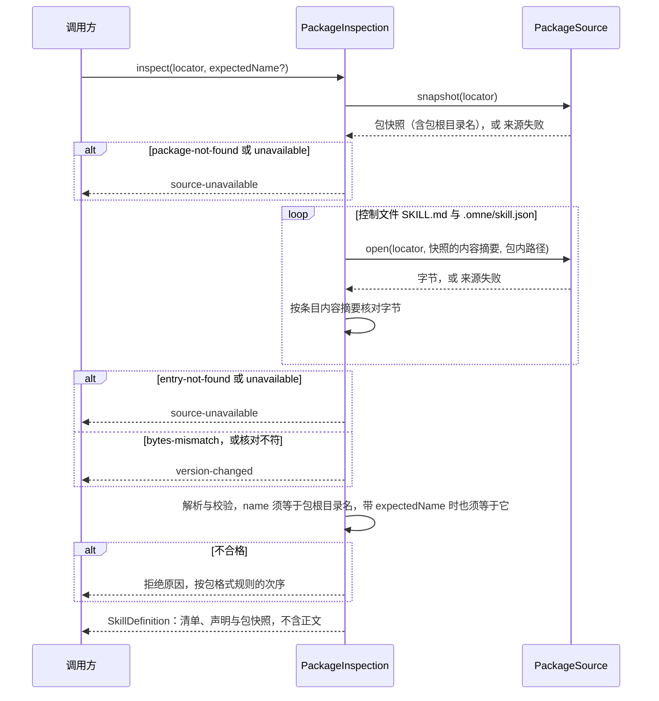
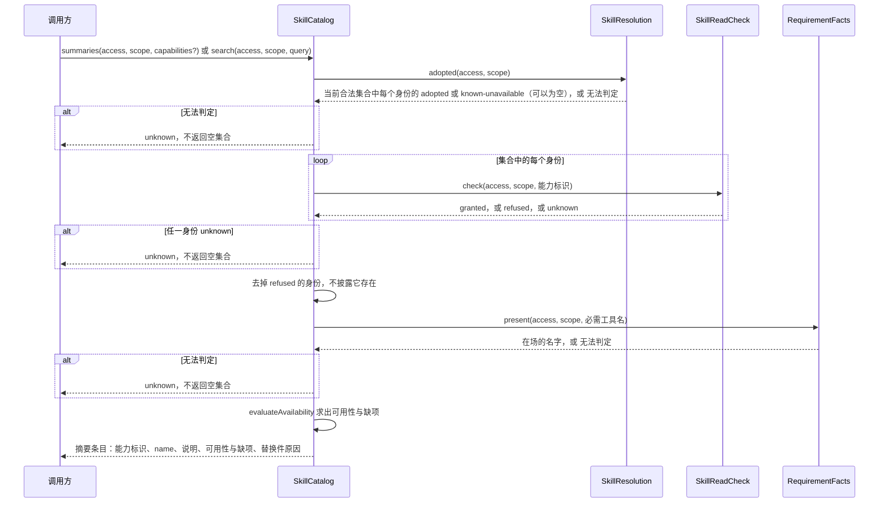
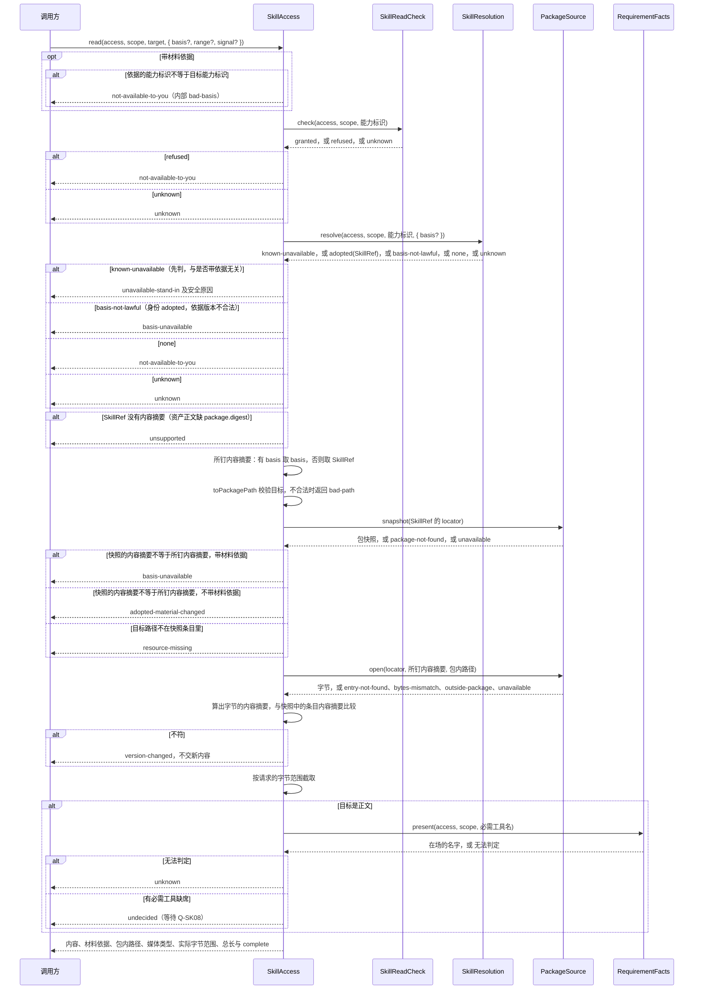
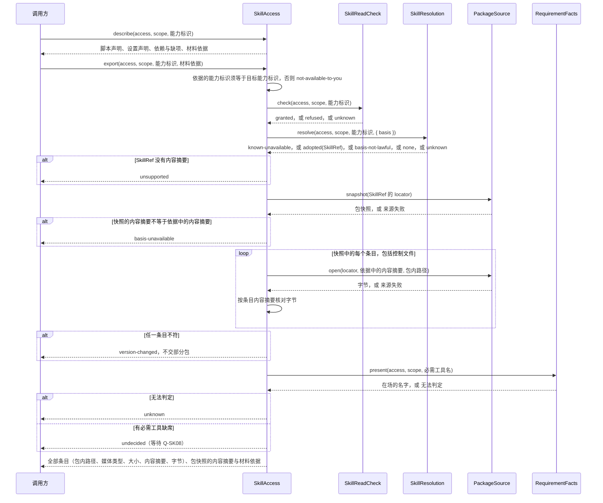

# Skill组内逻辑责任流程

状态：工程设计草案。流程中的服务与端口都是候选，尚非 workspace 成员，见[组入口](../README.md#成员与依赖)。流程只说明本组服务与端口怎样协作，不能因流程落位认为已采用。服务含义与失败种类见[工程设计](architecture.md)。图中只有本组的步骤，本组以外的参与者都合并成「调用方」。

## 组内检查

本节是 F-SK01 中 Skill 内部的部分，对应 J-SK01。跨领域交接见[领域流程 F-SK01](../../../docs/domains/skills/key-flows.md#f-sk01-合法来源定义校验与候选交接)。

1. `inspect` 的结果集合封闭：`SkillDefinition`、一个拒绝原因、`source-unavailable` 或 `version-changed`。规则见[工程设计「检查与发现」](architecture.md#检查与发现)。
2. name 与包根目录名不一致时，一律拒绝为 `name-mismatch`，不论带不带 `expectedName`。
3. `inspect` 不交正文。正文只经 `SkillAccess.read` 取得，`read` 现场核验读取权。
4. `open` 答 `outside-package` 时，`inspect` 拒绝为 `outside-package`。图中省略这一支。

## F-SK02 分层发现与不可用解释

对应 J-SK02；INV-SK02、INV-SK03、INV-SK04。

1. `SkillCatalog` 只在 `SkillResolution.adopted` 给出的当前合法集合里取身份。集合为空时返回空列表，这不是失败。调用方给出 `capabilities` 时，只交其中属于当前合法集合的身份。其余不交，也不说明原因。
2. 每个身份先经 `SkillReadCheck` 核验。答 `refused` 的身份不进入结果，不披露它存在。任一身份答 `unknown` 时，整次操作返回 `unknown`，不把未知压成空。
3. 全部必需项满足才是可用。已知不可用的身份保留，并带替换件原因。从未取得的身份不出现。
4. `search` 按 name 与说明找当前合法集合中该主体可读的身份，返回同样的摘要条目。
5. 本组不按常驻筛选，条目顺序不承载含义。排序、集合修订与呈现归调用方。
6. 仅必需工具不足时的正文读取结果由[组内读取](#组内读取)与 Q-SK08 单列，摘要不替它裁定。
7. 端口无法给出现行判断时，返回 `unknown`，不能以空集合表示「无方法」。

## 组内读取

本节是 F-SK03 中 Skill 内部的部分，对应 J-SK03。跨领域交接见[领域流程 F-SK03](../../../docs/domains/skills/key-flows.md#f-sk03-指定读取与工具消费者采用)。

图中每个 `alt` 分支都在返回后结束本次操作。端口失败按[工程设计「端口」](architecture.md#端口)的映射表转换：`package-not-found` 带材料依据时为 `basis-unavailable`，不带时为 `source-unavailable`。`entry-not-found` 为 `resource-missing`。`bytes-mismatch` 为 `version-changed`。`outside-package` 照原样。`unavailable` 为 `source-unavailable`。调用方经 `signal` 中止时，`read` 不再调用端口，也不交部分内容。

1. 调用方可以不带材料依据，这时 `SkillAccess` 读当时的合法版本。调用方也可以带上此前结果给出的材料依据，这时读取固定该版本。材料依据含能力标识、来源层、资产版本与内容摘要，不含包定位。工作区来源的材料依据可以不带资产版本。
2. 带材料依据时，`SkillAccess` 先核对依据的能力标识等于目标能力标识。不等时对外返回 `not-available-to-you`，不披露差异原因。
3. `SkillAccess` 每一步都现场核验，不用缓存代替。任一端口无法判定时返回 `unknown`。
4. 先核验读取，再解析对应。对无权主体，「无权」与「身份不存在」都返回 `not-available-to-you`。
5. 只有 `SkillResolution` 答 `known-unavailable` 时，才返回 `unavailable-stand-in`。`resolve` 先判 `known-unavailable`，再判 `adopted`，所以带不带材料依据，替换件都相同。替换件由 Skill 用 `resolve` 交来的最后合法 name、说明与原因组装。
6. 带材料依据时，`SkillResolution` 核对依据所指的材料是否合法，并当场给出包定位。只有身份 `adopted` 且依据的版本不合法时，`resolve` 才答 `basis-not-lawful`，`SkillAccess` 返回 `basis-unavailable`。
7. 资产正文缺 `package.digest` 时，`SkillRef` 没有内容摘要。`read`、`list` 与 `export` 返回 `unsupported`，带不带材料依据都一样。
8. 先取快照并比较包快照的内容摘要，再查条目，再读字节并按条目内容摘要核对。所以一次读取只对应一份包快照。快照不符时，带材料依据报 `basis-unavailable`，不带材料依据报 `adopted-material-changed`。
9. 只有正文字节核对通过后，才进入 Q-SK08 判断。第一波只核对必需工具名。资源读取不进入这一判断。
10. 成功结果交出后归调用方。`SkillAccess` 不保留副本，不记「已加载」状态，也不把 `SkillRef` 或包定位交给调用方。

`list` 走同一条核验与解析路径，再取快照并比较包快照的内容摘要。只有内容摘要相符后，`list` 才返回快照中的资源条目，不进入 Q-SK08 判断。`describe` 只走核验与解析，再用 `resolve` 交来的声明投影求缺项，交出依赖、脚本与设置声明。它不读包字节，也不交设置值。资产正文缺 `package.digest` 时，`describe` 照常交出声明，结果不带材料依据，并标明「没有可读的包」。

## 组内导出

本节对应 J-SK05 中 Skill 一侧的部分：交出包字节，供调用方物化。脚本怎样执行不在本组。

1. `export` 必须带材料依据。调用方先从 `describe` 取得它。
2. 核验、解析与端口失败的映射同[组内读取](#组内读取)。`SkillReadCheck` 与 `SkillResolution` 的拒绝分支与读取相同，图中省略。资产正文缺 `package.digest` 时，`describe` 不交材料依据，`export` 返回 `unsupported`。
3. 每个条目都按快照中的条目内容摘要核对。任一条目不符时不交部分包。
4. 导出的条目含正文，所以 Q-SK08 的条件也适用于 `export`。
5. 物化的落点、之后的使用与脚本执行都不归本组。脚本身份是能力标识加入口的包内路径，见[工程设计「Q-SK04」](architecture.md#q-sk04-脚本桥接的发起控制和原结果协议)。
