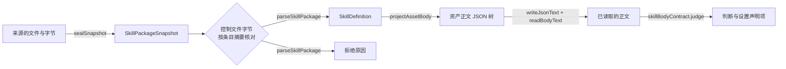

# 关键流程

本包没有服务流程。读取的 11 步与失败映射归[组工程设计「读取」](../../docs/architecture.md#读取)。本文件只写本包纯函数之间的数据流。

## 流程

检查一个包：

1. 来源把一个包的全部文件交给 `sealSnapshot`，得到快照。
2. 调用方按快照条目的内容摘要核对 `SKILL.md` 与 `.omne/skill.json` 的字节。
3. `parseSkillPackage` 交出 `SkillDefinition`，或第一个拒绝原因。
4. `projectAssetBody` 从定义派生资产正文。资产一侧经类别端口判断它，并取得设置声明项。

## 失败与生命周期

- 每一步的失败都是返回值，见 [SPEC「拒绝次序」](../SPEC.md#拒绝次序)。
- 前提被破坏（快照不是 `sealSnapshot` 造出，或控制文件字节与快照不符）时，`parseSkillPackage` 抛出 `TypeError`。
- 本包不持有状态，数据流里的每个值都不可变。
