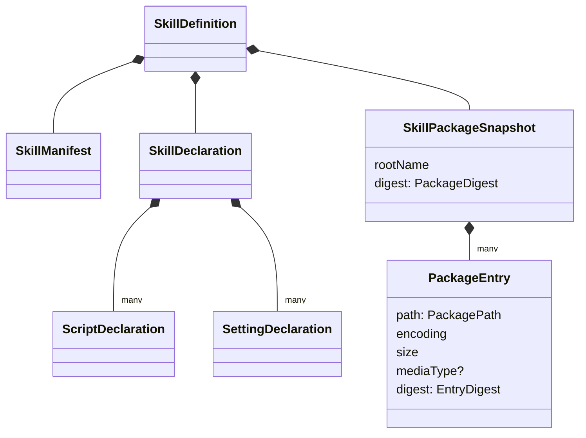

# 对象模型

Skill 没有有状态的聚合。本包的对象都是不可变值，由纯函数产出。组级的值关系图见[组工程设计「模型」](../../docs/architecture.md#模型)。

## 对象与关系

- `SkillPackageSnapshot` 的身份是它的内容摘要。内容摘要相同的两个快照指同一份内容。
- `SkillRef` 与 `SkillMaterialBasis` 是两个值。前者带包定位，只在 Skill 与 `SkillResolution` 之间传递。后者交给调用方，不带包定位。
- 本包不用 class。值是只读类型，端口是接口，替身是工厂函数加闭包。

## 生命周期

值在构造时一次成立，之后不变：`sealSnapshot` 与 `parseSkillPackage` 冻结它们交出的对象。值没有撤除或清理。内存替身持有构造时给出的数据，随调用方的引用释放。
