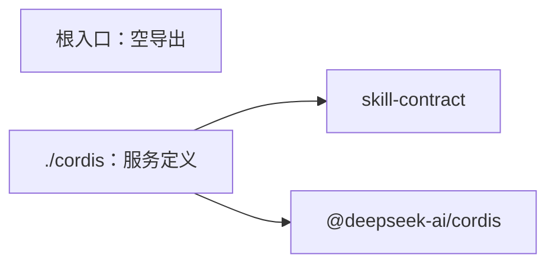

# Skill Cordis 定义的内部架构

本页说明本成员怎样组织两个入口与依赖，来兑现 [SPEC](../SPEC.md)。服务键、抽象类与依赖分类的正文归 [Cordis 说明](cordis.md)。组内成员的分解与依赖方向归[组页](../../README.md#成员与依赖)。本页不另立公共规则。

本成员不持有状态，也不持有资源。三个服务的实现归 [skill](../../skill/README_ZH.md)，提供它们的插件归 [skill-host-local](../../skill-host-local/docs/cordis.md)。

## 模块与依赖

本成员有两个入口，各一个源文件。

| 入口                                         | 源文件          | 承载                                                                                                  | 现状   |
| -------------------------------------------- | --------------- | ----------------------------------------------------------------------------------------------------- | ------ |
| `@omne-harness/skill-cordis-contract`        | `src/index.ts`  | 空导出，不加载 Cordis（[IC-4](../../../../docs/architecture/cordis-integration-conventions.md#ic-4)） | 已实现 |
| `@omne-harness/skill-cordis-contract/cordis` | `src/cordis.ts` | 五个抽象 `Service` 与 `Context` 增补                                                                  | 已实现 |

包外依赖只有两项，都在 `package.json` 里：

- `@omne-harness/skill-contract`：`PackageInspection`、`SkillCatalog`、`SkillAccess`、`SkillReadCheck`、`SkillResolution`。只做类型导入。
- `@deepseek-ai/cordis`：`Service` 与 `Context`，只由 `./cordis` 使用。

本成员不导入 `@omne-harness/skill` 或 `@omne-harness/skill-host-local`（[SPEC 性质 6](../SPEC.md#结果与不变量)）。依赖方向是提供者依赖本成员，反方向不成立。

## 关键机制与理由

### 服务定义单独成为一个成员

服务定义与纯契约的变化原因不同。值、失败与端口语义随领域变，服务键与装载约定随装配变。分成两个成员后，只用 `skill-contract` 或 `skill` 的调用方不加载 Cordis（[IC-4](../../../../docs/architecture/cordis-integration-conventions.md#ic-4)）。代价：组内多一个包。接口增删方法时，本成员的抽象类要一起检查。

### 签名从接口推出

抽象方法的参数与结果用 `Parameters` 与 `ReturnType` 从接口推出。接口改一个方法的签名，抽象类随之改变，不需要同步第二份签名（[IC-3](../../../../docs/architecture/cordis-integration-conventions.md#ic-3)）。代价：方法名仍要手写。接口新增或删除方法时，类型检查会报错，维护者补上或删去对应的抽象方法。

### 五个键，每个键一个抽象类

三个服务与两个端口各有一个键。三个服务的消费者按键取用，不依赖提供者。两个端口是别的领域提供的需求端口，它们是 Skill 声明的，由别的领域实现；本成员按需求方的词汇定义它们，不点名实现方（[外域概念的进入方式](../../../../docs/architecture/layers-and-dependencies.md#领域语义依赖与模型边界)）。

### 不导出键常量

[IC-2](../../../../docs/architecture/cordis-integration-conventions.md#ic-2) 写「定义包导出的键常量取自 `provide`」。本成员不导出键常量，只导出五个类。键仍只写一次，在各类的 `static readonly provide`；消费者写 `ctx.get(<类>.provide)`，字面量类型使 `ctx.get` 有类型。理由：键常量与类各自成为导出，会多出五个运行导出而没有新的信息。代价：消费者要导入整个类，才能取得键。这个选择来自 #1119 W4 的 Skill 规格，不是 IC-2 的字面写法；IC 约定的拥有者可以改判。

### 端口服务不写 `inject`

`inject` 没有可选形式（见[机制读数](cordis.md#机制读数与假设)）。写进 `inject` 等于端口缺席时插件停在 `PENDING`。Skill 要求端口缺席时答 `unknown`，所以抽象类不写 `static inject`，使用方每次调用现取（[IC-9](../../../../docs/architecture/cordis-integration-conventions.md#ic-9)）。

## 验证与维护

保证与验证的对应见 [SPEC 的组合与验证](../SPEC.md#组合与验证)。skill-contract 的接口变化时，同步抽象类、[公开接口页](public-api.md)、[tests/cordis-entry.spec.ts](../tests/cordis-entry.spec.ts) 的导出集合与 skill-host-local 的子类。
