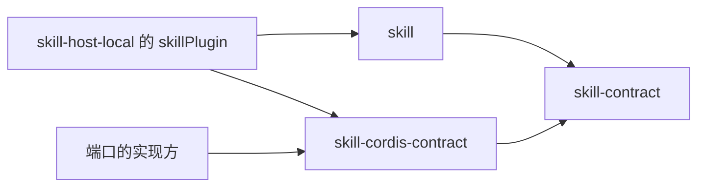

# 使用与定位

本页说明消费侧怎样使用本成员、具名的上层消费者与本成员在系统里的位置。它引用系统架构与真实消费者，不成为新的架构源。

## 使用方式

最小用法见 [README](../README_ZH.md#使用)。各类依赖方的做法如下，规则见 [Cordis 说明](cordis.md#依赖分类)。

- 提供三个服务的插件：继承 `PackageInspectionService`、`SkillCatalogService`、`SkillAccessService`，在 `apply` 里逐个 `new`。不另写键，不自己 `ctx.provide`。
- 端口的实现方：继承 `SkillReadCheckService` 或 `SkillResolutionService`，作为插件装载。
- 使用服务的插件：把需要它的那段工作写成 `ctx.inject(['skillAccess'], cb)`，或在调用时 `ctx.get(SkillAccessService.provide)` 并接受 `undefined`。
- 只需要类型的一方：`import type {} from '@omne-harness/skill-cordis-contract/cordis'`。

初始化与释放：本成员没有初始化与释放。服务的寿命归装载它的插件的 fiber。

## 消费者与定位

| 消费者                                                                     | 怎样用                                               |
| -------------------------------------------------------------------------- | ---------------------------------------------------- |
| [skill-host-local](../../skill-host-local/docs/cordis.md) 的 `skillPlugin` | 继承三个服务的抽象类并提供它们；对两个端口按调用现取 |
| 两个端口的实现方（别的领域的装配）                                         | 继承两个端口的抽象类                                 |
| 使用三个服务的上层插件                                                     | 按键取用                                             |

本成员在能力组里是服务定义成员，见[组页](../../README.md#成员与依赖)。系统层面的集成规则见 [IC 约定](../../../../docs/architecture/cordis-integration-conventions.md)。
