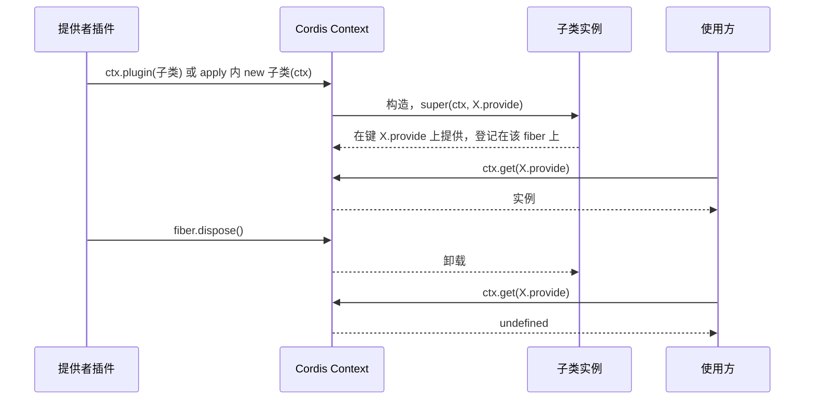
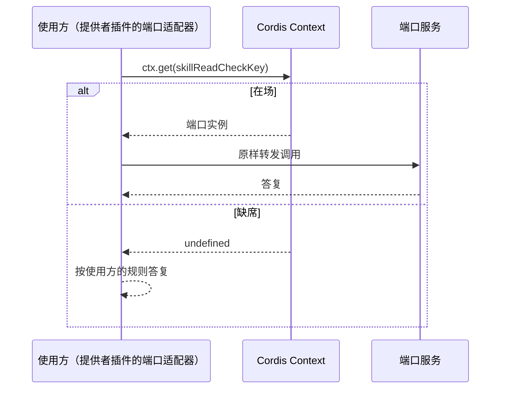

# 关键流程

本页用文本图源描述本成员的两个机制流程：服务的装载与撤除，以及端口的现取。参与者、顺序与失败分支都是 Cordis 4.0.4 的行为，本成员只规定键与类。

## 流程

### F-SC01 服务的装载与撤除

提供者可以装载子类本身，一个键一条 fiber；也可以在一个插件的 `apply` 里逐个 `new` 几个子类，它们共一条 fiber（[IC-2](../../../../docs/architecture/cordis-integration-conventions.md#ic-2)）。skill-host-local 采用后一种。fiber 卸载后，键上没有服务。

### F-SC02 端口的现取

使用方每次调用都现取，不缓存。端口换代后，下一次调用取到新的实例。本成员只规定键与类，现取与缺席时的答复由使用方兑现（[SPEC 性质 8](../SPEC.md#结果与不变量)），`skill-host-local` 的规则见其 [SPEC](../../skill-host-local/SPEC.md#port-absent)。

## 失败与生命周期

- 端口缺席：本成员不规定答复。`skill-host-local` 的规则见其 [SPEC](../../skill-host-local/SPEC.md#port-absent)。
- 端口换代：下一次调用取到新实例。已经开始的调用持有旧实例的答复，本成员不规定它的结局。
- 提供者 fiber 卸载：键上没有服务。本成员没有取消参数或资源要释放。
