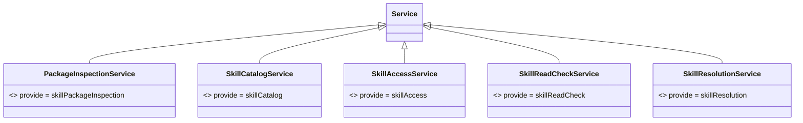

# Skill Cordis 定义的对象模型

本成员没有自己的领域对象。值、失败、包、快照与端口答复都归 [skill-contract](../../skill-contract/docs/object-model.md)，本成员只在方法签名里引用它们。理由是本成员只拥有装配接缝：它规定对象经哪个服务键、以哪种 Cordis 方式交换，不规定对象本身。

本成员定义下列技术对象。它们不自动成为产品领域对象。精确形状归 `src/cordis.ts`，导出索引归[公开接口页](public-api.md)。

## 对象与关系

| 对象                                  | 身份                        | 拥有者 | 可变性         | 关联                                                            |
| ------------------------------------- | --------------------------- | ------ | -------------- | --------------------------------------------------------------- |
| `PackageInspectionService` 抽象类     | 键 `skillPackageInspection` | 本成员 | 静态，随包发布 | `extends` Cordis 的 `Service`，`implements` `PackageInspection` |
| `SkillCatalogService<P, S>` 抽象类    | 键 `skillCatalog`           | 本成员 | 静态           | `implements` `SkillCatalog<P, S>`                               |
| `SkillAccessService<P, S>` 抽象类     | 键 `skillAccess`            | 本成员 | 静态           | `implements` `SkillAccess<P, S>`                                |
| `SkillReadCheckService<P, S>` 抽象类  | 键 `skillReadCheck`         | 本成员 | 静态           | `implements` `SkillReadCheck<P, S>`                             |
| `SkillResolutionService<P, S>` 抽象类 | 键 `skillResolution`        | 本成员 | 静态           | `implements` `SkillResolution<P, S>`                            |
| `Context` 增补                        | 五个属性，名同键            | 本成员 | 静态           | 泛型类取 `unknown`                                              |

五个类各自 `implements` skill-contract 的接口，图中不画。

## 生命周期

| 对象           | 创建   | 变化                   | 结束   |
| -------------- | ------ | ---------------------- | ------ |
| 抽象类         | 包发布 | 接口增删方法时随包升版 | 包退出 |
| `Context` 增补 | 包发布 | 同上                   | 包退出 |

子类的实例不归本成员：它由装载它的插件的 fiber 拥有，fiber 卸载时结束。
