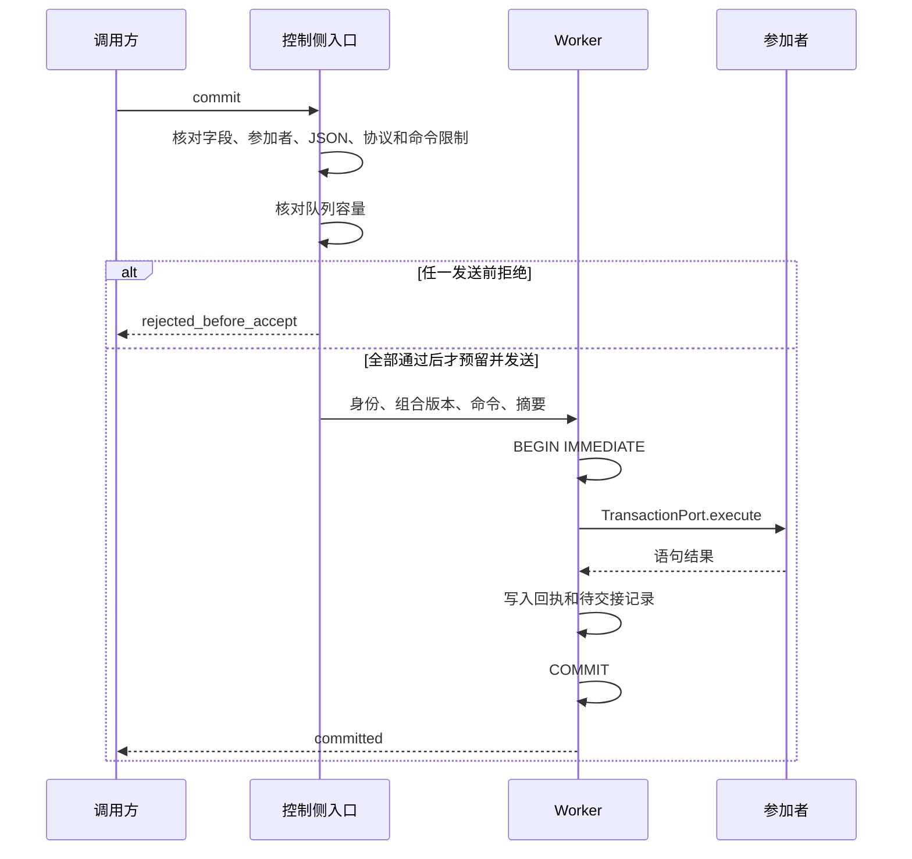
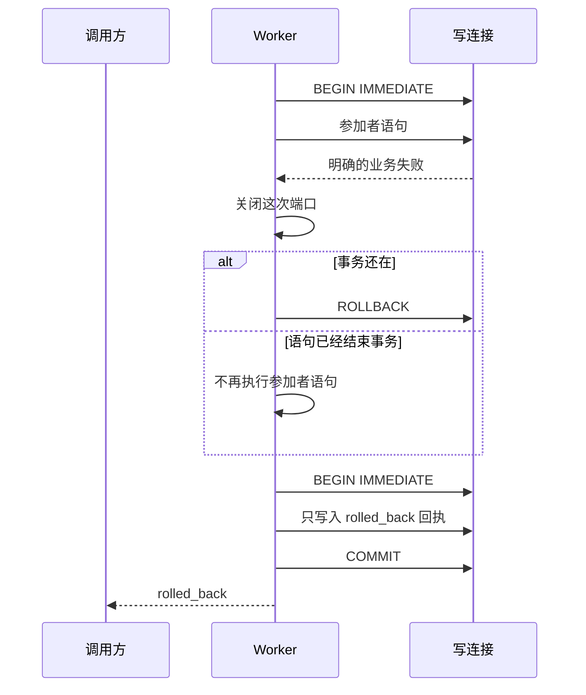

# SQLite 提供者设计

本设计已由 PanQiWei 在 [#247 技术采用决定](https://github.com/nemori-ai/omne-harness-lite/issues/247#issuecomment-6176738073)中接受。本页不授予生产实施资格。这里没有包、源码或生产提供者。

公共结果、拒绝原因、配置项和五项证明以 [SPEC](SPEC.md) 为准。下面走查 SQLite 提供者怎样得到这些结果。尚未决定的返回值见 [SPEC 的尚未决定](SPEC.md#尚未决定)。

## 部件与归属

| 部件 | 所在线程 | 拥有什么 |
| --- | --- | --- |
| 控制侧入口 | 调用方所在线程 | 字段核对、JSON 值核对、规范写出和输入摘要 |
| Worker | 专用 Worker 线程 | 写连接、写代际核对、登记读写、受理队列、事务和回执 |
| 参加者模块 | Worker 内 | 本参加者的事实语句。模块只拿到 `TransactionPort` |

控制侧入口只把版本化数据和操作身份发给 Worker，这条约束来自[数据与状态](../../../../docs/architecture/data-and-state.md#事务域与异步sqlite执行)。函数不能经结构化克隆进入 Worker。所以 JSON 值核对在控制侧完成，在消息发出之前。

Worker 一次处理一条消息。`node:sqlite` 的语句在这条消息里同步跑完。参加者命令不等待网络、模型、工具或 HITL。下一条消息要等当前语句返回。

## 启动

1. 提供者核对 SPEC 列出的四项配置：`admissionQueueLimit`、`lockWaitMs`、`maxCommandsPerCommit` 和 `maxCommandBytes`。任一项缺失，或者不是有限正数，提供者拒绝启动。数值由装配者给出。本页不规定数值。
2. Worker 打开写连接，读取该连接上的 `sqlite_version()`。读数低于 3.51.3 时，提供者拒绝启动。版本以这次读数为准，不从 Node 版本推断。
3. Worker 设置 `journal_mode=WAL`、`synchronous=FULL` 和 `foreign_keys=ON`，然后读回这三项。第 2 步在这一步之前完成，所以低于下限的库不进入 WAL。
4. 提供者确认旧写代际已排除，然后开放写准入。确认之前，`commit` 返回 `writer_not_current`。

## 正常提交

下列核对顺序描述单次提交怎样走过控制侧和 Worker。多个拒绝同时成立时，返回 [SPEC](SPEC.md) 规定的第一个原因。

1. 控制侧入口核对必需字段。字段缺失时，`commit` 返回 `field_missing`。命令数组为空时，同样返回 `field_missing`。
2. 参加者重复时，`commit` 返回 `participant_repeated`。
3. 某条命令的 `facts` 不是 JSON 值时，`commit` 返回 `facts_not_json`。
4. 控制侧入口用 RFC 8785 写出调用方排好的命令数组，再对写出的 UTF-8 字节计算 SHA-256。提供者不重排命令。
5. 协议版本不是 `1` 时，`commit` 返回 `unsupported_protocol`。不发送，也不增加预留。
6. 命令条数或单条字节超过上限时，`commit` 返回 `command_limit`。不发送，也不增加预留。
7. 这条写连接上尚未确认结束的预留个数已经等于 `admissionQueueLimit` 时，`commit` 返回 `queue_full`。不发送，也不增加预留。
8. 第 1 到第 7 步都通过之后，控制侧先把预留加一，再把带预留标记的消息发给 Worker。预留在四种情况下各归还一次：结果已经由结果拥有者收下，操作在执行前被确认撤下，发送失败，Worker 退出。取消观察不归还仍在执行或已经发出的预留。已经归还的预留，迟到结果不再减一。
9. Worker 核验消息带有预留。没有预留则拒绝执行。Worker 不因为个数已经等于上限而拒绝这条已经预留的请求。
10. Worker 核对旧写代际已排除。未排除时，`commit` 返回 `writer_not_current`。结果由结果拥有者收下后，控制侧把这次预留归还一次。观察方是否还在，不影响这一次归还。
11. Worker 在写连接上读取登记。没有登记时返回 `combination_unregistered`。参加者不在登记中时返回 `participant_not_in_combination`。通过核对的操作进入处理。
12. 轮到该操作时，Worker 执行 `BEGIN IMMEDIATE`。等待写锁的时间以 `lockWaitMs` 为上限。
13. Worker 在事务内按操作身份读取回执。回执存在且摘要相同时，Worker 用 `ROLLBACK` 结束这个还没有写入的事务，`commit` 返回已保存的回执。回执存在且摘要不同时，Worker 同样结束事务，`commit` 返回 `identity_conflict` 和已有回执。这两种情况都不执行命令。
14. Worker 按命令数组的顺序，把每条命令交给它的参加者模块。参加者模块通过 `TransactionPort` 执行语句。
15. Worker 写入已提交回执和待交接记录。
16. Worker 执行 `COMMIT`。`COMMIT` 成功后，`commit` 返回 `committed`。

第 1 到第 7 步在发送之前完成。消息还没有进入 Worker。第 10 步和第 11 步发生在 `BEGIN IMMEDIATE` 之前。这时写连接上没有语句。登记读取使用这条写连接。这些拒绝不进入受理队列。

第 12 到第 16 步在同一次消息里完成。事实、已提交回执和待交接记录在同一个事务里提交。

下面这张图用的是上面的步骤。多个拒绝同时成立时返回哪一个，以 SPEC 的拒绝顺序为准。

## 拒绝

所有发送前拒绝都出现在正常提交的第 1、2、3、5、6、7 步。第 10 步和第 11 步也在操作进入受理队列之前。拒绝不写入回执，也不占用队列位置。

拒绝之后，调用方可以用同一身份调用 `query`。这时没有回执，结果由五项证明决定。

- `writer_not_current` 之后，旧写代际尚未排除，`query` 返回未知。
- 其他拒绝之后，五项证明全部成立时，`query` 返回未提交。缺任何一项时，`query` 返回未知。

`registerCombination` 也在 Worker 的写连接上写入登记。登记拒绝的三个原因见 SPEC。登记和登记拒绝都不写入提交回执。

## 明确回滚

1. 正常提交的第 14 步中，某条命令出现明确的业务失败。提供者关闭这次调用的端口。后面的 `execute` 不再把 SQL 交给 SQLite。
2. Worker 撤下 authorizer，再确认事务。事务还在则执行 `ROLLBACK`。失败的语句已经结束事务时，Worker 不再执行参加者语句。`ROLLBACK` 因其他原因失败时，`commit` 返回 `unknown`。
3. 事务已经结束时，Worker 开始第二个短事务。这个事务只写入明确回滚回执，然后执行 `COMMIT`。
4. 第二个事务提交后，`commit` 返回 `rolled_back`。同一操作身份和同一输入摘要以后再次提交，得到这份明确回滚回执。第二个事务没有提交时，`commit` 返回 `unknown`。

第一个事务里的写入不保留。事务还在时，由提供者的 `ROLLBACK` 撤下。语句已经结束事务时，SQLite 已经撤下这些写入。明确回滚回执必须在这之后仍然存在，所以它写在第二个事务里。

两个事务在同一次处理中完成。两个事务之间，Worker 不处理别的消息。所以同一身份的另一次尝试不会在回执写入之前开始执行。

第二个事务没有提交时，`commit` 返回 `unknown`。这时事实已经回滚，但没有可以认回的明确回滚回执。

## 未知

`commit` 在下列情况下返回 `unknown`。

- 第 12 步或第二个短事务等待写锁，时间超过 `lockWaitMs`。
- `COMMIT` 报错，提供者不能确定事务是否已经提交。
- 回滚之后，写入明确回滚回执的第二个事务没有提交。
- `ROLLBACK` 因其他原因失败。

能确定的受理前失败返回 `rejected_before_accept`。

调用方收到 `unknown` 之后，用原身份调用 `query`。

## 查询

1. 控制侧入口把操作身份发给 Worker。`query` 不是受理，不进入受理队列。Worker 正在执行事务时，`query` 等到这次处理结束。
2. 查询的租户不是该事务域服务的租户时，Worker 返回未知，不读取回执。
3. Worker 在写连接上按操作身份读取回执。回执存在时，Worker 返回已提交回执或明确回滚回执。
4. 回执不存在时，Worker 核对五项证明。五项全部成立时，Worker 构造未提交并返回。缺任何一项时，Worker 返回未知。

| 证明 | 本设计的来源 |
| --- | --- |
| 旧写代际已排除 | 前一个 Worker 的退出已经被观察到，或这是崩溃后的新进程。新连接打开并读回版本和 PRAGMA 之后，库里的写代际已经加一 |
| 旧事务已终止 | 新连接打开时，SQLite 结束死连接留下的未提交事务。提供者在下一次 `BEGIN IMMEDIATE` 之前不持有事务 |
| 数据库恢复已完成 | `DatabaseSync` 打开成功，并且版本和三项 PRAGMA 读回成功。打开失败则这项不成立 |
| 权威读取已成功 | 第 3 步在写连接上的读取成功 |
| 该操作未进入受理队列 | 尚未确认结束的预留里没有这个操作身份 |

受理队列只在内存中。重启后队列为空，旧队列中尚未开始的操作没有回执。

## 参加者端口

参加者模块只拿到 `TransactionPort`。提供者在调用参加者期间用 SQLite authorizer 拒绝 `SQLITE_TRANSACTION`。注释、`NUL` 或多条语句里的提交和回滚也由 SQLite 拒绝。提供者自己写回执或回滚之前先撤下 authorizer。一条语句失败之后，这次调用的端口关闭，后面的 `execute` 不再把 SQL 交给 SQLite。调用是事务内的 `execute(facts, port)`。`params` 只能是 `null`、布尔值、有限数、字符串或 `Uint8Array`。行的业务字段由参加者规定。

## 关闭

1. 提供者停止新的准入。此后新的 `commit` 返回 `closing`，不进入队列。队列里尚未开始的操作被确认撤下，不写回执，预留归还一次。
2. Worker 不打断正在执行的语句。关闭期限是存储提供者插件上的配置字段。数值仍空着。调用方在 Worker 之外使用这个字段计算期限。SQL 仍在执行时，提供者持有这条写连接的租约。
3. 语句在期限内结束，并且提供者还没有给出 `incomplete` 时，Worker 关闭写连接，提供者调用 `release`，并观察 Worker 退出。关闭结果是 `closed`。
4. 期限到达时语句还没有结束，提供者给出 `incomplete`，并且不释放该租约。此后语句结束，提供者仍不调用 `release`。该租约保持持有，直到装配 `close` 的报告已经确定。装配 `close` 在排空阶段等待这份租约。排空结束时租约仍被持有，装配报告是 `timed-out`，不是 `failed`。步骤不执行。报告确定之后的 `release` 不改写这份报告。这条释放限制由存储提供者承担。存储关闭不放进排空之后的步骤列表。
5. 结束 Worker 不是回滚。调用方按原身份调用 `query`。

## 探针

探针脚本是 `tools/storage-probe/worker-probe.mjs`。它使用真实的 `node:sqlite` Worker 和隔离的数据库文件。探针不是生产提供者，不注册为包或入口。

运行之后，结果记在[探针观察](probe-observations.md)。

## 不在本设计内

物理断电和 [SQL-T01](../../../../docs/architecture/deployment/infrastructure-policy.md#sql-t01) 仍未完成。本设计和探针都不证明断电耐久。

行为模型不在 #247 内。`writer_not_current` 保持为明确的拒绝，不用模型省掉。单机恢复步骤写在上面的证明表和 SPEC 里。

本设计尚未选定下列事项。

- 确认旧写代际、旧事务和数据库恢复的单机步骤见上面的证明表。跨进程同时打开两条写连接不在这条路线里。
- 端口拒绝事务控制语句的规则见 SPEC。错误对象的类名未定。
- `SqlValue`、`QueryRows` 和参加者模块入口的精确形状。
- 事务域与租户的绑定怎样配置。
- 读回的 PRAGMA 值与设定不符时，提供者怎样处置。
- Worker 在操作途中退出时，控制侧给 `commit` 的调用方返回什么。调用方仍按 SPEC 用原身份查询。
- 待交接记录的内容和消费方。
