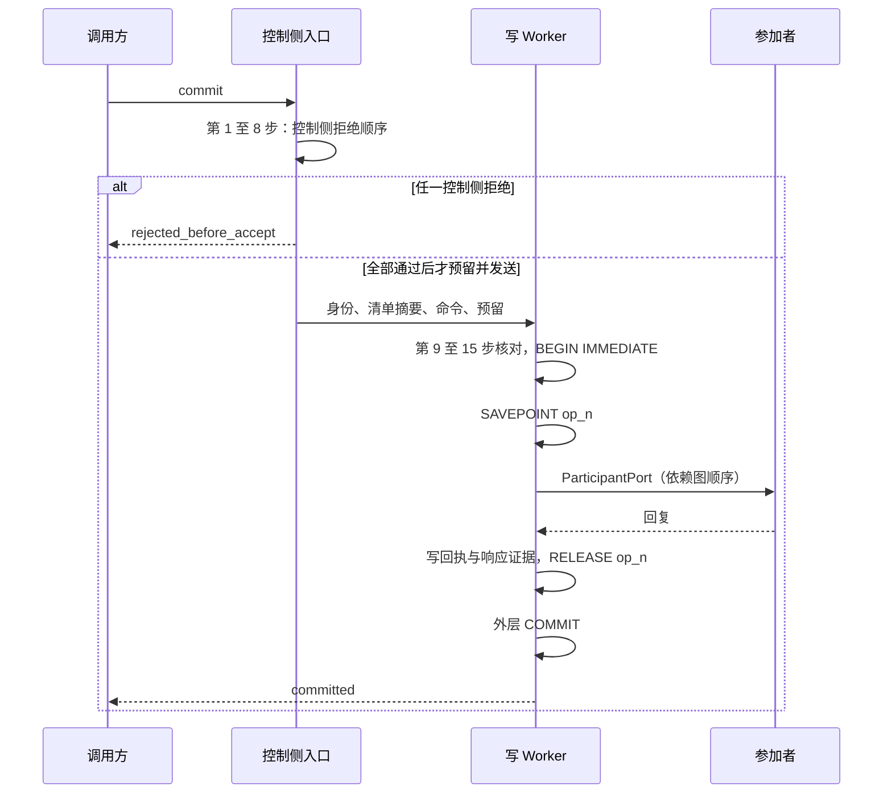
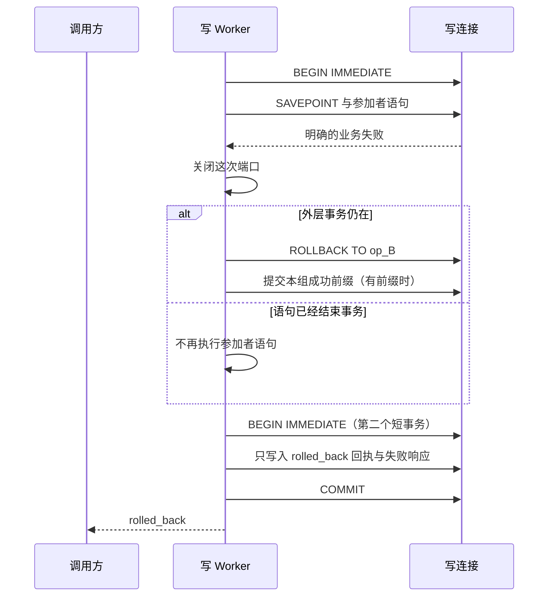

# @omne-harness/sqlite-provider 提供者设计与行为规格

本文件拥有 SQLite 提供者怎样兑现 [SQL 存储契约](../sql-contract/SPEC.md)：事务域的物理绑定与打开、迁移、组提交、失败处理、读 Worker、配置与 WAL、关闭机制和 Cordis 装配符合性。公开形状归 `src/` 的公开定义。结果、拒绝顺序、身份与摘要归 [sql-contract 规格](../sql-contract/SPEC.md)，本文件不复制它们。

## 范围与依据

依据：SQL r2 规格与公开形状，采用记录为 #687 评论 6554935672。采用是设计采用，不是交付接受 D-A01。本文件取代旧的目标文档 `packages/storage/docs/storage-contract/sqlite-provider.md`（下称 S2）。S2 已由 PanQiWei 在 [#247 技术采用决定](https://github.com/nemori-ai/omne-harness-lite/issues/247#issuecomment-6176738073)中接受。S2 没有实现。

标记【提案 P-nn】指 SQL r2 规格第 19.1 节的提案编号 P-01 至 P-13，用于对照替换清单。标注只说明条款来源，不说明它尚未采用。条款号沿用 SQL r2 规格（写作 §n.m），因此本文件的号不连续。缺少的号在 [sql-contract 规格](../sql-contract/SPEC.md)中。

范围是 M2 单机首条路径。首条路径不需要的能力写成已知限制（本文件末节）。

状态：本文件描述设计。本文件写成时，没有提供者代码被运行。下列项都未运行，不能写成已验证：Node Worker、驱动事务状态探测、真实材料、authorizer 逃逸路径、跨进程排除、Windows 故障注入、SQL-T01 断电、E9、Cordis 实际装配。证据范围见「验证与未执行」。

## 部件与归属

| 部件 | 所在线程 | 拥有什么 |
| --- | --- | --- |
| 控制侧入口 | 调用方所在线程 | 字段核对、JSON 值核对、清单摘要与输入摘要的核对、规范写出、预留与等待列表 |
| 写 Worker | 每个事务域一个专用 Worker 线程，不共用 | 写连接、写代际、登记读写、组调度器、域状态、DO-1、事务和回执 |
| 读 Worker | 每域最多 `maxReadWorkersPerDomain` 个，惰性创建 | 只读连接与 handler 执行 |
| 参加者模块 | Worker 内 | 本参加者的事实语句。模块只拿到 `ParticipantPort` |

控制侧入口只把版本化数据和操作身份发给 Worker，这条约束来自[数据与状态](../../../docs/architecture/data-and-state.md#事务域与异步sqlite执行)。函数不能经结构化克隆进入 Worker。所以 JSON 值核对在控制侧完成，在消息发出之前。

写 Worker 用组状态机处理消息（§7.3）。`node:sqlite` 的语句在一次参加者调用里同步跑完。参加者命令不等待网络、模型、工具或 HITL。两个原操作之间，Worker 让出事件循环，只处理关闭与撤下请求【提案 P-09】。

提供者使用 Node 24.21.0 内嵌的 SQLite 3.53.4 为基线（路线见[技术基础](../../../docs/architecture/technical-foundations.md#共同技术选择)）。Kysely 构造查询，并辅助迁移。提交边界是写连接上的事务。

## §2.2 插件承载

`SqliteStoragePlugin` 是 kernel-basis `definePlugin` 的函数插件。插件体构造一个 `StorageService` 子类的实例，不再 provide 同一个键。插件体还登记一个受管 effect，撤除时等待 `control.close({ initiator: 'disposal' })`。选择函数插件的理由：IC-14 的配置校验只按函数插件核验过（basis `plugin-throw-fails-fiber`）；同一个插件体能同时持有服务实例与关闭 effect。

纯工厂 `createSqliteStorage` 与配置类型从 `.` 导出，不导入 Cordis。绑定插件从 `./cordis` 导出。

## §5 事务域

### §5.1 物理绑定

【提案 P-07】

1. 每个事务域一个数据库文件 `<storageRoot>/domains/<hex>.sqlite`。`<hex>` 是 `transactionDomain` 的 UTF-8 字节的小写十六进制。文件名可逆，并且只由事务域决定，所以 `domain_occupied` 可以判定。
2. 文件内的 `_sql_domain` 表保存事务域与作用域的绑定行。绑定行在创建事务中写入，之后不改。
3. 打开时，提供者核对绑定行中的事务域与路径推导出的标识相同。不同时（别名、复制、改名），该域进入 `quarantined`。核对以文件内容为准。
4. 每个事务域一个写 Worker，不共用。不同租户因此不共用文件或写 Worker【提案 P-07】。这取代 S1 中「部署做不到时，一个租户的长事务占住共用写锁」的已知限制。

一个事务域只服务一个作用域。第一次成功登记把事务域绑到该作用域。之后另一作用域对同一事务域登记，返回 `domain_occupied`。

### §5.2 状态转换

域状态的定义见 [sql-contract 规格](../sql-contract/SPEC.md) §5.2。转换：

- `unopened` 被任何操作触及时到 `opening`。
- `opening` 成功到 `ready`。暂时性故障回到 `unopened`，持久或静态故障到 `quarantined`。
- `ready` 的写 Worker 异常退出时到 `recovering`，观察到退出后到 `opening`。
- `absent` 经登记创建到 `ready`。

暂时性故障是：没有 Worker 名额或进程内声明（§13.5）、打开时 I/O 错误、写锁等待超过 `lockWaitMs`、迁移 COMMIT 的结果不确定。其余打开故障都是持久或静态故障。

### §5.3 DO-1：构造与域打开

构造期只装载并验证静态材料【提案 P-08】。工厂核对配置（§12.1）、材料摘要（sql-contract 规格 §4.1）、声明组合与迁移图（sql-contract 规格 §4.2、§4.3）。工厂不打开数据库，不启动 Worker。不通过时工厂返回 `rejected`，插件抛错，fiber 进入 `FAILED`。

**规则 DO-1。**事务域的打开、恢复、写代际加一、迁移与组合版本升级，只在该域被操作触及时由 SQL 提供者执行。全部成功后，提供者才放行写准入，才持久保存新的登记。DO-1 合并了 Reduce 的 B8 裁定与第二条追加要求。

路径 A：域为 `unopened`，本代际第一次被 `registerCombination`、`commit`、`query` 或 `read` 触及。

1. 取得进程内声明与 Worker 名额。取不到时为暂时性故障。
2. 写 Worker 打开文件。SQLite 结束死连接留下的未提交事务，并完成 WAL 恢复。打开抛错时本次失败，提供者不准入写。
3. 读取该连接上的 `sqlite_version()`。版本以这次读数为准，不从 Node 版本推断。读数低于 3.51.3 时，该域进入 `quarantined`【提案 P-08】。这项核对在设置 `journal_mode=WAL` 之前完成，所以低于下限的库不进入 WAL。
4. 设置并读回 `journal_mode=WAL`、`synchronous=FULL`、`foreign_keys=ON`，设置 `wal_autocheckpoint` 与 `journal_size_limit`。读回不符时，该域进入 `quarantined`【提案 P-05】。
5. 按 §5.1 核对绑定行。读不到绑定行时按 `absent` 处理：`registerCombination` 继续路径 B 第 2 步，其他操作按 sql-contract 规格 §5.5 的 `absent` 行得到结果。
6. 在一个短事务中把写代际加一并提交。旧写代际从此被排除。此时没有提供者打开的事务，所以旧事务已经终止。
7. 在一个 `BEGIN IMMEDIATE` 事务中：
   1. 计算目标参加者：声明组合的参加者，加上登记摘要仍等于当前目录计算值的已登记组合的参加者。
   2. 对目标参加者的待做迁移，按 §5.4 执行 `up` 与 `verify`，写入标记。
   3. 执行 §4.5 的模式核验。
   4. 声明组合在该域没有登记时，写入该登记。同版本已有不同的登记时，该域进入 `quarantined`。
   5. 提交。
8. 域到 `ready`。读 Worker 此后才可以打开。

打开期间到达的操作排队，等待打开结果。打开失败时，等待者按 sql-contract 规格 §5.5 得到 `domain_unavailable`（`query` 为 `unknown`）。

路径 B：域为 `absent`，只有 `registerCombination` 能创建它。

1. 执行路径 A 的第 1 至 4 步。
2. 在一个 `BEGIN IMMEDIATE` 事务中：建立提供者表；写代际置为 1；执行本次组合参加者所需的全部迁移与 `verify`；执行模式核验；写入绑定行；写入登记；提交。
3. 任一步失败时回滚，域保持 `absent`，返回 `domain_unavailable` 并带诊断。COMMIT 结果不确定时返回 `unknown`。

`commit`、`query`、`read` 触及 `absent` 的域时不创建文件。

登记只发生一次（依赖 Context r3）。应用只在未登记租户首次 create 时调用 `registerCombination`。之后每次重启，路径 A 负责迁移与组合版本升级。这与 AA 一致：登记成功即表示迁移已经完成。S1 中新写者「加一完成之前，`commit` 和 `registerCombination` 返回 `writer_not_current`」的规则改为：域打开期间这些操作排队等待打开结果，打开失败为 `domain_unavailable`；`writer_not_current` 只用于旧 Worker 退出尚未被观察的 `recovering`【提案 P-08】。

新进程在崩溃之后打开数据库文件时，同一进程里前一个 Worker 的退出被观察到之前，不打开下一个写者（§13.5）。

### §5.4 迁移

迁移模块导出同步的 `up(port)` 与 `verify(port)`。`up` 抛错，或 `verify` 返回 `failed` 时，整个迁移事务回滚。需要原子回滚的迁移把 DDL、数据和迁移标记放进同一连接事务。Kysely 返回的 error 和逐项结果都要检查。未抛出异常不等于迁移成功。失败时，提供者保持升级前的格式，并拒绝按新格式开闸。

- 顺序：按 `requires` 的拓扑序执行。多份迁移同时就绪时，按 `(owner, id)` 升序选第一个。
- 标记：`_sql_migration` 保存 `(owner, id, checksum)`。标记的 checksum 与目录不同，或标记不在当前目录中时，该域进入 `quarantined`。目录因此不能删除已发布的迁移。
- 迁移端口的 authorizer 只允许两类访问：对 `owner` 参加者拥有的表执行 DDL 与读写；读取 `requires` 闭包所建的表。它拒绝 `_sql_` 表、`ATTACH`、事务控制、`SAVEPOINT`、PRAGMA 与扩展加载。
- 迁移不接收调用方的 SQL。事务外步骤（例如文件步骤）在 #541 闭合之前不能进入目录。事务外步骤须写明中断后的重入点。
- 每次迁移提交后，该域的模式代次加一（§9.5）。

## §4.5 分组资格

一个原操作的每个参加者在该域都可分组时，这个操作才进入多操作组。否则它单独成组（§7.3）。

| 层 | 条件 | 核验者与时点 | 不通过时 |
| --- | --- | --- | --- |
| 声明 | 材料字段 `grouping` 为 `groupable` 或 `singleton`，没有默认值 | 工厂，构造期 | 构造被拒绝 |
| 模式 | 参加者拥有的表没有 `DEFERRABLE INITIALLY DEFERRED` 外键，没有 `CURRENT_TIME`、`CURRENT_DATE`、`CURRENT_TIMESTAMP` 默认值，不是临时表 | 提供者读取 `sqlite_schema`，在域打开或新登记的迁移事务内（§5.3） | 本提供者代际内，该参加者在该域按 singleton 处理，记诊断 |
| 运行 | 语句只调用基本允许清单与 `allowedFunctions` 中的函数。基本清单不含时间、随机与连接状态函数 | authorizer，每条语句 | 回复 `failed`（`port_violation`），明确回滚 |
| 模块 | 模块不跨调用保留影响结果的状态，不产生带外副作用 | 材料拥有者，场景 C21 | 材料声明 `singleton` |

延迟外键是唯一能被后续操作修复的约束。反例 FK-1：A 插入违反延迟外键的行，B 补上父行，合组后 A 从应失败变为成功。参加者不能执行 PRAGMA（sql-contract 规格 §7.4），所以模式层足以排除 FK-1，而且核验成本不随历史数据增长。作者自报不代替核验。全部材料标为 singleton 不算完成 IP-ST-09（场景 C20）。authorizer 能否看到默认值中的时间函数待实测，实测前以模式层为准（L-9）。

## 参加者端口的提供者职责

端口的权限、事实格与失败规则归 [sql-contract 规格](../sql-contract/SPEC.md) §7.4 与 §7.6（同 S2「参加者端口」一节）。提供者在每次参加者调用前设置 authorizer，调用后与执行自己的事务语句和回执写入之前撤下它。一条语句失败之后，提供者关闭这次调用的端口。

## 提交的执行

### §7.3 组提交 G2-P

【提案 P-09】同一事务域的多个原操作共用一个外层事务，每个原操作使用一个 savepoint。正常时，一次 FULL 提交保存多个身份的事实、响应与回执。每个域一条写连接，命令在该连接的 `BEGIN IMMEDIATE` 中执行。

- 域调度器在写 Worker 内。它只收集相邻、已预留、可分组（§4.5）的操作，收集在 `BEGIN IMMEDIATE` 之前完成。第一个操作到达时开始计时，绝对期限是 `groupCollectMs`，后到的操作不延长期限。`groupCollectMs` 为 0 时不等待。
- 下列任一条件成立时立即封组：操作数达到 `groupMaxOperations`；加入下一个操作会超过 `groupMaxInputBytes` 或 `groupMaxResponseReservationBytes`；期限到达；遇到屏障；下一个操作不可分组。不可分组的操作单独成组，行为与 S1、S2 的单操作提交相同。已封的组不再增加成员。
- 屏障是 `registerCombination`、写代际改变、关闭、`query`、`domain-serial` 读与 WAL 维护。组不跨越屏障。维护只在两个物理事务之间运行。
- 组序号只用于诊断，不进入协议、摘要或持久身份。
- 组状态机独占写连接，直到本组收场。参加者同步执行，不能 `await`。两个原操作之间，Worker 让出事件循环，只处理关闭与撤下请求。其他消息只排队，不执行语句，不读暂存回执。写锁不释放。关闭与「开始下一个操作」的竞争在调度点裁定：Worker 先确认关闭时，不开始下一个操作。
- 执行时间超过 `groupMaxExecutionSliceMs` 后，Worker 不再开始新操作，提交已成功的前缀。未开始的操作保留原位置与原预留，进入下一组。这项检查只在语句或操作之间进行，不是硬截止。
- 公平：每完成 `writesPerControlTurn` 个新原操作，调度器服务一个已经等待的 `query` 或控制消息，关闭优先。写按 FIFO，不插队。每个组结束后，调度器都检查关闭、`query`、串行读与维护。
- 预留不因合组而合并。每个调用占一份预留，在结果拥有者收下、确认撤下、发送失败或 Worker 退出时归还一次。

受理队列的计数只由控制侧拥有（S1 义务，继续有效）。发送前，个数已经等于上限时，控制侧返回 `queue_full`，并且不发送。允许发送时先把个数加一，再发送。Worker 退出时，控制侧把尚未归还的预留各归还一次。Worker 不把已预留的请求再按满额拒绝，只核验消息带有这次预留，没有预留的消息拒绝执行。重启后计数为 0。个数为 0 且上限至少为 1 时，第一条可以发送。提供者不在租户之间轮转调度。

### §7.5 正常路径

全部判断顺序见 sql-contract 规格 §7.2。正常路径：

1. Worker 核对域、写代际与逐项预留，执行 `BEGIN IMMEDIATE`。写锁等待超过 `lockWaitMs` 时，本组全部操作为 `unknown`。
2. 按 FIFO 取一个操作，判断 sql-contract 规格 §7.2 第 9 至 15 步。
3. 该身份在本组之前已有持久回执：摘要相同时返回原回执，摘要不同时返回 `identity_conflict` 与原回执。两者都不执行命令，立即交付。
4. 同一身份已在本组暂存：本次调用成为等待者（sql-contract 规格 §7.7.3），不执行命令。
5. 新身份：执行 `SAVEPOINT op_n`，调用参加者。全部回复 `participated` 时，在同一 savepoint 中写入 `committed` 回执与响应证据。语句全部结束后，执行 `RELEASE op_n`。这时操作只是暂存。
6. 外层 `COMMIT` 确认成功后，本组的新回执才持久。提供者逐身份交付，等待者取得同一回执或 `identity_conflict`。
7. 观察者离开时，原身份仍可 `query`。通知失败不改变已保存的结果。

事实、已提交回执和响应证据在同一个事务里提交。`RELEASE` 不执行外层提交的全部检查。每个操作在结束时满足它独立提交时的约束，由 §4.5 保证。

### §7.7 局部失败的执行步骤

#### §7.7.1 局部失败

B 明确失败，A 已经暂存：

1. 停止 B 之后的参加者，关闭端口。本组未开始的后缀不再开始。
2. 外层事务仍在时，执行 `ROLLBACK TO op_B` 与 `RELEASE op_B`，确认 B 的写入已经撤下。B 的失败响应只留在内存中。
3. 有新暂存前缀时，提交外层事务。前缀持久后，交付 A 及其等待者的结果。没有前缀时，结束空事务并确认它已结束。
4. 原事务结束、并且 B 可能依赖的此前操作都有持久结果之后，用第二个短事务只写入 B 的身份、摘要、`rolled_back` 回执与失败响应。
5. 第二个短事务确认提交后，B 为 `rolled_back`。B 的等待者认回同一响应，或得到 `identity_conflict`。
6. 两个物理阶段之间，Worker 不处理该域的其他消息。后缀保持原位置与原预留，进入下一组。关闭已经开始时，后缀按关闭步骤撤下（§13.3）。

前缀 COMMIT 失败或结果不确定时，A 与 B 都为 `unknown`。提供者不在新事务中保存 B 的依据。逐种事件的结果见 sql-contract 规格 §7.7.2。

#### 明确回滚（单操作形态）

没有新暂存前缀时，本流程与 S2 的两段回滚相同：

1. 某条命令出现明确的业务失败。提供者关闭这次调用的端口。后面的 `execute` 不再把 SQL 交给 SQLite。
2. Worker 撤下 authorizer，再确认事务。事务还在则执行 `ROLLBACK`。失败的语句已经结束事务时，Worker 不再执行参加者语句。`ROLLBACK` 因其他原因失败时，`commit` 返回 `unknown`。
3. 事务已经结束时，Worker 开始第二个短事务。这个事务只写入明确回滚回执，然后执行 `COMMIT`。
4. 第二个事务提交后，`commit` 返回 `rolled_back`。同一操作身份和同一输入摘要以后再次提交，得到这份明确回滚回执。第二个事务没有提交时，`commit` 返回 `unknown`。

第一个事务里的写入不保留。事务还在时，由提供者的 `ROLLBACK` 撤下。语句已经结束事务时，SQLite 已经撤下这些写入。明确回滚回执必须在这之后仍然存在，所以它写在第二个事务里。两个事务之间，Worker 不处理别的消息，所以同一身份的另一次尝试不会在回执写入之前开始执行。第二个事务没有提交时，事实已经回滚，但没有可以认回的明确回滚回执，`commit` 返回 `unknown`。

有新暂存前缀而 B 的语句结束了整个外层事务时，A 与 B 都为 `unknown`，不写回滚回执（【提案 P-09】）。没有新暂存前缀时，保持上述规则（【提案 P-10】，sql-contract 规格 §7.7.5）。环境类错误为 `unknown`（【提案 P-04】）。

#### §7.7.6 撤下操作的序位（SQ-1）

本节是对提供者的义务，来源是 D5 r2 复评 N-4 的追加要求。

**SQ-1。**在同一个外层事务中，一个原操作被 `ROLLBACK TO` 撤下之后，它分配过的任何权威序位都不能被后继操作观察到，后继操作也不能沿用它而在稠密序列中留下缺口。权威序位包括 Agent 回复准入序位、修订、位置与 `AUTOINCREMENT` 行号。

G2-P 用下列五项兑现 SQ-1：

1. `ROLLBACK TO op_B` 撤下 B 的全部写入，包括计数行与 `sqlite_sequence`。回滚失败时，按 sql-contract 规格 §7.7.2「事务状态不明」一行处理，不再使用该连接。
2. 首次局部失败即停组（§7.7.1 第 1 步）。这个外层事务中只执行过早于 B 的前缀。后缀在新的外层事务中执行，从持久状态继续分配。持久状态是已提交的前缀，加上 B 不含业务事实的回滚回执。
3. 事实格按操作销毁，参加者不能读 `_sql_receipt`。B 的响应中即使含有序位，后继操作也读不到。
4. 参加者只在当前事务中从数据库分配序位，不在模块内存中缓存（§4.5「模块」层）。这是材料拥有者的义务，提供者不能在运行时检测。
5. 批级故障时，全部暂存序位随事务消失。

验证见场景 C22。有界模型不覆盖 SQ-1。

### §7.8 合并窗口与 G1

一个有 k 个新身份的组，用 1 次外层 COMMIT 代替 k 次。这是机制次数，不是 k 倍吞吐。

DEP-1：调用方在 `await commit(A)` 返回后才构造 `commit(B)`，二者不能合并。提供者不会为了等 B 而推迟 A 的提交。同一轮中独立发起、同域、中间没有屏障的操作可以同组。原协议要求先确认再发后者的操作（Tool call 与 queue、`received` 之后的 ACK）自然分在两组。

G1（同一原操作内的批写）保留：Session 的条目、状态、七个索引、共同根与回执一次提交；`received` 的材料、绑定与 `saved` 一次提交；Model 一个原内容操作内的多个片段，在 32 KiB、32 个片段或 10 ms 先到时保存。Model 的阈值待 Model 提供者确认，不覆盖冻结容量 C。未确认保存的内容不发布。超出预算的 `received` 材料在 #541 闭合之前为 `unavailable`，不先存后绑。

## 拒绝与未知的提供者路径

提供者在发送前完成 sql-contract 规格 §7.2 第 1 至 8 步，在 Worker 上完成第 9 至 15 步。拒绝不写入回执，也不占用队列位置。拒绝之后，调用方可以用同一身份调用 `query`：`writer_not_current` 之后旧写代际尚未排除，`query` 返回 `unknown`；其他拒绝之后，五项证明全部成立时返回 `not_committed`，缺任何一项时返回 `unknown`。

`registerCombination` 也在 Worker 的写连接上写入登记。拒绝原因与顺序见 sql-contract 规格 §6.2。S2 中「登记拒绝的三个原因见 SPEC」改为「见 SPEC 登记的拒绝顺序」【提案 P-03】。

`commit` 在下列情况下返回 `unknown`（【提案 P-09、P-04、P-13】）：

- 第 12 步或第二个短事务等待写锁，时间超过 `lockWaitMs`。
- `COMMIT` 报错，提供者不能确定事务是否已经提交。
- 回滚之后，写入明确回滚回执的第二个事务没有提交。
- `ROLLBACK` 因其他原因失败。
- 本组有新暂存前缀，B 的语句结束了整个外层事务。
- 环境类错误。
- 关闭时被撤下，或期限到达时尚未收场。
- Worker 在操作途中退出。

调用方收到 `unknown` 之后，用原身份调用 `query`。

## §8 query 的提供者机制

`query` 是写 Worker 上的排序屏障：当前组结束之后才执行。域与作用域的判断见 sql-contract 规格 §8。查询的作用域不是该事务域服务的作用域时，Worker 返回 `unknown`，不读取回执。五项证明的来源【提案 P-01、P-09】：

| 证明 | 来源 |
| --- | --- |
| 旧写代际已排除 | 本代际已完成 DO-1 路径 A 第 6 步（或路径 B 把写代际置为 1），并且此前写 Worker 的退出已被观察到 |
| 旧事务已终止 | 路径 A 第 2 步打开成功。之后在下一次 `BEGIN` 之前，提供者不持有事务 |
| 数据库恢复已完成 | 路径 A 第 2 至 4 步成功 |
| 权威读取已成功 | 本次在写连接上的读取成功 |
| 未进入受理队列 | 待决索引中没有该身份 |

受理队列只在内存中。重启后队列为空，旧队列中尚未开始的操作没有回执。读 Worker 不能构造任何一项证明。

## §9.5 读 Worker 与连接

- 读 Worker 只在域到 `ready` 之后打开连接。每个读 Worker 一个连接。
- 连接绑定作用域、事务域、绑定行、模式代次与 Worker 代际。任一项不符时隔离该连接。提供者不改标签复用连接。
- 连接回到空闲的条件：语句已结束，结果已转交或丢弃，事务已结束，端口已撤销，没有未结消息。清理异常时关闭连接，观察到关闭后才替换。
- 结果消息带 Worker 代际、请求序号与租约令牌。三者都匹配、请求尚未结算时才接收。迟到消息不改结果，不重复释放资源。
- 读 Worker 崩溃时，在途读取为 `worker_exited`，串行屏障保持到退出被观察。调用方重读得到新快照，提供者不拼接部分结果。
- 空闲达到 `readerIdleMs` 且没有事务时，读 Worker 关闭。观察到退出后才归还名额。
- 迁移会改变模式代次时：停止派发新读取，等在途读事务结束，关闭旧连接，然后迁移。旧代次的结果不交给新的读取。

## §12 配置、资源与 WAL

### §12.1 配置

`storage` 行的配置只含可序列化的数据（IC-16）。字段都必填。除 `storageRoot` 外，字段都是有限正整数，只有 `groupCollectMs` 可以为 0。初值是待实测的工程建议，不是吞吐或延迟承诺。装配填写采用值，工厂在构造期核对。缺值或违反规则时构造被拒绝（`config_invalid`，带字段名与规则），fiber 进入 `FAILED`（IC-14）。S1 的四项配置（`admissionQueueLimit`、`lockWaitMs`、`maxCommandsPerCommit`、`maxCommandBytes`）保持 S1 的含义，其余字段是 S1 允许提供者补充的配置。

| 字段 | 候选初值 | 限制什么 |
| --- | --- | --- |
| `storageRoot` | 装配给出 | 绝对路径（§5.1） |
| `admissionQueueLimit` | 64 | S1：每域已预留、尚未确认结束的 `commit` 数 |
| `globalAdmissionLimit` | 256 | 全局的同一计数 |
| `lockWaitMs` | 5000 | S1：写锁等待，到期为 `unknown` |
| `maxCommandsPerCommit` | 16 | S1：命令条数 |
| `maxCommandBytes` | 1048576 | S1：单条命令 |
| `maxRequestBytes` | 4194304 | 一个 `commit` 请求 |
| `globalInFlightWriteBytes` | 67108864 | 全部已预留请求 |
| `maxJsonDepth` | 64 | JSON 嵌套深度 |
| `maxJsonMembers` | 65536 | 一个请求的容器成员总数 |
| `maxResponseBytes` | 65536 | 一份参加者回复 |
| `maxOperationResponseBytes` | 1048576 | 一个操作的全部回复，也是每个预留的响应额度 |
| `globalWriteResponseBytes` | 33554432 | 全局写响应预留 |
| `maxDiagnosticBytes` | 4096 | 一条诊断 |
| `maxWorkers` | 16 | 全局写与读 Worker 数 |
| `reservedWriterSlots` | 4 | 只给写 Worker 的名额 |
| `maxReadWorkersPerDomain` | 2 | 每域读 Worker，惰性创建 |
| `readQueuePerDomain` | 32 | 每域读等待项 |
| `readQueueGlobal` | 256 | 全局读等待项 |
| `readQueueTimeoutMs` | 1000 | 读请求等待派发 |
| `maxReadInputBytes` | 262144 | 一个读请求的输入 |
| `maxReadResultBytes` | 4194304 | 一个读结果；每个 handler 的 `maxOutputBytes` 不得超过它 |
| `globalReadResultBytes` | 33554432 | 全局在途读结果预留 |
| `readObservationMs` | 2000 | 读运行的观察期限 |
| `readerIdleMs` | 30000 | 空闲读 Worker 的关闭期限 |
| `queryQueuePerDomain` | 16 | 每域 `query` 等待项 |
| `queryQueueGlobal` | 64 | 全局 `query` 等待项 |
| `controlQueuePerDomain` | 8 | 每域控制消息 |
| `controlQueueGlobal` | 32 | 全局控制消息 |
| `writesPerControlTurn` | 4 | §7.3 的公平份额 |
| `groupMaxOperations` | 8 | 一组的原操作数 |
| `groupCollectMs` | 1 | 收集期限。Windows 定时器可能晚醒，不是延迟上界 |
| `groupMaxInputBytes` | 4194304 | 一组的输入字节 |
| `groupMaxResponseReservationBytes` | 8388608 | 一组的响应预留 |
| `groupMaxExecutionSliceMs` | 5 | 一组的时间片 |
| `walAutocheckpointPages` | 1000 | `wal_autocheckpoint` |
| `journalSizeLimitBytes` | 67108864 | `journal_size_limit` |
| `checkpointIntervalMs` | 1000 | PASSIVE checkpoint 间隔 |
| `checkpointWalBytes` | 16777216 | 触发 PASSIVE checkpoint 的 WAL 大小 |
| `walReadPauseBytes` | 67108864 | 进入 `read-paused` 的 WAL 大小 |
| `walWriteStopBytes` | 134217728 | 进入 `write-stopped` 的 WAL 大小 |
| `closeDeadlineMs` | 10000 | 关闭期限的唯一来源 |

字段之间的规则：

1. `maxCommandBytes ≤ maxRequestBytes ≤ groupMaxInputBytes`，并且 `maxRequestBytes ≤ globalInFlightWriteBytes`。
2. `maxDiagnosticBytes ≤ maxResponseBytes ≤ maxOperationResponseBytes ≤ groupMaxResponseReservationBytes ≤ globalWriteResponseBytes`。
3. `groupMaxOperations ≤ admissionQueueLimit ≤ globalAdmissionLimit`。
4. 每对「每域、全局」队列字段中，每域值不大于全局值。
5. `reservedWriterSlots < maxWorkers`，并且 `maxReadWorkersPerDomain ≤ maxWorkers − reservedWriterSlots`。
6. `maxReadResultBytes ≤ globalReadResultBytes`。
7. `journalSizeLimitBytes ≤ walReadPauseBytes`，并且 `checkpointWalBytes ≤ walReadPauseBytes < walWriteStopBytes`。

### §12.2 资源

- 全局 Worker 名额计入处于任何状态的写 Worker 与读 Worker。观察到 Worker 退出之前，名额不归还。读 Worker 最多使用 `maxWorkers − reservedWriterSlots` 个名额。没有名额时，打开域是暂时性故障。读请求等待名额的时间计入 `readQueueTimeoutMs`。
- 输入、结构化克隆、响应、等待者与结果发送都计入有界预算。提供者先做有界遍历，再分配完整字符串。
- 预算是资源配置，不是租户之间的公平政策。提供者不在租户之间轮转调度（S1）。
- 慢语句期间持续提交的内存上界没有探针（L-6）。没有这次探针，不能声称内存已经证明有界。

### §12.3 WAL 维护

1. 写 Worker 在两个物理事务之间做维护。每 `checkpointIntervalMs`，或 WAL 超过 `checkpointWalBytes` 时，执行一次 PASSIVE checkpoint。
2. WAL 超过 `walReadPauseBytes`，并且连续两次 checkpoint 的已回写页数都没有增加时，域进入 `read-paused`：停止派发新读取，等在途读事务结束，再执行 RESTART 或 TRUNCATE checkpoint。WAL 降到 `checkpointWalBytes` 以下时解除。
3. `read-paused` 中 WAL 仍超过 `walWriteStopBytes` 并且没有进展时，域进入 `write-stopped`。新的写入按 sql-contract 规格 §5.5 得到 `domain_unavailable`，已预留的操作按真实结果结算。WAL 降到 `walReadPauseBytes` 以下时解除。
4. 提供者不降低 `synchronous=FULL` 来换吞吐。

## §13 关闭的提供者机制

关闭的发起者、期限、租约、调用方结果与报告闩锁规则归 [sql-contract 规格](../sql-contract/SPEC.md) §13。本节是提供者的步骤。

### §13.3 关闭步骤

1. 停止准入。全部域进入 `draining`，收集窗口关闭。新到的操作按 sql-contract 规格 §5.5 得到结果。
2. 撤下未开始的工作：控制侧等待列表中的操作直接移出；已发给 Worker 的未开始操作经 Worker 确认后撤下。每个预留归还一次。
3. 正在执行的写跑完。Worker 在操作之间确认关闭后，不再开始后缀，按 §7.7 提交成功前缀或完成失败处理。Worker 不打断正在执行的语句：`node:sqlite` 把语句同步跑完，所以关闭等待当前语句结束。
4. 已开始的读事务结束后关闭连接，`domain-serial` 屏障随后释放。
5. 全部连接关闭、全部 Worker 退出都已被观察时，返回 `closed`。
6. 期限到达时仍有 Worker 未退出，返回 `incomplete`，附 `residuals`。语句仍在执行时，提供者持有该 Worker 的租约。语句在期限内结束时，提供者调用 `release`。期限到达而语句未结束时，提供者不释放租约，此后语句结束仍不调用 `release`，直到装配报告确定（sql-contract 规格 §13.4）。这条释放限制由存储提供者承担。

结束 Worker 不是回滚。

### §13.5 进程内写者排除

同一进程中，一个数据库文件只能有一个写 Worker。sqlite-provider 模块持有一张模块级声明表，按文件路径记录持有写 Worker 的提供者代际。DO-1 第 1 步先取得声明。旧代际的写 Worker 退出被观察之前，新代际取不到声明，打开按暂时性故障处理。插件重跑因此不会产生第二个写者（IC-8）。旧 `StorageService` 引用的调用得到 `closing`。

运行中的停止使用已经验证的 interrupt，或使用独立进程。`node:sqlite` 路线没有已验证的中断（L-5）。

## §14 Cordis 集成符合性（提供者部分）

采用 Cordis `4.0.4`。basis 的 probe 记录见 `.meta_harness/design/basis/README.md`，本规格没有重跑 probe。下表是设计符合，不是运行通过。契约部分见 sql-contract 规格 §14。

| IC | 承载 | 后继须能失败的验证 |
| --- | --- | --- |
| 8 | `inject: [storageHostKey]`；重跑时 §13.5 排除第二写者 | 换代后没有两个写者（basis `plugin-body-reruns-on-provider-change`） |
| 13、17 | Worker、队列与结果拥有者属于提供者宿主；登记不随调用方 effect 撤除；Worker 内没有 Cordis Context | 卸载调用方后原操作能收场与认回（basis `service-method-ctx-is-caller`） |
| 14–16 | `definePlugin` 的同步 Standard Schema 校验 §12.1；一条发行层 `storage` 行，运行时对象经 `storageHost` 交入 | 非法配置使 fiber `FAILED`（basis `plugin-throw-fails-fiber`，只按函数插件核验过） |
| 19 | 单进程的调度、写者排除与恢复前提写在 §7、§8、§13；跨进程排除不由 Context 提供 | 真实进程故障与旧代际迟到消息的验收 |

## §15 预算、LI-A3-5 与 D5

预算按实际原操作的轨迹计数，不把一轮预设为一个事务。记录原操作数 `Nop`、物理写事务数 `Ntx`（一个多身份组计 1，第二个短事务另计 1）、`Nquery`、`Nread` 与维护次数。真实同步次数由观测得到，不用 `Ntx` 乘常数推算。小事务探针（APSW/SQLite 3.53.4，Windows）只证明小事务的 xSync 次数，不能换算 Run 成本，也不证明 Node 提供者或完整 Run。

生产 SQL 与完整 Model、Journal 提供者都不存在，本文件不给每轮的提交数或毫秒数。V4 从真实轨迹列出每个原操作的调用时点、可并发边与屏障，标明哪些组实际含多个身份。IP-ST-09 须用具名的真实并发路径证明 G2-P 生效，不能把零合并记作完成。真实单轮的可合并窗口尚未证实（L-2）。

D5 的公开协议归 Agent 契约拥有者。SQL 只承诺 `(作用域, execution, admission_sequence)` 有序唯一索引，读成本 `O(log N + Δ)`，前提是拥有者给出可验证的下界与完整前缀依据。SQ-1（§7.7.6）保证组提交不在准入序位中留下缺口。

## 验证与未执行

### 有界模型（§16.2）

有界模型 `bounded_model_r2.py` 复制自 G2 的 `bounded_model.py`，r2 只增加一项：前缀为 0 的整事务结束场景（sql-contract 规格 §7.7.5，第二个短事务成功、未发生、响应丢失），以及它的负控 `prefix0-early-rollback`。候选运行结果是 76 个场景、836 个 checkpoint、8 个负控。模型只用 Python 标准库，不执行 SQLite，不验证生产代码。枚举边界是最多两个成功前缀、一个失败身份、一个后缀与一个早已持久的身份。这是有限轨迹检查，不是对任意规模或真实 I/O 的证明。原子持久化是模型前提。模型脚本与运行记录目前保存在任务 tmp，尚未进入本成员的 `verification/` 目录。

| G2 §9 的行 | 模型规则名 | 负控 | 覆盖 |
| --- | --- | --- | --- |
| committed | `publication-requires-original-durable-receipt` | `early-commit` | 覆盖 |
| rolled_back | 同上 | `early-rollback` | 覆盖 |
| identity_conflict | 同上 | `early-conflict` | 覆盖 |
| unknown | 同上；`no-fabricated-result-kind` | `fabricate-batch-rollback` | 覆盖；`no-fabricated-result-kind` 没有专门负控 |
| rejected_before_accept | 无 | 无 | **未覆盖**：模型没有准入与预留 |
| query 阳性 | `recovery-query-per-original-identity` | 无 | **部分**：「把暂存回执当阳性」没有负控 |
| query not_committed | `pending-is-not-negative-proof`、`all-five-proofs-required` | `forget-pending` | 覆盖 |
| 同摘要认回 | `publication-requires-original-durable-receipt` | 无 | **部分**：「同组重执行同一身份」未建模 |
| 租户、代际与命令边界 | `identity-dimension-separation`、`full-identity` | 无 | **部分**：跨租户合组、错代际回复、触发器结束事务未建模 |
| 原业务响应 | `historical-basis-durable` | `orphan-failure-basis` | 覆盖 |
| 操作独立提交检查 | 无 | 无 | **未覆盖**：没有约束语义，归 C21 |
| 取消与关闭 | `release-requires-resource-and-report` | `early-release` | **部分**：只覆盖报告闩锁的两种事件次序 |
| r2：前缀为 0（P-10） | `publication-requires-original-durable-receipt` | `prefix0-early-rollback` | 覆盖 |
| 原子性前提 | `fact-receipt-atomicity` | 无 | 不变式，没有负控 |

SQ-1 与 DO-1 没有模型覆盖，分别由 C22、C17 验证。

### 场景与成员验证

场景 C01 至 C23 在 [sql-contract 规格](../sql-contract/SPEC.md)的「§16.1 场景」。本成员承担需要真实 `node:sqlite` 文件、Node Worker、域状态表、DO-1、SQ-1、读池与关闭的场景（C06 至 C10、C15 及 C13、C14、C16 至 C23 中依赖真实文件的部分）。这些场景都未运行。验证单元 V2 在 Windows Node Worker 上运行，须保存提交、命令、环境、退出码与原始日志。需要 SQLite 3.51.3 及以上。

### 探针

探针脚本是 `tools/storage-probe/worker-probe.mjs`。它使用真实的 `node:sqlite` Worker 和隔离的数据库文件。探针不是生产提供者，不注册为包或入口。说明见 [存储 Worker 探针](../../../tools/storage-probe/README.md)，运行结果记在[探针观察](docs/probe-observations.md)。2026-10-14 的主线程探针（Node v26.0.0、SQLite 3.53.0，读回 WAL、`synchronous` 为 2、`foreign_keys` 为 1，第二句主键冲突后回滚，表数量为 0）不是规格基线（Node 24.21.0、SQLite 3.53.4），没有进入 Worker，也没有做断电试验。

### 未执行

Node Worker、驱动事务状态探测、真实材料、authorizer 逃逸路径、跨进程排除、Windows 故障注入、SQL-T01 断电、E9、Cordis 实际装配、成员类型检查与仓库门禁，都没有在写本文件时执行。当 `synchronous` 为 `FULL` 时，普通进程终止证明进程级持久。物理断电没有做，行为模型不证明断电耐久。

## 不在本设计内

S2 中已闭合的项已经从本节删除：事务域绑定配置（P-07，§5.1）、PRAGMA 读回不符（P-05，§5.3）、待交接记录（P-06，sql-contract 规格 §7.5）、`SqlValue`、`QueryRows`、模块入口与错误类名（P-12，sql-contract 规格 §7.4、§10；操作不 reject，不需要错误类名）、Worker 中途退出（P-13）。

仍不在本设计内：

- 物理断电和 [SQL-T01](../../../docs/architecture/deployment/infrastructure-policy.md#sql-t01)。本设计和探针都不证明断电耐久。
- 跨进程同时打开两条写连接（L-4）。

## 已知限制

下列限制写入本规格，触发条件出现时重开对应设计。

| 编号 | 限制 | 后续触发条件 |
| --- | --- | --- |
| L-1 | 资格核验与提交之间的窗口，上界是一次 check→commit 路径 | 真实多进程或高并发撤权需求 |
| L-2 | 真实单轮中的可合并窗口尚未证实 | V4 的真实轨迹 |
| L-3 | 写 Worker 不做空闲关闭。同时打开的域数受 `maxWorkers` 限制，超出时打开为 `domain_unavailable` | 部署租户数接近该上限 |
| L-4 | 跨进程写者排除不在保证内 | 多进程部署 |
| L-5 | 单条 SQL 的 CPU 与内存没有硬上限；Node 同步语句没有已验证的中断；旧 Worker 卡住时 `recovering` 没有时间上界 | handler 负载验证失败，或出现卡死的原生调用 |
| L-6 | 慢语句期间持续提交的内存上界没有探针（S1） | V2 |
| L-7 | 材料摘要不防御能写构建目录的攻击者；核对与加载之间存在竞态 | 构建目录不受受信部署保护 |
| L-8 | WAL 阈值不是磁盘空间的硬保证 | 磁盘空间告警 |
| L-9 | authorizer 能否看到默认值中的时间函数待实测；实测前以模式层为准 | V2 |
