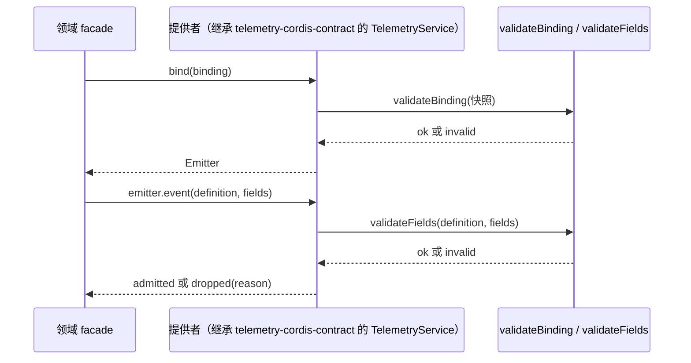

# 关键流程

本文件说明一条记录从发射到准入的路径。输出、排空与关闭的流程归 `telemetry-node`。

## 流程

1. 装配把提供者装成 `telemetry` 服务。发射方的行用 `ctx.telemetry.bind(binding)` 取得 emitter。
2. 提供者取得绑定快照，用 `validateBinding` 判定。绑定无效时，emitter 对每次记录答 `dropped(invalid)`。
3. 每次记录先用 `validateFields` 判定字段，再按提供者的采样、政策与容量判定准入。
4. 段由 `startSegment` 打开，由 `end` 结束。段内事件带段的 carrier。
5. 跨进程时，发送方把 `Segment.carrier` 交给接收方。接收方用自己的作用域重新 `bind`，把这个 carrier 放进 `links`。

## 失败与生命周期

- 任何一步的无效输入都答 `dropped(invalid)`，不抛错，并由提供者计数。
- 准入只是本地事实。之后的输出失败不改变已经返回的 `Admission`，只进入提供者的计数与 `CloseReport`。
- 段结束后的事件答 `dropped(closed)`。
- 关闭由提供者负责。关闭报告的四个确认边界见 SPEC.md TC-15。
