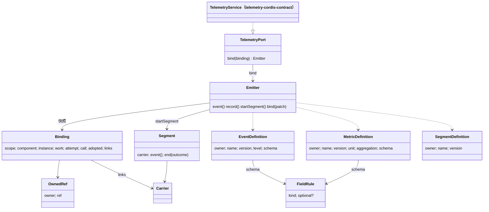

# 对象模型

本包是值包。它没有 class 层次。下面是公开值之间的关系。精确形状见 [public-api.md](public-api.md)。抽象服务 `TelemetryService` 在成员 `telemetry-cordis-contract`，图中用虚线表示它实现本包的端口。

## 对象与关系

- `Binding` 是一份关联值。`scope` 是 legal-identity 铸造的 `ActingScope`，其余成员是 `OwnedRef` 或 `Carrier`。
- 定义是冻结的值，由各领域在代码里声明。本包不登记它们。`schema` 的每条 `FieldRule` 可以带 `optional: true`，`Fields<S>` 随之把该键变成可省略。
- `Emitter` 持有一份绑定快照。`bind(patch)` 产生新的 `Emitter`，不改原对象。
- `Segment` 由 `startSegment` 产生，持有自己的 `Carrier`。
- `TelemetryService` 是唯一的 Cordis 服务定义，归 `telemetry-cordis-contract`；提供者继承它。本包只给它实现的端口类型。

## 生命周期

- 定义与绑定没有生命周期。它们是不可变的值。
- `Emitter` 没有释放操作。它不持有资源，随持有者一起消失。
- `Segment` 有两个状态：打开与结束。第一次有效的 `end` 使它结束，之后不再改变（SPEC.md TC-14）。
- 捕获替身的状态在 `createCapturingTelemetry` 返回的闭包里，`clear()` 把它恢复到初始状态。
