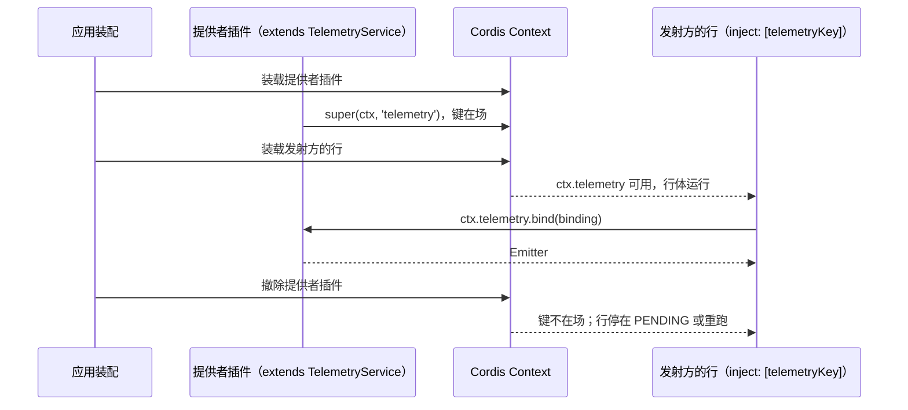

# 关键流程

本文件说明服务键从提供到注入的路径。记录从发射到准入的路径归 [telemetry-contract 的流程](../../telemetry-contract/docs/flows.md)，输出、排空与关闭归 `telemetry-node`。

## 流程

1. 装配装载提供者插件。`Service` 的构造函数用 `TelemetryService.provide` 登记键，提供者不另写键。
2. 发射方的行把 `telemetryKey` 写进 `inject`。键在场时行体运行；缺席时行停在 `PENDING`，装配把缺席的键写进状态记录。
3. 行体用 `ctx.telemetry.bind(binding)` 取得 emitter，交给成员已有的回调参数。之后的记录路径归纯契约与提供者。
4. 提供者撤除时键不在场。已经取得的 emitter 仍是不可变的值；它之后的记录由提供者答 `dropped(closed)`。

## 失败与生命周期

- 键缺席不是 no-op：遥测是必需注入（RFC-0013 D04），缺席是装配失败，由 `apps/harness-server` 的 A11 用例核对。
- 本包没有取消、恢复或资源释放。提供者的关闭报告归 `telemetry-node`，关闭步骤归应用。
