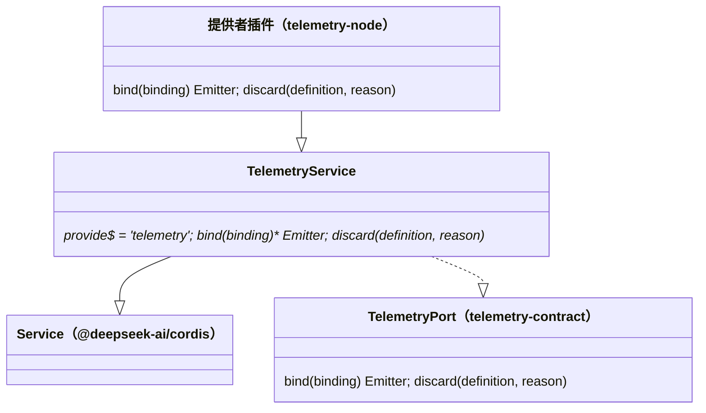

# 对象模型

本包只有一个抽象 `Service` 子类。它实现纯契约的端口；端口、emitter、绑定与定义的模型归 [telemetry-contract 的对象模型](../../telemetry-contract/docs/object-model.md)。

## 对象与关系

- `TelemetryService` 是抽象类。它的身份是键 `telemetry`，由静态字段 `provide` 给出，`telemetryKey` 取自它。
- `bind` 与 `discard` 是抽象方法，由提供者实现。`Context.telemetry` 的类型是 `TelemetryService`，所以消费者看到的形状与 `TelemetryPort` 相同。
- 本包没有别的对象，也没有状态。

## 生命周期

- `TelemetryService` 的实例由提供者插件创建，随提供者的 fiber 撤除。本包不创建实例。
- 实例不持有资源。运行时资源的创建与关闭归提供者。
