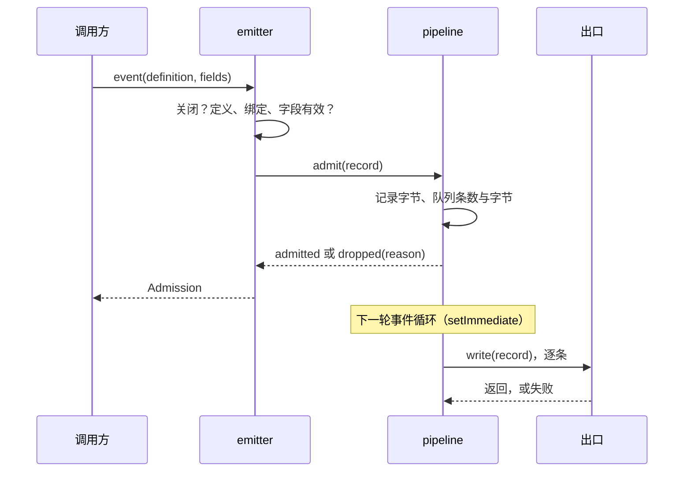
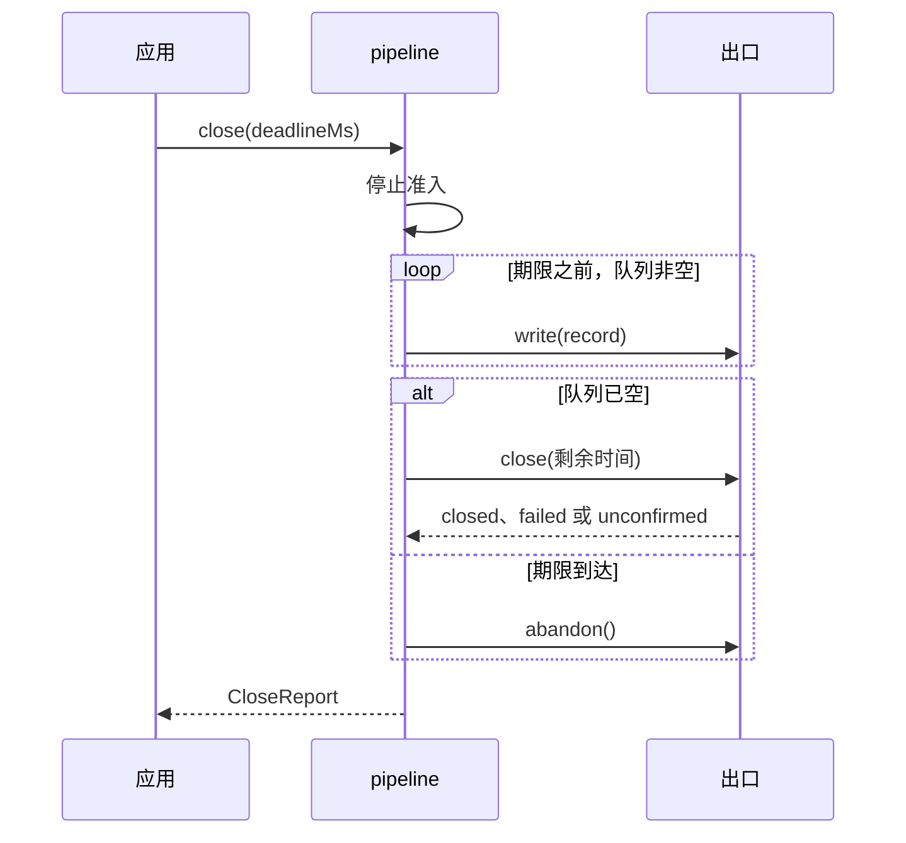
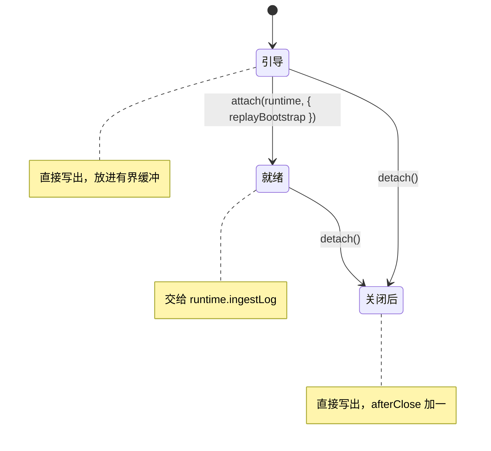
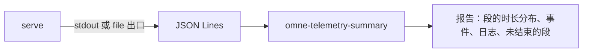

# 关键流程

本文件说明四个流程：准入到出口、关闭、日志桥三态、离线热点分析。行为条款归 [SPEC.md](../SPEC.md)。

## 准入到出口



1. emitter 先看运行时是否已开始关闭，再核对定义、绑定快照与字段（TN-2）。
2. pipeline 测量序列化字节，核对 `maxRecordBytes`、`maxQueueItems` 与 `maxQueueBytes`，入队后安排一次排空。
3. 排空时 pipeline 按准入次序逐条写出。写出失败计一次输出错误，并可能触发一条限频摘要（TN-5）。

前提：出口的写函数是同步的。数据来源是调用方的定义、字段与绑定快照。去向是应用的写函数或运行时持有的文件。

## 关闭



关闭只在第一次调用时进行，之后的调用返回同一个 Promise。报告的填写规则见 SPEC.md TN-7。插件的兜底关闭用期限 0，所以它不排空队列，只结束出口（TN-10）。

## 日志桥三态



- 引导：进程启动后，到 `telemetry` 行 ACTIVE 之前。`telemetry` 行 FAILED 或缺席时，桥停在这里。
- 就绪：应用在 `telemetry` 行 ACTIVE 之后调用 `attach`。运行时的出口不是桥的 `write` 时，用 `replayBootstrap: true` 回放缓冲。
- 关闭后：应用的关闭步骤先调用 `detach`，再关闭运行时。从这时到撤根，消息直接写出并计数。关闭期限耗尽时，撤根阶段的消息也走这条路径。

三个状态下，WARN 及以上的消息都到达某个出口。丢失只在 `write` 抛错时发生，并计入 `writeFailures`。状态的切换由应用驱动，桥不观察 Cordis 行的状态。

## 离线热点分析



热点分析在运维者本机离线进行，不在运行中的进程里聚合。聚合规则见 SPEC.md TN-11。

段级热点按下面的步骤找：

1. 取得记录。二选一：
   - 应用把运行时配置成 `file` 出口，记录写进一个文件。
   - 把 `serve` 的 stdout 重定向到一个文件。stdout 里的 `tree`、`row-state` 等装配记录不影响聚合，报告把它们计入 `skipped.otherKinds`。
2. 让 `serve` 正常关闭，使运行时把队列排空到出口（TN-7）。
3. 运行命令。安装了本包的环境里，命令名是 `omne-telemetry-summary`。在本仓库里，先构建本包，再在仓库根直接运行构建产物：

   ```sh
   pnpm --filter @omne-harness/telemetry-node run build
   node packages/telemetry/telemetry-node/dist/summary-cli.js telemetry.log
   ```

   没有文件参数时，命令从标准输入读：`node packages/telemetry/telemetry-node/dist/summary-cli.js < telemetry.log`。
4. 读表格。段按 p95 降序排列，第一行是 p95 最大的段。`failure` 列与 `unfinished segments` 行指出出错与没有结束的段。
5. 需要机读结果时加 `--json`。只看一个租户时加 `--tenant '{"organization":"org_…","account":"acc_…"}'`。只看一段时间时加 `--from` 与 `--to`（ISO 8601 时间，`from` 含，`to` 不含）。

`--tenant` 只筛选本机文件里的记录，不授予访问权限。报告不外传。

段级报告指出哪一段慢，不指出哪个函数慢。需要函数级热点时，用 Node 的 CPU profiler：

1. 在仓库根启动服务：

   ```sh
   node --cpu-prof apps/harness-server/dist/bin.js serve
   ```

   需要指定输出目录时，加 `--cpu-prof-dir <目录>`。
2. 运行要分析的负载。
3. 用 Ctrl-C 或 SIGTERM 停止服务。`serve` 处理这两个信号并正常退出，Node 在退出时把 `.cpuprofile` 文件写进当前目录或 `--cpu-prof-dir`。进程被强制终止（例如 SIGKILL）时，Node 不写这个文件。
4. 在 Chrome DevTools 的 Performance 面板里加载 `.cpuprofile` 文件，查看火焰图与自身耗时。

失败与限制：

- 输入里的非法行只计入 `skipped.invalid`，聚合继续。命令的退出码仍是 0。
- 输入文件打不开或读失败时，命令以退出码 1 结束，不打印报告。
- 关闭时没有写出的记录（`CloseReport.pending`）不在文件里，所以不进入报告。
