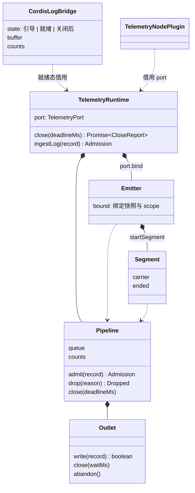

# 对象模型

本文件说明内部对象的职责、身份、状态与生命周期。本包用闭包与冻结的对象实现，不使用类，插件类除外。

| 对象               | 身份与状态                                                                      | 生命周期                                   |
| ------------------ | ------------------------------------------------------------------------------- | ------------------------------------------ |
| `TelemetryRuntime` | 由应用创建，一个实例对应一次运行时生命                                          | 创建到 `close` 完成。关闭后不再接受记录    |
| Pipeline           | 队列、计数、打开的段数、摘要时间、关闭的 Promise                                | 与运行时相同                               |
| Outlet             | `writer` 无状态；`file` 持有 SonicBoom 与最近一次写入的失败标志                 | 运行时创建时打开，关闭时结束               |
| Emitter            | 不可变的值，持有绑定快照与 scope 的记录形式。无效绑定共用一个丢弃一切的 emitter | 随持有者消失，不登记（IC-13）              |
| Segment            | carrier、trace 与 span、开始时间、第一次 `end` 的结果                           | `startSegment` 到第一次有效的 `end`        |
| `CordisLogBridge`  | 三个状态之一、引导缓冲、四个计数                                                | 应用创建，随根 logger 的 exporter 登记存在 |
| 插件类             | 每次工厂调用产生一个类，捕获交入的运行时                                        | 插件 fiber 的生命。effect 只登记兜底关闭   |

禁用实现是与 `TelemetryRuntime` 同形的对象，只有一个计数与关闭的 Promise。
