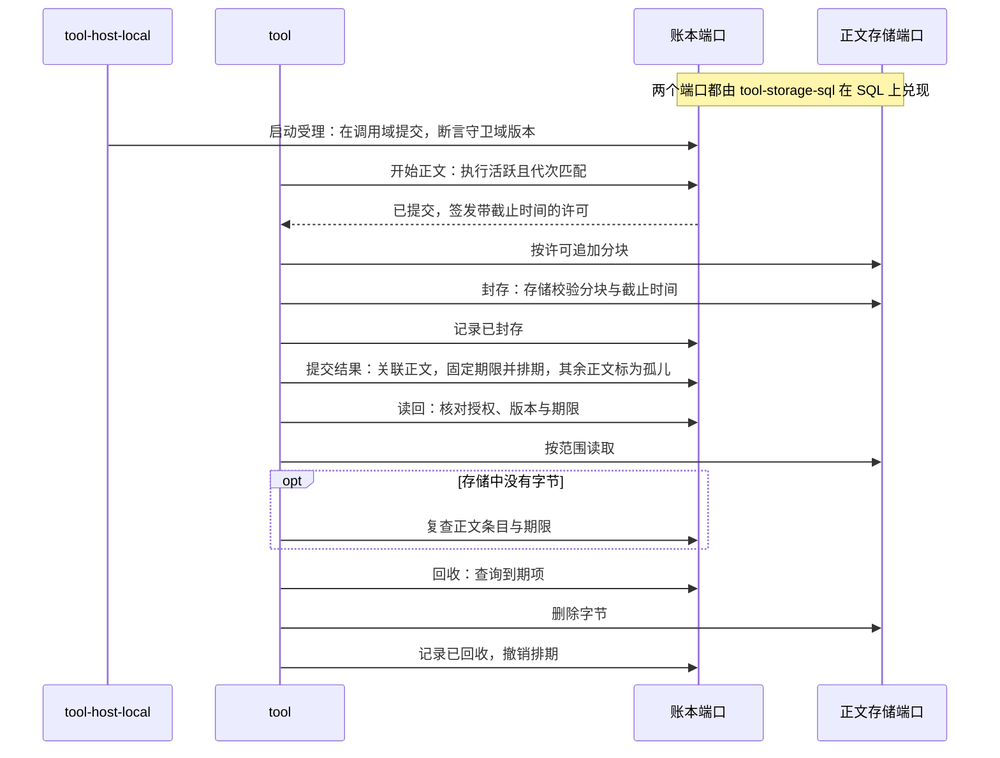

# 工具执行组的工程关系

本页维护 Tool 能力组的已接受设计。契约包已导出公开类型与契约函数，Cordis 定义包已导出服务定义。`tool` 已实现独立执行与部分 runtime 路径，`tool-host-local` 已实现本地启动协调器；单机宿主与组合验证尚未完成。

## 包分解与邻接协作

四个包按安装闭包划分。`tool-contract` 定义逻辑调用、真实执行、内部等待、控制、结果及执行账的契约，不含 Cordis 与实现。`tool-cordis-contract` 持有唯一的 Cordis 定义。`tool` 是不含 Cordis 的实现，`tool-host-local` 是单机宿主与插件。发起协调者与身份治理、环境、决策方和原消费方分别承担资格、资源及业务采用；程序消费方和动作桥接方通过公开行为组合，不以方法读取或连接成功代替动作准入。

本组不维护第二份状态机、错误集合或精确承接协议。领域级设计见[契约包架构](../tool-contract/docs/architecture.md)，内部机制见[实现包架构](../tool/docs/architecture.md#tool-内部实施规格)，插件装配见[单机宿主的 Cordis 集成](../tool-host-local/docs/cordis.md)，责任与事实归属见[领域角色](../../../docs/domains/tool-execution/architecture.md)。

## 结果卸载的工程分解

本节把[领域的结果卸载](../../../docs/domains/tool-execution/architecture.md#结果卸载)分解到四个成员，并规定与部署无关的原则。产品规则见[产品正文](../../../.meta_harness/design/product/tool-execution/design.md#结果保管卸载与模型采用)。端口形状、字段、错误集合和表结构归各成员的 SPEC 与源码。

本节是目标设计，尚未实现。成员 SPEC 中的[卸载与全文读取](../tool-contract/SPEC.md#卸载与全文读取)和[有限期正文保管](../tool-contract/SPEC.md#有限期正文保管)等条款仍描述当前实现。这些条款与本节冲突时，以本节约束后续改写。

### 成员分工

| 成员 | 承担 | 不承担 |
| --- | --- | --- |
| `tool-contract` | 返回声明中的正文格式、上限和预览方式；正文策略的语义；账本端口、正文存储端口和时钟端口的契约；部署参数的有效域与启动校验规则；两个存储端口的一致性套件和分步替身 | 任何存储实现 |
| `tool` | 结果管线：判定是否卸载、形成首屏、提交结果；正文条目的生命周期；作者的正文写入器；读回；按到期索引回收 | SQL；宿主事实的放置 |
| `tool-storage-sql` | 在 SQL 存储契约上兑现账本端口和正文存储端口：按租户分区、单域比较交换、条件提交、到期索引、不可变分块和封存清单、按范围读取 | 期限、授权和是否卸载 |
| `tool-host-local` | 每次调用的宿主事实放进调用域；租户级域只保存跨调用状态；启动受理以条件提交断言租户级守卫域的版本；宿主时钟兑现时钟端口的前提 | 正文保管与回收 |

作者只取得正文写入器，读者只取得读回入口，回收方只取得回收入口。作者一次写完整块正文时，同样走开始、追加、封存三步，不另设接口。

### 部署无关原则

契约面向分布式与异构部署。契约不假定账本与正文存储在同一个事务中，也不假定读取有快照隔离，或时钟完全同步。

1. 账本是唯一权威。只有账本提交能使正文可达。期限只保存在账本中：结果提交在同一次账本提交里写入结果的正文描述和到期索引。正文条目和正文存储都不保存期限。
2. 正文字节不可变，只属于一个结果。正文身份不复用，不跨结果共享，不去重。正文存储没有业务状态，所有操作幂等。同一序号写入不同内容时，存储以条件写报告冲突。
3. 写入许可有时限，由存储校验。账本确认调用的执行仍活跃、执行代次匹配且调用未结算后，才提交正文条目并签发写入许可。许可绑定租户、调用、正文和执行代次，带截止时间，由装配给定的密钥签名。存储校验许可的完整性和截止时间，拒绝超时的写入。封存先由存储校验分块齐全，再回到账本提交。存储报告封存成功，表示正文已耐久。
4. 按可达性回收。结果提交把引用的正文关联到结果，并按期限排期。调用结算把未关联的正文标为孤儿，并在宽限期 G 之后排期。回收先删除存储中的字节，再在账本中记录已回收。中途崩溃时重跑，结果相同。回收后不留行。
5. 读不到时复查账本。读回先在账本中核对授权、结果版本和期限，再从存储读取范围。存储中没有字节时，读回再查账本：正文已回收、已成孤儿或已进入到期窗口，答复已到期；只有已关联且明显未到期的正文，才报告完整性故障。存储读完后，读回再用本地时钟核一次期限，已到期就答复已到期、不返回字节，因此读取停顿多久都不破坏到期窗口。读回不使用页租约，每页单独判断到期，不续期。
6. 按调用放置。每次调用的事实保存在该调用的调用域中，包括启动受理、调用来源、交付状态、环境获取和控制对象。转发的接收副本保存在父调用域中，随父调用结果的交付释放。租户级域只保存跨调用状态，例如启动守卫和环境保留范围。热路径按键读取，不读取整个域。因此租户级状态的大小和每次调用的读写量都与已结算的调用数无关。
7. 条件提交可以断言同一租户分区中其他域的版本。启动受理在调用域提交，并断言守卫域的版本未变。这一个机制取代各处的专用守卫提交。
8. 到期索引是账本原语。账本提交可以排期或撤销排期，回收方按租户与时间查询到期项。到期索引是唯一的调度来源。
9. 部署参数由装配给定，启动时校验，不满足时拒绝启动：
   - ε：任意两个参与者之间的最大时钟偏差。每个参与者的时钟不递减，或回拨不超过 ε。
   - W：写入许可的时长。
   - G：孤儿回收的宽限期，必须满足 G > W + 2ε。
   - 正文的保留期限也必须大于 W + 2ε，否则到期清扫删掉字节后，仍在许可截止时间内的迟到写入会把字节写回。系统期限上限在启动时校验，作者声明的期限在声明受理时校验。
   - k：预览除数，默认 8。预览预算 P 取作者预览上限、系统预览上限和 ⌊L/k⌋ 中的最小值，L 是卸载的触发阈值。

由于时钟偏差，到期判断有一个双向窗口：在到期时刻前 ε 内的读取可能已被拒绝，在到期时刻后 ε 内的读取可能仍然成功。窗口之外的结果是确定的。跨过到期时刻的读取答复已到期，不报告完整性故障。

### 本地实现与契约

本地 SQLite 实现可以把存储的封存和账本的提交放进同一个事务，也可以把到期索引随账本提交同事务写入。这些只是优化，契约不依赖它们。本地实现的行为必须与分步执行相同，一致性套件同时覆盖分步执行和两步之间崩溃的情况。打开不兼容的旧库时，本地实现明确拒绝，不做迁移。

已知限制：调用永不结算时，它的正文不会成为孤儿，一直保留，并计入存活正文。

### 协作

