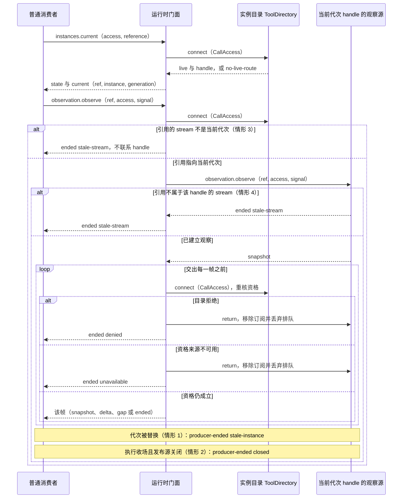

# tool/tool-contract 长期行为规格

状态：本页的 Tool 架构、公开契约、操作协议、对象模型与 Cordis 集成设计已接受。[公开入口的分组](#公开入口的分组)（D-03）与[公共流协议上的观察](#公共流协议上的观察)（D-10）属 [#626 revision 4](https://github.com/nemori-ai/omne-harness-lite/issues/626#issuecomment-6395260809) 的写回，其接受在该卡交付时记录。当前源码实现资产正文端口和契约函数，按[公开入口的分组](#公开入口的分组)分在两个入口。根入口的运行时导出只有调用与操作引用的编解码函数和两个身份解码函数（`decodeToolCallId`、`decodeToolOperationId`），类型导出是组外成员实际导入的类型及其声明的传递闭包。其余契约函数（定义判定、状态判定、呈现、可用性判定、作者注册、等待契约、默认参数 codec、结果渲染和结果投影）、其余身份解码函数、默认结果政策与 `toolBodyContract` 在 `./provider`。服务定义、服务键和事件增补在 `@omne-harness/tool-cordis-contract`。独立执行与 runtime 在 `@omne-harness/tool`，单机宿主在 `@omne-harness/tool-host-local`，实现范围见[组的支持范围](../README.md#支持范围)。与决策方的双边交接在该功能实施时细化，其他明确未定项与运行验证义务保留。

正文端口负责工具资产的读取与判定。执行、等待、结果保管和恢复由运行契约规定。

## 正文端口

`toolBodyContract` 登记类别 `tool`。调用方先用 `@omne-harness/assets` 的 `readBodyText` 读取正文。`judge` 不接受对象字面量，也不接受伪造的读取结果，并且不调用传入的函数。名字与能力名不一致时返回 `name-mismatch`。`composes.skills` 只变成 `skill` 身份引用，不成为必需依赖。判断失败时，声明和引用抛出，不返回结果。`pinBody` 保存当时的正文内容。验证命令是快层 `pnpm turbo run test:fast --filter=@omne-harness/tool-contract` 与慢层 `pnpm turbo run test:slow --filter=@omne-harness/tool-contract`。

`toolBodyContract` 已实现 `programmable` 的布尔校验与声明投影。只有布尔 `true` 产生声明项 `programmable`。省略或 `false` 不产生声明项。非布尔值以 `invalid-programmable` 拒绝，不按真值转换。运行时准入属于下文的[运行契约](#342-主干运行契约候选)：`programmable` 的准入检查已在 `tool` 的受理路径实现，证据范围与尚未覆盖的部分见[组的支持范围](../README.md#支持范围)；没有耐久或生产环境的证据。

## 用途、调用方与公开边界

本成员向发起协调者、独立程序消费者、程序消费方、程序执行方和动作桥接方提供工具定义消费和一次 Tool Execution 的行为。查询、观察、停止、撤回及许可内的转后台应可通过公开契约使用。Tool 不为调用创建或推进任何外部工作对象，后续工作由消费方按其规则决定。

本页用下列三个角色名区分使用工具的程序。Tool 不按它们是什么来分支，只按调用方式、可信来源和当前资格准入。

- 独立程序消费者：直接调用公开执行函数，不经 Tool runtime 的程序。它自己提供环境、执行者和执行作用域，见[独立函数与依赖](#独立函数与依赖)。
- 程序消费方：借助脚本或随带的资源使用工具的消费方。它的资源读取与脚本执行分别准入，脚本编排的调用另核 `programmable`。它是消费一侧，不是执行一侧：它的脚本由程序执行方运行，子调用经 `ProgramTools` 由程序执行方发起。
- 程序执行方：在受信环境中运行程序，并经 `ProgramTools` 发起子调用的角色。Tool 为它保存父子关联，见[程序组合协议](#code-与-tool-的组合协议)。

同一实现可以同时承担其中几个角色。

公开执行函数和运行时管理接口分别提供。纯函数或显式依赖的执行闭包可以只处理调用方给出的输入，不依赖 Tool runtime、外部工作对象、租户或存储，也不承担只在运行时层成立的持久关联、交接和治理保证。系统托管资源访问及需要接续的执行由实际集成方明确身份、授权、存储和运行时责任，不能把函数层独立使用当成省略这些责任的许可。内部解析、判定、投影、传输适配和执行者同样通过明确输入与依赖可替换、可单独取用。

本成员拥有原逻辑调用、真实执行、内部等待、控制实际结果、真实收场、原结果、效果确定性、执行账及相应交付状态。它不拥有共同资产治理、身份许可、环境设施、包装工具操作的业务对象，也不拥有消费方的工作终态或请求组装。调用某领域接口不直接写该领域私有状态。

根公开入口须可在满足显式依赖后独立使用。Cordis 装配在集成入口适配，同成员定义、行为和提供者不得因共同打包合并生命周期。本规格服从[产品](../../../.meta_harness/design/product/tool-execution/design.md)、[领域协作](../../../docs/domains/tool-execution/architecture.md)、[冻结成员规则](../../../docs/member-documentation.md)和已接受架构。

### 公开入口的分组

本节依据 [CP-15c 契约稳定审计 D-03](https://github.com/nemori-ai/omne-harness-lite/issues/732)（选项 A），由 [#626](https://github.com/nemori-ai/omne-harness-lite/issues/626) 写回。源码按本节规则分组：`./provider` 子入口导出提供者协议，Tool 组成员从它导入这些名字。导入扫描表列在交付 PR 的说明中，不进入本页。`tests/public-entry.spec.ts` 核对两个入口的运行时导出与「一名一入口」。

本成员有四个入口。`.` 是消费者入口，`./provider` 是提供者协议入口，`./binding` 是受信绑定读取器入口，`./testing` 是一致性套件入口。根入口的运行时导出只有组外成员实际导入的调用与操作引用编解码函数和两个身份解码函数（`decodeToolCallId`、`decodeToolOperationId`），其余契约函数、默认结果政策与 `toolBodyContract` 在 `./provider`；规则 6 规定了日后有组外消费者时怎样移回。四个入口都不导入 Cordis 或其他 Tool 成员。分组只改导出位置与导入路径，不改任何类型或函数的形状。

分组规则：

1. 根入口 = 有 Tool 组外导入者的名字 ∪ 这些名字的声明直接或间接引用到的名字。Tool 组外是 `packages/tool` 之外的包与应用，含它们的测试与示例。引用取传递闭包：根入口的每个声明在根入口内自足，不需要从 `./provider` 取类型。契约函数、品牌身份解码函数、默认结果政策、`toolBodyContract` 与 `describedAdoption` 按同一规则判定。
2. 不在上述集合里、只被 Tool 组实现成员（`tool`、`tool-host-local`、`tool-cordis-contract`，含 `tool-contract` 自己的测试）使用的名字移到 `./provider`。它们是提供者协议：由外部提供者实现的端口、提供者之间的协议记录、保管与账目的读写端口、装载与绑定登记表、执行者绑定与启动记录、作者适配与契约函数，以及只有这些名字引用的值类型。
3. 兜底：既没有组外导入者、又不被根入口声明引用的名字，属于提供者协议（作者装载、登记表、加载器、动态性纯函数）的进 `./provider`，其余进根入口。[公共流协议上的观察](#公共流协议上的观察)的名字（`ToolStreamSnapshot`、`ToolStreamDelta`、`ToolStreamEnd`、`ToolStreamSelection`、`ToolStreamReferences`、`ToolStreamObservation`）经 `ToolRuntime` 的传递闭包进根入口；producer `tool` 适配器 `toolStreamCallCodec` 与 `ToolHandle`、`ToolDirectory` 按规则 2 进 `./provider`（当前只有 runtime 门面与实例目录使用它们），组外消费者出现时按规则 6 移回。
4. 分组依据是导入扫描：对工作区内每个非 Tool 组成员的源码、测试与示例列出它从 `@omne-harness/tool-contract` 导入的名字（含 `import * as` 命名空间导入经属性访问用到的名字），再对根入口候选集合求声明引用的传递闭包。每次改变分组时，扫描表列在该交付 PR 的说明中，不进入本页。
5. 根入口不能为空；一个组外消费者需要的名字不能只在 `./provider`。两种情形都是分组错误，停止改变分组并交契约拥有者裁定，不以把该消费者改成导入 `./provider` 来通过。
6. 一个 `./provider` 的名字后来有了组外消费者时，把它移回根入口；根入口增加名字是新增，`./provider` 删除名字是破坏性变化，两者都走契约变更协议。
7. `./binding` 与 `./testing` 的导出不变；`./provider` 不导出 `./binding` 的读取器，也不导出任何 `./testing` 的名字。

`./provider` 与根入口共享同一份源码定义，不复制类型；一个名字只从一个入口导出。导入 `./provider` 的成员仍然可以导入根入口。

下列详细行为章节与本页操作协议共同构成本规格。

- [定义、可用性与发起](#定义可用性与发起)维护定义完整性、前提、匹配、排队及 dummy。
- [结果、过程与保管](#结果过程与保管)维护返回、过程帧、账目、可靠承接、卸载与消息消费边界。
- [等待、控制与恢复](#等待控制与恢复)维护前后台关系、内部等待、取消、故障及迟到。

## 共同不变量

1. 一个逻辑工具调用保留独立原身份和原用途。转后台、消费者替换和接续执行不另发一次原调用。
2. 原调用的定义、实现、参数、设置、获准 Context、授权依据、工作区、环境和资源入口相互匹配，发起后不暗换。
3. 已知、可用、获准分别判断。dummy 的归类见产品[定义、已知能力与一次执行](../../../.meta_harness/design/product/tool-execution/design.md#定义已知能力与一次执行)。真实原工具未启动。
4. 前台和后台仅改变调用方等待及结果交付方式，同一次 Tool Execution 的寿命、结果和费用责任不变。转换只从前台到后台，不返回前台，不释放仍运行的并发名额。
5. 调用方或最后句柄退出不取消执行，当前权限和工作状态在实际发起前复核。
6. 控制意图、受理、逻辑取消和物理停止分别可查，外部效果不因资源释放宣称可逆。
7. Tool 先可靠保管真实原结果，再进入执行后扩展和消息准入。消费者可先可靠承接或在 Tool 仍保管时先完成处理，两者按[结果专题](#先可靠承接再处理结果)兑现。业务拒绝不丢原结果，不重做效果。
8. 结果回原消费位置。Tool 不为调用创建或推进任何外部工作对象，后续工作由消费方按其规则决定；后台和已终态工作不自动指派给其他消费位置。
9. 可靠交接前原生产者保管，交接后消费者有足够接续依据，不留下责任空档或重复逻辑承接。Tool 不改写消费方的工作终态；一般后台结果仍有合法投递资格时，由消费方按其规则承接后继工作。
10. 工具全文不套用消费方的确认清理，不因消费方的压缩、归档、工作结束或已消费删除。
11. 查询失败不等于工具丢失。确认工具自身连续性丢失时，不自动重放，效果和费用未知如实表达。
12. 已确认持久事实经受进程崩溃、操作系统崩溃和断电。确认丢失按原身份对账。

## 身份、作用域与资格

进入运行时管理或访问系统托管资源的调用方声明真实主体、适用租户和组织归属、操作资源范围、原用途、消费和控制责任。工作区及调用方已有的工作关联在适用时保留，不能把任何一项外部关联当成同一步多个效果的唯一身份。独立调用保留自己的工作和调用身份，不生成不存在的关联。

访问系统托管数据与资源时，独立集成方兑现等价的身份、权限、环境和外传契约。工具可读 Context 与其他读取方可读的 Context 分别筛选。只给执行所需的输入和获准接口，不能给不可信代码原始 Cordis Context、全局容器或全部宿主数据。

执行前、观察、查询、取结果、消费及导出各自核对当前资格。历史写入授权不能永久授予读取权。成本资格按原租户及组织范围判断，不由账目访问放宽正文、附件和秘密读取。

## 必要持久事实与确认

下表列举本成员须能恢复辨认的业务依据，不规定 Schema、存储表或事件溯源方法。

| 事实范围 | 必须能回答的问题 |
| --- | --- |
| 原逻辑调用与采用依据 | 哪一次、谁发起、为哪项工作、采用什么匹配定义和输入，是否真实启动？ |
| 排队和发起状态 | 当前为何等待，是否仍有发起资格，实际启动或发出是否已经成立？ |
| 内部等待及答复 | 等什么，哪个原等待仍有效，什么有效答复已成立，是否有当前合法处理者？ |
| 控制意图和实际结果 | 谁对哪个目标请求何种控制，是否受理，执行是否真的停止，是否仍待控制或收场？ |
| 真实收场与原内容 | 前台返回还是最终终局，原因是什么，效果已知还是未知，原文和附件在哪里？ |
| 原位置及交接责任 | 内容由谁保管，消费是否已承接，恢复从哪里继续，取消是否已移除业务推进资格？ |
| 执行账和财务关联 | 实际时长、用量、费用、未知或待结算项，原调用和真实尝试是什么？ |

运行资源、订阅和句柄可以重建。权威事实与查询投影须标明来源和覆盖进度，不能凭展示缓存判定准入、终态或交接已经成立。恢复不能仅查消费方的日志，当前条件和原 Tool 状态各由其拥有者取得。

消费方日志依据的事实是调用登记、真实开始与收场、不可用，以及结果和消费位置已经保存，Tool 提供这些事实。排队、内部等待的逐步过程和过程帧留在本成员。消费者可靠保存后续需要的内容或引用，或者完成处理并可靠保存必要完成事实，本成员再解除交付责任。不设与消费方确认同形的工具确认，也没有到期清理。

停止请求和交付解除的最小对接是现行规则。稳定身份是原工具调用身份。托管访问把租户当作参数。缺租户或跨租户默认拒绝。样例见 [TL-F02](docs/flows.md#tl-f02)。两条解除路径见[可靠交接与处理的两条路径](#可靠交接与处理的两条路径)。

先保管后处理：消费者保存后续需要的内容或可恢复引用，以及原位置。耐久确认后可以解除对应的待交付关系。

先完成处理：消费者完成处理，并可靠保存足以恢复该结果和责任的完成事实。不要求再存一份不需要的原文。处理失败、处理中断或完成事实未知时，交付责任保持。

| 操作 | 关联身份 | 必要参数 | 成功 | 拒绝 | 未知 | 同身份重试 | 参数冲突 |
| --- | --- | --- | --- | --- | --- | --- | --- |
| 停止、撤回或转后台 | 原工具调用身份，加上这次控制的提交身份 | 租户、调用身份、控制种类；撤回另带必填的 reach | 请求已受理。受理不等于物理停止或已经转后台。撤回的 reach 不及目标调用提交时的关系时，控制仍然提交并返回回执，回执的进度为 rejected，原因 `out-of-reach`，调用不变。发起即后台的调用从受理起是后台关系 | 无资格，该调用不接受这种控制，或撤回的 reach 缺失、未知 | 按原调用身份和提交身份查询。不另开一次执行 | 相同提交身份返回原受理 | 同一提交身份改了目标、种类或 reach 则拒绝 |
| 解除交付责任 | 原工具调用身份和原消费位置 | 原消费位置，以及下面两条路径之一 | 该路径的保存成立后解除交付责任 | 所选路径的保存尚未成立。责任仍在 | 按原调用身份和原位置对账。未知则不解除，生产方继续保管 | 重复确认返回已解除或仍未解除的原状态 | 同一调用身份配上另一个消费位置则拒绝 |

对上述应保存事实的确认必须在达到普通进程崩溃、操作系统崩溃和断电耐久后发出。已确认多媒体内容的字节或可恢复引用也在此边界内。只指向短寿命沙箱、临时文件或即将失效地址不成立。物理介质可读取及部署满足声明存储条件是前提，介质损毁的灾后政策另待。

事实共同成立、单次受理、有效答复与等待更新、调用发起与当前资格、交接关系解除的精确提交边界由相关拥有者明示。明确未提交和提交结果未知分别处理。未知时使用原身份查询对账，不直接新建有外部效果的调用。

## 结果与失败范围

完成、失败、不可用、转后台、被中断、等不到应答是给调用方的语义结果。转后台是前台返回，不是最终执行完成。当前后台最终收场仅为完成、失败或被中断。完整参数解析失败不执行原工具，按失败说明；未收齐不解析。

能在本层按工具契约解释的结果以正常返回交付，不伪装系统异常。工具实现、资源或保管故障若不能在当前契约内收束，向其外层责任者上交身份、阶段和分类，保留原调用和未结责任。不能把“实现炸了”机械当成功返回，也不能把本层无法可靠保存结果转换成已经交接。

停止新准入、控制已发执行和撤销读取分别处理。关键准入、当前资格或必要保存不可用时，阻止依赖允许或确认的新动作。可选依赖或过程观察故障按实际范围降级。取消等待提交不证明远端回滚；框架 disposer 不证明工具停止或效果撤销。

## 并发、重放与恢复

同一原调用的重复查询、通知、控制和交接须能核对已发生事实，不重复逻辑承接或原账目。工具真实执行的效果是否去重，取决于具体外部操作协议；稳定身份本身不保证外部恰好执行一次。

并发控制、完成、控制、答复和消费者替换须在拥有者处裁定有效结果。原执行真实完成和调用方不再需要结果可以同时为真。不得为维持简化状态表把迟到真实完成改写成物理中断。

调用方换代后认回原 Tool；工具自身确认丢失后失败收束且不自动重放。新合法动作与恢复原调用分别记录。消费方已终态的工作只补允许的真实结果或费用，不复活推进。其余具体行为归[等待控制专题](#等待控制与恢复)。

## 旅程能力与验证入口

此表只定位产品要求、协作与本成员必要行为，不将图或设计文档作为实现证据。每个能力由目标定义判定支持程度，旅程用于验证其组合后果。

| 需求与架构流程 | 所属能力 | 必要专题与验证场景 |
| --- | --- | --- |
| [TL-J01](../../../.meta_harness/design/product/tool-execution/design.md#tl-j01)、[TL-F01](docs/flows.md#tl-f01) | CAP-TL01、CAP-TL02、CAP-TL03 | [TL-V01 定义与动态取用](verification/README.md#tl-v01) |
| [TL-J02](../../../.meta_harness/design/product/tool-execution/design.md#tl-j02)、[TL-F02](docs/flows.md#tl-f02) | CAP-TL02、CAP-TL03、CAP-TL04、CAP-TL07、CAP-TL11 | [TL-V02 发起与逻辑结果](verification/README.md#tl-v02) |
| [TL-J03](../../../.meta_harness/design/product/tool-execution/design.md#tl-j03)、[TL-F03](docs/flows.md#tl-f03) | CAP-TL04、CAP-TL05、CAP-TL10、CAP-TL11 | [TL-V03 等待关系与名额](verification/README.md#tl-v03) |
| [TL-J04](../../../.meta_harness/design/product/tool-execution/design.md#tl-j04)、[TL-F04](docs/flows.md#tl-f04) | CAP-TL06、CAP-TL10、CAP-TL11 | [TL-V04 原等待与决定](verification/README.md#tl-v04) |
| [TL-J05](../../../.meta_harness/design/product/tool-execution/design.md#tl-j05)、[TL-F05](docs/flows.md#tl-f05) | CAP-TL07、CAP-TL08、CAP-TL09、CAP-TL11 | [TL-V05 观察与原结果采用](verification/README.md#tl-v05) |
| [TL-J06](../../../.meta_harness/design/product/tool-execution/design.md#tl-j06)、[TL-F06](docs/flows.md#tl-f06) | CAP-TL07、CAP-TL09、CAP-TL11、CAP-TL12 | [TL-V06 全文与真实账目](verification/README.md#tl-v06) |
| [TL-J07](../../../.meta_harness/design/product/tool-execution/design.md#tl-j07)、[TL-F07](docs/flows.md#tl-f07) | CAP-TL03、CAP-TL06、CAP-TL09、CAP-TL10、CAP-TL11、CAP-TL12 | [TL-V07 控制取消与恢复](verification/README.md#tl-v07) |

共同耐久、资格、独立消费和外部效果验证仍由下节拥有。未核实状态在[同页能力表](../../../.meta_harness/design/product/tool-execution/design.md#能力定义与实现状态记录表)表达，[阶段承诺](../../../.meta_harness/design/product/tool-execution/design.md#阶段与版本支持承诺)已将 CAP-TL01 至 CAP-TL12 全部纳入 `0.0.0 → 0.1.0` 完整交付。该承诺不表示技术接受、运行支持或验证已经完成。

## 持续验证义务

本成员和实际组合须保留可复跑的针对性验证，结论绑定版本、环境、前提和未覆盖。所需证据包括以下范围。

| 验证责任 | 具体反例与必要结果 |
| --- | --- |
| 定义及发起 | 缺参数说明、help 不一致、schema 或实现更新、完整错误参数、半截参数。不得猜用法或执行半截，旧建议不得盲发。 |
| 资格与环境组合 | 一批批准尚未齐备，已批准动作被撤权；排队期间调用被撤回；所需隔离失败。不得借旧批准发起或退到宿主。 |
| dummy | 已知不可用和从未取得定义分别处理。dummy 不启动原工具，有原消费结果，不编用量。 |
| 并发与前后台 | 同范围同工具前后台共同计数、按顺序排队、转后台不改原执行身份、阈值不能扩大许可。 |
| 等待与控制 | Ask 长期等待、普通消息、无答案答复、重复或失权答复、调用方退出。不得超时批准或关闭仍有效原等待。 |
| 独立调用与动态采用 | 三份合法输入依赖齐全、缺失、恢复；旧调用与新定义并存；无外部工作对象的查询和停止。不得为调用创建外部工作对象或改旧函数。 |
| 原结果及交接 | 保存失败、提交未知、确认丢失、消费者替换、扩展失败及消息否决。原结果仍有责任者，不重跑效果。 |
| 后台与终态 | 消费方的工作已终态，后台结果转换失败；调用被撤回后真实结果到达。不得改旧终态、造后继工作或恢复入队资格。 |
| 全文及附件 | 卸载摘要、机械首尾、分页新调用、消费方压缩或归档后的取回、地址失效。不能留空链接或套消费方的确认清理删除。 |
| 失联与效果 | 查询不可用、仅调用方丢失、Tool 自身确认丢失、外部提交未知。不得从查不到推断未执行或自动重放。 |
| 账目与观测 | 重复通知不重计；新调用真实计量；费用迟到、未知；账目读取与正文权限分别核对。 |
| 耐久与安全 | 进程崩溃、OS 崩溃、断电、附件唯一副本、恶意代码和外传。证据覆盖声明的故障与隔离，不能只靠 mock。 |

真实外部效果、控制和隔离缺环境时报告无法验证。长期查询、结果分页、重连快照和排队须有资源边界；具体规模、时间和成本目标仍由相关契约与性能设计明确，不能以“点查询”声称任意全文常数成本。

## 实施前缺项与维护

停止请求和交付解除的最小对接见[必要持久事实与确认](#必要持久事实与确认)。稳定身份是原工具调用身份。公开类型及校验规则见 [public-api](docs/public-api.md)，完整操作、跨提供者提交和恢复协议见 [protocols](#tool-操作协议)，OOP 与依赖见 [object-model](docs/object-model.md)。这些契约的实际提供者仍须验证。需要持久接续的等待，须明确哪些状态可以恢复和如何判定自身丢失，不能从一个工具函数的异步形状推断已有恢复能力。

最终结果的文本、内容 ref 与附件地址分流归 [P14](#p14-附件引用与消费方交付)。共享值迁移和提供者验证由共享内容块拥有者继续跟踪，不再把这两种路径记为产品来源缺证。任意嵌套容器未获准。过程在途内容的故障保留仍需技术兑现。

[RFC-0012](../../../docs/rfcs/RFC-0012-tool-dynamics.md) 采用的对象链、会话常驻规则、G7 与换代协调者已写入本页。类型变更清单第 1–7 项与纯函数 `deriveDefinition`、`shapeOf`、`planAdoption`、`refreshAvailability`、`foldResident` 在源码中实现：源码导出 `ToolGovernance`、`ToolImplementation`、`ToolAuthority` 与带 `layer` 的可用结果。登记表与协调者的本地实现归 2.4，动态性套件的用例体归 2.5。[公开入口的分组](#公开入口的分组)与[公共流协议上的观察](#公共流协议上的观察)的源码已按两节实现。按键排空与交接依赖 [P09](#p09-账目恢复与退出) 的 `inspectDrain({ executor })` 范围。该范围交付之前，协调者在有在途调用时停在 `draining`。

修改定义、调用匹配、结果保管或控制协议时同步所有消费方、环境、决策方、程序消费方、动作桥接方、Context 和相应验证。提供者补自己真实承担的机制与限制，不另写一份更弱的公共保证。独立执行与 runtime 的部分路径已在 `@omne-harness/tool` 实现，范围见[组的支持范围](../README.md#支持范围)。耐久存储与故障测试尚无。本规格不授予实施或符合性接受。

## 主干运行契约

本节规定 Tool 的运行契约。精确类型归源码 [src/index.ts](src/index.ts)，[public-api](docs/public-api.md) 是源码导航，独立执行函数和 runtime 工厂的签名导航见 `@omne-harness/tool` 的 public-api（`tool/docs/public-api.md`）。消费及失败场景归 [context](docs/context.md)，对象模型与装配分别归 [object-model](docs/object-model.md) 和 [cordis](../tool-cordis-contract/docs/cordis.md)。

当前生产根入口导出资产正文端口、全部公开类型、品牌身份解码函数、默认结果政策和契约函数。契约函数只做同步的判定、构造与投影。下述独立执行函数与 runtime 在 `@omne-harness/tool`：独立执行已实现，runtime 只实现了一部分路径，托管结果处理的其余部分尚未实现，范围见[组的支持范围](../README.md#支持范围)。Tool 运行时的系统架构见[工具运行时](../../../docs/architecture/runtime/tool-runtime.md)。

Tool 拥有一次原调用、真实执行、等待、控制、原结果、效果与交付关系。它不替被调用领域写私有状态，不拥有消费方的工作终态。前台转后台改变等待关系，仍是同一执行。全文保留与待交付关系分开，下面没有消费方确认或按其规则清理 Tool 全文的操作。

### 值、定义和固定请求

所有代码块组成同一设计声明。品牌身份防止混用，不代替租户和当前资格核验。`P` 是身份拥有者交付的可信输入；`R` 是普通函数的返回值类型；`B` 是当前具名结果政策允许的块类型。提供者必须验证真实值，不能通过泛型参数声明某种块已经获准。

[本节设计定义](docs/public-api.md#值定义和固定请求)。

Adoption 与 DurableEvidence 分别是精确采用和耐久事实引用，摘要只证明内容一致，不证明资格。提供者能按引用恢复完整原采用，不能只保留一个可能失效的地址。ConsumerRef 是消费拥有者登记的稳定位置，调用方已有的工作关联另由受信适配器核验并随原调用保存。ResourceScope 是 `{ owner, key, grant }`，没有种类：范围拥有者授予 key，grant 是这次授予的耐久证据。准入提供者对每个接受的范围拥有者声明一个核验器，核验 grant 确由该拥有者授予当前租户和调用方，缺失、属于他方或拥有者没有声明核验器回复 denied，核验器不可读回复 unavailable，调用者不能换键绕过限流。

Tool 的这些类型由 Tool 自己拥有，不导入消费方的身份或确认类型。跨成员引用在实际适配处逐项映射。相同字段形状不代表可以跳过原记录、租户或来源检查。

定义继续采用现有资产名称和正文规则。函数参数 Schema 的每个参数有说明；多命令清单的每项有名字与一行说明，声明详细参数时也须完整。统一 inspect 返回合法定义、可用性、命令清单及可取得的详细用法；help 使用同一固定采用，不能自行编另一份 Schema。executor-owned 表示由执行者判断参数，不表示任意参数总是合法。

原参数和扩展后生效参数均按原始 JSON 文本保存，使用 json-text 做无重复键的完整解析。complete=false 或解析失败不得启动真实工具。known-unavailable 在托管身份及目标核验后不解析参数、不创建原执行资源，直接形成带原因的不可用结果；这一规则不让调用者绕过租户检查。缺乏任何合法旧定义的目标不构造 dummy。

并发上限必须为正整数，时限为非负有限整数。未声明且无合法配值时为 null，不擅自设生产默认。后台许可来自作者定义，设置只能在许可内选择阈值。固定 settings 与 limits 必须一致；后续设置变化不重写旧执行的采用。实际资格收窄仍立即约束新的受保护动作。

`programmable` 的定义与默认行为归[定义专题](#可编程调用的定义与准入)。`ToolDefinition` 保留可选字段，不将未声明改写成作者显式声明。原始正文适配器须校验字段类型，`ToolBindings.inspect` 返回匹配实际定义采用的值。`ToolAvailability` 描述一般可用性，不因不支持脚本编排就把直接调用也标为不可用。

`FixedToolRequest.invocation` 必填，区分直接调用与脚本编排。`source` 由受信发起协调者保存，能核对当前主体、租户、目标工具、原 call/operation、调用方式和实际发起位置。脚本调用另关联原脚本执行及子调用位置；不要求独立调用虚构外部工作关联。ToolCommands 的准入提供者核对来源与实际受信入口，不能信任脚本提交的 kind 或摘要。来源缺失或类型非法返回 invalid，来源伪造或与入口不符返回 denied；必要来源不可读返回 unavailable，不回退为 direct。

已知不可用定义仍按既定 dummy 协议返回原不可用结果，不启动原工具。可用定义在 programmatic 路径未显式许可时，admit 返回 unsupported，adoption 指向所核定义，reason 说明不支持可编程调用，不创建已受理执行。相同 call/operation 更换 invocation 或 source 属于 conflict。未知提交仍按原身份对账，不能改成直接调用重试。普通直接调用不要求 programmable，但仍核对其受信来源及原有资格。

许可检查与现行启动围栏共用排序。已经受理但尚未启动时许可撤回，prepareStart 返回 unsupported 且不产生启动意图。若启动意图已保存而真实调用尚未发出，最终启动围栏仍须拒绝。没有启动记录时，当前宿主先取得 authority.exclude 对整次待发调用的排除，再调用 rejectPending；已有启动记录时调用 recordStart(rejected)。两者同提交永久拒绝、排除依据和 settle 待办。exclusion 须证明原调用及全部延迟启动均未执行且已被排除；启动意图存在不等于实际已启动，一次拒绝应答、连接失败或查不到句柄也不构成排除证明。

拒绝记录与启动在同一排序域裁定。先实际启动则不能写 rejected，按在途控制处理；无法排除实际或延迟启动时仍保留 unknown 并对账。rejected 成立后，原调用永久禁止 start 或 resume，即使后来重新允许 programmable，也只能另发新调用。记录确认未知时按原 operation 查询，不先收场或重试执行。

首次启动被拒绝时，当前宿主随后以 preserveResult 保存 unavailable 终局、原因及 effect=not-started，再完成原结果交付和资源释放。resume 被拒绝则保存 interrupted（cause 为 resume-rejected，携带排除依据 exclusion）及此前真实效果，不能声称整次调用未启动。该操作核验原 startRejection、未启动排除依据和当前写资格，允许从准备、排队或已持有启动意图但未执行的状态收场，不能改写取消或其他已成立终局。loadRecovery 返回 startRejection 及 settle 待办；崩溃恢复只续做结果保存与交付，不走 inspectStart(not-started) 所允许的首次启动。保存未知继续认回原操作，确认前不声称结果已交回，也不遗失原环境与名额的释放责任。已启动执行保留原 invocation 与定义采用，控制及安全 resume 仍按原协议，不能以定义更新重发原动作。

### 返回与执行事实

[本节设计定义](docs/public-api.md#返回与执行事实)。

调用准入失败属于 ToolFailure；已经形成原逻辑结果的参数失败、dummy 不可用、执行失败、中断或等不到资源应答属于 ToolTerminal，供消费者正常处理。失败不推导效果未发生。后台占位不属于 ToolTerminal，已开始的后台执行最终不能是 unavailable，也不能再次返回后台占位。Ask 没有 deadline，不使用 no-response 表示决策方没有回答。

工具作者通过显式普通返回或结构化返回入口选择语义。普通返回整个值先经固定 OutputCodec 与 ToolOutputCustody 保管，再经 TextRenderer 转文本，生成一个人和消费方均可见的 text 块。转换失败形成 result 失败，原返回事实仍由提供者以可保管表示保存，不能隐式吞掉它；作者须提供能够完整表示其返回类型的 renderer/codec。只有结构化入口允许 original 与 attachments，不能靠探测某对象是否有 content 字段推定它是 ToolResult。

原件引用包含原大小、摘要与存储键。只有内容及所需保留达到耐久后，才报告 offloaded。分页结果的 next 绑定 call/result/原读取范围，不得换版或静默扩大字段。现有工具全文无到期回收政策，释放 delivery、消费方的工作终态、归档、压缩或确认均不改变保留义务。

ResultPage.source 由 Tool 原结果保存操作产生，定位租户、call、精确结果版本、delivery 及实际来源。相同版本各页使用同一来源。消费方将其交给原消费者的受信参加者验证，不自填摘要证明结果真实。读取此证据不自动授予解除 delivery 或读取其他版本的资格。

`B` 由具名 ResultPolicy 验证。供消费方直接感知的许可集合及附件地址投影归 [P14](#p14-附件引用与消费方交付)，不把 ContentBlock 库存当许可，也不发明递归容器。提供者缺能力时保留原结果与失败原因，不重跑工具、不删除原件。共享 ref 尚未实现，由共享内容块拥有者跟踪。

### 普通操作与实例目录

本节的来源重入与公开控制修订依据为 [#547 D-02 技术采用](https://github.com/nemori-ai/omne-harness-lite/issues/547#issuecomment-6287849458)。

[本节设计定义](docs/public-api.md#普通操作与实例目录)。

普通调用方先保存完整 consumer 和固定 `ToolInvokeRequest`，再以 `ToolRuntime.invoke` 提交当前主体、合法租户和请求，不提供 call、operation 或 invocation/source。runtime 在首次异步等待前复制并封闭校验请求，再调用 `ToolInvocationSourceIssuer.resolve`。关联键是合法租户的 organization/account 与完整 consumer 的 owner/work/position/purpose。来源原子地检查该键、分配并保存 call/admission、原请求和原主体，不先异步分配再插入。索引属于同一来源事实，不是另一张定位权威。programmatic 子调用继续沿原 reservation/child/admission 的内部协议进入。

resolve 先核当前主体对合法 tenant/consumer 的资格，再访问关联。已有记录须先核稳定主体相同，再比较完整规范请求；摘要只辅助比较，不代替授权或完整绑定。同键同请求认回原身份与原来源，同键异请求向有权者返回 conflict，关联原 admission，不分配新身份。异主体、撤权或伪造 tenant/consumer 统一拒绝，不通过 conflict 泄露原记录。刷新凭据但主体相同可以认回。来源保留原主体，配对 guard 用同一 authority 比较当前与原主体，并核对租户、call、admission、完整固定请求、真实入口与原证据。ledger 仍核当前主体的调用与 scope 授权。资格或主体比较不可用、抛错均不能放行。

来源记录为 reserved 或 issued。reserved 已固定身份，按原 reservation 幂等签发；issued 重入不重新签发。原键的在途提交必须先消解，或取得可靠排除，不能以空读再次分配。身份不得复用，包括提供者重启。任何 await 后写入前须重读并认回赢家，不得覆盖并发提交。来源返回值和签发阶段见 [ports.ts](src/ports.ts)。生产提供者须证明原子唯一、旧写排除及重启边界。

`accepted` 返回原调用引用、原受理状态回执与 recovered，后者为来源或 admission 认回的逻辑或。lookup 返回当前权威状态，不能覆盖原回执。`association-unknown` 无引用，表示关联可能落地但暂不能证明原身份；调用方保留原完整意图并重复 invoke。`commit-unknown` 带原引用，表示来源签发或 admission 尚未知；lookup 的 not-accepted 不足以证明原来源不再续做，仍沿原 invoke 接续。resolver 抛错或返回不合法身份时保留 association-unknown，后者是提供者违约。已证明原引用后 admission 抛错保留 commit-unknown。

`rejected` 只描述当前尝试的确定失败，不证明历史上没有关联或受理。来源已建立后的准入拒绝不删除关联、不永久缓存拒绝；依赖恢复后重入沿原身份继续。原 scope 或其他固定输入不能更新，要新执行或修改意图须登记新 consumer。未知时不回收原键。不承诺外部效果 exactly-once。

原受理回执为 accepted 时首次唤醒宿主。认回后只用当前 lookup 判断是否补 wake：仍待启动则补，已 running/settled 不补，查询未知允许保守补 wake。查询失败不撤销原 accepted。宿主按 tenant/call 归并待处理或并发 wake，driver 保持启动唯一。内部 admit 尝试次数可以多次，唯一受理事实、队列责任和真实启动分别观察。唤醒失败不回滚受理；当前 tool 实现依赖调用方重入，不承诺无人重入的自动扫描。共享内存来源只有非耐久单进程证据。

普通接口由 `queries`、`commands`、`instances`、`observation`、`content` 和 `catalog` 组成。`instances` 是引用读面 `current`，`observation` 是公共流协议的观察面，两者见[公共流协议上的观察](#公共流协议上的观察)。queries 的 lookup 用调用引用内的原 admission；queryOperation 用操作引用内的原 operation。commands 只有 control 和 releaseDelivery。control 的成功结果为带操作引用的 `committed`。releaseDelivery 为每次意图分配 operation，成功返回 `released` 及原生产者耐久回执，不附本次操作引用，也不承诺本次新增操作记录。首次释放与已释放后的重入使用同一成功形状。两者的未知结果为带原操作引用的 `commit-unknown`，拒绝为 `rejected`。回执未知后用原操作引用查询提交结果，不自动重发。`not-committed` 或 `rolled-back` 只否定这次操作，不证明交付仍 pending。可靠否定后，调用方可以明确再次 releaseDelivery，取得已有释放回执。unknown 或不可读时继续保留未知。lookup 用原 admission 定位并返回当前权威 ToolState，其中的 delivery 可用于认回已有释放。invoke 的 state 才是受理时回执。readProcess 当前未支持，ResultPage 不含 DeliveryState。acceptDecision/acceptResource 留在受信内部端口。每次合法公开 control 都先分配新的 operation，再委托内部 commands.control；同参数重发不是原操作认回。调用方持有原操作引用时应先 queryOperation 对账，引用丢失时本协议没有按控制意图找回的能力。新的 committed 不证明旧 unknown 已完成。新 stop 不撤销旧 stop，新 withdraw 以其提交时的 reach 和关系判断。当前真实 ledger 仍返回 unsupported，此时身份已消耗但没有控制事实，门面返回 rejected/unsupported，不暴露已登记操作。

`ToolInvocationRef` 和 `ToolOperationRef` 是独立字符串品牌，版本 1 分别编码为 `["tool-invocation",1,tenantText,call,admission]` 和 `["tool-operation",1,tenantText,call,admission,operation]`。tenantText 采用 legal-identity 的 tenantCodec，其他身份沿现有身份词法。codec 只接受固定数组长度、标记与版本，总长度最多 1668 个 UTF-16 code units。编解码不读存储、不生成业务身份；编码生成规范 JSON，解码允许同结构的非规范空白并返回规范值。失败为 type、version、shape 或 length。引用不含 principal、instance 或 generation，不授予权限、不证明调用存在，也不创建第二张持久定位表。

每次引用访问先解码并用 tenantEquals 与当前合法租户比较，跨租户或伪造租户回复 denied，不进入底层端口。底层端口每次核当前 principal 与撤权。持久查询、内容和交付不依赖 catalog 或实例目录。`instances.current` 仅提供实时观察的当前引用，unavailable、`current: null` 与 unsupported 保持可辨。放弃引用或观察不取消执行，旧代次的观察以 `producer-ended`/`stale-instance` 结束。

宿主通过 `ToolInstanceIdentities` 取得实例身份，并显式传给 `ToolDriver.run`。同一存活实例重复唤醒沿用身份，不由 runtime 工厂固定全局 instance。当前固定 generation 的实现限制不构成 claim 或换实例接管能力。

每项操作核验当前身份、显式 tenant 及该资源动作。内容、观察、成本、控制和交付解除分别授权。已知名称、历史句柄或已受理事实均不是永久权限。异常仅用于程序缺陷，预期错误用 Reply。signal 只终止相应观察，不取消真实执行。

| 操作 | 成功、顺序及重复 | 拒绝、未知和责任 |
| --- | --- | --- |
| inspect | 返回当前合法选择或已知不可用旧形状；command 合法时包含已声明用法 | 从未合法取得的定义不泄露；不能为维持同形读取撤权后的新正文 |
| admit（受信内部端口） | 同提交固定输入、当前资格、原 consumer、原调用和待调度责任。同 call/operation/输入认回 | 异输入 conflict；未知按原 operation 查询。受理不等于环境就绪或真实启动 |
| lookup/queryOperation | 原事实与精确操作分别查询；不以目录无活体判未执行 | not-committed/not-accepted 需要 Storage 完整排除证明；不可读返回 unavailable |
| control（受信内部端口） | 同一 operation 与固定输入同提交保存原控制意图及续做责任，重复认回；stop、withdraw 和 background 不换 call；withdraw 的 reach 必填且无默认值，并在提交时与目标调用当时的关系比较 | 控制方不在其控制责任范围内、不许可后台或正在 Ask 时拒绝转换；撤回的 reach 不及目标当时的关系时，控制已提交，回执进度为 rejected，原因 `out-of-reach`；停止与撤回受理不声称实际停止 |
| acceptDecision（受信内部端口） | 核决策方对原请求的唯一有效决定与原 wait，答复、等待变化和后续责任同提交 | 无答案是合法决定的一种，不能视为授权；重复不重复执行，冲突及失效登记拒绝 |
| readResult | settled 后按原版本分页，当前资格每页复核；releaseDelivery 后仍可读全文 | 暂不可读不伪造不存在；地址失效报告保管故障，不能重执行原工具 |
| releaseDelivery | 原结果/位置/关系及两条证据之一共同验证后释放指定交付关系 | 未保存或完成未知保持 pending；不同位置 conflict；未知提交认回，不删除全文 |
| account | 原租户费用、用量与未知按修订返回 | 不连带披露正文/附件；多次读取不重计费 |
| current/observe | `current` 按原调用引用给出当前过程流的公共引用与权威状态；`observe` 按引用先交一致快照，再交从该观察者上一游标起的增量（[公共流协议上的观察](#公共流协议上的观察)） | 旧代次引用以 `producer-ended`/`stale-instance` 结束，不静默跳后继；gap 后不续读，重新取快照；观察者退出不撤独立 Tool 宿主，也不取消执行 |

### 独立函数与依赖

[本节设计定义](docs/public-api.md#独立函数与依赖)。

独立函数不造租户或外部工作对象，不持久重试。A/R/E 由独立消费者选定，显式提供环境、执行者及 ToolExecutionScope。A 是业务参数，E 是受限业务依赖，execution 是本次执行的输出、等待和取消能力。访问托管资源时，传入的 E 必须是已经限权的能力集合。不能把 Cordis Context、全局服务容器或全部宿主环境传给不可信代码。`executeTool` 不接收工具定义，不承担 programmable 检查。脚本只能取得经过受信桥接和 Tool 准入的调用能力，不能直接取得托管工具的 executor 来绕过许可。execution.signal 请求执行者停止，效果由实际执行者说明，关闭 Promise 等待不构成逆转。独立上下文的支持、回执和失败边界见 [P11](#p11-作者输出与等待原语)。

TextRenderer 是普通返回的转换接缝，其完整语义和实现采用随 executor 固定。String(value) 或 JSON.stringify(value) 不能作为所有 R 的无条件默认；循环结构、精度丢失或无法表达的值必须显式拒绝。结构化作者直接使用 ToolResult<B>，经过独立 ResultPolicy 及附件保管校验。两种入口都不可绕过实际效果与必要事实保存。

ToolCommands 隐藏本域提交、当前资格、队列与保管机制。它只接受具名操作，不提供任意事务回调。scanPending/loadRecovery 使恢复者可以只经公开依赖取得原采用与未完责任。WriteContext 的代次不自证权限，提供者核验受信通道及当前实例绑定。晚到费用/效果用不依赖旧代次的 recordLateFact，只有核实来源和原归属的当前补录者可调用。

### 发起、队列与环境协议

admit 同提交固定当前身份、合法定义/执行者匹配、实际调用方式与来源、调用参数、原消费位置、完整批判断依据及待办。明确是 dummy 时只形成不可用结果和真实替换件处理账目，不进入真实环境和队列。实际工具先准备环境，再按资源 scope 与工具身份进入队列。环境准备失败不退到更宽松宿主。

enqueue 保存唯一顺序，不以当前内存队列决定先后。同一 scope 的前台、后台和内部等待共用名额；每个 scope 按自己固定的 concurrency 与同一 FIFO 规则工作，null 表示没有数量上限但仍服从资源提供者容量准入。队列容量不足时，新的受理可以在承诺前拒绝；已经受理的超额并发按序等待，不能当执行失败。

prepareStart 按 [P02](#p02-定义准入与队列) 的对账保存核对队首/名额、未取消、未记录 startRejection、原定义与实现匹配、当前调用方式许可、当前推进和业务资格、授权与原批判断适用性：队列域裁定并持有名额，调用域保存唯一启动意图，两者由同一操作身份对账，不是一个跨域事务。真实 executor 调用前还须进入与相关撤权、撤回、控制、推进代次变化共用的启动围栏。先资格变化则不启动；先启动则按在途控制处置。占位与外部效果不能同一 SQL 原子提交，recordStart 未知时查询原身份，不再次调用 executor。

实际发起不重跑已经完成且仍适用的扩展。决定所依据的参数、定义或动作发生变化时，旧批准不能沿用，交原协调者重新判断。有效判断不齐不能启动其中已批准的部分。批判断引用由其拥有者验证，不能由 Tool 自报整批已准许。

名额只在真实执行收场，或准备、排队及启动意图阶段可靠排除执行并因取消或 startRejection 收场时释放。拒绝路径沿本页 preserveResult 保存终局及待交付责任，不因返回 unsupported 就提前释放名额。后台化、Ask、调用方退出和观察断线不释放名额。宿主持有环境对象，结束后释放仍属于本执行的资源；释放不删除保管所需附件，也不声称外部效果可撤回。替换宿主先排除旧实际执行能力，不能只换数据库代次。

### 等待、计时与接续

前台累计时间由耐久的累计量及当前计时段决定。进入任何内部等待前保存累计量，内部等待期间不累计；退出等待后新段从实际恢复点开始。后台关系不累计前台时间，重启不把累计量归零。时钟倒退或来源不可用报告故障，不能增大剩余上限。跨进程恢复需要宿主可验证的持续时间来源，不能直接相减两台不相关的单调时钟。

达到 foregroundMs 时，许可后台且当前无 Ask 则保存同 call 后台关系与前台占位（占位来源为 foreground-limit），否则保存停止意图（终局原因记 foreground-limit），实际停止另查。Tool 自己发起的这两种转换也经同一 control 命令提交裸 `background` 或 `stop`，ControlRecord.source 指向 Tool 自己的计时证据。backgroundAfterMs 是偏好阈值，同样不越过作者许可或 Ask，占位来源为 threshold。重复转换认回原控制，已经后台不产生第二占位，不能回前台。

ToolState.foreground 保存已经确定的前台返回。转后台时与原转换共同固定 background 分支，后续收场仍保留该占位事实；始终前台时在可靠保存逻辑或真实终局后固定 final；逻辑中断可以早于物理结束，之后的真实结果另存晚到版本。占位的 source 记录后台的来由：launched 表示发起时就在后台，control 带原控制的操作号，threshold 与 foreground-limit 是 Tool 自己的计时结果。该 source 由 Tool 为该权威状态产生，能核验原转换和消费关系，供消费方保存一次后台占位。lookup 返回此耐久事实，不依赖活体 observe 才能恢复；占位只解除本步前台等待，不解除最终结果 delivery。

openWait 要求前台且未收场，先保存原 WaitIntent、接续依据和登记任务；ensure 认回决策方对原请求的登记后 attachRegistration 保存关联，才能报告 Ask 已开放。Ask 不设置超时，不提供默认答案。acceptDecision 通过决策方核验原请求的唯一有效决定，再与原等待和后续责任共同提交；no-answer、declined 和明确 answer 分别处理；批准的含义由相应授权解释者判断，不由 Tool 猜测。控制或撤回可使等待失效，不能把取消填成答案。

后台不开放需要答复的 ToolWait。resource 分支是有具名期限的资源应答协议，不是普通 Promise 调度；尚在此等待时转换后台须先由原资源协议结束等待，否则拒绝转换。后台内部普通 I/O 的失败归执行失败，不形成新的交互等待或 no-response 终局；已真实开始的后台执行最终只允许 completed/failed/interrupted；从未启动且可靠排除的调用可保存 unavailable。Ask 始终不能通过提前结束或虚构答复换取后台许可。

普通 JS 函数依赖存活协程继续 await，不能因序列化了一段字节就宣称其调用栈可恢复。可恢复 executor 必须在采用中声明 checkpoint Schema、保存边界、恢复入口及旧执行排除条件。实例连续性仍在时从原实例继续；确证丢失后，`ToolCommands.settleLost` 形成异常终局并保留未知效果，不自动重放，对应[接续原调用与确认自身失联](#接续原调用与确认自身失联)表中“Tool 自身可靠确认失去连续性”一行。恢复型执行者的完整 checkpoint 接口在本页后续提供者增量中闭合，尚未声明的执行者不能被装配为可恢复模式。

### 结果、过程与后继责任

preserveResult 在确认终局前可靠保存原输出、附件保留、实际终局、效果、原位置及交付任务。结果到达但保存未知时保持原操作和责任，不能由调用方提前写成功。后台实际收场后按原消费位置交付，Tool 不为此创建或推进任何外部工作对象，后续工作由消费方按其规则决定。被消费方拒绝的结果仍保留，拒绝的后果由消费方裁定。

过程帧只给人观察。preserveProcess 先可靠保存当前块、追加/替换方式及游标，再向观察者发布。节流只合并同块合法增量；裁剪须保留数量、原因与最终过程表示。没有过程块不造过程消息，观察发送失败不单独使原执行失败。必要保管失败仍须可见，不能以“过程可选”为由丢已展示事实。过程不进入消费方的请求内容，也不代替最终结果。

releaseDelivery 核验真实收场、原消费位置和当前承接者，再按 retained 或 processed 耐久证据释放指定交付关系。retained 保存所需内容/可靠引用及后续责任，processed 保存必要处理结果及完成事实。双方确认未知时各保留原责任，依原 operation 认回。Tool 全文仍由原保管者长期保留，消费者可以依原 Tool 引用恢复，不必复制第二份全文。

released.evidence 是 Tool 生产侧解除该版本 delivery 的耐久回执，记录原 operation、consumer 和已核验的承接证据；它不是把请求中的 custody/completion 原样返回。承接方引用此回执，并带同一结果版本。承接方核验生产者确认记录，不以消费方自己的保管事实冒称对方已解除。

取回原文是一个新的合法 Tool 调用，取得新页并产生新输出，只计取回本身的实际成本，不重做原效果或回写旧占位。独立消费者也能依 call/result 调用 readResult，不需要存储私有文件路径。

### 运行契约的验证边界

环境、执行和等待能力通过下列工厂依赖进入。E 是环境拥有者的运行时能力类型，只有相匹配的准备者和执行边界能组合；它不进入配置、日志或跨线程消息。普通执行者和可接续执行者显式区分，不能用可选字段暗称支持恢复。

[本节设计定义](docs/public-api.md#当前增量与验证边界)。

start/resume 是受信执行绑定提供的操作，封装当前授权、实际能力调用和资源归属，并消费 ToolStartAuthority 的具名 permit，精确排序见 [P04](#p04-实际发起围栏)。开始返回值未知时保留原执行，不再 start。普通消费者拿不到这些 binding；resolve 不因采用旧引用放宽当前准入。bindings 对执行者的内部 renderer、参数 codec、结果政策和允许资源能力做固定匹配，不能取当前最新实现覆盖原采用。

prepareStart 保存 ToolStartRecord，再交 start，启动边界按此身份认回原启动。start 返回句柄前断线时，恢复者通过原 binding.inspectStart 查询；该查询以当前主体核权，不要求旧 generation 仍有推进权。live 重新连接同一个事实流/stop/answer 端口，不再次启动。settled 返回原确定终局及可核验来源，按原结果正常保存或晚到补录。unknown 继续核对；lost 必须有可信连续性排除，不能由一次连接失败推断。not-started 只有在原启动及所有延迟尝试被排除后成立，此时才允许同身份首次 start。对端无查询/去重能力时仍须实现 unknown 的真实结果，不能假装支持确定恢复或以重试 start 代替查询。

recordLateResult 处理旧实例排除之后、外部已准入操作的原输出和附件到达。当前受信桥接者按原 start、call、executor 和 source 核验来源，原事件同值认回，异值冲突。它可靠保存全文及附件，产生新的结果版本和该版本的待交付关系，同时追加实际终结事实。旧的 runtime-lost 等逻辑终局和原结果版本保持，不改成未曾失败；readResult 明确区分 terminal 与 actualTerminal，以及 original/late 关系。

lookup 的 supplements 列出这些晚到版本及其独立 delivery，消费者按精确版本读取和解除关系。旧版本 delivery 已解除不自动解除新版本，也不允许因此删除原全文。晚到关系沿原 consumer 交当前合格承接者处理历史、保管或允许的后续用途，绝不据此恢复旧工作推进或已撤回的投递资格。当前没有合格读取者时，Tool 继续保管；没有必要继续业务也不免除全文保留。这个端口只补真实原结果，不接受新参数、重试、后台占位或 dummy，不产生第二执行。

checkpointed.suspend 先让原执行停在可恢复位置、保存已发生效果及后续步骤，并证明旧执行不会继续。commands.suspend 验证证据后共同保存 suspended、checkpoint 及旧实例撤资格，原名额和等待保留。合法 resume 只能从已提交的同一检查点接续未做步骤，不能重跑 start 或已完成效果。过程中崩溃而不能证明安全暂停时，仍走未知/自身失联分支，不自动补一个检查点。live-only 无此入口，其计算资源不能在等待时随意销毁。

prepareResume 在同一启动排序域内核验当前资格、未记录 startRejection、原检查点及旧执行排除，保存具名 resume 调用记录，不增加第二个并发名额。resume 与 start 都按 ToolStartRecord.operation 认回。inspectStart 对两种记录均适用；恢复返回的 invocations 保留完整原启动/接续链，start 指当前尚需认回的记录。接续回执未知时先查询该记录，不能换操作号再次 resume。controls 保存每项未完控制的原意图及传播进度，恢复者不会从 task 名称猜 stop 或 background。返回 live 时重新连接原控制通道，不重新 prepare 环境或替换原执行资源；只有确证暂停后合法接续，才按原环境采用重新取得所需资源。

answer 接收原 ResponseRecord。Ask 经 decisions.resolve 核实后由 acceptDecision 保存，资源回应经 acceptResource 的专有协议核实；随后交原 live execution。回执丢失按原 wait/decision 认回；执行者也须按同一决定去重，不能重复从等待后的第一步发效果。决策方只提供决定，动作授权仍由相应领域核验。暂停等待恢复先核原等待及决定再 answer，不从普通消息的文本猜答案。

facts 按批次、来源事件及游标保存并确认；同一原 final 只成立一次，流先耗尽或抛错不当完成。过程块 sequence 是该 index 的非负十进制序列；重复同值认回，异值冲突，open 的 mode 固定，closed 后不能更新。append 的 content 是已累计的完整当前值，必须保留前序内容，replace 只替换同一 index。持久批保存完成后才发布快照，trim 明示实际裁剪而不删除必要原过程责任。

| 输入或依赖 | 分类、缺席与换代 |
| --- | --- |
| 普通 invoke 的 principal/tenant/request | 调用方保存完整 consumer 与请求；call/admission 由来源分配或认回，不由普通调用方声明 |
| 受信内部操作的 principal/tenant/call/operation/request/control/decision | 每次内部操作参数；不同主体及当前资格重新核验，固定请求不随恢复改变 |
| commands | 必需领域提交能力，内部结合 Storage、授权/消费者守卫与结果保管；不可用不报已保存 |
| bindings | 必需定义/执行者解析能力，普通根函数不用它；换代保留原执行者绑定，未发调用重新核匹配 |
| environments | 必需资源准备能力，E 生命周期由宿主控制；缺条件拒绝，不降级到更宽松环境 |
| decisions | Ask 的必需能力。无 Ask 的执行无须实际调用；能力缺席时不装配支持 Ask 的提供者 |
| instances | 本域独立宿主，登记和撤除不由调用方持有；退出留下事实、等待、交付及费用责任 |
| clock | 必需持续时间及等待能力，计时证据跨恢复可核验；不能用 wall clock 倒退延长上限 |
| resultPolicy | 必需块许可校验，采用明确；缺对应政策不把任意 ContentBlock 当合法终局 |
| configuration | 正容量/页大小，非负有限延迟，全部加载时验证；同一个在途操作不随新配置缩小保证 |
| E、PreparedEnvironment、live execution、观察 signal | 临时能力和资源，持有者释放；不序列化，不以释放声称业务已完成 |

recover 使用 scanPending/loadRecovery 从原事实找待办，再分别接续准备、队列、拒绝后的收场、等待、控制、交付及账目。只有原事实证明未启动，才可沿原身份首次 start；已经启动且失联的执行绝不通过 start 重放。quiesce 仅停止新的宿主准入，返回真实未完数量；不是自动取消所有业务的 disposer。环境释放通过 planRelease、ToolEnvironment.release/inspectRelease 和 recordRelease 认回；本次执行不再需要资源且内容已有独立保管者后才执行。完整退出清单及 handover 见 [P09](#p09-账目恢复与退出)。

共享 ref 迁移、媒体读取时机及真实提供者行为须验证。类型样例不能证明运行时支持；运行契约尚未达到生产可用状态。

### 完整设计与协议拥有者

本节与 [protocols](#tool-操作协议) 共同构成行为规范。P01 至 P09 分别规定操作身份、准入队列、环境、启动、输出、等待、控制计时、保管及恢复退出的精确提交边界；类型只在源码，导航见 public-api。接口对应对象、寿命及依赖见 [object-model](docs/object-model.md)。[coverage](verification/README.md)逐项对齐十二项产品能力及验收反例。

程序执行方的父子预留、可信来源、前台计时、可靠结果承接和控制原因边界见 [composition](#code-与-tool-的组合协议)。其语言/引擎和执行域具体提供者另行固定采用，不在 Tool 治理规格中虚构选型。MODEL-E01 的共享 ref 迁移仍待实施，不以泛型或接口完整性核销。

### 契约缺口决定（G1–G9）

下列决定于 2026-10-16 接受，同日按四包拆分重新归属。它们补齐公开契约的可实施点。依赖方向是 `tool-host-local` → {`tool`, `tool-cordis-contract`} → `tool-contract`：

- `@omne-harness/tool-contract` 是纯契约包，不依赖 Cordis 与任何 Tool 实现。
- `@omne-harness/tool-cordis-contract` 持有唯一 Cordis 定义。
- `@omne-harness/tool` 是不含 Cordis 的领域实现。
- `@omne-harness/tool-host-local` 是单机宿主与 Cordis 插件。

其他领域的生产代码只依赖契约包，编写 Cordis 插件时另加 `tool-cordis-contract`。

| 编号 | 决定 | 归属包 |
| --- | --- | --- |
| G1 | 账本工厂 `createToolLedger(store, guards, clock, configuration, ports)` 返回 `{ commands, reads, admissions, queues, facts }`。第五参数 `ToolLedgerPorts` 显式提供结果保管 `custody.retainResult`、原环境释放核验 `releaseInspection.inspectRelease` 与显式字节读口 `content` 或 `null`；`facts` 供恢复消费者按精确 evidence 读取本域已存原事实。构造类型与使用范围由 `tool` 拥有。`queues` 只承载队列域的对账（`reconcile`，回复与读法见 tool 包第 22 条（`tool/SPEC.md#22-跨域提交与修复`）），由同一个账本实现提供，不经 `ToolCommands`。记录仓端口 `ToolLedgerStore` 按事务域读取一组记录，再按修订号原子提交一组写入 | `tool` 根入口 |
| G2 | `createIndependentToolScope(input)` 构造独立执行作用域：本地接收者、显式上限、内存等待历史，按 [P11](#p11-作者输出与等待原语) 只承诺 `local` 回执。输入类型是 `IndependentToolScopeInput` | `tool` 根入口；输入类型在 `tool-contract` |
| G3 | 具名默认结果政策只接受文本块与共享引用块，拒绝 thinking、inline 媒体与嵌套容器（[P14](#p14-附件引用与消费方交付)）。其身份是 `defaultResultPolicyAdoption` | `tool-contract` 根入口 |
| G4 | 宿主时钟适配器：同进程单调时钟加进程 epoch，跨进程比较返回 unknown（[P07](#p07-计时控制与检查点)） | `tool-host-local` 根入口 |
| G5 | 本地启动协调器实现 [P04](#p04-实际发起围栏) 的同机排序域。其他拥有者通过 `invalidate` 进入同一排序域。耐久受理台账依赖记录仓 | `tool-host-local` 根入口 |
| G6 | `./testing` 入口：`tool-contract` 提供端口一致性套件，`tool` 提供真实 runtime 的测试装配、非耐久记录仓和记录仓一致性用例。套件不依赖测试框架，返回用例列表，用 `node:assert` 判定。其他领域的测试可以把 `@omne-harness/tool/testing` 作为开发依赖 | `tool-contract` 与 `tool` 的 `./testing` |
| G7 | 2026-10-21 按 [RFC-0012](../../../docs/rfcs/RFC-0012-tool-dynamics.md) 改写。`ToolBindingRegistry` 与换代协调者 `toolGenerations` 由单机宿主实现。登记键是（来源层，能力身份，资产版本）。来源层四选一：`official`、`organization(orgId)`、`tenant(TenantId)`、`workspace(wsId)`。`wsId` 的拥有者定义之前，Tool 在边界用不透明品牌文本。来源层只取自核验后的 `authority`，不取自登记者的 `Access.tenant`。`Access.tenant` 只核登记者在该层的登记资格。`resolve` 按请求带的能力身份与记下的形状，在本租户可访问、当前 live 的贡献中选同形者：记下的登记键仍 live 时优先它，否则按回退顺序取同形贡献；没有同形者返回 unavailable。回退顺序、draining 与 serving 替代的定义见 [ToolBindingRegistry](#p15-配置声明与合法装载)。访问核验按来源层：official 任何合法租户；organization 要同组织；tenant 要 `tenantEquals`；workspace 要当前获授。比较两个来源层是否同一层（登记键比较、`sameBindingKey`）用 `sameSourceLayer` 的文本比较，不用 `tenantEquals`：`judgeFixedToolRequest` 复制出的 `layer.tenant` 是封闭形状核过的文本，未经 `tenantCodec` 铸造。不做层序选择。同一个键的第二次登记：同一个 fiber 用同一个装载 digest 再登记，登记表认回同一贡献。其他情形一律 `conflict`，原贡献不动。原贡献 release 之后，新资格成立的登记成为后继。晚到的旧 release 比较 token，不删后继。release 只撤自己的 token。两个 fiber 同时首次登记同一个键时，一方成功，一方 `conflict`，由本地排序域决定。同一能力身份的新旧实现是不同资产版本键下的并存贡献。协调者是 `ctx.plugin` 句柄的唯一持有者，有 `ensureLoaded`、`unload`、`sweep` 三个动词，契约见 [Tool 的 Cordis 定义](../tool-cordis-contract/docs/cordis.md#换代协调者契约)。保留义务：有未归档会话引用、且没有同形 serving 替代的贡献，协调者不 dispose。`ToolLoader` 的设置读取仍是构造依赖，实现模块随 `load` 输入给出 | `tool-host-local`：登记表在根入口，协调者在 `./cordis` |
| G8 | `executeTool`、`createIndependentToolScope` 与 `createToolRuntime` 进入不含 Cordis 的实现包。它们管理并发、等待、取消与状态，不属于各实现必须给出同一答案的契约词汇。构造形状 `ToolDependencies` 与 `ToolConfiguration` 随工厂进入同一包 | `tool` 根入口 |
| G9 | 单机宿主命名为 `packages/tool/tool-host-local` | `tool-host-local` |

## 定义、可用性与发起

本节维护必要行为，不定义精确字段。

### 定义完整性与呈现

Tool Definition 和 Tool Execution 分别存在。工具资产的 body 保持小：身份、治理声明（`requiredCapabilities`、`programmable`、`composes.skills`）与实现引用 `implementation { executor, module, construction }`。实现包只提供形状与操作。装载时 `deriveDefinition(governance, implementation)` 派生 ToolDefinition：参数契约、返回声明、命令表、description、`backgroundAllowed` 与 declarations 来自实现，`adoption`、name、`requiredCapabilities` 与 `programmable` 来自资产。`definition.adoption` 全等于资产版本。资产 name、能力名与定义 name 必须相同，装载时核对，不同则拒绝装载。源码里这两侧的输入是 `ToolGovernance { asset, requiredCapabilities, programmable }` 与 `ToolImplementationFacts { implements, description, backgroundAllowed, declarations }`：`asset` 是资产版本引用，带能力名 `name` 与版本 `adoption`，`ToolAuthority.asset` 与登记键里的资产版本用同一个值；`implements` 是实现投影的形状，即单函数的参数契约与返回声明，或多命令的命令表（命令名、一行说明、参数或 `executor-owned`、返回声明）。`deriveDefinition` 是纯函数，输入这两侧，输出形状不变的 `ToolDefinition`；它不做 I/O，不核资产 name 与能力名（那是装载器的核对），也不代替 `judgeToolDefinition` 对不可信输入的封闭检查。同一能力身份下，各层的资产可以引用不同实现，派生不同形状的定义，不要求共享参数形状。数据版本、实现身份和实际运行资源分别可辨。定义采用单函数或多命令形态，能力身份沿现行资产规则，不在本稿补名称字符集或长度。

单函数定义具有工具说明、参数约定及每个参数的说明。多命令定义具有工具说明、合法命令清单及每命令一行说明。作者可以仅提供清单，也可以提供全部命令的完整参数；提供的参数每项须带说明。不完整说明不能冒充完整合法定义。

多命令在消费方面前始终是紧凑清单和交给所选命令的参数，不展开全部命令参数。提供完整参数时，系统据此校验，用法入口和可选 help 据此答详细用法。仅清单时，系统不能凭空推导参数校验，实际工具判断参数合法性。help 与统一 inspect 结果一致，不熟命令的动作前取得详细用法。

呈现位置由装配决定，工具作者的定义不拥有这一预算选择。非常驻能力通过发现与取用入口可达，已合法纳入的常驻工具也可搜索，标明可直接调用。常驻工具是调用方不经 Tools 元工具发现即可调用的工具。会话内常驻集合的规则见[会话常驻规则](#会话常驻规则r1r5)。呈现位置不放宽实际调用授权。元能力入口沿自身不可移除规则，不在本稿重定完整元能力集合。

### 声明与设置

必需依赖是抽象能力名称的合取，不是指定资产、按次猜提供者或“甲或乙”的表达。可选项不写入必需声明，实际使用时探测。缺一个必需提供者则整个工具不可用；同一名称的候选由合法选择满足，不在定义侧暴露候选优先算法。

可选声明包括外部服务、附件存储、目标环境及设施、参数模态、结果模态、可编程调用许可、后台许可及转后台阈值。未声明服务或附件则不依赖或不产该类附件，环境没有特殊要求，模态缺省文本，后台许可缺省拒绝。参数模态与结果模态的值取自 [modality 成员的词表](../../common/modality/SPEC.md#四种模态)，只接受其中四种模态。未声明不是允许暗用未披露的设施或对外服务，实际使用必须符合声明及资格。

目标环境声明设置形状及默认，落点与身份类不接受工作区配值。转后台阈值是偏好类设置。前台上限和工具并发上限也是偏好，定义和合法配值均未提供时没有该项限制。共同求值、锁定和许可上界归 settings 与 permissions，不用统一覆盖算法改写其语义。

后台许可是作者对调用方式的许可，不是设置。控制方可以在许可内选择何时转后台，不能用阈值或发起协调者交来的批准增加未声明许可。等待、发过程帧和此次返回卸载原文属于实际执行行为，不添加为静态必填声明。

附件依赖检查须包含实际消费者的取回能力和读取资格，不能仅以存储连接成功判可用。消费方档案还检查参数与结果模态。调用参数需要的模态由消费方的实际输出能力满足，结果模态由消费方的输入能力或合法转换满足；不能把两端都只认输入能力，也不能因声明缺口跳过实际可读内容检查。每个消费方按自己的档案处理，不强制绑定某种消费者。

### 可编程调用的定义与准入

本节拥有 `programmable` 声明的精确行为。`programmable` 是定义层面的可选布尔属性，只有 `true` 许可脚本组合或编排调用。省略与 `false` 都拒绝这种方式；字符串、数字、null 等非布尔值是无效声明，不能按真值转换。

声明适用于整个工具及其所有命令，随定义版本采用。它不是可被租户设置覆盖的开关，不从常驻、后台、动作桥接来源、调用方的特殊身份或一次发起协调者交来的批准推导。`inspect` 和详细用法保留该声明及缺省含义。直接调用集合与脚本可调用集合分别投影，后者仅含明确许可且当前可用的工具。

发起协调者从受信入口取得调用方式与来源，Tool 在受理和实际启动前核对目标定义的许可。脚本不能自报直接调用，不能通过通用调用入口、SDK 或包装工具抹去编排来源。原生 Shell 命令是否可运行归环境和动作授权，不由本属性推断。

当前许可不成立时，不启动目标工具，向调用方说明方式不受支持。没有合法工具身份时仍按原规则隐藏定义。许可成立只满足一个前提，当前资格、整批判断、环境及资源限制仍逐次成立。具体失败形状、原来源保留与排队后变化由 [SPEC](#342-值定义和固定请求)拥有。

### 已知与可用的动态关系

采用点是会话初始化、新 Run 开始和显式 reload。采用点与必需提供者变化时，重算合法选择、治理及依赖。各刷新点允许的变化不同，见[刷新点允许的变化](#刷新点允许的变化)。提供者恢复不独自恢复工具可用性，当前定义、持有和治理仍须成立。

从未合法取得的定义被过滤时，不新增可见身份，不能凭名称编 schema。已知但卸载、撤权、被禁用或依赖失效时，保留最近合法身份和形状，用不可用说明替换。授权撤销后不得为维持同形读取新的未授权内容。合法新定义可以改变非常驻工具的后续采用形状。会话常驻项的 name 与参数形状在会话内不变（R1），实现只在采用点同形前进。

同标识还有合法候选时先按共同选择规则更新实现，不跳过候选直接认定不可用。例外：与会话常驻项首次定义不同形的候选不替换该项，按 R5 处理。必需绑定不等于服务永远在线；从未取得必需合法定义或 runtime 自身必要依赖不能建立时，按装配失败处理，不能用 dummy 补齐未知定义。

动作桥接方的每个发现动作是工具条目，动作身份和许可沿合法端点，不成为另一个资产持有对象。每次接续执行开始及显式合法刷新可更新后续清单。失联保留最近合法取得的清单并给原因，未发现过的动作不编造，对端删除的已知动作仍能解释不可用。程序消费方的资源读取和脚本执行分别准入，方法读取不授权任意路径脚本或 Shell。

### 会话常驻规则（R1–R5）

本节规则由 [RFC-0012](../../../docs/rfcs/RFC-0012-tool-dynamics.md) 于 2026-10-21 采用。

常驻工具是调用方不经 Tools 元工具发现即可调用的工具。同形指 `shapeOf(definition)` 相等。`shapeOf` 只看 name、kind、参数契约和命令表。参数契约取 schema 的规范 JSON 与 vocabulary 的 owner、name、digest。命令表按命令名排序，取各命令的参数契约或 `executor-owned` 标记。description、参数 descriptions、命令 summary、returns、declarations、adoption 与 executor 不参与。采用点是会话初始化、新 Run 开始和显式 reload。

- R1：会话初始化确定常驻集合后，集合只增不减。每一项的 name 与参数形状在会话内不变。
- R2：会话可以在采用点加入此前未装载的常驻工具。Run 中途不加入。Run 中途的新工具经 Tools 元工具（非常驻）可达。
- R3：已装载的常驻工具被卸载或暂时不可用，且登记表里没有本会话可访问的同形可用贡献时，会话以同形替换件替代它：`ToolAvailability` 的 `known-unavailable` 带原 definition。调用它得到不可用应答。有同形可用贡献时不走 R3，`resolve` 按 G7 的回退顺序路由到它。
- R4：会话持久保存每个常驻工具首次装载的 definition，会话事实种类是 `tool-resident-admitted`。当前记下的登记键从 Run 依据派生，不另写会话事实。
- R5：常驻工具的实现变更，且新定义与首次定义不同形时，按下列规则处理。
  - R5a：原实现仍装载且可用时，会话继续使用它（同形）。版本不钉死：负责选取实现的一方按记下的形状选同形可用实现，见[项目要求](../../../docs/requirements.md#定义装配与活体sys-composition)。
  - R5b：没有同形可用实现、原实现不可装载，且存在不同形的合法胜出者时，会话冻结。「不可装载」要耐久证据：换代协调者 `ensureLoaded` 返回 `missing`（包或 digest 缺失）或 `rejected`（装载被确定性拒绝）时铸造的 Tool `DurableEvidence`；`unavailable` 是暂时失败，不构成证据。冻结只在采用点判定。Tool 只给判定与原因 `tool-shape-lost`。冻结是 Session 拥有的独立会话生命周期状态，不是归档，见[会话与工作](../../../docs/domains/sessions-and-work/README.md)。冻结后在途 Run 自然收场，会话不再派发新 Run。
  - 暂时缺席、未知与撤权一律按 R3 处理，不冻结。

非常驻工具不受 R1–R5 约束。meta 能力入口（Tools 元工具）必定常驻且不可替换，不参与卸载与冻结判定；经它发现和使用非常驻工具只是对它的一次调用。动作桥接方（MCP）的动作不在本节范围。

装配对每个选入的能力身份回答两个问题：

1. 资产：这个租户的作用域里有没有合法持有的资产。必需能力从未取得合法定义时，装配失败。
2. 绑定登记表：登记键有没有贡献，实现的必需依赖是否在场。没有贡献时，换代协调者按需装载。装载失败时，保留已知定义并标 `known-unavailable`，装配不失败。

版本由持有决定：持有固定某版，或跟随当前版。引用工具的定义只引用能力身份。跟随当前版对已有会话有条件：同形才跟。这是 [assets 版本选用规则](../../assets/assets/SPEC.md#definition-and-version)的例外。

#### 采用点判定

采用点对每个常驻项按下表判定。「记下的键可用」指采用依据里记下的登记键在登记表中 live、非 draining、且本会话按 G7 可访问。「同形可用贡献」指登记表里任一来源层、本会话可访问、非 draining、与首次定义同形的贡献，不要求它是合法胜出者。协调者按保留义务重装记下的键，这不是为选版回头寻找旧版本（[接受决定](https://github.com/nemori-ai/omne-harness-lite/issues/618#issuecomment-6335123860)）。重装的失败按换代协调者的失败集合归类：`missing` 与 `rejected` 是耐久失败；`unavailable` 是暂时失败；`denied` 与来源核验的 `invalid` 按撤权处理，给同形替换件（R3）；`conflict` 表示同键已有贡献，按该贡献是否可用走第一或第二行；`draining` 按 draining 处理，视为不可用。

| 记下的键可用 | 同形可用贡献 | 合法胜出者 | 结论 |
| --- | --- | --- | --- |
| 是 | 任意 | 同形 | 前进到胜出者 |
| 是 | 任意 | 无，或不同形 | 保持记下的键（R5a） |
| 否 | 有 | 同形 | 前进到胜出者 |
| 否 | 有 | 无，或不同形 | 记下的键改为按 G7 回退顺序选出的同形贡献 |
| 否 | 无 | 同形 | 前进到胜出者；协调者按需装载 |
| 否 | 无 | 无 | 协调者重装记下的键：成功则保持；`missing`、`rejected` 或暂时失败都给同形替换件（R3） |
| 否 | 无 | 不同形 | 协调者重装记下的键：成功则保持（R5a）；`missing` 或 `rejected` 则冻结（R5b）；暂时失败则同形替换件（R3） |

判定由纯函数 `planAdoption` 给出，输出是前进、保持、替换件或 `FreezeVerdict { cause: 'tool-shape-lost', evidence }`。冻结判定的交付路径：新 Run 的判定随采用材料经 `startRun` 交会话；显式 reload 的判定由 Tool 宿主经 `ToolResidencyActions.freeze({ session, cause, evidence })` 交会话，输入形状与 [session-contract 的 `freeze`](../../session/session-contract/SPEC.md#常驻工具与会话冻结) 相同：`session` 是会话引用，租户由 Session 按会话目录取得。两条路径都是采用点，会话只执行一次状态转换。

#### 刷新点允许的变化

| 刷新点 | 加入新能力身份 | 记下的键前进 | 判冻结 | 恒允许 |
| --- | --- | --- | --- | --- |
| 会话初始化 | 是 | 不适用 | 否 | 可用性 |
| 新 Run 开始 | 是 | 是 | 是 | 可用性、实现、路由 |
| 显式 reload | 是 | 是 | 是 | 可用性、实现、路由 |
| Run 中的提供者变化 | 否 | 否 | 否 | 可用性、路由 |

「记下的键前进」指采用依据里的登记键改变，只在采用点发生。「路由」指 `resolve` 在记下的键不可用时按 G7 回退顺序把后续调用路由到同形贡献，它在任何刷新点都允许，不改写记下的键，也不改变常驻形状。已经发出的调用保留原实现。

### dummy 的调用语义

调用已知不可用替换件，无论其收到何种参数，都正常返回具体不可用原因，不执行原件。dummy 沿同类别 Tool Execution 保留原动作、原调用和消费位置，不创建真实原工具执行资源，不执行原功能，也不虚构资源或副作用。替换件本身的实际处理开销如实记录，不能一律预设所有用量为零。

恢复可辨这次不可用结果已取得、待处理或已处理。调用方替换不重发，未来新调用按新的合法条件判断。不可用提示说明缺哪项条件，不能用无意义失败让调用方反复撞相同缺口。逻辑查询和真实启动、计算计量分别表达，设计字段和来源账目见 [public-api](docs/public-api.md) 与 [P09](#p09-账目恢复与退出)。

### 发起的完整前提

进入运行时管理的真实发起方须取得以下共同匹配的依据。

1. 合法定义、实际实现和明确动作身份。
2. 完整参数及扩展处理后的生效参数，保留原参数。
3. 当前主体、操作、资源、租户和组织范围及有效准入依据。
4. 允许读取的 Context、适用设置、工作区及数据外传资格。
5. 满足工具需要的环境、设施、资源和凭据。
6. 原用途、结果消费位置、控制责任及已有工作关联。
7. 可信调用方式及其来源，脚本编排还须有当前目标定义的可编程调用许可。

整批动作判断齐备前，不能执行已经批准的部分。Tool 在发起边界核对发起协调者交来的整批决定依据。

准入后选择环境并准备资源，再进入适用并发排队。环境无法满足、准备失败或无法确认隔离时不执行，说明原因，不静默退回宿主或更宽松环境。无特殊环境声明的工具使用明确直接依赖，不凭空造沙箱要求。

同一并发范围、同一工具前后台合计并发，上限超出按发起次序排队，不直接拒绝或报执行失败。内部等待仍属未收场执行。转后台不减少计数。每个调用只在自己的显式资源范围内计数，不套虚构的外部限额，其 FIFO、准入前容量拒绝和名额协议见 [P02](#p02-定义准入与队列)。

排队后实际发起重新检查有效推进资格、业务状态、当前授权、定义约定及实现匹配。权限收窄不能因为原参数未变就沿用旧允许。无关 reload 不要求协调者重新判断；决定依据已变化时，不自动借旧批准。新资格与启动共同成立的精确边界由协调者明确并验证。

### 固定采用与参数失败

发起后保留固定的定义、实现、调用方式及来源、参数、设置、授权、Context、工作区、环境和资源入口。后续合法更新影响后续调用，旧调用不能换函数、暗改参数、迁到更宽松环境或自动重发。失效资源按本次契约处理，不保证永远冻结其可用性。

旧调用建议尚未发出时，调用约定或实现绑定改变不自动执行，也不暗中修参数。原因交合法调用方重新判断，单纯文案变化不自动判为不兼容，未经核对也不宣称兼容。

参数块未收齐时不解析、不执行。完整块解析不了时，不调用原工具，返回失败并说明参数问题，保留原调用块。后续修正参数是新动作，不能借其成功重写原失败。

创作工具仍须授权和真实提交归属，不能直接生成组织资产或代主体提升权限。文件写入不等于装载，合法显式装载后新调用才采用。本页不决定同标识创作入口如何拒绝或新增，不能默认覆盖、持有切换或自动发布。

## 结果、过程与保管

本节维护结果行为。原工具结果、消费方的消息采用、请求输入、执行账及费用是不同事实。

### 两种作者返回与一种消费形态

普通函数返回的整个值作为文本使用，在上报时统一转换为 ToolResult。结构化 ToolResult 提供面向消费者的内容，以及可选卸载原文和附件地址。只有结构化返回提供这些附加能力，普通返回不通过猜字段暗中取得卸载或附件语义。

精确形状、固定 codec/renderer 与两种作者适配见 [public-api](docs/public-api.md#定义作者适配与独立消费)，原值先保管再转换的顺序见 [P05](#p05-执行事实与原输出)。普通返回也须能被明确消费，不能因尚未采用精确格式把未经转换的任意对象当消息正文。

完成、失败、不可用、转后台、被中断和等不到应答带具体原因正常返回。真正的运行事实与效果确定性另行说明，“失败”不能自动推出“没有效果”。转后台只交前台占位，最终结果仍归同一原调用。当前后台最终收场不能再次是转后台或 dummy 不可用，也不开放需答复等待。

原结果可以是多块。作者以 content 的多模态 ref 要求消费方直接感知，以 attachments 的文本地址保留消费方按需读取的选择，具体投影归 [P14](#p14-附件引用与消费方交付)。过程帧不是最终许可清单，任意嵌套容器不自动获准。

### 过程帧的观察契约

工具发帧是可选运行原语，不在定义中增加“发不发”的许可项。未发帧正常，发送失败不单独导致执行失败。工具作者根据当次执行决定内容，系统按实际收到的协议处理，不凭定义猜帧。

同一次工具执行的过程对消费方形成一条过程消息的到达增量，块可以很多，过程消息不是一串独立工具结果。它给人观察，不进入消费方的请求内容。没有实际交付块时不虚构过程消息；已有块时，无论工具如何收场，都保留已交付过程并独立标明真实收场。

开块时固定填充方式，追加片段保留各片内容，整体替换只替换同一块当前值，不覆盖其他块或历史消息。进度状态可以整体替换，已发生过程可以追加。工具可在同次调用先发日志，再开整体替换的面板，不声明全工具仅一种模式。

封块交付完整块。分次到达组装与一次性取得相同内容；重连观察者先读已到当前快照，再接后续增量。快照包括已封块、开着的追加内容及整体替换最新值，不等于完整增量历史。帧的封口结果和执行终局分别表达，过程播报不能替代最终返回。

输出、快照和观察者资源有边界。节流可合并相邻增量，不能默丢内容；裁剪多少、为什么裁剪须可见。长期历史保存最终过程内容，不要求回放每个增量及当时屏幕。已展示但未收场内容采用 [P08](#p08-过程分页与全文交接) 的保存先于展示和持久读取协议，实际故障保留仍须验证，不能用收场保存或消费方确认声称逐片耐久，也不能默认允许丢失。

独立入口可以提供等价过程观察，不强制形成消费方的消息。访问和导出各核对当前权限。Frame 故障与必要生命周期记录故障不同，后者不能因“发帧可丢”无声取消其记录义务。

#### 公共流协议上的观察

本节依据 [CP-15c 契约稳定审计 D-10](https://github.com/nemori-ai/omne-harness-lite/issues/732)，由 [#626](https://github.com/nemori-ai/omne-harness-lite/issues/626) 写回，照 Model 已入轨的形状（`model-contract/src/model-stream.ts`）。源码按本节实现：`ToolRuntime.instances` 是 `ToolStreamReferences`，`ToolRuntime.observation` 是 `ToolStreamObservation`，`toolStreamCallCodec` 在 `./provider`。runtime 门面的实现在 `tool/src/stream-facade.ts`，实现方式见 tool 的 SPEC「运行时观察门面」（`../tool/SPEC.md#运行时观察门面`）。门面的验证在 `tool/tests/stream-observation.spec.ts`，只对受控的进程内发布者运行，不对真实观察提供者运行。公共引用、游标、帧词汇、快照与订阅边界、披露与容量、失败顺序由 [stream-arrival 的公共观察契约](../../common/stream-arrival/README.md#public-observation-contract)拥有，本页只定义 Tool 自己的投影、目标选择与原因映射，不改公共协议。

Tool 提供三样：

| 提供物 | 形状 | 责任 |
| --- | --- | --- |
| 引用读面 | `ToolStreamReferences
.current({ access, reference })` 返回 `Reply<ToolStreamSelection>`；`ToolStreamSelection` 是 `{ state: ToolState; current: { ref: StreamRef; instance: ToolInstanceId; generation: string; projection: 'tool-process-v1' } \| null }` | 按原调用引用给出当前发布代次的公共引用与当前权威状态。全部回复见下文「`current` 的回复」。它是 [P16](#p16-目录与发现的故障隔离) 表中观察入口一行的后继 |
| 观察面 | `ToolStreamObservation
` 是 `StreamObserver<P, ToolStreamSnapshot, ToolStreamDelta, ToolStreamEnd>`。`ToolStreamSnapshot` 是 `{ state: ToolState; process: readonly ProcessBlock[]; foreground: ForegroundReturn \| null }`；`ToolStreamDelta` 是 `{ state: ToolState; blocks: readonly ProcessBlock[] }`；`ToolStreamEnd` 是 `{ reason: 'closed' \| 'stale-instance' }` | 首帧是一致快照 C 或明确结束；之后每个 delta 从该观察者上一次交付的游标开始。快照与订阅在同一临界区取得。`observe` 的输入没有 `after` |
| producer `tool` 适配器 | `toolStreamCallCodec: StreamCallCodec`，`producer` 为 `tool`，`resolve({ text, tenant })` 以 `resolveToolInvocationRef` 解析，再以 `encodeToolInvocationRef` 写出规范调用文本 | `malformed` 的详细拒绝映射为公共 `malformed`；`foreign-tenant` 原样保留；公共层的租户核验先于本适配器，所以 Tool 内部把未铸造租户当作外租户的处理不改变公共结果。它是公共 `judgeStreamRef` 与 `encodeStreamRef` 的原调用 codec |

发布代次与引用：发布代次只有一个含义，就是 `(instance, generation)`，即 `ToolExecutionRef` 的 `instance` 与 `generation`；一次 `ToolInstanceHost.publish` 发布一个代次。一条过程流绑定原调用与一个发布代次，每个发布代次使用新的 `StreamId`；旧引用保持原身份，不接到后继。当前代次是实例目录此刻为该调用保存的那个发布；被替换或执行已收场的代次不再是当前代次。

`current` 的回复，按先后只有下列几种，门面不再有别的：

| 情形 | 回复 |
| --- | --- |
| 调用引用不可读 | `invalid`，`field` 为 `reference`，不进入目录 |
| 跨租户或伪造租户 | `denied`，与其他引用访问相同，不进入目录 |
| 实例目录缺席 | 整次回复 `unavailable`，`dependency` 为 `toolInstances`；不回复 `current: null` |
| 目录提供者尚未实现路由查找（当前 `ToolInstancesService.connect`） | 原样透传目录的 `unsupported` |
| 目录可用，核权后确无原路由（没有当前代次） | `current: null`，`state` 是当前权威状态（来自原调用的 lookup，不来自目录）。它不证明未执行、执行结束或丢失 |
| lookup 答 `not-accepted`（引用里的受理从未提交，没有权威状态） | 回复 `invalid`，`field` 为 `reference` |
| 目录可用并交回当前代次的 handle | `current` 为该代次的 `{ ref, instance, generation, projection: 'tool-process-v1' }`，`ref` 由 `encodeStreamRef({ tenant, producer: 'tool', call, stream: handle.stream }, toolStreamCallCodec)` 得出，`call` 是原调用引用的规范文本；`state` 是当前权威状态 |
| 当前权威状态不可读 | 整次回复 lookup 的失败，不以目录答案代替状态 |

游标：观察游标是公共 `StreamCursor`，位置是该过程流内发布者为每次已确认投影变化推进的单调位置，含没有新块的状态变化。`ToolCursor` 另有托管与执行用途（`readProcess` 的 `at`、`ProcessSnapshot` 与保管记录的已保存版本），保留，不与 `StreamCursor` 互换。

公共原因与 Tool 自有原因：标准结束原因、gap 原因、它们的先后顺序与迭代器完成规则归 [stream-arrival README 的失败顺序](../../common/stream-arrival/README.md#failure-order-and-iterator-completion)，本页不复制那张表。Tool 的情形进入该顺序的方式：未铸造租户、外租户与当前资格不允许是公共 `denied`；实例目录、资格来源或目标源不可读是公共 `unavailable`，目录提供者回复 `unsupported` 也算目标源不可读；引用语法失败、producer 不是 `tool`、同租户映射不存在与代次已退役是公共 `stale-stream`；该观察者上一次交付的游标之后的历史不可取得是 gap `source-history`，缓冲超限是 gap `buffer`；`signal` 中止或迭代器 return 是公共 `observer-closed`；快照或自有结束值超限是公共 `capacity`。Tool 自有的结束值只有两个，经 `producer-ended` 携带：

| `ToolStreamEnd` | 含义 |
| --- | --- |
| `{ reason: 'closed' }` | 原执行已收场且发布源关闭。不改写成公共 `source-closed`，公共消费者不从中推断业务终局 |
| `{ reason: 'stale-instance' }` | 已建立的观察所在的代次被替换，旧引用不再服务 |

与公共失败顺序的偏离：公共顺序要求先核当前资格，再判 producer 与同租户映射。Tool 的资格按调用核验（实例目录按 `CallAccess` 回答）。引用的 producer 不是 `tool`，或调用文本不是合法的 Tool 调用引用时，没有可以核资格的 Tool 调用。所以这两种情形在资格之前结束于 `stale-stream`，不问目录。结束原因与公共顺序相同，只有先后不同。

观察入口的输入与中止：

- `observe` 把输入当不可信值核验。`request`、`access` 或 `signal` 的形状不对时结束于 `denied`，不抛 `TypeError`。`access` 里的租户由公共引用判定核验。
- 引用判定通过后、路由之前 `signal` 已中止时，结束于 `observer-closed`，不问目录（引用判定先给出的 `denied` 或 `stale-stream` 照旧）。路由期间中止时，不等目录答复，同样结束于 `observer-closed`。
- handle 观察源的 `observe` 或迭代器抛错时，异常保持为连接失败（公共失败顺序允许的通道），不改成结束帧，也不改成 `producer-ended`。

逐帧重核：运行时门面是最终集成输出边界。交出每一帧之前（含 gap 与 ended），门面按与路由相同的资格来源（实例目录，按同一调用与同一 `access`）再核一次。目录拒绝时，门面先移除订阅并丢弃排队，再结束于 `denied`。资格来源缺席、抛错或回复 `unsupported` 时，以同样方式结束于 `unavailable`。其余回复（任何代次的 `live` 或 `no-live-route`）不由门面结束观察，代次的结束归下文情形 1 与 2 的生产者。重核之后 `signal` 已中止时，门面不交出该帧，结束于 `observer-closed`。真实观察提供者自己的披露检查归该提供者，门面的重核不代替它。

旧代次的终止帧，按观察是否已经建立来分：

1. 已建立的观察，其代次被替换：由生产者结束，帧为 `producer-ended`，值为 `{ reason: 'stale-instance' }`。
2. 已建立的观察，其执行收场且发布源关闭：由生产者结束，帧为 `producer-ended`，值为 `{ reason: 'closed' }`。
3. 新的观察请求，引用指向的代次已不是当前发布（被替换或已收场）：按公共失败顺序算「已退役」，结束于 `stale-stream`，不联系任何 handle。门面只把引用解析到当前代次的 handle：引用的 `stream` 与当前 handle 的 `stream` 不同，或目录答 `no-live-route`，门面层直接结束于 `stale-stream`。
4. handle 的观察源收到不属于自己 `stream` 的引用：结束于 `stale-stream`（防御，不信任路由）。

下图是一次普通观察经过的各方，标出四种终止情形与逐帧重核：

无 `after` 续读：公共协议不提供 `after`。断开或 gap 之后，消费者经 `current` 重新取得当前引用，再从新快照接增量，与 [CAP-TL08](../../../.meta_harness/design/product/tool-execution/design.md#cap-tl08)「重连先取当前快照再接增量」一致。已交付的快照仍保留原版本意义，在途读取不跨代拼接。

`ToolHandle` 与 `ToolDirectory.connect`：两者只服务实例绑定与发布代次。`ToolHandle
` 是 `{ instance: ToolInstanceId; generation: string; stream: StreamId; observation: ToolStreamObservation
 }`。`instance` 与 `generation` 是它绑定的发布代次，`stream` 是该代次的过程流身份，`observation` 是只服务这一个引用的观察源。`ToolHandle` 没有 `observe` 方法。`ToolInstanceHost.publish(execution, handle)` 以它为发布对象，handle 的 `instance` 与 `generation` 须等于 `execution` 的对应字段。实例目录的登记语义是同 fiber、同原实例、同一 handle 对象认回。登记套件里的 handle 替身计数 `observation.observe`。受信的 `ToolDirectory.connect(CallAccess)` 回答 `live` 与 `no-live-route`，`live` 交回当前代次的 handle。它不是普通消费者的观察入口。运行时门面用它实现 `current`，把公共 `observe({ ref })` 路由到当前代次的 handle，并在交出每一帧之前用它重核资格。普通消费者经门面的 `instances.current` 与 `observation.observe` 观察，不取得 handle。

观察面的验证义务（`tool/tests/stream-observation.spec.ts` 对受控发布者逐条覆盖）：Tool 的每种情形进入公共顺序的结果（`denied`、`unavailable`、`stale-stream`、`observer-closed`、gap `source-history`、gap `buffer`、`capacity`）与两个 `ToolStreamEnd` 值各一条；快照优先于订阅；gap 后终止且不续读；`signal` 中止后以 `observer-closed` 结束且不取消执行；旧代次终止帧的四种情形各一条：已建立的观察在代次替换后得到 `producer-ended`/`stale-instance`，已建立的观察在收场后得到 `producer-ended`/`closed`，对非当前代次的新观察请求在门面层得到 `stale-stream` 且不联系 handle，handle 观察源对不属于自己 `stream` 的引用得到 `stale-stream`；`current` 表中每一行；逐帧重核：快照之后撤权，下一个增量之前结束于 `denied` 且订阅已移除，撤权先于生产者的终止帧时也结束于 `denied`，资格来源回复 `unavailable` 或抛错时结束于 `unavailable`，资格仍成立时照常交帧；畸形的 `request`、`access` 或 `signal` 结束于 `denied` 且不问目录；handle 观察源抛错时迭代器拒绝，不产生结束帧；路由之前已中止与路由期间中止都结束于 `observer-closed`，且不联系 handle。这些用例只证明门面的路由、映射与重核。真实 Tool 观察提供者的原子订阅边界与披露检查由该提供者的验证承担，本页的用例不证明它们。

### 执行账与真实成本

每次逻辑调用都能辨认实际处理和真实执行事实。完成时上报实际运行时长、计算用量等执行账，不直接装入结果消息或请求内容。dummy 不启动真实原工具，不虚构其用量；替换件处理确有开销时按事实保存。

原调用的真实时长、用量、费用及各次真实尝试可追溯。消费者重读、通知重投、接续执行或解除交付关系，不重复记录原成本。真正的新合法调用可有自己的开销，不为了“去重”抹掉真实重复收费。

收场、消费、费用结算分别可查。费用未知保留待核实责任，不能填零，撤回、归档和消费者失权不删除费用。迟到账目归原调用及原工作；不当普通消息触发新工作。每个调用使用真实归属，不造工作对象来记账。

每个租户可查自己的成本明细；持有具名资格「组织成本账目读取」的主体可查本组织所有租户账目明细，该资格由身份领域发布。组织边界不能扩成该账号其他组织。账目资格不授予正文、原文、附件、凭据或秘密权限。遥测估算和采样不冒充完整财务事实，字段复用 CallAccount，来源修订和范围读取见 [P09](#p09-账目恢复与退出)，具体费率由真实计量提供者固定，不增加额度、预算或超限拦截。

### 可靠交接与处理的两条路径

Tool 先可靠保管真实原结果、归属和原消费位置，直到合法消费者按自身协议可靠接下或完成处理。执行后扩展、卸载或消息准入期间，原结果仍须有保管者，失败不能先销毁结果。消费者先认回原调用及原用途，不从新的接续执行或当前等待实例重新生成身份，再按适用协议选择以下路径。

先保管后处理时，消费者保存后续需要的内容或在所需期限内可恢复的引用、所属租户、适用工作关联、原位置和待交付责任。取得普通进程崩溃、操作系统崩溃和断电耐久确认后，消费者可依工具协议解除对应待交付关系，再从原位置执行后续扩展、卸载和消息采用，记录各自结果。

先完成处理时，Tool 在处理期间继续可靠保管原结果，消费者从原位置执行后续扩展、卸载和消息采用。消费者完成处理并可靠保存必要完成事实后，才依工具协议解除对应待交付关系。此路径不强制消费者再保存一份不需要的原结果全文；完成事实须足以恢复已完成结果及责任，不能重复已完成的逻辑处理或外部效果。处理失败、处理中断或完成事实保存未知时，原交付责任保持，按原身份和原位置对账。

通知、展示、读到内容或开始处理均不构成可靠交接。解除关系及保存承接依据须可恢复一致，未知提交先按原身份核对。双方不能同时放弃保管，也不能重复逻辑承接。两条路径均保护仍有效的全文保留责任。协议不要求所有工具统一确认形态，更不授予按消费方规则清理工具全文。

消费者可以独立处理或保管结果，无须先写入消费方的消息位置。消费者退出或失权不释放原交付责任；有合法替代者时从相应位置接续。结果保存失败或引用无法达到所需保留时，生产方继续承担未交付责任，报告缺口，不能声称已经消费。确无当前合法读取者也不授予不合法者内容。

### 卸载与全文读取

工具作者在 ToolResult 提供卸载原文时，消费方使用作者构建的摘要作占位。系统兜底处理单条结果超限时保留首尾、标明机械截断，不编造语义摘要。卸载输入、字节预算与分页见 [P08](#p08-过程分页与全文交接)，数值由合法消费配置提供，不造统一生产默认。

占位包含够用内容、原始大小及取回方式。原结果、摘要和原附件地址能相互关联，完整字节或有效可恢复引用达到必要耐久和保留条件后，才声称已经卸载。存储失败不留下声称可取回的空占位；结果卸载扩展不可用须可见，不能伪造已卸载或自行丢原文。

卸载与前后台、内部等待正交。结果大不自动转后台，也不改变终局。消费方整体超预算的压缩不是单条结果卸载，不能靠压掉刚返回内容掩盖单条超限。

历史一开始追加占位，不先记录全文再覆盖。取回是新的工具调用，分页返回新内容，原占位不改。取回沿其自己的新调用和新 Tool 返回追加，不重计原工具费用、不重做原效果。独立消费者也按原调用查询，不能要求知道存储内部文件路径。

全文取回不因卸载、消费、压缩、消费方工作结束或归档过期。当前没有采用工具全文到期回收规则，存储提供者可实现分层和去重，但不能自行删唯一原文或缩短承诺。消费方确认、旧句柄释放和订阅结束也不授权删除。原附件地址不能因消息摘要处理被抹掉或暗换。

读取核对当前资格，权限撤销可以拒绝当前读者，不能因此删仍承担保管责任的内容。地址失效、存储不可用和对象不存在分别表达；临时失败不冒充不存在。确认过的多媒体内容及引用须共同耐久，不把临时沙箱文件地址当永久保管。

### 消费方采用与否决边界

消费方消费原结果时，Tool 的可靠保管事实先成立，再沿上述任一合法路径进行采用及引用投影；Tool 内容 ref 的二进制读取与必要转换由消费方在实际需要时进行。先完成处理路径不强制消费者在处理前另存一份原结果。转换只能追加派生表示，不伪造或覆写原件。消费方可读块仍须满足其自身能力及转换能力，对消费方不可见的过程内容不缩小候选，有 transcript 的块不增加历史模态约束。附件地址文本不触发媒体加载，内容 ref 则按 P14 检查实际模态；共享 ref 实现和发送行为仍待验证。

消费方否决工具结果或模态转换失败时，Tool 保留真实原结果、原因和原调用，不重跑工具制造另一份可采用结果。

后台结果、没有消费方工作对象的结果、消费方工作已终态或已撤回的结果，不改写原终态。原结果和账目仍保存，Tool 不把它们默认挂到其他消费位置、不为它们创建工作对象、不恢复普通入队资格。未规定的旁路后果由消费方明确，Tool 不填默认失败、成功或丢弃政策。

消费方的历史与原工具结果不是同一个权威源。历史是否采用不改变真实执行是否发生；转换或扩展失败也不自动回滚工具操作。执行后位置没有否决真实动作的能力，只能处理已经存在的结果和允许的后续候选。

## 等待、控制与恢复

本节维护等待、控制和恢复行为，不规定线程、进程或传输协议。

### 前后台的关系边界

前台表示当前步骤等待一次工具结果；后台表示该步骤可继续，原调用之后交付最终结果。两者是等待与交付关系，不是两种 Tool runtime 或生命周期。转后台保持同一原执行、采用输入、效果及账目，不启动第二次工具，不要求更换物理执行位置。

工具作者的后台许可缺省不允许，阈值、前台上限和控制方的请求都不能放宽。允许后台时，自动阈值或控制可以转换。支持发起时后台的入口仍检查许可，前台位置当场得到来源为 launched 的占位。已有后台关系不能再次转后台，也不能转回前台。

转后台占位是前台返回，不是实际执行终局。完成后按原消费者交付最终收场，消费方保存过占位时以关联提醒到达，无占位时交原工具返回位置。Tool 不为此创建或推进任何外部工作对象，后续工作由消费方按其规则决定。每个消费者遵守自身结果入口，无须模拟他方的消息。

### 时限和并发适用范围

前台上限只累计在前台实际运行时间，内部等待时间不计，转后台后不计。达到上限时，允许后台则转后台，否则请求停止，终局原因为 foreground-limit。实际中断结果须由执行方报告，不能把到点请求当成物理停止证明。该原因属于有意中断，不自动重试。

没有定义默认和合法配值时，没有前台上限或并发上限。转后台阈值属于偏好且只在许可后台时可用，不等同于前台上限。精确计时、暂停、恢复和原固定设置的协议见 [P07](#p07-计时控制与检查点)，但不能将恢复重新计时当作绕过已适用上限。

同一并发范围同一工具的同时执行计入前台、后台及其内部等待；超额按发起次序排队，不当执行失败。排队是尚未实际执行的状态，开始前重核资格。资源准备或控制受理不是完成，名额获取、释放和队列恢复见 [P02](#p02-定义准入与队列) 与 [P09](#p09-账目恢复与退出)，不能转后台释放后漏计仍运行执行。

### 内部等待与有效答复

Tool Wait State 属于工具执行，保存正在等待的内容形状及原等待身份。它不同于消费方自己的等待，也不同于调用方等待 Tool 结果。本设计的需答复工具只在前台等待，答复来自决策方。

Ask 等待决策方的决定，无超时、无默认答案，当前不转后台。前台上限不计算这段时间。释放调用方句柄、物理等待资源退出、客户端断线或查询失败，均不作废原仍有效等待，不能以超时推定决策方拒绝或批准。在工具自身失联的故障分支，须确认原执行终局才使登记作废，不填答案。合法控制和撤回的失效分支继续按原规则处理，不要求先发生失联。

答复核对当前主体资格、原请求及仍有效等待。同一原请求只有一次有效决定。登记和有效决定归决策方，Tool 保管原等待及接续依据；动作授权解释归身份与授权，不由 Tool 或其他交付面代定。普通输入继续可靠受理，不能以普通输入代替对原请求的答复。有效答复与等待状态、后续责任共同保存，重复答复不能重复后续效果。

决策方明确“不回答”表示没有答案，属于有效答复，不是失败，也不授权动作，不能把无答案填成同意。控制、原执行终局及撤回可能使登记失效，历史答复与关闭事实仍保留。

其他确实占用资源的等待可以依其专有契约设时限，到期按等不到应答处理，不编造应答。Ask 不适用这项时限。未采用具体资源政策时不设统一等待期限。

### 单次控制与实际效果

控制方只能控制其控制责任范围内的调用，并在当前资格内单独停止、撤回或在许可内转后台一次工具，不要求消费方的工作同步结束。控制责任及合法范围由控制方明确提供，不能凭获得句柄扩大到其他租户或其他发起者。

控制绑定原调用和目标，保留发起主体、请求、受理及实际结果；控制方的业务原因由控制方经控制操作号与 ControlRecord.source 自行关联。重复控制核对既有结果，不重复建立调用。完成和中断竞争时保存实际先后和效果，不能把真实完成伪报为未执行。控制不能自动撤销历史内容或费用。

Tool 区分三类中断原因：控制请求（带控制操作号，并说明是否为撤回）、前台上限和恢复被拒（带排除依据），分别可辨；控制方的业务原因由控制方经控制操作号与 ControlRecord.source 关联。`stop` 请求执行停止，原消费位置继续等真实收场。`withdraw` 表示控制方不再需要这次结果，必填 reach 说明范围，并同时限定目标调用本身，见[撤回的后果](#撤回的后果)。对处于前台关系的目标调用，Tool 可先形成 interrupted 逻辑结果和前台 final，解除本调用的内部等待并传播停止，真实结果、效果和成本仍沿原调用保存为晚到版本，且不恢复入队资格。已经是后台关系的目标调用没有前台 final，因为它的占位已经保存：转后台的调用在转换时保存，发起即后台的调用在受理时保存（来源 `launched`）。Tool 自己的前台上限和阈值转换也经同一 control 命令提交裸 `stop` 或 `background`，ControlRecord.source 指向 Tool 自己的计时证据。工具自身异常连续性丢失属于失败，不能和有意中断混成同一原因。

提供者须说明真实控制能力。可请求不等于能强制停止远端，不可撤回操作不能通过 disposer、终止本地等待或关闭连接声称已逆转。控制未完成继续保留跟踪责任和实际缺口，迟到结果归原调用。

### 撤回的后果

`withdraw` 先可靠保存撤回意图，再向调用传播停止，不等待物理停止。`reach` 先限定目标调用本身，再限定程序调用的子调用。Tool 在控制提交时按目标调用当时的关系判断 reach，这个判断与提交原子完成。控制方在挑选目标之后，调用仍可能由 Tool 按阈值转后台。只有 Tool 在提交里判断，撤回才不会误撤已转后台的调用。

- `all`：撤回目标调用的前台执行和后台执行。目标调用已在后台时，形成 interrupted 逻辑终局，不形成前台 final，因为已有后台占位。对程序调用，关闭屏障覆盖全部子调用。
- `foreground-and-unadmitted`：只有目标调用在控制提交时是前台关系，Tool 才撤回它；是否已经启动不改变这一点。发起即后台的调用在受理时已固定后台占位并交给调用方，关系从受理起就是后台，不属于这个 reach，要撤回它须用 `all`。名字里的 unadmitted 指程序调用尚未受理的子调用预留，不指目标本身。对程序调用，关闭屏障只覆盖前台子调用及未受理预留，其余已受理的后台执行不自动跟随。目标调用在控制提交时是后台关系（已转后台，或发起即后台，不论是否已启动），控制仍作为已提交的 ControlRecord 保存，返回回执，进度为 `rejected`，原因 `out-of-reach`。这是回执里的进度，不是 ToolFailure 的拒绝。Tool 不形成中断，也不改变该调用。

Tool 报告实际收场，不以调用方存活为前提。控制方的业务事实和控制的实际结果分别保存。控制提交路径在实现包中尚未实现，本节是契约，不表示实现已具备。

已发执行可能继续产生真实效果。Tool 继续保管原结果、真实收场和成本，不把撤回后的真实成功伪报物理中断。结果不能恢复业务推进、创建工作对象或恢复入队资格。控制方不重启旧调用，控制后的真实状态也不倒退。

撤回不冒充消费成功。原消费者不再需要推进时，仍按原契约保存必要历史和未结责任，不能双方都删数据。后台结果的旁路采用后果由原消费者维护，Tool 不默认归入后继工作。

### 接续原调用与确认自身失联

合法接手者读取原调用、当前工作资格、取消状态、原消费位置及责任，按以下事实接续。

| 可核实事实 | 合法处理 |
| --- | --- |
| 仅调用方或等待句柄退出，Tool 仍运行 | 认回原身份和句柄，继续观察或等待，不重发。 |
| Tool 已收场、结果未交接 | 向原生产方取结果，可靠承接后回原位置。 |
| 结果已可靠交接但处理未完 | 从消费侧保存位置继续，不再重跑原工具。 |
| 查询暂时不可用 | 保留未知，按策略等待或报告，不断言丢失。 |
| Tool 自身可靠确认失去连续性 | 失败收束，原因异常中断，不自动重放。 |
| 原工作已终态或已撤回 | 仅处理允许的迟到事实、结果和账目，不恢复推进。 |

环境失效、实例丢失和客户端断线按真实故障域判断。换机器或新建环境不证明原调用可以热迁移，恢复字节不证明旧进程停止。连续性证据、原执行查询和迟到补录协议见 [P09](#p09-账目恢复与退出)，具体提供者仍须证明其判据，不能仅以单次查不到、超时或无返回判断。

确认为工具自身丢失后，前台原结果位置补失败及异常中断原因，已有后台占位则补原最终结果位置的关联提醒。没有外部工作对象的消费者也须能辨认这次真实失败，不必为通知造工作对象。补收沿原身份，不产生第二次工具，也不改写消费方已有终态。

外部效果单独表达已发生、已知未发生或未知。没有结果不证明未执行，失败不证明外部回滚，稳定幂等身份也不证明对端去重。系统不自动重放，合法调用方可以在当前资格内核查、补偿或另起动作，各自记录独立操作和实际结果。

### 持久、资源与退出

原调用和采用依据、有效答复、控制、结果、交接和账目保存确认须包含进程崩溃、操作系统崩溃与断电耐久，不能只存运行实例内存。确认丢失按原身份对账，读取不可用不伪装对象不存在。

长期等待可以释放不再需要的活跃计算资源，但必须保留原等待和接续责任；资源回收不能自行终结业务等待。确实依赖不可恢复物理资源的具体工具须明确其失联和终局边界，不能从概念独立性宣称任意函数都能恢复。

不可信执行域终止不自动停止已准入的宿主调用。桥接与真实调用拥有者承接控制及迟到结果，不能只向已销毁域返回。环境变量、文件、网络与服务只给获准范围，终止机制须独立于恶意代码协作，具体实现另待采用与验证。

已确认持久事实和介质物理损毁分别处理。灾后安全开放不能据旧备份恢复撤权或造管理员，本域不补定未采用的恢复资格。没有可靠保存和准入依赖时，新动作不假装继续；现存原调用仍须保管、报告和对账，不能被集成退出无声遗弃。

## Tool 操作协议

本节规定操作协议。精确类型只在 [public-api](docs/public-api.md)。下文的“提交”指满足进程崩溃、OS 崩溃和断电耐久的确认；内存赋值、通知或 Promise 完成不具备这个含义。实际提供者与部署条件仍须验证。

### P01 操作、事实与资格

所有受理后的变更以 `(tenant, call, operation)` 唯一标识。提供者保存操作种类、规范输入摘要、执行结果、当前 revision、必要业务变化和后续任务。它们共同提交。重送同身份同输入返回原结果；同身份异输入返回 conflict。`expected` 不匹配返回 stale-revision，不冒充同操作冲突。查到旧操作仍须核当前读取资格；认回旧结果不代表重新批准其动作。

未确认的提交只返回 commit-unknown，随后查询原 operation。committed.receipt 指向该操作的完整具名结果，包含原准备票据、启动记录或交付回执，不能只存一个 revision。loadRecovery 是受信恢复端的完整读口；普通调用者经对应 lookup/readWait/readResult 取得允许的投影。明确 not-committed 必须排除该操作所有在途提交，才可同身份重交。超时、缺目录项或读取失败不能生成这个结论。

每个命令先校验真实边界输入，再核受信主体、租户、动作及资源归属。Commands、Bindings、Authority 与 Children 不交脚本。WriteContext 由当前宿主注入，存储提供者核对实例代次及受信通道，品牌和摘要不是授权。接收晚到事实使用独立补录资格，只能核原 start/source/event，不能取得新的推进权。

业务状态、操作回执和待办是三个索引下的同一提交承诺。任务保存完整协议记录，不让恢复者从字符串任务名猜参数。recordTask(done) 必须验证对应业务结果已提交或对端回执已保管，再与后继任务共同完成。通知丢失由 scanPending 补偿；扫描每页固定范围与游标，任务未完成不能因被扫描而消失。

### P02 定义、准入与队列

judgeToolDefinition 对未知输入执行封闭字段与类型检查。名称采用资产的非空、区分大小写精确身份，不暗中改名或正规化；多命令名非空且本工具内唯一。说明不能是空白。参数 Schema 按其 vocabulary 精确采用检查，每个声明参数都有说明，defaults 必须满足设置 Schema。原作者未声明的 programmable 保留缺省，判定只认 true。两项模态声明按 [modality 成员的判定](../../common/modality/SPEC.md#判定模态)检查：不是列表或元素不是文本为 `type`，不在四种模态之内为 `modality`，重复为 `duplicate`，`field` 指向出错的元素；其他写法（例如 `audio`、`Image`）被拒绝，不映射。模态省略时在投影中展开为文本；原采用保留省略事实。完整定义的解析适配负责将资产正文转成 ToolDefinition，不将现有 toolBodyContract 的最低校验宣称为全部定义校验。

ToolCatalog 根据当前合法候选与实际消费方能力求值。可用结果 `ToolAvailability.available` 带来源层 `layer`，固定请求因此自带登记键的全部分量。消费方档案 `{ capabilities, conversion, attachmentAccess }` 的能力、合法转换（没有时为 null）及附件资格来自其拥有者；调用者不能自报支持全部模态。消费方的输出能力对应工具输入，输入能力或合法转换对应工具的直接内容输出。outputModalities 声明消费方要直接感知的 content 模态；只放在 attachments 的媒体不因其 MIME 类型提高该要求，地址按文本处理。附件存储及消费者合法取回能力仍按独立声明检查，能看地址不等于有权读字节。每个消费方提供自己的能力依据。evaluateToolAvailability 是纯判定函数，不自做授权；传入事实必须已经被受信调用方核实。search 的 programmatic 视图只列显式许可且当前可用项；普通视图保留合法已知不可用项。usage 固定定义采用，返回命令详细 Schema 或执行者拥有的真实用法，help 复用同一来源；不能为显示最新用法跨越撤权。

admit 核 scope 的 grant、consumer、真实来源、固定设置与限额、定义/实现匹配、参数完整性和批判断。容量不足可以在受理前拒绝。`complete=false` 返回 invalid 且不受理。完整参数解析失败形成原调用的 arguments 失败结果；已知不可用则不解析参数，形成 unavailable 结果。两者同提交原结果、原位置、delivery 和实际替换处理账目，不创建环境或真实执行。无法保管该结果时不报告受理完成。未知目标不能构造 dummy。

真实工具准入后 planPreparation 保存原环境、原采用和具名任务。环境准备确认后 enqueue。FIFO key 在租户内为 [owner, key, 工具名]，tenant 是队列域身份的一部分，owner 与 key 相同的不同租户不共享队列；key 不含实现版本，换实现不绕过同工具限制。顺序来自已受理调用的持久序号；准备尚未完成的较早调用不占执行名额，但后来的同 key 调用不得越过仍在准备且未被可靠关闭的较早项。scope 由其拥有者授予，admit 核验 grant，不能由调用者任意换键。不同调用的队首判断、名额计数与 prepareStart 的队列步骤必须在同一队列事务中裁定，单个 ToolCall 的 CAS 不足以防止超发。

prepareStart 原子地对账保存（契约不要求两域共同事务，“原子地”指每个域内的提交）：核未取消、无启动拒绝、队首和名额、固定匹配与当前资格，在队列域裁定并持有名额 held，在调用域保存唯一 ToolStartRecord、starting 和启动任务。两域没有共同事务，名额可以先于启动记录被持有，由同一操作身份的重做对账；没有启动记录的 held 名额是待履行义务，不是启动，也不得被调用域以外的路径撤回。等待、后台化、宿主退出、暂停均不释放名额。实际结束、可信物理排除或可靠确认连续性丢失并证明旧执行不再占执行资源后，才共同保存释放依据。仅逻辑 settled 不足以释放。

### P03 环境准备和释放

PreparationRecord 固定原调用、操作、环境采用、输入摘要和 initial/resume 用途。先提交再 prepare；对端按同一操作去重，inspectPreparation 查询原分配。prepared 返回原资源的重新连接能力 E 和持久证据，不重新分配环境。pending 或 unknown 保留原任务；excluded 须排除全部延迟分配，才允许用原操作重新请求。rejected 保存具体 environment 失败及清理责任，不降级宿主。

prepared 命令核验环境 owner 的归属、设施、代次与固定请求。同一准备回执不能供另一调用使用。若准备期间已取消，仍登记原资源并安排 release，不能丢弃回包。计划安全接续可以用新准备操作取得符合原环境采用的资源，但不能暗改未暂停执行的环境。

release 使用独立 ReleaseRecord，绑定原准备、资源和独立保管证据。执行已结束、已可靠排除或安全检查点不再使用资源，且结果、附件、过程及接续事实已有独立保管者，才可提交释放任务。release 回包丢失查 inspectRelease；失败或未知继续保留清理责任。释放完成不改原业务结果，不删除全文，也不证明外部效果撤回。不得把原对象的 finally 回调作为唯一释放协议。

### P04 实际发起围栏

Tool 的事务只决定本域是否预留启动。受信执行边界再使用 ToolStartAuthority，核当前身份/授权、工作资格、推进代次、批决定、调用方式许可、固定定义和执行绑定、实际环境代次，以及 programmatic 子调用的原父程序推进屏障。prepare 生成包含各拥有者版本的 permit，permit 本身不授权执行。

Tool 实现必须提供启动排序域。第一版单机做法采用同机的启动协调器和耐久受理台账，归 tool-host-local 的 SPEC（`tool-host-local/SPEC.md`）。相关拥有者通过 invalidate 将资格失效纳入同一排序域，再确认该失效已生效。围栏失效未成立前，不能对外声称新发起已经被阻止。准入资料不可读时拒绝新的 consume，不能读过期缓存放行。

executor 先以原 start operation 保存不可执行的待发胶囊，取得 executorReceipt。consume 只能由这个受信执行边界调用。它核票据与当前 guard，在同一排序内将原胶囊从待发变为唯一可执行受理记录，形成 acceptance。胶囊在 consume 前不能运行，consume 后只由原执行桥按同一 startId 推进。外部工具受理或请求交给受信外发桥的这一点是启动线性化点；不是远端效果已完成。绑定的 start/resume 封装这一过程，不能把 consume 与任意函数调用自由拼接。

失效先成立则不发起；受理先成立则属于在途执行，后续请求停止。远端效果可能晚于撤权实际发生，不能承诺撤权回滚已发动作。跨进程或远程提供者必须实现等价受理、去重和排除；没有这个能力的装配不能声明满足当前启动保证。

recordStart 显式绑定原 invocation。unknown 查 authority 和原 binding.inspectStart，不再 start。not-started 只表示原 ticket 及延迟请求已被排除；若没有永久拒绝，可以同逻辑调用、原启动身份重新核权后首次执行。rejected 同提交不可逆拒绝和收场任务，此调用以后禁止 start/resume。首次启动拒绝的效果可以是 not-started；resume 拒绝必须保留此前效果、成本及结果，不能写整次调用从未执行。无法证明排除则保持 unknown，不能用“拒绝”解除名额。

父程序的关闭屏障也是 StartGuard，scope 必须保留真实原因和适用对象 `applies`。适用对象取自关闭它的控制：`stop` 使用 all-children，`withdraw` 取其 `reach`，reach 不及父调用当时的关系时控制结果为 rejected（out-of-reach），不形成关闭意图（见[撤回的后果](#撤回的后果)）；程序异常、资源耗尽和连续性丢失同样使用 all-children。all-children 排除尚未 consume 的子启动和后继 resume。`foreground-and-unadmitted` 只使原前台范围及未受理预留失效；cutoff 之前已合法受理的后台子调用仍可按自身规则首次启动或安全 resume，不能因父 closed 被拒绝。cutoff 引用原控制事实与已受理/关系排序依据，不能只看调用方传来的后台标记。子受理或关系归属未知时先查询，不能直接永久 rejected。父仍开放时使用 gate=open 的程序guard，不伪造尚不存在的closure操作；关闭意图后才携原closure、scope及cutoff。工作/推进资格同样按动作范围核验，既有后台接续使用Tool自己的当前受权协调者，不能附加调用方或消费方仍存活的条件绕过上述保留。

关闭先写关闭意图和具名 scope 的 program-fence 任务，再由 authority.invalidate 使相应守卫失效，确认后由 Children.confirmBarrier 保存 closed。该回执确认的是适用范围的屏障，不是全体子调用永久失权。已 consume 子调用按真实原因控制及保管。正常 returned 只关闭新 reserve，不使原预留的启动资格失效。不能用父是否 closed 一个布尔值决定全部子 start/resume。

### P05 执行事实与原输出

事实流以原 start、来源 owner、batch/event 身份和连续游标关联。receiveFacts 对同来源同 event 同内容去重，异内容拒绝；不依据当前实例代次丢掉合法旧执行事实。每个批次保存事实、对应状态和后续任务后，才产生 FactReceipt。执行源收到这个保管回执才能解除自己的未交付责任。流结束或抛错只意味着通道结束，不能代替 final。重连先从已保存 cursor 读；源无法续接时必须用原事实查询恢复或报告缺口，不能跳过 wait/final。

receiveFacts 同提交 FactProgress（原 start/source、已保存 cursor）、原 FactReceipt 和 fact-ack 任务。loadRecovery.streams 返回每条源流的这些值及 pendingAcknowledgements。恢复者从该 cursor 续流；未确认回执经原 live execution 或 bindings.recover.acknowledge 重送。源按原 batch/custody 去重 ACK，回包未知保留原 fact-ack，不回退游标；recordFactAcknowledgement 核源确认后同提交清除待确认回执与任务。源已收场也须保留这个受限确认入口，不能因无live route遗失释放责任。

作者返回方式在绑定时固定，禁止按 content 字段猜结构化结果。ParameterCodec 独立解析完整无重复键 JSON；真实返回先经固定 OutputCodec 与 ToolOutputCustody.preserve 保管，再按 [P13](#p13-双返回形态与程序输出契约)执行返回验证、普通投影或直接 ToolResult 校验、程序 schema 及 ResultPolicy。普通返回生成一个人和消费方可见的 text 块，程序数据另由固定契约生成；结构化返回才承接作者附件及卸载原文。judgeResult 验证整个结果的唯一块身份、可见性、附件闭包和当前采用的块规则，它不能替代程序业务 schema。B 只是验证后类型，不能将任意 ContentBlock 当已允许结果。

托管作者须声明覆盖全部合法 R 的无损 codec。编码失败或 renderer 抛错是明确的提供者故障。编码失败时保留原对象/源责任、记录诊断并阻止释放唯一保管者，不能报告原输出已耐久；若源也失去连续性，记录原输出丢失的真实故障，不伪造空原件。renderer 或 policy 失败发生在原件保管之后，形成 result 失败结果并保留 raw 引用，不重新执行。纯 executeTool 不提供这些耐久保证。

retainResult 将最终投影及附件转为独立耐久保管，再由 preserveResult 同提交结果版本、terminal、effect、原消费位置、delivery 和后续任务。原件保管成功而终局提交未知时按原 operation 查询，两边均不放弃责任。诊断不携秘密正文。保管失败不能改写成成功或已交付。final 的原版本只成立一次；后来真实收场走 recordLateResult，原逻辑终局及版本不被覆盖。

### P06 内部等待与答复

openWait 先保存 WaitIntent、opening、接续位置、计时段关闭及登记/资源任务。Ask 的 ensure 按原 call/wait 认回决策方对原请求的同一登记，回包未知由 inspect 对账；attachRegistration 核登记和原等待后变为 open。先撤销而登记后创建时，失效待办仍必须作用于该原登记。决策方的通知与查询提供可靠决定来源，不要求它采用 Tool 的存储结构。

resource 的 opening 同提交 resource-wait/ensure 任务，evidence 指向原 openWait 提交。resources.ensure 按原 call/wait/operation 登记资源关联，inspect 认回同一 registration，attachResource 核来源、原contract、接续位置后同提交 open 与适用的到期待办。deadline=null 不安排 expire。截止到达只唤醒任务；resources.expire 根据原协议核确实到期且无更早有效回应，产生可认回的到期事实，再经 acceptResource 处理。回应与到期由资源拥有者对同一等待裁定，Tool 不自行制造超时答案。

取消或终局同提交 resource-wait/invalidate；若ensure回包晚到仍认回原登记后执行失效。失效、ensure或expire回包未知都调用该对端 inspectOperation(principal,tenant,call,operation)，不删任务。committed 返回原操作的真实回执，逐项绑定动作种类、原wait、采用和输入摘要；excluded 必须排除所有延迟应用，pending/unknown 保留原任务。recordTask(done) 核这个对端回执，不能拿 Tool 本域 queryOperation 代替它。Ask ensure/invalidate 使用 decisions.inspectOperation 承接相同查询义务。inspect(wait) 只读业务关联与决定/回应，不用它猜测一次失效操作已完成。attachResource 和 attachRegistration 均拒绝在已关闭等待上重新开放，但迟到登记证据仍用于清理。资源契约不支持到期时 expire 返回 unsupported，不能把 Ask 接入该通路。

acceptDecision 核原请求唯一有效决定与原等待仍有效，固定 ResponseRecord、responding 和 answer 任务。acceptResource 经对应 contract 的 ToolResourceResponses 校验真实来源、载荷与资格；资源到期也必须由该协议给 expired 证据。Ask 没有 deadline 和 expired 分支。普通 Promise/I/O 不建 ToolWait。

answer 接收完整原 ResponseRecord，执行者按 operation、wait、决定/资源事实去重，接受回执不代表已继续执行。回包未知查 inspectAnswer，不换号重答。continued 事实提供真实恢复点；closeWait 验证该事实，同提交关闭等待与新计时段。后续动作仍经过自己的当前授权。live-only 协程丢失后不能重建调用栈；checkpointed 将已消费答复和接续位置写入检查点。

取消与答复在原 ToolCall 事务排序。取消先成立则关闭等待，后到决定不被当作答案；答复先成立则保留该事实，随后取消阻止尚未获准的后续动作并请求停止。已在途动作仍保管实际收场。登记失效是具名可靠任务，失败不回滚业务终局，也不填默认回答。后台状态不能 openWait；有效 Ask 或 resource 等待不能转后台。resource 结束后可重新评估转换，Ask 不得为了转换而伪造结束。

### P07 计时、控制与检查点

ToolTiming 保存累计前台运行量和当前 ClockSegment，来源/epoch/marker 可核验。Commands 提供者将 begin/elapsed 采样证据与 recordStart、openWait、closeWait、后台化、suspend、终局的转换同提交。重复同段不重加。`ToolClock.begin` 只产生标记。没有提交的计时段没有任何效果，也不需要关闭。已用时间只累计已提交的计时段。恢复必须核同一来源连续性；无法比较的 epoch 返回 unknown，不归零、不通过墙钟倒退增加额度。阻止依赖剩余额度的新计算段，保留原等待与控制；如果物理执行无法约束，报告真实限制缺口，不能谎称停止。

前台阈值到达且作者许可、无需答复等待时，control(background) 同提交关系和唯一 foreground 占位；完成先提交则返回原 final，不再后台化。已后台同值认回，不能再转前台。后台 actual terminal 限 completed/failed/interrupted；允许尚未真实开始的后台准入在当前资格失效后形成 unavailable，但须有 not-started 排除证据。

control(stop) 与 control(withdraw) 先保存意图（withdraw 带必填的 reach）、控制操作号和传播任务。pending/unknown、accepted、stopped、already-ended、rejected 分别保留。只有实际收场证据证明 stopped；accepted 不释放名额。withdraw 在提交时先按 reach 比较目标调用当时的关系。reach 为 foreground-and-unadmitted 而目标是后台关系（已转后台或发起即后台）时，控制结果为 rejected，原因 `out-of-reach`，不形成中断，调用保持原样，已保存的意图记录该拒绝。在 reach 范围内，处于前台关系的目标可以先形成 interrupted 逻辑结果（cause 为 control，withdrawn 为 true）和前台 final，实际效果保持真实或未知。已在后台的目标在 reach 为 all 时形成 interrupted 逻辑终局，没有前台 final。迟到结果另存版本。单次控制不自动终结消费方的工作。控制资格在传播时复核；变窄时记录拒绝，不擦除已保存意图。

planSuspension 仅允许 checkpointed，先保存原 start、schema 和操作。suspend/inspectSuspension 认回原暂停。成功须同时给检查点保管、已完成效果边界、已消费答复和旧执行排除。Commands.suspend 才提交 suspended，保持名额和原等待。unknown 不 resume、不销毁唯一活体。prepareResume 核当前资格、同一未消费检查点及旧执行排除，以新 resume operation 保存唯一后继；未知查原 resume，不能另起恢复。首次 start 与后继 resume 的效果账不能混淆。

程序执行方的计时还接受可信执行环境的 ProgramScheduling。执行源以原 execution、source、sequence 和实际 marker 交 program-scheduling 事实，receiveFacts 委托与 recordScheduling 相同的具名转换。blocked 必须证明当前没有可运行 continuation 且只等待所列原子调用；runnable 才开启计算段。脚本自报、一次Promise未完成或调用方断线都不是调度证据。

recordScheduling 同提交调度状态、计时段关闭/开启和下一计时任务，使用证据中的实际边界而非收到消息的时刻。相同sequence同值认回，异值冲突；旧序号拒绝，缺号先续读事实源，不能跳段计算。loadRecovery.scheduling 与 streams 返回最后已确认状态及游标。重启认回同一live-only程序源，不重建程序栈；连续性无法确认则 timing unknown，不归零、不将子Ask阻塞期计入额度。确认程序丢失后按真实故障收束。一般Tool的recordStart/continued同样使用原执行者的实际起段证据，不以迟到本域回执时间作为开始时间。

### P08 过程、分页与全文交接

preserveProcess/receiveFacts 在发布之前保存块和游标。index 的 mode 开块后固定，sequence 严格递增；重复同值认回，封块后不可改。append 携带累计完整值且保留前序，replace 仅替换同 index。裁剪必须保留数量、原因及可追溯原过程保管依据，不删除已展示内容的必要事实。

observe 先提供一致快照 C，再发 from=C 的 delta；读取快照和接续游标必须来自同一保存边界，不能在二者之间漏事件。观察请求没有 `after`：历史不可重放发 `gap`（`source-history`），缓冲超限发 `gap`（`buffer`），两者都结束本次观察，消费者经 `current` 重新取得引用与 snapshot（[公共流协议上的观察](#公共流协议上的观察)）。慢观察者不拖住执行；必要保存失败阻止发布，可选发送失败不使工具失败。readProcess 在无活体或终局后仍可取得持久快照；at 是 `ToolCursor`，指已保存版本，过期游标不能静默换成另一版本。人用过程不进入消费方的请求内容或程序执行方的正式数据通路。

readResult 固定 resultVersion。页按完整内容块分页，next 绑定租户/call/result/读取投影/块位置。超单页上限的单块先可靠卸载为具名内容引用及投影，不能切坏块结构；未完成卸载则明确不可分页，不跳过该块。Attachment 只说明地址与摘要，不授权读取。content.read 每次核原结果与附件关联及当前资格，按字节分页，offset/next 由提供者生成，调用者负责按介质解码，不能把任意字节切片当完整 UTF-8。raw 需要原输出读取资格，不随诊断或账目权限开放。

ToolOffloader 在原结果已保管后生成派生表示。作者结构化原文采用作者摘要；系统兜底仅机械保首尾，不猜摘要。headBytes+tailBytes 不得超过 maxBytes，文本在完整 Unicode 字符边界取首尾，结果记录原字节数和截取事实。大非文本块以原附件引用表达，不截成损坏图片。派生不覆盖原结果，存储失败不发布假可取回占位。实际全文取回是新调用，只计新开销，不重做原工具。

releaseDelivery 以 result/delivery/consumer 精确定位，核 retained 或 processed 证据。同提交 pending→released、原操作回执和 Tool 生产侧证明。retained 保存可恢复引用/内容及后续责任；processed 保存必要处理与完成事实。提交未知时双方继续保管。全文、原附件和必要过程独立保留，没有到期删除动作。晚到版本有新 delivery，旧版本解除不影响它。缺当前合格消费者时仍保管，不因此复活旧工作推进。

### P09 账目、恢复与退出

recordAccount 和 receiveFacts(account) 走同一个来源入口。键为原调用、真实 start/resume、owner/event；内容同值认回，异值冲突。CallAccount 是当前采用的完整修订，按其 revision 替代该计量来源的旧版，不把累计数相加。多来源/不同计量尝试保持明细，不混成一笔伪精确总价。未知和待结算不填零。dummy 只有真实替换件处理账，不造原工具执行量。迟到账目不需要旧实例推进资格。

ToolAccounts 是 Tool 执行账的范围查询端口，具体提供者复用账目能力。tenant 范围核本人或受权代理；organization 范围由组织拥有者核真实组织成员与管理资格，逐页重新核权。游标绑定范围和稳定读取水位；查询只含调用/尝试/账目及来源，不附参数、正文和附件地址。单 call account 使用同一事实来源。程序执行方的外层调用只记自身资源，子调用成本通过关联展示，不再并入外层作为另一笔费用。

任务认领、业务推进和物理连续性分别处理。claim 换当前协调代次只排除旧协调者写本域状态，不自动杀原执行。新协调者在原执行查询 unavailable 时仍可承担查询、控制对账、保管和清理责任；只有新 start/resume 或接管物理能力需要对应排除证据。recover 扫描后先 loadRecovery，逐任务查询原对端，不能重新运行已发函数。bindings.recover 只给原事实查询与控制，不提供 start；撤权后仍须有受权托管者处理原责任。

ToolChildren 的 reserve、admitted、retain、close 与父调用的 child/program-fence 待办共同提交。scanPending 必须包含已逻辑收场但有这些任务的父调用；loadRecovery 返回原 reservation、控制原因和关闭状态。driver 通过 children 阶段适配器查询原子准入、承接结果、补做屏障及逐项控制，再用 recordTask 与后继责任共同提交，不能依赖活程序或子目录路由。

schedule 只是唤醒提示，调用已受理以 Commands 的持久任务为准。同 call 的并发唤醒归并；当前代次由 claim 裁定。createToolRuntime 将 driver 安装到 host，host 在自己的独立寿命下创建实例协程。运行流程为载入原事实、认领协调权、发布观察路由、按任务推进、保存并确认事实、退出并条件撤贡献。异常退出留任务，扫描重调度。发布不是开始执行的凭据，无路由不表示无调用。

quiesce 只关闭新准入并返回数量。inspectDrain 列出原执行、未完任务及未转交资源的耐久 inventory。handover 校验 successor 对同 inventory 每项责任的可靠接手和旧推进排除，提交生产侧交接回执；inventory 变化则拒绝旧回执并重新取清单。无法交接则保持关闭准入但继续原保管，不报告排空完成。仅在无活体责任或完整交接后释放 driver/实例资源。意外卸载由恢复扫描接续，disposer 不能确认这些业务结果。

### P10 持续验证入口

[coverage](verification/README.md) 将每项产品能力映射到本协议、公开形状、对象和验证反例。必须运行真实提供者的断电、外发围栏、环境隔离与资格竞争验证，才能声称对应保证成立。类型检查和有限状态探索只审查类型表达及模型前提；不构成这些运行保证或技术接受。

### P11 作者输出与等待原语

[作者执行上下文](docs/public-api.md#作者执行上下文)由本次执行绑定提供。`emit` 异步交接过程输出，不等待观察者消费。`wait` 对当前工具的依赖步骤采用同步等待语义，作者必须等待返回再使用回答。TypeScript 以 Promise 和 `await` 表达这两种操作，不以同步阻塞线程实现等待。普通 Promise、网络 I/O、子工具结果 await 不自动成为 ToolWait。

#### 输入、身份和寿命

上下文固定原执行身份，不接收作者指定的 tenant、call、start、source 或底层事件身份。辅助函数可只依赖 ToolProcessEmitter 或 ToolWaiter。作者参数与长期 E 不携带此上下文；它不能进 settings、检查点 JSON 或全局服务容器。作者持有该能力不扩大工具当前权限。

绑定在每次 emit 调用时固定输入副本、分配本执行内递增 sequence，并在本地受理顺序中占位。校验或容量拒绝不占位、不外发。已经占位的操作保留原身份直到确认、可靠排除或明确保管故障；不得以换号重发解决未知。输入复制和限额检查先于队列接管，后续修改原对象不改变已受理内容。

wait 的 key 是作者给本次逻辑等待的稳定非空键。映射以原 ToolCall 和该 key 为范围，绑定把 key、精确 contract、输入摘要、wait 身份及接续依据保管到 resume 证据。相同 key 和输入认回同一等待与回应，不再重复登记、不重复消费 ResponseRecord 或产生 continued 事实；异输入返回 conflict。再次询问必须使用新 key。checkpointed 后继认回该映射；live-only 不能借同一 key 重建已丢失调用栈。

authorWaitHistoryBytes 和 authorWaitHistoryItems 限制 Scope 未移交的等待键、摘要、请求和回应历史。绑定在开放新 key 前，按采用协议声明的请求和回应编码上限预留完整记录容量；协议未给有限上限则 unsupported，单条不能容纳则 too-large，暂时无额度则 capacity，均不创建外部等待。实际回应超出原协议限额不被当作有效回应，原外域保管者继续承担原件责任。活动记录不能淘汰，容量不足不能阻止原回应、取消或失效任务。

托管绑定把已结束记录交给按 call/key 可查询的耐久索引后，才能释放本地额度。旧 key 查询先于新 key 准入，不能凭内存缓存未命中判为新等待。该索引属于原执行源恢复协议及 resume 证据的保管者，不是目录 Map。读取历史按原协议限制载荷和并发，不能把全部历史一次载入内存。独立 Scope 可使用显式提供的查询索引；只有内存时达到任一上限即拒绝新 key，保持旧 key 可认回，不能静默淘汰后重复登记。作用域结束后独立模式不承诺跨执行认回。

#### emit 的内容、确认和容量

append-text 每次交新增文本。绑定按 index 累计并转换为 P08 的 append 累计完整值；作者不自行填写底层 sequence、trim 或 cursor。replace 每次交该 index 的完整 ContentBlock。首次写入固定模式，跨模式写入拒绝；close=true 在本次更新后封块。空追加可用于封块。绑定校验内容类型、可见性与附件资格，过程只面向人，不进入消费方的请求内容或程序执行方的正式输入。过程裁剪仍须遵守 P08，不能静默截断输入。

托管 emit 的成功回执必须是 retained，evidence 指向覆盖该更新的真实保管事实。source ACK 丢失可以继续按原 P05 重送，不要求观察者 ACK。UI 断开不阻止保存确认；保存未知不能确认成功，也不能提前发布。独立上下文可以明确返回 local，只承诺其过程接收端已经接管，不承诺跨进程耐久。托管绑定收到 local 属于提供者违约。

authorBufferBytes 与 authorBufferItems 限制每次执行所有已受理但未确认的输出，包括在途批次、待发送记录及其输入副本。bytes 按固定编码后的实际载荷与元数据计算，包含生成的累计块。另保留每个未封块的累计状态，其总字节数受 authorBufferBytes 限制；不得通过 Promise 闭包或累计器逃过容量控制。已封块只保留有界元数据或持久索引。

单次更新或累计状态自身超过容量时返回 too-large；暂时剩余额度不足返回 capacity。两者都保证未受理，不自动排队等空间。作者等待已受理回执后可以重试 capacity；too-large 需调整过程分块或按既有内容协议卸载。拒绝的输入不会被以后悄悄发送。绑定不保留无限量拒绝对象或失败 Promise；作者自身无限产生对象不属于运行时保管保证。容量配置不等于工具前台时限，保存背压不自动成为业务 ToolWait。

并发 emit 按受理顺序处理。后一次保存先完成时仍不能越序发布。wait 与作者返回均建立输出屏障，先前已受理的输出必须已保存才能开放外部等待或发布正常 final。作者可不立即 await emit，但绑定必须跟踪它，不能因作者遗漏或捕获错误而遗失责任。正常 return 只关闭新原语受理；原 R 仍先按 P05 保管，再等待屏障后完成最终投影。终止或失败不必等故障输出恢复才受理控制，未完输出责任继续独立存在。

已受理输出保存 unavailable/unknown 时，用原 operation 返回可识别失败并保留内部任务。作者不得把 unknown 当作未发送后再调用 emit 重发。绑定在原操作上查询或重试，屏障仍关闭。若可靠排除且不能完成保存，则形成明确输出提供者故障，不能在作者 catch 后发布 completed。执行源连同唯一未确认副本丢失时报告真实缺口；未确认输出不承诺断电无丢失。已展示或已 retained 的内容继续由 P08 保管。

#### wait 的开放、回应和取消

ask 与 resource 的 contract 必须来自绑定允许的精确协议采用。作者 contract 携带请求与响应 schema，按 [P12](#p12-等待-schema-与响应提交)固定为 WaitIntent.schemas；不能只保存可变名称。适配器校验 request 的 JSON、资源关联和当前资格。ask 的请求和采用保管进 request 证据，不要求 Tool 拥有决策方的呈现字段。resource 的 WaitIntent 同样携带 request 证据，ensure 读取原关联，不能从可变环境猜任务。deadline 仅 resource 可给，null 表示不安排到期；给有限 deadline 前核协议支持和有效时间格式。Ask 类型没有 deadline，未知字段在边界拒绝。

wait 调用先预留当前等待位置并设输出屏障，再按 P06 保管原等待与接续依据。同一执行只允许一个未结束的逻辑等待；同 key 同输入的重入共享原等待，其他 key 返回 busy。后台或已收场拒绝开放。普通 helper 可在等待期间 emit 状态，但不得据未收到的回答推进业务副作用。wait 位置即使因暂时不可用返回失败仍保留；同 key 重试认回它，不能另开一个等待。多个 helper 等待同一个结果时，每个 helper 都可能继续；此接口不替作者去重业务分支或后续副作用。重复读取已结束 key 也不产生新的 continued 计时事件。

有效外部回应经 P06 校验与保管，原执行者消费原 ResponseRecord 后，在放行作者 continuation 的实际边界固定一次 continued 事实及计时证据，并承担 P05 的源保管责任，然后把成功结果交给作者。它不等待观察者或下一轮事实 ACK 才放行。Tool 后续保存该事实并 closeWait，计时采用源的实际恢复点，不采用迟到通知的接收时刻。答复被接收、实际接续和作者拿到结果分别可核对，ACK 或 answer 回包丢失不重复放行 continuation。

ask 成功值保留 answer、no-answer、declined；Tool 不把 answer 猜成授权。resource 返回按所传 schema 校验后的 response 或协议认可的 expired，不提供任意 T 断言。无效响应提交只向提交方返回 invalid 和安全的问题路径，原 wait 保持未完成；不得因此 resolve 或 reject 作者的 wait Promise。请求本身非法可在开放前令 wait 返回 invalid，校验设施故障另走 unavailable/unknown，不能伪装为提交者填写错误。没有有效回应时不能自动填写空值。等待期间前台运行计时暂停，并发名额保持；不能同时转后台。

取消以 P06 的原调用排序为准。取消先于回应成立，wait 返回 cancelled，登记失效继续由持久任务完成。回应先成立后又取消，不撤销已保存回应；原执行者在放行前已确认取消时返回 cancelled，否则可以交原回应，不能声称跨进程通知已瞬时到达。后续动作仍通过当前授权边界，迟到停止请求经 signal 处理并保留实际执行事实。捕获取消不会恢复已撤资格。signal 是本次真实执行的停止信号，不能复用 UI 观察 signal 或调用方连接 signal。

作者有未结束的 wait 却正常 return 属于作者协议错误。绑定保存原返回值，拒绝正常 completed，按失败终局关闭等待并可靠安排失效；不能在 final 后再恢复被遗弃的 continuation。return、取消或实例关闭后的新原语返回 closed 或 cancelled，既存输出、回应与外部效果仍按原身份保管。检查点暂停和恢复必须保存输出屏障位置、wait/key 映射、已消费回应及作者接续位置，并排除旧执行；普通 async 函数不会自动获得此能力。

#### 独立消费与失败解释

独立 executeTool 由调用者显式提供 ToolExecutionScope，其 context 为 mode=independent，并接好本地接收者。Scope 的 limits 必须给出正安全整数的输出及等待历史上限。包装器在开始前核对独立模式和限额，拒绝不匹配的作用域且不调用作者。它只把 context 交给作者，在作者返回或抛错后调用 scope.finish。finish 调用时立即关闭新受理，返回的 Promise 汇合既存输出；同 exit 重复调用认回同一收尾，异 exit 拒绝。存在活动等待时 returned 收尾失败，并关闭等待，不能把它当成功排空。failed 收尾不无限等待故障输出，但保管或故障责任须有原接收方继续承担。取消状态始终优先于 returned。缺过程或等待能力返回 unsupported，不默认丢输出、不自动回答。该路径不创建 ToolCall，不自行承诺持久恢复；同样履行本地顺序、等待唯一性、取消和 return 屏障，由上下文提供者与执行包装器协作完成。托管路径的全部耐久保证由绑定和 P05 至 P08 承担，不能以独立模式降级。

invalid、unsupported、capacity、too-large、busy、conflict、closed、cancelled 是具名失败，不抛作普通程序异常。unavailable 和 unknown 携带原操作身份供诊断与认回，不授予作者直接调用内部恢复端口。程序缺陷可以抛异常，绑定转换为真实失败并保留既存责任。正常业务拒绝和 no-answer 属于结果，不与这些故障混合。

### P12 等待 schema 与响应提交

本节已明确 Tool 侧 schema、校验及接续守卫。与决策方的请求/答复双边公开接口和跨后端提交阶段，留到该功能实现时细化。开始该功能实现前须完成协议采用与故障验收设计；validator 的 valid 不代表有效人的决定已提交，不能用 Tool 单侧声明替代交接。

每个等待协议由业务拥有者声明 kind、adoption、request 和 response 的 ToolValueSchema、大小上限及 expiry。作者通过 defineToolWaitContract 取得对应句柄；该函数只固定声明，不装载服务、不授予权限。ToolAuthor.waits 是此作者允许采用的完整集合，绑定核与定义和提供者采用一致。工具可复用协议或自定义业务 schema，不在 Tool runtime 中硬编码每种表单。展示提示、字段布局和 UI 校验由决策方或交付面拥有，不能替代接收端校验。

ToolValueSchema 的 identity 固定 id、revision、digest，ref 只是在当前执行域加载该精确形状的能力。绑定核来源 artifact 与摘要，校验返回的 revision 必须匹配；缺旧修订时报告 unavailable，不自动跟随最新 schema。原采用、两个形状身份、上限、expiry 和可恢复来源证据保存为 WaitIntent.schemas，与原请求、wait/key、接续位置一起保管。响应提交方无权替换这些值。长等待固定的是逻辑修订，不要求永久占住已编译租约；再次加载仍须取得原修订，无法取得就保留等待。

形状检查复用 schema-provider 的 validate 或 lease/check。先以 json-text 严格读取，拒绝重复键、不可表达的数字或超过限额的输入，再执行提供者已准入的 schema 子集。SchemaRef 可以采用该提供者支持的 Zod 或 JSON Schema，不能暗开被其拒绝的 callback、transform、coercion 或递归能力。请求在开放等待前验证，响应在有效决定提交前验证。JSON Schema 的描述或 format 注解不自动成为已执行的约束，准确支持范围仍归 schema-provider。

业务校验独立于 schema。ToolWaitResponseValidator 由原等待绑定和响应拥有者组合提供，读取固定请求、原 schema 与当前资格。它核身份、租户、wait 和 kind，再核形状，然后检查业务约束，例如选中的资源是否在原请求的候选集合。身份和业务查询不能塞进 schema 回调。validator 的 valid 带 qualification，绑定原 submission、候选摘要、schema 修订及资格条件；不表示已提交，也不是永久许可。

决策方或资源接收者在提交一次有效回应前调用该门槛，并在自己的提交边界重核等待仍有效、回应尚未被消费及资格证据仍适用。需要跨拥有者一致时沿 P06 的采用协议保存已确认阶段、未知和下一责任；一次远程校验不能假装跨库原子提交。改变相关状态的动作必须与最终守卫共排序，或使用可复核的版本/围栏证据；不具备该机制的提供者不得宣称竞争下已保证唯一有效回应。

invalid 只反馈给本次提交者。字段路径和原因按披露资格裁剪，不记录秘密正文；不消费决策方的一次有效决定，不关闭等待，也不恢复工具。修正后的新提交使用新 submission 身份，原 wait/key 不变。同 submission 同内容重传认回原提交结果，异内容 conflict，未知先查询原身份。denied、stale、conflict 和校验设施 unavailable 分开；设施故障不能填写默认回答。业务明确拒绝或 no-answer 是有效处理，按共同协议结束等待，不被当成 schema 错误。no-answer、declined 不套用 answer.value 的业务 schema，resource 不能冒用决策方的决定。

决策方确认有效决定后，ToolDecisionBridge.resolve 只交回经过上述门槛的原决定；ToolResourceResponses.resolve 同样交回被验证的原资源回应。P06 的接收端继续核证据、原版本及当前等待。若已宣布有效的回应与固定 schema 不符，属于提供者契约故障，保留原决定和诊断，不重新解释成人未回答，不二次登记。恢复仅重做校验或接续未完成步骤，不重复人的处理或工具副作用。

本机制借鉴 HTTP/OpenAPI 的请求与响应分离、内容契约及受理与完成分离。wait 的长期业务身份、去重、取消和恢复由本域协议负责，不依赖连接存活，也不照搬 HTTP 状态码为领域状态。HTTP callback、队列消息和本地 UI 可以适配同一接收边界；本规格不规定具体网络 endpoint。

### P13 双返回形态与程序输出契约

作者在装载时显式选择 ordinary 或 structured。ordinary 的 execute 返回普通 R，settle 阶段生成 ToolResult；structured 的 execute 直接返回 ToolResult，不再通过任意 R 的 result(R) 隐式获得第三种写法。一个普通对象即使有 content、data 或 attachments 字段，也按普通值处理。两条路径都在逻辑终局保存前归一化，消费方不再判断作者写法。这里的 settle 指现有 P05 原件保管、规范化和 preserveResult 管线，不新增另一个公开结算命令。

ToolDefinition 的函数或每个命令声明 ToolReturnDeclaration，固定返回模式和 program。ToolAuthor 的 executor、OutputCodec、ToolReturnValidator、renderer 及程序数据契约必须与它一致。参数和返回声明进入 Catalog 的用法；program=json 的 definition 给出可发现的 Schema 正文、词汇采用与字段说明，必须来自同一 schema 源并匹配 identity，不能手工维护另一份宽松定义。无法导出受支持的描述时，该数据协议不能用于程序化发现。提供者缺少匹配验证器、旧协议或转换器时，发起前判不可用。program=none 是明确没有自定义程序数据，不等于输出未定义。programmable 仍是单独许可，缺省拒绝不变；允许脚本调用但 program=none 时只能取得通用 ToolResult，不允许脚本猜业务字段。

原函数的 R 可以是当前 codec 明确支持的普通 TypeScript 值；泛型和返回注解不构成实际值证明。执行边界把真实返回视作 unknown，OutputCodec.encode 接受 unknown 并明确拒绝不可保管值，不依赖断言。原返回尽可能先无损保管，再由 ToolReturnValidator.check 核类型及可从原 arguments 和返回值判断的业务性质。encode 不能表示真实值时，继续 P05 的源保管或明确丢失责任；不能先丢原值再返回校验失败。validator 是独立的具名返回契约，不是 schema-provider 内允许任意执行的 schema 回调。

普通路径的 TextRenderer 处理经过返回验证的 R，并形成展示文本；program=json 时，固定 encode 将同一个 R 显式编码为 JsonValue，随后按声明的 ToolValueSchema 验证。编码必须保持所声明业务信息，不可通过 JSON.stringify 静默丢 undefined、精度、原型语义或循环引用；必要表示方式由输出协议明确。结构化路径直接验证整个 ToolResult、块与附件规则，再核 data 与声明的程序协议匹配。只有结构化入口允许作者给 original 和 attachments；新增 data 不放宽这个旧边界。

ToolResult.data 是同一结果版本的程序表示。kind=json 携带协议采用、schema 身份和完整 JSON 值；kind=none 明确无此表示。ordinary 的作者只返回 R，由绑定填 data，不要求作者自己制造 ToolResult。structured 的作者显式填 data，不能只写“已经验证”绕过校验。展示内容与 data 都从同一原结果形成并在一次结果提交中保管，不能事后给同一 resultVersion 替换另一份数据。数据与自然语言展示的完整语义等价不是 schema 能证明的性质，特定工具的映射约束由其返回验证器及测试拥有。

固定 pipeline 为原返回保管、返回契约验证、普通归一化或结构化验证、程序编码及 schema 检查、整结果政策检查、输出屏障、结果保管与提交、交付。renderToolResult 只承担同步投影和整结果形状判定，不承诺完成 schema 的异步装载、业务资格或耐久保存；托管绑定必须执行完整 pipeline。任何输出违反声明，都形成 cause=result 的失败而非 completed，保留原件、诊断和实际 effect；禁止自动重跑可能已产生副作用的工具。临时校验设施不可用时保留原返回及 settle 任务，恢复验证，不重执行。

失败、unavailable 或 interrupted 等系统终局可生成 data=none 的系统结果，不要求伪造正常业务输出。程序执行方先检查 terminal，只有 completed 才按对应返回声明消费成功数据。业务失败若是正常返回的一种，应在作者 schema 中显式建模为联合；结构有效不代表业务成功。

程序执行方的程序输入从 data 取得，不能解析展示文本、过程 emit 或仅作保管的 raw 来推测业务值。ProgramTools.call 保持统一结果封装及原 child/result 身份。具体语言 SDK 可以按精确声明把成功 data 解码为函数返回值，但不得暴露宿主对象、SchemaRef.load 或不受限的 executor。动态名称调用不具静态业务类型，SDK 需要采用匹配的契约或显式校验；没有依据的 call<T> 不提供保证。类型生成来自同一声明，绑定版本不一致时拒绝消费，不按最新 schema 解释旧结果。

data 不自动进入消费方的请求消息，也不是低权限读取者必然可见的字段。结果保管保存完整 data，合法程序消费按其原调用、当前资格和精确 resultVersion 读取。消费方仍只按可见性规则投影 content/original/attachments，内部保管引用不等于可披露。展示分页不得把 data 截为不合法 JSON；各页的 data 是同一固定版本的相同元数据，消费者按版本认回一次，不重复处理；不能把后续页的 data 改成 none 冒充原数据缺席。程序数据有声明的最大编码大小，准入时须确认该上限和结果元数据可由本提供者的分页预算承载，否则不可用。超过声明上限是明确结果契约失败；大数据协议应声明具名内容引用，通过已授权内容接口取回，不支持任意对象流。result 卸载不得改写合法程序值。

ToolRuntime.readResult 与 ToolReads.result 的当前形状均交回完整 ToolResult，调用者必须具有包含 data 的完整结果读取资格；不足时拒绝本次读取，不把 data 改成 none 来隐藏字段。消费方的受信适配器在获准读取后按自己的规则生成展示投影。当前公开接口不承诺低权限的部分结果读取；需要该能力时须另行定义显式投影契约。

输出 schema 能证明结构、枚举、范围等已执行约束，不能证明外部服务诚实、文件实际存在、操作必然成功或整段脚本正确。需要这些性质时，由具体工具声明并验证相应证据或后置条件；证据不足保留未知，不把 TypeScript、schema 或自然语言声明当证明。

#### 多命令作者注册与返回选择

simple tool 与 multiple-command tool 复用 ToolReturnDeclaration。单函数声明一次 returns，多命令在每个 command 声明 returns。每个命令可以有不同的参数类型、普通返回类型、程序 schema 及返回模式。ordinary 和 structured 可以出现在同一个工具内，不能要求所有命令共用一个 R 或统一改写为 ToolResult 作者。

作者先用 defineToolOperation 将一个 ToolAuthor 的参数说明、返回声明和执行能力封装成 ToolOperation。构造时检查 A、R 与该作者的解析器、执行器、返回验证器、编码器和渲染器的类型关系。封装后对登记层隐藏 A/R 和 executor，内部保留这组对应关系及完整 P13 管线。不能用 ToolAuthor<unknown, unknown, …> 或强制断言拼成异构命令表。类型只能检查可表达的关系，schema 身份、正文及 codec 的语义一致仍需绑定验证。

defineFunctionTool 接受一个已声明参数的操作。defineCommandTool 接受以命令名为键、包含 summary 和 operation 的表。命令键是唯一名称源，不能另传一份平行的名字到执行器表。构造器从这份注册生成 ToolImplementation，分别投影函数参数/returns 或各命令的参数/returns。ToolImplementation 只含实现侧事实：形状、description、`backgroundAllowed` 与 declarations。它不含 name、adoption 与治理字段。装载器用 `deriveDefinition` 把它与资产治理声明合成 ToolDefinition，见[定义完整性与呈现](#定义完整性与呈现)。Catalog 与 ToolUsage 读取这个派生定义，不维护第二份声明。executor-owned 参数命令继续保留自己的 usage、protocol 和 ParameterCodec，不能借此省略返回声明或校验。

这些构造器不执行工具，也不访问外部服务。它们检查可同步判断的形状、名称及模式一致性，保存声明快照和原能力绑定。构造器拒绝空命令表和非法名称，只采用记录的自身键，不查原型链。上游从条目序列生成命令表时，须在覆盖发生前拒绝重名；构造器无法恢复已被调用者覆盖的同名项。它们的成功不是 available 或使用授权。绑定提供者在开放可用性前，异步核对各操作的 schema 来源、精确修订、正文和上限，以及实际作者绑定。声明与绑定不一致时，对应操作不可用，不能改用其他命令或扩大 schema 让它通过。

ToolBindings 提供者经 `register` 接收已装载的 ToolImplementation，按登记键持有。resolve 按 FixedToolRequest 的能力身份、记下的形状和 command 在同形贡献中选择一次操作（记下的登记键仍 live 时优先它），固定其参数解析、executor、返回检查、renderer、程序编码及 schema。单函数只接受 command=null，多命令要求具名且存在的 command，不存在时拒绝，不能默认第一个或任意分派。执行、settle 与恢复都沿原选择。仅满足另一个 command 的 schema 不能成功，不能把所有命令的输出合成联合再验证。已完成结果的归属沿 call 的固定请求和 resultVersion 查回；即使两个命令采用相同 schema，也不能交换调用归属。

登记会封闭不同 A/R，但不隐藏环境 E 或内容块 B 的兼容性。一个注册中的操作使用同一显式 E/B 契约。某个函数只需部分依赖时，由作者提供窄适配；独立服务可按操作注入，不自动并集全部权限。ToolOperation 与 ToolImplementation 是当前执行域的能力，不是 settings 或数据记录，不能交给程序执行方。恢复保存原采用及可恢复来源，不序列化这些闭包。

程序执行方的静态 SDK 从具体 command 的公开程序 schema 生成或绑定类型，不能从已经封闭的 A/R 或任意 call<T> 推断业务类型。普通 R 与编码后的 data 可以不同。动态字符串选命令时，返回仍是具名统一封装，消费者须按实际命令及采用核对。工具级 programmable、身份、准入、FIFO、并发和控制规则保持，不因为命令是独立函数而把它变成独立工具或绕过托管调用。

### P14 附件引用与消费方交付

供消费方直接感知的 ToolResult.content 只采用文本块及 [共享引用式内容块契约](../../common/content-block/docs/public-api.md)。作者在 content 放多模态 ref，表示消费方采用结果时直接感知该内容；ref 不要求在 attachments 重复登记。作者放入 attachments 的内容则只生成告知地址的文本块，由消费方决定是否发起新的合法读取。两处都放表示同时声明两种用途，不能因地址相同自动提升附件、删除内容块或去重掉地址提示。inline 多模态、thinking 和任意嵌套容器不因共享类型库存而自动获准，未知分支明确拒绝。

projectToolResult 是不读字节的纯投影，检查完整结果的块形状和身份；settle 输出校验、内容来源及当前披露资格由外层既定边界承担，不由纯函数假装核权。按 content 顺序保留 toModel 的文本及 ref，再按 attachments 顺序追加一个文本地址块。地址文本采用固定前缀“附件地址（按需读取）：”及 JSON 编码的 storage/key 对象，不解析成 URL、不解引用、不从文字猜多模态块。attachmentBlockIds 是消费者在原 call/resultVersion 的消息位置固定的块身份，一项附件对应一个身份；数量不等、重复或与已有块身份冲突则拒绝。重试沿原映射，不生成重复消息。生成的地址块供人和消费方读取，包含的地址须是结果政策允许向该消费者披露的逻辑定位符，不含凭据；不允许披露的地址不能先写进结果消息再遮挡。附件列表不是私有秘密区。

消费方沿原 call、resultVersion 与消费位置保存投影。data、original 不自动进入消费方的请求。content ref 和附件都须被结果保管协议承接，并核来源归属及当前披露资格；内容 ref 不靠“属于附件列表”证明合法性。附件地址文本不进入媒体读取计划，也不增加图片或语音模态约束。已有可靠 transcript 可按原规则选择，不能为提前投影而装载字节生成它。转换不改原 ToolResult，失败不重跑工具。

消费方生成工具声明时消费完整 ToolDefinition 及其精确采用。ToolPresentation 只是发现摘要，不能代替完整投影输入。声明的 description 由原 description 和 programmable===true 的许可含义组成；省略或 false 说明不支持可编程调用。此规则不封闭未来可纳入描述的定义字段。Tool 的定义投影不能静默丢命令、放宽约束或改变权限，不能表达时明确失败。

这些是本域交付的已明确设计边界，非当前源码支持声明。共享块的契约同步与实现迁移由各拥有者承担。

### P15 配置声明与合法装载

ToolDefinition.declarations.settings 明确装载/装配时允许从配置赋值的项。items 是封闭路径清单，schema 是对应值约束，defaults 也必须满足同一规则。路径采用属性段数组，不接受任意表达式；空路径、重复、祖先与后代重叠、schema 外字段及未声明项拒绝。可选且无默认项可以缺省，缺必填项拒绝，不猜值。null 是普通值，不自动表示清除。

items.category 对接设置拥有者已有的偏好、绑定、落点/身份和治理分类，sensitive 标记受保护值；它们不创设来源权限。消费原设置求值及证据，核当前合法来源、锁定与上界，不在 Tool 重写覆盖算法。目标环境可由获准层配置，工作区不能配落点/身份或提高治理权限。programmable、backgroundAllowed、主体、租户和授权上界不属于可被配置覆盖的作者构造参数。秘密内容不进入 defaults、Catalog、消费方的工具声明或日志；配置只保存获准引用，解析能力由 DI 提供。工具凭据按调用的租户绑定。本租户的绑定缺失时，调用按缺凭据失败，不静默退回缺省凭据或其他租户的凭据。

作者构造配置 C、本次调用参数 A、服务与环境依赖 E 分开。受信装载器校验配置后把 C 交实现模块的 `createAuthor(construction)`，它产生 ToolImplementation；C 不合并进 arguments.original/effective，不接受调用方或程序执行方经调用参数改写。服务、SchemaRef、函数、signal 与秘密解析器不作为 JSON 配置。无需给每个 ToolExecutor 再加一个配置参数，作者闭包固定本次合法装配值。

ToolLoader 的构造依赖是合法设置读取适配器、schema 检查和资格守卫。load 输入是 `{ asset, settings, module, services }`：资产版本及其治理声明、设置快照、实现模块 `ToolImplementationModule { executor, createAuthor }` 与实现需要的服务。来源证据本身不自授权。加载器先由实现模块取得实现形状，再用 `deriveDefinition` 派生定义。它核资产 name 与定义 name 一致，核注册投影与逐命令参数/返回契约一致，才给出 ToolLoadedRegistration。ToolLoadedRegistration 带登记键、派生 definition 与 shape。此句柄不可由普通调用者自造，也不可持久序列化。上游公开 API 尚未实现时，由适配器兑现这个窄消费边界，不假称已有 Settings SDK。授权前不运行不可信模块初始化，允许的初始化仍受执行环境约束。

ToolBindingRegistry 接受受信装载结果与 `ToolAuthority { layer, asset, holding, publication }`，按登记键登记贡献，返回 `Outcome<ToolContribution, ToolContributionFailure>`。它按能力身份与形状查同形贡献，不做层序或候选选择。同键规则见 [G7](#342-契约缺口决定)，不以 Map 覆盖猜冲突政策。构造成功、装载成功、登记成功、当前可用、调用受理及真实启动分别判断。加载和登记不执行工具业务动作。load 可重建同一采用的本地句柄，不是一次 ToolCall，也不创建执行账；装载器自身资源及重复登记的贡献身份必须可清理。登记回执不等于持久业务提交回执。

`register` 的失败集合：`conflict`（同键已有其他 live 或 draining 贡献）；`denied`（`toolContributionAuthority` 拒绝来源，或登记者没有该层的登记资格）；`invalid`（`ToolLoadedRegistration` 的登记键与核验后的来源层或资产不一致，或 shape 与 definition 不符）；`unavailable`（来源核验器或登记表存储不可读）。失败不留部分登记。`toolContributionAuthority` 是同步端口：`verify(authority)` 返回 `Outcome<VerifiedAuthority { layer, asset, holding, publication }, denied | invalid | unavailable>`。`VerifiedAuthority` 是带品牌的 `ToolAuthority`，没有运行时构造器，只由 `verify` 的实现产出，普通 `ToolAuthority` 不能代替它。`admits(access, layer)` 核登记资格；它缺席时 `register` 返回 `unavailable`。

登记表的其他方法：`snapshot(scope)` 只读返回 `scope` 可见的条目。`scope` 是调用方的访问依据时，只返回按 G7 对该租户可访问的条目，别的租户的租户层与工作区层条目不出现；换代协调者等内部调用方以系统作用域调用，得到全部条目。每条带登记键、登记序号、装载 digest、shape、状态（`live` 或 `draining`）与作者插件 fiber uid；`pins(key)` 返回当前解析到该键、尚未收场的固定请求计数，`resolve` 时登记、收场时解除，是进程内的计数，不是持久账；`close(key)` 把条目标为 draining，`reopen(key)` 撤回该标记，两者都不改贡献；`drain(key)` 返回该键的 `pins` 计数与在途调用清单，P09 的 `inspectDrain({ executor })` 交付之前只报告，不等待。

draining 的地位：记下该键的请求仍可经 `resolve` 的首选分支解析到它；回退分支与采用点选择都排除它；换代协调者 `ensureLoaded` 遇到 draining 的同键返回 `draining`，不认回。

回退顺序（[接受决定](https://github.com/nemori-ai/omne-harness-lite/issues/618#issuecomment-6335123860)）：在本会话按 G7 可访问（含工作区层的当前获授）、live 且非 draining 的同形贡献中，取登记序号最小的一份。登记序号是登记表本地排序域给每次成功登记分配的单调序号，`snapshot(scope)` 返回它。回退不比较资产版本，不读合法胜出者，不做层序选择；向胜出者前进只在采用点由 `planAdoption` 完成。

同形 serving 替代：对一份有会话引用的贡献，存在另一份 live、非 draining、与引用会话记下的形状同形、且按 G7 对每个引用会话的租户都可访问（官方层对任何合法租户，组织层核同组织，租户层核 `tenantEquals`）的贡献。工作区层的贡献不作为 serving 替代：它只服务当前获授该工作区的会话，协调者不读会话的工作区。它不必是合法胜出者。`ToolResidencyReader.referencing` 因此返回每个引用会话的身份（含租户）与 shape，与 Session 契约的引用形状一致。

新配置须整体校验后才供后续采用，失败不发布半新半旧注册，保留此前仍合法的候选。FixedToolRequest.settings 指向原设置快照，和 definition/executor 一起用于执行、settle 与恢复；不再新增同义配置快照字段。原版本或秘密引用无法合法恢复时明确 unavailable，不能改取最新值继续。当前资格撤回仍约束受保护动作，旧快照不授永久许可。

从 Tool 治理视角，资产提供身份与治理声明，作者提供实现及操作，Tool 提供类别校验、定义派生、注册与合法装载。草稿发布、持有、所有权和合法候选选择继续由资产及装配拥有者提供输入，不要求 Tool 再造发布治理。文件写入不代表登记；撤登记只阻止后续采用，不表示在途调用取消或副作用回滚。作者插件 fiber 的贡献 effect 与旧 token 条件撤除归 Tool 宿主。工具实现的计划卸载、排空与交接由换代协调者 `toolGenerations` 执行（`tool-host-local/docs/cordis.md#作者装载与贡献登记`）。

### P16 目录与发现的故障隔离

ToolRuntime 的持久操作不以前置 connect 成功为条件。目录或发现提供者撤除，不能卸载持久查询、控制、结果交接及长期执行宿主。当前目录和 Catalog 通过稳定窄代理按次取得，不缓存旧服务引用。根接口仍要求具名端口，Cordis 的可选查找留在适配器，不进入领域值或参数。

| 情况 | 返回与责任 |
| --- | --- |
| 目录缺席 | `instances.current` 整次回复 unavailable，dependency=toolInstances；不回复 `current: null` |
| 目录可用，核权后确无原路由 | `instances.current` 回复 `current: null`，`state` 仍是当前权威状态；不证明未执行、执行结束或丢失。受信的 `ToolDirectory.connect` 在这一情形答 `no-live-route`，它只服务实例绑定，不是观察入口 |
| 目录撤除 | lookup、queryOperation、control、readProcess/readWait/readDiagnostics/readResult、account、releaseDelivery 继续走 Commands/Reads；控制派发和恢复不依赖观察路由 |
| Catalog 缺席 | inspect、catalog.inspect/search/usage 返回 unavailable，dependency=toolCatalog；新准入不能相信缓存或客户端传入的 available，也不伪造 dummy |
| 已受理调用遇到 Catalog 撤除 | 原执行、结果交接和恢复按固定采用继续，当前动作资格仍须核验；不重新发现最新定义 |
| 同一 admit 重试遇到 Catalog 缺席 | 先核当前读取资格并认回原受理；已提交不能改成未受理。未知继续原操作查询，不创建新调用 |
| Catalog/目录恢复或换代 | 新操作使用当前合法提供者，不重放真实工具动作 |

ToolHandle 绑定发布代次 `(instance, generation)` 与该代次的过程流 `stream`，没有 `observe` 方法。普通消费者的观察入口是 `instances.current` 与 `observation.observe`（[公共流协议上的观察](#公共流协议上的观察)），`current` 的全部回复列在那一节。目录提供者撤除时，门面在交出下一帧之前的重核得到 `unavailable`，已建立的观察以 `ended`/`unavailable` 结束。代次被替换使已建立的观察以 `producer-ended`/`stale-instance` 结束；旧代次的引用之后的新观察请求得到 `stale-stream`，不能读取或静默切到新代。`current` 取得句柄到交回之间须核代次未失效。已交快照仍保留原版本意义，在途读取不得跨代拼接。这里需要提供者显式活性守卫，Cordis 不自动吊销任意 JS 引用。

目录换代只使发布子 fiber 重建原实例的合法贡献，不重启 driver 或 executor，不重新 start/resume。Commands/Reads 自身的必需依赖失效仍可使相应门面不可用，这条隔离不承诺全域高可用。精确依赖和贡献撤除见 Cordis 装配（`tool-host-local/docs/cordis.md#阶段装配与换代`）。

## 程序组合协议

本节规定 Tool 侧程序组合协议。“程序执行方”的定义见[用途、调用方与公开边界](#用途调用方与公开边界)：它在受信环境中运行程序，并经 `ProgramTools` 发起子调用。运行程序的语言、引擎和执行域由程序执行方的提供者固定采用。

### C01 子调用登记与发起

桥接对每次实际程序调用分配递增 ordinal，并将程序 digest 与 ordinal 作为 ChildPosition。循环同一行、同参数再次调用仍是新 ordinal。跨执行域传输另使用原请求序号认回重传；该序号由受信代理生成并绑定程序实例，不能让脚本复用任意旧身份。

reserve 先耐久保存 parent、position、childCallId、admissionOperation、原 consumer、请求摘要和可信来源，再允许子 admit。父关联与子受理不需要跨域 SQL 原子性；中间崩溃后按预留的 child/admission 查询。not-accepted 必须排除延迟准入才可关闭预留，unknown 不创建新子调用。admitted 同值认回，异值冲突。父关闭屏障与 reserve 在父关联事务排序，关闭后无新预留；关闭前已预留项仍须逐一认回、排除或依法控制。异常/停止的关闭意图同时产生 program-fence 任务，每个子 start/resume 都核父 StartGuard 的适用范围；reach 为 foreground-and-unadmitted 的撤回不得影响撤回前已合法受理的后台调用自身的首次启动或安全接续。只有共同围栏已 invalidate 且 confirmBarrier 已保存回执才称 closed；此前为 closing。正常 returned 只禁止新 reserve，允许此前预留项继续原准入。

可信来源保留 programmatic 根、父调用及包装链，转经 Tools、SDK、脚本资源等入口不可洗成 direct。真实目标在 admit 和最终启动边界都检查显式 programmable=true 与当前授权。程序执行方自身不许可，因此直接和间接递归均拒绝。包装工具不得把私有 executor 泄漏给程序。可见工具集合可以比当前许可更窄，不能更宽；缓存发现结果不代替实际发起核验。

所有子调用保留真实的消费位置和 scope，按真实目标工具的 FIFO 和限额计数。外层程序执行方的一个名额不替代各子名额。子工具各选自己的合法环境，不继承代码域对宿主资源的无限能力。

父子登记与交接时序见[程序子调用时序](docs/flows.md#程序子调用时序)。

### C02 返回、等待与计时

ProgramTools.call 只以正式终局结果完成，成功程序值按 [P13](#p13-双返回形态与程序输出契约) 的声明和验证消费。后台占位更新宿主状态，但不作为程序结果解开依赖。明确业务失败作为 terminal 返回，程序可以处理；协议拒绝或未知保持相应 Reply，不变为空成功。结果页、图片、附件和卸载原文按具名接口和当前资格读取，不猜测转成文本。人用过程帧不进入程序的数据通路。

程序读取前，宿主保存原子结果及父位置的可靠引用和接续责任，取得 Tool 生产侧 release 回执，再在 ChildState 中标 retained。跨这几步未知均按原身份查询；程序内 Promise resolve 不是保管证据。父程序退出后，这份保管继续独立存在。

程序执行方的计时区分可运行程序段、阻塞子调用段和子 ToolWait。只有确有可运行 continuation 的计算段累计程序执行方的前台实际运行时间；没有可运行分支而只等待子结果时暂停该段。普通 await 不自动创建 resource ToolWait。宿主从引擎调度事件和 child 状态形成可核验计时证据，不依据脚本自报。调度经 ToolExecutionFact.program-scheduling 或 Commands.recordScheduling 同提交，最后状态及源游标由 loadRecovery 返回，具体重复、乱序及未知规则见 [P07](#p07-计时控制与检查点)。子 Ask 的原等待与登记保持，父不复制登记，不给它增加墙钟期限。

并行分支仍可计算，计算、内存等限额继续有效；达到计算限额时按真实 resource-limit 原因收束，不能把阻塞 Ask 的时间算进额度以制造超时。程序域保活成本与计费可持续存在，费用不等于前台计时。独立环境须实际限制计算、内存、输出、并发和宿主调用并能终止不合作程序，缺能力时拒绝程序执行方的装配，不降级宿主执行。

### C03 父收场、控制与恢复

程序正常返回后先保存显式输出，关闭新发起，等待全部 reserved 明确受理或排除、全部已受理子调用逻辑终局及相应结果可靠保管，再由 finish 产生正常结束依据。对仍有物理未知、控制或费用待办的子项继续列出真实责任；不能用逻辑 terminal 冒称物理已停。正常完成前的子执行要求沿产品“全部收场”核实际结束，只有物理已结束/可靠排除的子项才通过 finish 守卫。

异常或停止允许外层先收束，但其结果必须带宿主产生的 child summary 和未完责任引用，脚本不能伪造。控制表按真实原因保留范围。

| 父结束原因 | 新子调用 | 既有子调用 |
| --- | --- | --- |
| 正常返回 | 关闭预留 | 等全部真实收场、结果保管；后台占位不算完成 |
| 父收到 stop | 关闭预留 | 对当前有权控制的全部未完关联逐项请求停止，含后台 |
| 未处理异常、资源耗尽、确认程序连续性丢失 | 关闭预留 | 同样对有权控制的全部未完关联请求停止；保留无权、拒绝、未知 |
| 父收到 withdraw，reach 为 foreground-and-unadmitted，父在控制提交时是前台关系 | 按原控制事实关闭新发起 | 仅前台范围及未受理预留，不改写成异常扩大到后台 |
| 父收到 withdraw，reach 为 foreground-and-unadmitted，父在控制提交时是后台关系（已转后台，或发起即后台） | 不关闭，调用保持原样 | 控制结果为 rejected，原因 out-of-reach，不关闭屏障，不控制子调用 |
| 父收到 withdraw，reach 为 all | 按原控制事实关闭 | 覆盖全部未完调用，不等物理全停 |
| 调用方退出、观察断线、查询暂不可用 | 不据此结束程序 | 不自动取消、不重跑 |

close 保存关闭意图、真实原因、program-fence 和逐项 child 待办，屏障生效顺序见 [P04](#p04-实际发起围栏)。关闭后仍可能认回此前已受理子调用，须追加到同一控制计划，不能只对第一次快照执行一次取消。每项控制调用仍核当前资格，记录 accepted/rejected/unknown 和实际收场；外层结束不解除这些责任。对普通返回的 finish 与异常 close 使用不同守卫，不让异常偷走正常结果完成条件。

确认程序连续性丢失后不从头重跑，也不依据 ordinal 猜测程序断点。宿主可以恢复 child ledger、原子调用状态、有效答复、控制和结果保管。程序源查询 unavailable 保持 unknown；环境销毁只证明程序域结束，不证明已发子调用停止。晚到结果继续入原位置和账目，不投给已销毁程序、不复活原工作推进。

外层最终输出只包含程序显式输出和受信 child summary 引用，不自动把全部子全文放进消费方的请求。空输出合法。输出超限经 ToolOffloader 保管原文后产生派生表示。外层账目只计代码运行资源，子费用通过关系查询，不重计。具体的程序执行提供者必须给 help/execute、语言数据桥、隔离及资源指标的完整采用文档后才能实施；这些外域交付不由 Tool 类型图替代。

### C04 组合责任的长期驱动

ToolChildren 具体提供者与 ToolCommands 使用同一父调用事务边界。reserve 同提交 child/reconcile；admitted 同提交后续 collect，若父已异常关闭则同时安排 control；close 同提交 program-fence 与每项未完 child 的处理任务；retain 同提交生产侧回执和任务完成。不得把关联写到一个库、待办只放程序内存。

ToolTask 的 child 分支携完整 reservation、动作和真实 ProgramEnd，program-fence 携原父 guard。scanPending 包含有这些任务的父调用，即使其逻辑终局已经成立；loadRecovery 返回原任务及 program 关闭状态。独立 driver 通过 ToolDependencies.children 阶段适配器和正规子 ToolRuntime 恢复查询、控制和保管。程序执行方的具体执行域已销毁或提供者暂缺时，保留 blocked 及诊断，不能删除任务或重新运行程序。

父关闭后迟到认回的已受理子项进入同一责任集合。若原子请求尚未consume且属于屏障scope，父屏障拒绝其新启动；若早已consume，记录原事实并按真实关闭原因补做控制。reach 为 foreground-and-unadmitted 的撤回以原cutoff核验前台范围及未受理项，已合法受理的后台子项继续其自身协议，不能被统一屏障误杀；受理/关系未知先查询。两种情况都不产生责任空档。普通完成的finish守卫还须确认没有未对账reservation及未承接子结果。
