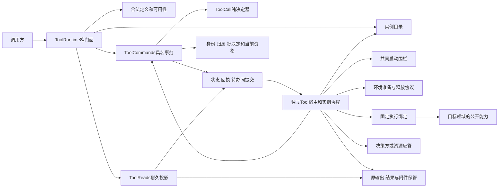

# Tool 包架构

本页的 Tool 技术设计已接受。产品拥有目标，项目架构拥有系统协作，治理领域拥有责任，Tool 成员拥有精确形状与必要行为。根入口已导出公开类型与契约函数。独立执行已在 `tool` 实现，runtime 只实现了一部分路径，宿主与提供者大多尚未交付。五档支持范围见[工具执行组的支持范围](../../README.md#支持范围)。阶段承诺与运行支持分别读取 [Tool 产品](../../../../.meta_harness/design/product/tool-execution/design.md)。

## 系统位置与职责

Tool 为一次原调用保管真实执行、等待、控制、效果、过程、结果、交付与费用事实。调用方发起，消费方管自己的工作资格和消费位置；它们都不拥有 Tool 的活体寿命。Tool 不为调用创建或推进任何外部工作对象，后续工作由消费方按其规则决定。独立程序可以不依赖任何外部工作对象，通过显式依赖消费纯函数或托管门面。

## 责任边界和继续阅读

内部模块、采用的机制、程序执行方的宿主构造和全部内部实施规格属于实现，归 tool 实现包的架构（`tool/docs/architecture.md`）。本页只保留领域级设计与对外缺项。

外域接缝见 [治理领域架构](../../../../docs/domains/tool-execution/architecture.md)。参数、依赖和 OOP 见 [object-model](object-model.md)，协议见 [protocols](../SPEC.md#tool-操作协议)，Cordis 装配见 [cordis](../../tool-cordis-contract/docs/cordis.md)，产品覆盖与验证见 [coverage](../verification/README.md)。文本、内容 ref 与附件地址分流归 P14；共享类型迁移和真实发送验证由共享内容块拥有者跟踪，不以政策接缝扩大任意嵌套许可。

## Tool 设计状态与外部缺项

本节维护尚需实施或验证的义务。Tool 的公开形状、操作协议、OOP 和装配设计已接受。纯契约函数与独立执行已实现。runtime 只实现了一部分路径。耐久存储、真实环境与其余宿主和提供者的实现及验证尚未完成，范围见上述支持范围。相邻领域的未定协议由其拥有者继续设计。

### TOOL-E01 共享引用契约的迁移验证

共享 ref、消息校验和读取阶段由共享内容块拥有者跟踪。Tool 作者明确选择直接感知的 content ref 或按需读取的附件地址；ResultPolicy 校验完整结果，projectToolResult 纯投影，二者已在本包实现并有单元测试。消费方在实际需要时才加载直接感知内容。这一加载与共享块、消息校验的迁移尚未交付，由共享内容块拥有者实现。本设计不授权任意递归容器，实际转换失败不删除原件。

### TOOL-M01 公开形状与独立函数消费

设计归 [public-api](public-api.md#定义作者适配与独立消费)、[P02](../SPEC.md#p02-定义准入与队列)、[P05](../SPEC.md#p05-执行事实与原输出)。定义了定义与声明、名称/参数校验、Catalog、纯可用性判定、普通/结构化作者适配、固定 codec/renderer 和独立执行边界。OOP 与参数/DI 分类归 [object-model](object-model.md)。

已实现：根入口导出的公开类型，`judgeToolDefinition` 与其余判定函数，纯可用性判定 `evaluateToolAvailability` 与 `presentTool`，普通与结构化作者适配，默认参数 codec 与结果渲染，以及 `tool` 的独立执行 `createIndependentToolScope` 与 `executeTool`。它们都有单元测试。已实现 [RFC-0012](../../../../docs/rfcs/RFC-0012-tool-dynamics.md) 的类型迁移（定义派生 `deriveDefinition`、`ToolImplementation`、`ToolAuthority`、可用结果的 `layer`）与纯函数 `shapeOf`、`planAdoption`、`refreshAvailability`、`foldResident`，表驱动测试覆盖采用点判定表每一行。尚未交付：Catalog 提供者，资产正文到完整 ToolDefinition 的解析适配（装载器），独立消费者的使用示例，完整托管适配的验证。当前 `toolBodyContract` 只做最低校验，不能被当作完整新定义校验。变更后的公开声明同步真实消费者，不保留第二套手写类型源。

### TOOL-M02 发起、队列、等待与控制

设计归 [P01 至 P07](../SPEC.md#p01-操作事实与资格)。已定义同提交回执/待办、跨调用FIFO和名额、共同启动围栏、环境准备查询、等待及答复确认、控制实际进度、计时段、暂停/接续和恢复未知。

尚未采用的具体提供者须证明资格失效的共同排序、原执行查询和延迟请求排除、时间来源连续性、决策方/资源应答交接、checkpoint 排除与实际控制能力。Tool CAS、一次授权查询、心跳超时、无目录项或 disposer 均不能替代这些证据。相关拥有者接受与真实组合验证仍须完成。

### TOOL-M03 原结果、全文与账目

设计归 [P05](../SPEC.md#p05-执行事实与原输出)、[P08](../SPEC.md#p08-过程分页与全文交接)、[P09](../SPEC.md#p09-账目恢复与退出)。已定义原值先保管、结果版本、retained/processed两路径、生产侧解除回执、附件及原文读取、字节分页和整块分页、卸载、来源账目修订及租户/组织查询。

仍需具体存储、执行者和消费方证明进程/OS崩溃及断电耐久，证明未知提交不会让双方同时放弃保管，证明全文在消费方归档等事件后继续可取。介质物理损毁的恢复资格没有新政策；具体费率与计量源由其拥有者固定，不用遥测估算替代账目。

### TOOL-M04 已展示过程的故障保留

设计归 [P08](../SPEC.md#p08-过程分页与全文交接)。已选保存先于展示、持久快照、快照后连续增量、gap显式重连和独立readProcess。可批保存，不要求每片同步落盘；批未确认就不得对外展示。过程只给人，不进入消费方的请求内容或程序正式数据。

实际过程提供者、存储及交付面尚须证明保存/发布故障窗口、裁剪依据和无活体读回。图和类型不能证明断电无丢失；未经运行验证不标本项已兑现。

### TOOL-M05 程序执行方跨能力组合

程序执行方的 Tool 侧协议由 [composition](../SPEC.md#code-与-tool-的组合协议) 和 public-api 的 [程序编排接缝](public-api.md#程序编排接缝)承接。父子预留、受理未知、可信来源、逐目标许可、结果承接、父关闭、控制原因、计时及父域退出后责任均有设计。

| 拥有者 | 仍须交付的具体成果 | 验证边界 |
| --- | --- | --- |
| 程序执行提供者 | 固定语言与版本、help/execute精确输入输出、程序错误和结果编码、标准能力、输出策略 | 独立消费与真实程序组合，不由Tool泛型替代 |
| 执行环境提供者 | 固定引擎和隔离配置、跨界校验、秘密隔离、时间/内存/并发/输出/宿主调用限额 | 原生宿主能力不可达、不合作代码可终止、超限可解释 |
| Tool、身份与装配 | 本页已经提出的父子关联、可信来源与启动围栏具体实现 | 包装转发、父关闭竞争、撤权后缓存入口不能启动、受理未知不重发 |
| Tool、决策方与程序执行方 | 父程序段和子等待证据、原登记接续及控制范围 | Ask阻塞不计父运行限额，不伪造答案；reach 为 foreground-and-unadmitted 的撤回不扩大后台范围 |
| Tool、内容与消费方 | 可靠子结果承接、原附件及分页、外层汇总与未完责任 | 父域销毁后原结果可取，费用不重复，终局/保管提交未知可恢复 |

具体提供者设计与真实安全证据未交付前，不能宣称程序执行方的完整技术实现设计或运行支持已经完成。此处补齐的是 Tool 治理边界及组合协议。阶段仍归 META-P02；Stop不在本项范围。
