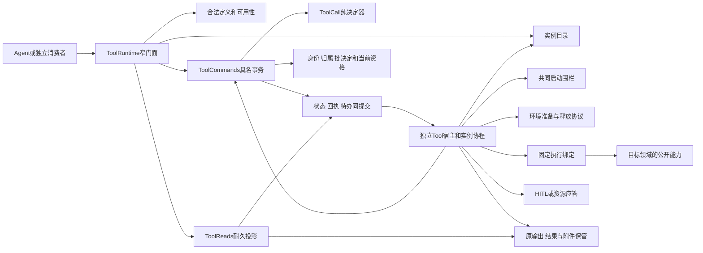

# Tool 包架构

本页的 Tool 技术设计已接受。产品拥有目标，项目架构拥有系统协作，治理领域拥有责任，Tool 成员拥有精确形状与必要行为。运行契约未实现，当前根入口仍只有 `toolBodyContract`。阶段承诺与运行支持分别读取 [Tool 产品](../../../../.meta_harness/design/product/tool-execution/design.md)。

## 系统位置与职责

Tool 为一次原调用保管真实执行、等待、控制、效果、过程、结果、交付与费用事实。Agent 发起和消费，Session 管工作资格和原位置，Model 管模型响应；它们都不拥有 Tool 的活体寿命。独立程序可以不用这些领域，通过显式依赖消费纯函数或托管门面。

## 内部模块与依赖

| 模块 | 拥有 | 向外依赖 |
| --- | --- | --- |
| definition | 定义判定、参数 codec、紧凑呈现与纯可用性判定 | 资产名称、JSON 和消费者能力的显式输入 |
| author | 普通/结构化返回适配、固定 renderer/codec、独立执行函数、作者上下文接口 | 受限 E、显式执行作用域、结果政策；不依赖 Cordis 或本域存储 |
| call | 聚合不变量、状态决定、具名命令与读取投影 | 受信 guard 快照及本域提交适配 |
| coordination | 持久待办推进、原执行认回、答复/控制/暂停/交接 | 明确外域端口；没有任意容器查找 |
| execution | 固定绑定、真实发起边界、事实流及原控制 | 环境与外部工具真实协议 |
| custody | 原输出、正式结果、过程与附件的保管、分页及交付 | 存储与当前读取/承接资格 |
| composition | Code 子调用预留、可信来源、父退出后责任 | 正规 Tool 门面和具体 Code 执行域 |
| cordis | Service 定义、阶段适配器、独立 host、目录贡献 | 固定 Cordis 4.0.4 与共同 IC |

这些是职责分解，不预设新包、进程或每项一层 class。Commands 的具体提供者可以把本域状态、队列、回执和待办放在同一存储事务；不得把外部执行和 SQL 提交描述为一个原子动作。派生投影可重建，原输出和源事实的保管不能靠重跑工具恢复。

## 采用的机制与成本

公开面保留具名操作。内部使用纯 `decide(state, command, guards)` 计算变更和待办，最终事务重核 revision、队列与有效 guard。这样既能列举合法命令，也能穷举并发反例。无需规定事件溯源、通用消息总线或公开任意事务回调。

每种有外部效果的协议保留自己的准备记录、查询、排除与未知。共享操作身份与回执结构，不将环境释放、答复和停止压成无业务语义的统一 execute。代价是至少一次意图提交和一次结果提交；这项成本换取回包丢失后仍能认回原操作。批保存过程可以降低写入次数，但展示必须晚于保存。

目录只提供可替换观察句柄。长期宿主只驱动已有责任。ToolRuntime 只对消费者提供稳定操作。三者分开防止 Agent 退出、目录无路由或 Cordis disposer 被解释为业务收场。计划换代先显式交接，意外故障从待办恢复。

Code 是具体 Tool 执行者的一种组合应用，不增加第四 runtime。子工具各有原调用、队列和结果；宿主保存父子关系，程序仅取得窄代理。完整组合协议见 [composition](../SPEC.md#code-与-tool-的组合协议)，语言和引擎由具体提供者固定，不以本包泛型替代隔离设计。

## 责任边界和继续阅读

外域接缝见 [治理领域架构](../../../../docs/domains/tool-execution/architecture.md)。参数、依赖和 OOP 见 [object-model](object-model.md)，协议见 [protocols](../SPEC.md#tool-操作协议)，Cordis 装配见 [cordis](cordis.md)，产品覆盖与验证见 [coverage](../verification/coverage.md)。文本、内容 ref 与附件地址分流归 P14；共享类型迁移和真实发送验证沿 MODEL-E01，不以政策接缝扩大任意嵌套许可。

## Code 宿主构造

Code 是 ToolExecutorBinding 的一个具体提供者，采用 foreground、live-only，自身不允许 programmable。不增加第四 runtime。程序语言、版本、标准能力、help/execute 参数及跨执行域编码由该提供者精确声明；执行环境提供者固定引擎和隔离能力。本页不以通用接口宣称这些选型已完成。

Code 宿主注入受限程序环境、ToolRuntime、ToolChildren、来源签发和结果保管能力。一次 execute 的程序和显式输入是参数；租户、主体、Session/Run、父调用、权限、环境、限额和绑定是受信宿主依赖。脚本只取得 ProgramTools 的窄代理及自己显式输入，不取得 Context、服务容器、E、executor、来源签发能力或宿主凭据。跨界必须复制/校验允许的数据，不传 JS 宿主对象引用。

## Tool 内部实施规格

本页规定内部构造方法。行为协议归 [protocols](../SPEC.md#tool-操作协议)，公开类型归 [public-api](public-api.md)，对象关系归 [object-model](object-model.md)。当前已实现资产正文端口；运行契约和下述提供者尚未实现。

### 聚合和事务提供者

ToolCall 决定器输入当前持久状态、具名命令和已核验 guard 快照，输出拒绝，或业务变化、操作结果与后续任务。决定器不读服务、不发通知、不运行工具。Commands 各具名入口负责边界解析和资格，事务适配器负责最终 revision/唯一操作检查及提交。不得允许调用者绕过决定器任意写状态。

持久布局至少能索引 tenant/call、operation/inputDigest/result、queueKey/ordinal/slot、start chain、wait/response、control、timing、result/delivery、process cursor、source event、task 和 child relation。它们不要求各占一张表。队列名额和 FIFO 跨调用同提交；重复操作的回执读取与授权分开。保管正文可独立存储，但必须先有耐久内容证据，再提交引用，失败保留可对账的原件责任。

命令提交时创建的任务使用完整判别联合。对端接受、本域确认、生产侧交付解除不能复用同一个 evidence。每个 evidence 核拥有者、原租户/调用、操作、精确采用、摘要及仍有效的使用范围。拒绝和异常保留身份与阶段，日志不复制正文秘密。

### 协程驱动

createToolRuntime 先组装门面和 driver，再向独立 host.install 注册 driver；安装本身不受理业务。host.schedule 是唤醒提示。driver.run 通过 scanPending/loadRecovery 读任务，claim 当前协调代次，以实例 fiber 发布观察句柄，然后只推进已持久安排的工作。多次唤醒合并，事务围栏裁定唯一写者；定期扫描补漏。

一个实例可处理多个待办，不能为每个观察者创建真实执行。事实流读取、控制与等待响应可以并发接收，但进入 Commands 时按原 operation 和当前 revision 排序。事实存储 ACK 后才确认源可交接；无 ACK 不释放源保管。可选观察者慢或断开不影响真实执行。

依赖失败暂停依赖它的任务并保留诊断，不把整次调用的所有清理都阻塞。例如授权不可用阻止新启动，但受权托管通道可以继续接受原结果；结果写入不可用时不能继续确认源，却可以请求停止和查询原执行。不可用、已排除和连续性丢失是不同结论。

### 准备、执行与结果管线

顺序为固定请求、环境准备认回、FIFO、启动记录、共同围栏、原执行、事实保管、原输出 codec/custody、返回适配、结果提交和交付。dummy 与参数失败在环境之前收场。普通返回不经对象字段猜测；作者适配在绑定时固定，结构化结果也必须经过整结果政策和附件保管。

对端每种操作保留稳定身份。准备、停止、答复、暂停、释放的响应丢失均查询同一记录。对端不具确定查询能力时返回 unknown，不能通过换操作号实现“恢复”。托管提供者资格声明须说明支持哪些排除和连续性证据；缺能力的提供者不能装成能安全恢复的变体。

执行链与协调代次分开。协调者退出不自动中断执行。受信 late ingress 核原来源后可保存迟到结果与费用，而不恢复旧协调者推进权。检查点只有在原执行排除、已做效果和消费位置可恢复时成立；普通 Promise 栈不采用序列化恢复。

### 作者输出和等待适配

作者使用普通 async execute(A, E, context)。每次执行上下文使嵌套 helper 可以借用 emit 或 wait 的窄接口。生成器方案则通过 yield 输出和等待，由宿主 next(answer) 驱动，每次输出都交回控制，且要求 helper 传播生成器协议。因此采用执行上下文。行为与失败统一归 [P11](../SPEC.md#p11-作者输出与等待原语)，不新增运行时或通用消息总线。

执行绑定构造一个 Scope，把原身份、停止信号、容量、过程转换器和等待适配器封装起来。作者只取得 Context。内部有一个按调用顺序分配位置的有界输出账，记录受理序号、固定内容、保管状态和回执。事实读取器不等待作者消费 emit 的 Promise，因而不会出现作者 await emit、宿主却等待作者 return 才读取事实的死锁。

append-text 转为固定文本块的累计值；replace 保持完整块。容量核对同时覆盖在途内容和未封块累计状态，超过限额明确拒绝。后端可批保存，但原事件身份不随分批改变。关闭块的身份和模式索引可落存储，不在内存无限累积。等待、控制和恢复通路不占过程输出队列的额度，输出填满不能阻塞取消传播。

wait 适配器先固定 key 和输入，再把请求保管为证据，与输出屏障后的 WaitIntent 交给既有事实流。Ask 适配器解析采用的卡片请求；resource 适配器从 request 证据取得关联，不读取变化中的 E 补全原请求。原答复按 ResponseRecord 送入 Scope；它只消费一次原答复并产生一次 continued 事实；同一结果的多个作者等待分支仍可能各自继续，业务副作用去重由作者及目标协议负责。等待 key 及已消费回应交给原执行源的耐久查询索引后才释放本地历史额度。独立内存适配器按显式上限拒绝新 key，不静默淘汰旧记录。等待输入和回应解码由各协议拥有者负责，Tool 不发明统一卡片表单或默认授权答案。

作者返回时包装器立即调用 finish 关闭新受理，同时按 P05 保管原 R。正常最终投影等待这两项成功，并确认没有活动等待。暂时保存未知留在原输出账，阻止 completed；永久失败形成明确故障。失败或取消的逻辑终局可以先成立，后续保管、清理和迟到效果由原任务承接。独立 executeTool 使用同一 Scope 收尾接口，能力与耐久保证由显式提供者说明，不内建无声 noop。

实现至少拆开过程接收、外部回应接收和控制三条可推进路径。一个等待中的作者协程不占住整个 driver；同一 ToolCall 的事实转换仍在 Commands 中排序。Cordis 只装配这些适配器及其资源，不能把 Fiber 的等待或撤除替代为 ToolWait 或 cancelled 决定。

### 业务 schema 与输出归一化

等待形状放在实际工具或其业务协议拥有者，通用检查复用 schema-provider。ToolWaitContract 绑定请求及响应形状，执行绑定把采用列表固定为作者允许集合。开放等待时保存 ToolWaitSchemaSnapshot；响应端按原快照取得 schema 租约，完成检查后释放。恢复加载不到原修订时报告缺席，不跟随当前最新声明。

ToolWaitResponseValidator 是交给 HITL 或资源接收适配器的窄依赖。接收者先校验候选，再按其权威协议确认有效回应；invalid 只返回提交者。只有已确认的有效回应进入 ToolDecisionBridge 或 ToolResourceResponses 的 resolve。业务校验依赖当前权限、候选集合或资源状态时，单独注入相应守卫，不放入 schema callback。这里没有新增等待运行时、卡片存储或通用 HTTP 服务。

结果管线保持两种作者写法。ordinary 的 executor 返回 R，structured 的 executor 直接返回 ToolResult。前者经固定 renderer 和程序编码器生成 ToolResult，后者验证原封装。两者均在 P05 提交前完成返回验证、程序 schema 检查、块政策和保管。OutputCodec 解决可保存与可恢复，不证明业务字段正确；ToolReturnValidator 使用原 arguments 和实际返回检查类型及本域后置条件。

ToolResult.data 使展示内容和程序数据共享原 resultVersion、保管及交付责任。分开保存原函数值和展示结果、由 Code 另取输出，会增加两份记录的同提交、版本和交付一致义务，因此不采用。RawOutput 仅负责原件保管，不能成为绕过权限和输出校验的程序 API。

多命令采用逐操作封装。defineToolOperation 在各自 A/R 类型下封装作者，登记表只组合 ToolOperation，不要求不同函数共享返回类型。defineCommandTool 从命令键和各操作声明生成 ToolDefinition。另一方案是让整张表持续携带每键的 A/R 泛型；它有利于同进程调用推断，但不能直接代表跨域程序数据，也不能替代动态分派校验。本设计把类型检查留在单操作构造处，Code 类型来自逐命令程序 schema。完整规则见 [P13 的多命令部分](../SPEC.md#多命令作者注册与返回选择)。

ToolBindings 提供者持有 ToolAuthorRegistration，按原 adoption 与 command 选择封闭操作。选中后，参数解析、执行、输出检查、渲染与程序编码保持配对。恢复不按新表重新选名，settle 不遍历其他命令的 schema 寻找可通过项。各操作使用同一明确环境契约 E，不因聚合而扩大依赖或权限。同步注册只完成可判断的绑定，schema 来源及正文的异步检查在可用性成立前完成。

Code 的具体语言适配器从经过验证的 data 解码本语言值，禁止跨域传原宿主对象或函数。动态调用只保证实际声明中的性质，不凭名字推导静态类型。展示投影仍由 Agent/Session 的消息路径处理，不把 data 整体塞进模型上下文。具体引擎和 SDK 语法仍由 Code 提供者交付。

该分离参考 LangChain JS 的 content 与 artifact。核对固定源码 [tools/index.ts](https://github.com/langchain-ai/langchainjs/blob/bfa3b31fd3136495235984b43287b3c6eff7da3e/libs/langchain-core/src/tools/index.ts) 的输入解析、content_and_artifact 与结果包装路径，以及 [tools/types.ts](https://github.com/langchain-ai/langchainjs/blob/bfa3b31fd3136495235984b43287b3c6eff7da3e/libs/langchain-core/src/tools/types.ts)，该路径没有通用业务输出 schema 验证，artifact 类型也不提供这项保证。本设计只借鉴表示分离，新增的输出验证和可靠交接责任由 Tool 自己兑现。模型 structured-output 不作为工具返回校验依据。

### 故障处理与资源次序

计划退出先 quiesce，读取完整 drain inventory，排空或 handover，再撤目录及释放实例资源。handover 必须有承接者对同一清单的耐久回执；变化中的清单不能用旧回执盖过。存储失败或外部操作 unknown 时保留责任，不报告优雅退出成功。

环境释放晚于其所需内容与接续事实转入独立保管；释放本身可失败和查询。停止执行与释放环境分别确认，不依赖 Cordis disposer 的执行顺序。Code 程序域销毁后，child ledger、控制任务和结果保管仍由长期宿主承担。

### 验证设施与限制

设计验证至少包括公开声明提取编译、非法状态类型反例、两个调用竞争名额、启动与失效排序、每类外部回包丢失、答案与取消、逻辑终局和迟到版本、父关闭与子受理未知。必须包含能击中错误变体的断言，不能只验证 happy path。

真实提供者还须证明断电耐久、跨 owner 失效顺序、环境资源排除、持续时间来源、原事实源保管、受限程序隔离与不合作程序终止。模型假设和实际探针范围分别记录，未运行项见 [coverage](../verification/coverage.md) 的验证义务及 [open-questions](#tool-设计状态与外部缺项) 的外部缺项。设计文档不选择尚未采用的存储后端或 Code 引擎。

## Tool 设计状态与外部缺项

本节维护尚需实施或验证的义务。Tool 的公开形状、操作协议、OOP 和装配设计已接受；生产实现及实际提供者验证尚未完成。相邻领域的未定协议由其拥有者继续设计。

### TOOL-E01 共享引用契约的迁移验证

沿 [MODEL-E01](../../../model/model/docs/architecture.md#model-e01) 跟踪共享 ref、消息校验和发送阶段读取。Tool 作者明确选择直接感知的 content ref 或按需读取的附件地址；ResultPolicy 校验完整结果，projectToolResult 纯投影，Model 才加载直接感知内容。接口尚未实现，不授权任意递归容器；实际转换失败不删除原件。

### TOOL-M01 公开形状与独立函数消费

设计归 [public-api](public-api.md#定义作者适配与独立消费)、[P02](../SPEC.md#p02-定义准入与队列)、[P05](../SPEC.md#p05-执行事实与原输出)。定义了定义与声明、名称/参数校验、Catalog、纯可用性判定、普通/结构化作者适配、固定 codec/renderer 和独立执行边界。OOP 与参数/DI 分类归 [object-model](object-model.md)。

仍需实际导出与运行时校验实现，以及独立消费者和完整托管适配验证。当前 toolBodyContract 不能被当作已提供完整新定义校验。变更后的公开声明同步真实消费者，不保留第二套手写类型源。

### TOOL-M02 发起、队列、等待与控制

设计归 [P01 至 P07](../SPEC.md#p01-操作事实与资格)。已定义同提交回执/待办、跨调用FIFO和名额、共同启动围栏、环境准备查询、等待及答复确认、控制实际进度、计时段、暂停/接续和恢复未知。

尚未采用的具体提供者须证明资格失效的共同排序、原执行查询和延迟请求排除、时间来源连续性、HITL/资源应答交接、checkpoint 排除与实际控制能力。Tool CAS、一次授权查询、心跳超时、无目录项或 disposer 均不能替代这些证据。相关拥有者接受与真实组合验证仍须完成。

### TOOL-M03 原结果、全文与账目

设计归 [P05](../SPEC.md#p05-执行事实与原输出)、[P08](../SPEC.md#p08-过程分页与全文交接)、[P09](../SPEC.md#p09-账目恢复与退出)。已定义原值先保管、结果版本、retained/processed两路径、生产侧解除回执、附件及原文读取、字节分页和整块分页、卸载、来源账目修订及租户/组织查询。

仍需具体存储、执行者和消费方证明进程/OS崩溃及断电耐久，证明未知提交不会让双方同时放弃保管，证明全文在归档等事件后继续可取。介质物理损毁的恢复资格没有新政策；具体费率与计量源由其拥有者固定，不用遥测估算替代账目。

### TOOL-M04 已展示过程的故障保留

设计归 [P08](../SPEC.md#p08-过程分页与全文交接)。已选保存先于展示、持久快照、快照后连续增量、gap显式重连和独立readProcess。可批保存，不要求每片同步落盘；批未确认就不得对外展示。过程只给人，不进入模型或程序正式数据。

实际过程提供者、存储及交付面尚须证明保存/发布故障窗口、裁剪依据和无活体读回。图和类型不能证明断电无丢失；未经运行验证不标本项已兑现。

### TOOL-M05 Code 跨能力组合

[Code 产品](../../../../.meta_harness/design/product/meta-capabilities/design.md#meta-code)的Tool侧协议由 [composition](../SPEC.md#code-与-tool-的组合协议) 和 public-api 的 [程序编排接缝](public-api.md#程序编排接缝)承接。父子预留、受理未知、可信来源、逐目标许可、结果承接、父关闭、控制原因、计时及父域退出后责任均有设计。

| 拥有者 | 仍须交付的具体成果 | 验证边界 |
| --- | --- | --- |
| Code提供者 | 固定语言与版本、help/execute精确输入输出、程序错误和结果编码、标准能力、输出策略 | 独立消费与真实程序组合，不由Tool泛型替代 |
| 执行环境提供者 | 固定引擎和隔离配置、跨界校验、秘密隔离、时间/内存/并发/输出/宿主调用限额 | 原生宿主能力不可达、不合作代码可终止、超限可解释 |
| Tool、身份与装配 | 本页已经提出的父子关联、可信来源与启动围栏具体实现 | 包装转发、父关闭竞争、撤权后缓存入口不能启动、受理未知不重发 |
| Tool、HITL与Code | 父程序段和子等待证据、原卡接续及控制范围 | Ask阻塞不计父运行限额，不伪造答案；Run取消不扩大后台范围 |
| Tool、内容与消费方 | 可靠子结果承接、原附件及分页、外层汇总与未完责任 | 父域销毁后原结果可取，费用不重复，终局/保管提交未知可恢复 |

具体提供者设计与真实安全证据未交付前，不能宣称 Code 的完整技术实现设计或运行支持已经完成。此处补齐的是 Tool 治理边界及组合协议。阶段仍归 META-P02；Stop不在本项范围。
