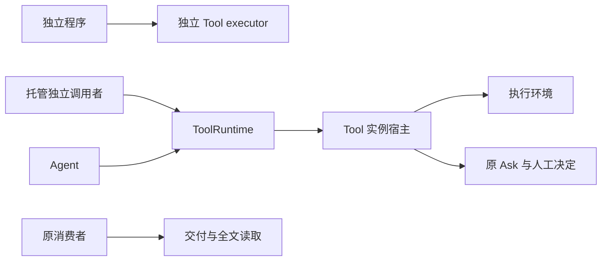
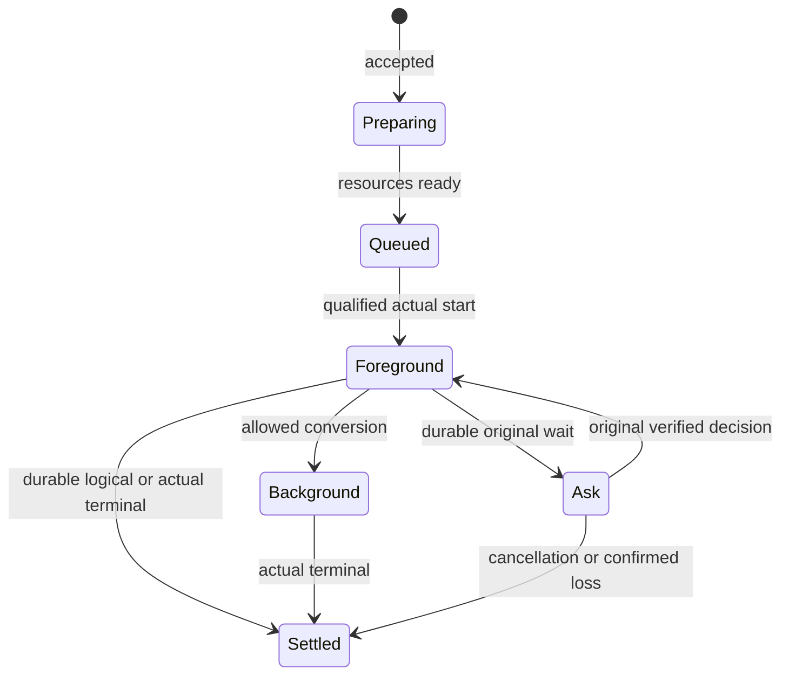

# Tool 消费与系统定位

本页说明独立消费、系统协作和失败处理。运行契约已接受，公开类型已经导出，运行函数、提供者及其验证尚未完成。

## 系统位置与消费入口

本包面向Agent、托管独立调用者和直接使用 executor 的独立程序，承担工具执行、等待关系、真实收场、结果交付与全文保留。以下图示只投影本包消费关系，系统保证仍归[运行架构](../../../../docs/architecture/runtime/README.md)，组内责任归[组入口](../../README.md)。



独立消费与 Harness 接入的设计形状见 [public-api](public-api.md)，该页导航到源码中已导出的类型，并单列尚未实现的函数。需要托管状态的路径必须具备相应提供者，纯独立路径不暗建 Session。装配依赖和资源撤除见 [Cordis](../../tool-cordis-contract/docs/cordis.md)。

## 原消费场景的前提

本页配合[运行契约](public-api.md)，不声称存在生产实现。实例目录、执行事实、业务等待和全文保管分别验证，不以返回一个结果对象替代完整责任。

## 独立调用及普通返回

独立程序把实际参数、ToolExecutor、有限环境能力和自己的 ToolExecutionScope 交 executeTool。Scope 提供本次执行的 context，其 signal、emit 接收端和 wait 应答端由调用者显式接好。包装器把 context 交给作者，并在作者退出后 finish；过程能力缺失返回 unsupported，不能默认吞输出或代答。它直接取得 R 或具体失败，不要求租户、Session 或存储，local 回执不声称耐久。普通返回经明确 TextRenderer 转为整个文本；结构化作者另返回 ToolResult，不能凭字段猜格式。实际使用托管资源仍由环境和执行适配器检查其访问规则。作者示例见 [emit 与 wait](flows.md#作者调用-emit-和-wait)。

托管独立调用使用自己的 resource scope 和 consumer，显式给出 principal/tenant/call/operation。admit 成功后由 Tool 宿主准备环境、按原顺序排队、取得名额并在真实启动前复核资格。观察者退出后这些责任继续。lookup 和 queryOperation 可在没有活体时核对原事实，不能借 no-live-route 重跑。

## Agent 脚本编排

两种作者返回在 settle 阶段统一成 ToolResult。普通 R 保留原件，经固定返回验证器、renderer 与程序编码器转换；structured 作者直接返回 ToolResult。返回字段碰巧叫 content 不改变模式。具体签名及运行时性质归 [P13](../SPEC.md#p13-双返回形态与程序输出契约)。

编排者从 Catalog.usage 读取每个命令的 returns，不能只知道输入参数就猜输出。程序数据在结果 data，展示内容在 content；程序调用仍先核 terminal。program=none 明确只有通用结果封装，不提供虚构的业务返回类型。动态名字调用与静态生成的 SDK 都核同一采用，schema 校验不证明业务执行成功。两个写法的例子见 [settle 流程](flows.md#两种返回在-settle-汇合)。

同一个多命令工具可以分别返回读取对象、目录列表和写入回执。作者通过 [逐操作注册](flows.md#多命令函数与独立返回)组合不同函数，编排者按选中 command 的声明消费。具体 SDK 的类型来自该命令的程序 schema，不来自登记层已经封闭的普通返回 R。动态字符串选择不能被强制泛型伪装成某个固定命令的返回类型。

脚本入口先按合法定义筛选可调用集合。目标工具声明 `programmable: true` 且当前可用时才暴露调用能力。每次子调用由受信协调者固定 `invocation.kind = programmatic` 与来源，带入 `FixedToolRequest`，再经 `ToolRuntime.admit`。只批准脚本本身，不代替目标调用的资格和适用整批判断。

例如脚本并行调用两个工具，A 显式许可而 B 未声明。A 可在其余准入条件成立后执行，B 的调用明确拒绝且不执行；B 仍可按原规则被模型直接调用。A 已发生的效果不因 B 拒绝回滚。若两者属于必须共同判断的一批动作，仍先满足原批次屏障。

缓存名称、包装工具、MCP 或通用调用入口不能去掉子调用的编排来源。省略和 false 的失败、排队时许可撤回以及原调用恢复的判据见[定义专题](../verification/scenarios.md#tl-v02)。普通独立 SDK 消费不自动算 Agent 脚本；判断依据是受信来源，不是函数名。

## 前后台与 Ask



准备/队列取消和发起时后台是契约另行允许的分支，这张图仅示原前台代表路径。名额在 Foreground、Ask、Background 均被占用；实际收场或可靠排除后释放，逻辑终局本身不释放名额。Ask 没有超时边，不能转后台。后台最终结果不能再次为后台占位或 dummy。

一次 Ask 的顺序为 openWait 保存意图、原接续点和出卡任务，HITL.ensure 认回原卡，attachCard 保存关联；HITL 在固定 schema 及业务资格校验后作唯一有效决定，非法提交只反馈提交方并保持等待，acceptDecision 保存 ResponseRecord 及接续责任，然后向原执行者 answer。答复应答丢失时仍使用原 wait/decision；执行者重复 answer 不重复后续效果。停在可恢复检查点的执行者只能 resume 未做步骤，普通函数不能靠重新 execute 模拟接续。

## 交付与全文

作者直接感知和按需读取的两种结果示意如下。省略 data、original 及具名内容引用的完整元数据，仅说明位置语义。

```text
要模型现在看图：
  content = [图片块(ref = 图片位置)]
  attachments = []
  → ToolMessage 保留图片 ref
  → Model 真正请求时读取图片、校验并编码

要 agent 自己决定是否看图：
  content = [文本块("已生成图片，可按需读取")]
  attachments = [图片位置]
  → ToolMessage 包含说明文本及附件地址文本
  → 本次模型请求不读取该图片
  → agent 若决定读取，另发合法读取调用
```

地址不是读取授权。两种结果都保管内容并校验披露资格；后续读取返回的新结果仍由其作者决定用内容 ref 还是附件地址。精确投影、块身份与保管规则归 [P14](../SPEC.md#p14-附件引用与模型交付)。

先保管路径保存原内容或所需期内可靠引用、consumer 及后续责任，然后 releaseDelivery。先处理路径在 Tool 继续保管期间完成适用扩展、卸载和消息处理，保存完成事实，然后 releaseDelivery。处理失败或保存未知时保持 pending。两条路径都不删除 Tool 全文。

解除关系回执丢失时，原 call/result/delivery/consumer 和原 operation 足以认回。另一位置使用旧 delivery 必须拒绝。Run 结束或归档后，合法消费者仍可通过 readResult 分页取原全文；新的模型取回工具调用只产生其自己的新内容和实际取回费用。

| 交错或故障 | 必须观察的结果 | 后继验证者 |
| --- | --- | --- |
| 环境准备成功，排队期间撤权 | 实际 start 拒绝，环境按原责任释放，不暗换宿主 | 环境与执行边界提供者 |
| prepareStart 保存意图后、真实调用前撤回 programmable | 启动围栏拒绝；可靠排除启动后记录 rejected，再保存 unavailable 终局；恢复只收场，不重新 start | 启动围栏、ToolCommands 与恢复提供者 |
| 拒绝记录已确认，保存不可用结果前崩溃 | loadRecovery 返回 startRejection 和 settle 待办，继续原结果交付和资源释放，不因许可重新开放而发起 | ToolCommands 与宿主恢复者 |
| 达到并发上限 | 原受理不变，FIFO 等待；已有 Ask/后台仍计数 | ToolCommands/调度提供者 |
| 实际 start 后回执未落盘 | 原操作未知，不能再次 execute | Tool 执行与存储组合 |
| 前台上限到达时正在 Ask | Ask 时间不累计，无默认回答，无后台转换 | Tool 时间/等待提供者 |
| 转后台后 Agent 退出 | 原 Tool 继续，最后交原 consumer；不建第二执行 | Tool 宿主与 Session 消费者 |
| 普通执行者自身确认丢失 | 异常收场，效果 unknown；不自动重放 | 宿主排除与 Tool 恢复者 |
| checkpoint 保存后旧执行未排除 | 不 resume，不能双推进同一工具 | checkpointed executor |
| 原参数 malformed，目标是已知 dummy | 正常 unavailable，不解析原参数、不启动原工具 | 定义/执行提供者 |
| 原参数 malformed，目标可用 | 参数失败原结果，无实际执行 | 参数 codec/Tool |
| 过程块已显示后崩溃 | 已展示块及方式/裁剪说明可恢复，未封块不伪造完整结果 | ToolCommands/内容保管 |
| 结果消息准入拒绝 | 原真实结果保留，不重跑；适用 Run 后果交 Session | Agent/Session |
| delivery 已解除后归档 | 原全文仍可依法读取，原费用不重复 | Tool 保管/账目提供者 |
| 旧实例死后成本回执到达 | 原来源事件补账，不需要旧推进资格 | 独立事实适配器 |

## 尚未覆盖的证据

类型样例只检查接口能接合，以及独立函数与托管身份边界。FIFO、时间暂停、Ask 唯一答复、实际启动围栏、checkpoint 安全与全文耐久需要相应模型或真实提供者证据，不能由类型检查推导。

最终内容按 P14 区分文本、直接感知的内容 ref 与按需读取的附件地址。MODEL-E01 的共享块和消息校验迁移仍未实现，本例不发明递归容器，也不把过程帧类型当最终许可。当前未运行真实工具、生产环境或断电验证。


## 完整消费与装配阅读顺序

先读 [architecture](architecture.md) 确认本包责任，再读 [object-model](object-model.md) 区分值、实体、协程和依赖；[public-api](public-api.md) 给唯一设计形状，[protocols](../SPEC.md#tool-操作协议) 给每次调用的守卫、提交与未知处理。接入 Code 再读 [composition](../SPEC.md#code-与-tool-的组合协议)，Cordis 集成读 [cordis](../../tool-cordis-contract/docs/cordis.md)。[coverage](../verification/coverage.md) 将这些入口对回全部产品能力。

纯作者路径可分别取 ParameterCodec、evaluateToolAvailability、presentTool、executeTool 和 renderToolResult。它们只消费显式输入；托管路径才组合身份、存储、环境、事实流和恢复。Catalog、过程读取、内容读取与账目范围查询按各自权限开放，不把一个万能Tool句柄交给程序。
