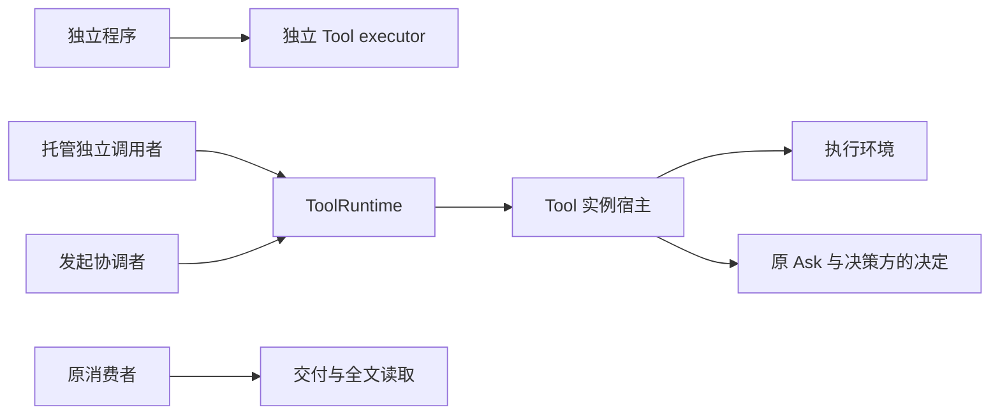
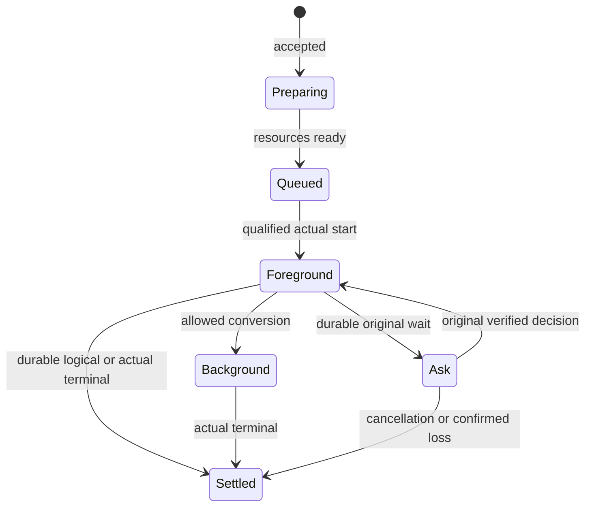

# Tool 消费与系统定位

本页说明独立消费、系统协作和失败处理。运行契约已接受，公开类型与契约函数已经导出。独立执行与 runtime 的部分路径已在 `tool` 实现，其余运行函数、提供者及其验证尚未完成，范围见[支持范围](../../README.md#支持范围)。

## 系统位置与消费入口

本包面向发起协调者、托管独立调用者和直接使用 executor 的独立程序，承担工具执行、等待关系、真实收场、结果交付与全文保留。以下图示只投影本包消费关系，系统保证仍归[运行架构](../../../../docs/architecture/runtime/README.md)，组内责任归[组入口](../../README.md)。



独立消费与 Harness 接入的设计形状见 [public-api](public-api.md)，该页导航到源码中已导出的类型与函数。需要托管状态的路径必须具备相应提供者，纯独立路径不暗建外部工作对象。依赖哪个包、取哪个入口，见[消费入口与契约变更协议](#消费入口与契约变更协议)。

## 消费入口与契约变更协议

本节写给面向 Tool 契约开发的其他领域开发者。其他领域的生产代码只依赖契约包。编写 Cordis 插件时，另加 `@omne-harness/tool-cordis-contract`。独立执行与 runtime 工厂在不含 Cordis 的 `@omne-harness/tool`，独立程序与应用装配按需选择它。

### 从哪个入口取什么

| 入口 | 取什么 | 正文 |
| --- | --- | --- |
| `@omne-harness/tool-contract` 根入口 | 全部公开契约类型（定义与请求、作者与执行、端口、结果、操作、记录、保管、程序），品牌身份解码函数，资产正文端口 `toolBodyContract`，契约函数，默认结果政策 | [public-api](public-api.md) 总入口，按模块分节导航 |
| `@omne-harness/tool-contract/binding` | 读取句柄内作者的函数与操作槽、登记槽类型（`ToolOperationSlot`、`ToolRegistrationSlot`），只供受信的执行绑定提供者 | [定义、作者适配与独立消费](public-api.md#定义作者适配与独立消费) |
| `@omne-harness/tool-contract/testing` | 一致性套件（含凭据、首次采用、结果接收端口、外层调用方的启动围栏与授权消费点）、回答表、三个读取原语（`finalAnswer`、`resendRecalls`、`crossTenantAnswers`）与完成手柄 `completionOf`、用例运行入口 `runConformanceCase` 与 `NotApplicable`，以及守约的非耐久替身 | [端口一致性套件](public-api.md#端口一致性套件testing) |
| `@omne-harness/tool-cordis-contract` 根入口 | 不导出值 | [公开接口](../../tool-cordis-contract/docs/public-api.md) |
| `@omne-harness/tool-cordis-contract/cordis` | Service 类、服务键、`Context` 增补、事件增补与实例目录的登记类型（`ToolPublication`、`ToolRegistrationInput`、`ToolRegistrationFailure`、`ToolRegistration`、`ToolPublicationAuthority`） | [公开接口](../../tool-cordis-contract/docs/public-api.md)与 [Cordis 定义与装配规则](../../tool-cordis-contract/docs/cordis.md) |
| `@omne-harness/tool-cordis-contract/testing` | `ToolInstancesService.register` 的登记语义套件，和守约的非耐久登记服务 | [公开接口](../../tool-cordis-contract/docs/public-api.md) |

### 符合端口的证明入口

提供者用 `./testing` 的套件核对自己的端口实现。登记服务的实现用 `tool-cordis-contract` 的 `./testing`。夹具与完成手柄的要求见 [public-api 的 `./testing` 一节](public-api.md#端口一致性套件testing)，写法与不适用的报告规则见[提供者怎样证明符合端口](#提供者怎样证明符合端口)。

### 支持范围在哪里

支持范围分五档。逐包的表在 [tool-contract 的 README](../README.md#支持范围)与 [tool-cordis-contract 的 README](../../tool-cordis-contract/README_ZH.md#支持范围)，跨包总表在[组页](../../README.md#支持范围)。某个包的目录不在当前检出里时，表中提到它的单元格带标注，规则见组页的[未交付标注](../../README.md#未交付标注)。本节的消费说明与入口表遵守同一规则。

### 契约变更协议

契约包进入集成轨道之后，两个契约包的公开面只按下列四条变化。公开面指根入口与子入口的导出、类型形状、服务键、事件和套件用例集。

1. 公开面的变化单独成提交，不与 runtime 改动混在同一个提交。提交类型按[贡献指南的类型清单](../../../../CONTRIBUTING.md#标题与提交正文)选择，scope 写 `tool-contract` 或 `tool-cordis-contract`。破坏性变化按同一节在类型后加 `!`，并在正文写 `BREAKING CHANGE:`。
2. 提交正文与 PR 正文写明动因、受影响入口与迁移方式。这两处是消费者读得到的变更记录。已知消费者是集成轨道上依赖这两个包的成员，依赖关系可从各成员的 `package.json` 查得，依赖规则见[依赖方向](../../../../docs/package-organization.md#依赖方向与cordis集成)。按[当前演进政策](../../../../docs/engineering/publication.md#当前演进与消费者)，同一批变更修改这些成员，删除被替代的实现，不保留旧入口。尚未进入集成轨道的开发线，以提交正文与 PR 正文为准。
3. 语义变化先经设计的选择评审，再改契约包。语义变化指下列任一项：类型形状或服务键的改变，SPEC 行为条款（失败集合、顺序、读取规则等）的改变，套件已有用例判定结果的改变。补齐只指新增导出或新增用例，并且守约提供者在已有用例上的结果不变；一条新用例如果会让按此前条款读法守约的提供者失败，它收紧了「什么算守约」，算语义变化。补齐不需要选择评审。
4. 有消费者等待时，变化单独送入集成轨道，不等所属 runtime 交付收口。同时通知已知消费者与正在面向契约开发的开发线。

runtime 实施中发现的契约缺口按同一协议处理：先记为候选，裁定后才改契约包。

## 原消费场景的前提

本页配合[运行契约](public-api.md)，不声称有耐久或生产环境的证据；已实现的范围见[组的支持范围](../../README.md#支持范围)。实例目录、执行事实、业务等待和全文保管分别验证，不以返回一个结果对象替代完整责任。

## 独立调用及普通返回

独立程序把实际参数、ToolExecutor、有限环境能力和自己的 ToolExecutionScope 交 executeTool。Scope 提供本次执行的 context，其 signal、emit 接收端和 wait 应答端由调用者显式接好。包装器把 context 交给作者，并在作者退出后 finish；过程能力缺失返回 unsupported，不能默认吞输出或代答。它直接取得 R 或具体失败，不要求租户、外部工作对象或存储，local 回执不声称耐久。普通返回经明确 TextRenderer 转为整个文本；结构化作者另返回 ToolResult，不能凭字段猜格式。实际使用托管资源仍由环境和执行适配器检查其访问规则。作者示例见 [emit 与 wait](flows.md#作者调用-emit-和-wait)。

普通托管调用使用自己的 resource scope（owner、key 与授予证据 grant）和完整 consumer，显式给出 principal/tenant，保存原意图后 invoke；call/admission 由来源分配或认回。受信内部 admission 与 programmatic reservation 才显式携带原 call/operation。admit 成功后由 Tool 宿主准备环境、按原顺序排队、取得名额并在真实启动前复核资格。观察者退出后这些责任继续。lookup 和 queryOperation 可在没有活体时核对原事实，不能借 no-live-route 重跑。

## 脚本编排

两种作者返回在 settle 阶段统一成 ToolResult。普通 R 保留原件，经固定返回验证器、renderer 与程序编码器转换；structured 作者直接返回 ToolResult。返回字段碰巧叫 content 不改变模式。具体签名及运行时性质归 [P13](../SPEC.md#p13-双返回形态与程序输出契约)。

编排者从 Catalog.usage 读取每个命令的 returns，不能只知道输入参数就猜输出。程序数据在结果 data，展示内容在 content；程序调用仍先核 terminal。program=none 明确只有通用结果封装，不提供虚构的业务返回类型。动态名字调用与静态生成的 SDK 都核同一采用，schema 校验不证明业务执行成功。两个写法的例子见 [settle 流程](flows.md#两种返回在-settle-汇合)。

同一个多命令工具可以分别返回读取对象、目录列表和写入回执。作者通过 [逐操作注册](flows.md#多命令函数与独立返回)组合不同函数，编排者按选中 command 的声明消费。具体 SDK 的类型来自该命令的程序 schema，不来自登记层已经封闭的普通返回 R。动态字符串选择不能被强制泛型伪装成某个固定命令的返回类型。

脚本入口先按合法定义筛选可调用集合。目标工具声明 `programmable: true` 且当前可用时才暴露调用能力。每次子调用由受信协调者固定 `invocation.kind = programmatic` 与来源，带入 `FixedToolRequest`，再经受信内部 admission 端口。只批准脚本本身，不代替目标调用的资格和适用整批判断。

例如脚本并行调用两个工具，A 显式许可而 B 未声明。A 可在其余准入条件成立后执行，B 的调用明确拒绝且不执行；B 仍可按原规则被直接调用。A 已发生的效果不因 B 拒绝回滚。若两者属于必须共同判断的一批动作，仍先满足原批次屏障。

缓存名称、包装工具、动作桥接方或通用调用入口不能去掉子调用的编排来源。省略和 false 的失败、排队时许可撤回以及原调用恢复的判据见[定义专题](../verification/README.md#tl-v02)。普通独立 SDK 消费不自动算脚本编排；判断依据是受信来源，不是函数名。

## 前后台与 Ask



准备/队列取消和发起时后台是契约另行允许的分支，这张图仅示原前台代表路径。名额在 Foreground、Ask、Background 均被占用；实际收场或可靠排除后释放，逻辑终局本身不释放名额。Ask 没有超时边，不能转后台。后台最终结果不能再次为后台占位或 dummy。

一次 Ask 的顺序为 openWait 保存意图、原接续点和登记任务，决策方 ensure 认回对原请求的登记，attachRegistration 保存关联；决策方在固定 schema 及业务资格校验后作唯一有效决定，非法提交只反馈提交方并保持等待，acceptDecision 保存 ResponseRecord 及接续责任，然后向原执行者 answer。答复应答丢失时仍使用原 wait/decision；执行者重复 answer 不重复后续效果。停在可恢复检查点的执行者只能 resume 未做步骤，普通函数不能靠重新 execute 模拟接续。

## 交付与全文

作者直接感知和按需读取的两种结果示意如下。省略 data、original 及具名内容引用的完整元数据，仅说明位置语义。

```text
要消费方直接感知图片：
  content = [图片块(ref = 图片位置)]
  attachments = []
  → 结果消息保留图片 ref
  → 消费方在实际需要时读取图片、校验并编码

要消费方自己决定是否读取图片：
  content = [文本块("已生成图片，可按需读取")]
  attachments = [图片位置]
  → 结果消息包含说明文本及附件地址文本
  → 本次消费不读取该图片
  → 消费方若决定读取，另发合法读取调用
```

地址不是读取授权。两种结果都保管内容并校验披露资格；后续读取返回的新结果仍由其作者决定用内容 ref 还是附件地址。精确投影、块身份与保管规则归 [P14](../SPEC.md#p14-附件引用与消费方交付)。

先保管路径保存原内容或所需期内可靠引用、consumer 及后续责任，然后 releaseDelivery。先处理路径在 Tool 继续保管期间完成适用扩展、卸载和消息处理，保存完成事实，然后 releaseDelivery。处理失败或保存未知时保持 pending。两条路径都不删除 Tool 全文。

解除关系回执丢失时，原 call/result/delivery/consumer 和原 operation 足以认回。另一位置使用旧 delivery 必须拒绝。消费方的工作结束或归档后，合法消费者仍可通过 readResult 分页取原全文；新的取回调用只产生其自己的新内容和实际取回费用。

| 交错或故障 | 必须观察的结果 | 后继验证者 |
| --- | --- | --- |
| 环境准备成功，排队期间撤权 | 实际 start 拒绝，环境按原责任释放，不暗换宿主 | 环境与执行边界提供者 |
| prepareStart 保存意图后、真实调用前撤回 programmable | 启动围栏拒绝；可靠排除启动后记录 rejected，再保存 unavailable 终局；恢复只收场，不重新 start | 启动围栏、ToolCommands 与恢复提供者 |
| 拒绝记录已确认，保存不可用结果前崩溃 | loadRecovery 返回 startRejection 和 settle 待办，继续原结果交付和资源释放，不因许可重新开放而发起 | ToolCommands 与宿主恢复者 |
| 达到并发上限 | 原受理不变，FIFO 等待；已有 Ask/后台仍计数 | ToolCommands/调度提供者 |
| 实际 start 后回执未落盘 | 原操作未知，不能再次 execute | Tool 执行与存储组合 |
| 前台上限到达时正在 Ask | Ask 时间不累计，无默认回答，无后台转换 | Tool 时间/等待提供者 |
| 转后台后调用方退出 | 原 Tool 继续，最后交原 consumer；不建第二执行 | Tool 宿主与消费方 |
| 普通执行者自身确认丢失 | 异常收场，效果 unknown；不自动重放 | 宿主排除与 Tool 恢复者 |
| checkpoint 保存后旧执行未排除 | 不 resume，不能双推进同一工具 | checkpointed executor |
| 原参数 malformed，目标是已知 dummy | 正常 unavailable，不解析原参数、不启动原工具 | 定义/执行提供者 |
| 原参数 malformed，目标可用 | 参数失败原结果，无实际执行 | 参数 codec/Tool |
| 过程块已显示后崩溃 | 已展示块及方式/裁剪说明可恢复，未封块不伪造完整结果 | ToolCommands/内容保管 |
| 消费方拒绝结果 | 原真实结果保留，不重跑；拒绝的后果由消费方裁定 | 消费方 |
| delivery 已解除后消费方归档 | 原全文仍可依法读取，原费用不重复 | Tool 保管/账目提供者 |
| 旧实例死后成本回执到达 | 原来源事件补账，不需要旧推进资格 | 独立事实适配器 |

## 提供者怎样证明符合端口

环境、启动围栏、执行者绑定、输出保管、时钟、决策桥和资源应答的提供者，对自己的实现运行 `@omne-harness/tool-contract/testing` 的一致性套件，不必读 Tool 的内部实现。提供者写一个夹具工厂，工厂返回被测端口、它接受的 `access` 和它能给的控制手柄。提供者在自己的测试框架里逐条注册用例，写法见 [public-api](public-api.md#端口一致性套件testing)。

- 夹具没有某个手柄时，需要它的用例报告“不适用”并指明手柄。不适用的用例没有检查任何事，不算通过。提供者的测试报告须单列它们。
- 套件对守约替身全部通过。每条用例里每个承载独立规则的断言，都有一个只违反该规则的违约变体让它失败：逐断言的对应表在各包 tests/README 的「断言与违约变体的对应」一节。契约允许的提供者（首答 pending 再落地的环境、合并就绪事实的执行者、围栏式的 `excluded`、先预检再终检的登记服务）必须全部通过，套件不能比条款更严。这证明套件能发现违约，不证明某个提供者耐久、跨进程或断电后仍符合。
- 入参带 `access` 的端口套件有跨租户用例，夹具用 `otherAccess` 提供第二个租户。登记套件也有跨租户用例，夹具用 `otherTenant` 与 `otherAuthority` 提供第二个租户。外租户读不到、改不了第一个租户的记录，也得不到记录存在与否的信息。时钟端口的 `elapsed(evidence)` 没有 access 入参，租户隔离在那里观察不到，所以时钟套件没有跨租户用例。
- 真实实现的对照与未对照的端口见 [public-api 的 `./testing` 一节](public-api.md#端口一致性套件testing)。没有对照的端口，套件只对非耐久替身证明自身。
- 套件只查单个端口的承诺。组合行为由 runtime 测试验证。

## 尚未覆盖的证据

类型样例只检查接口能接合，以及独立函数与托管身份边界。端口一致性套件只证明单个端口在内存提供者上的可观察承诺。FIFO、时间暂停、Ask 唯一答复、耐久的实际启动围栏、checkpoint 安全与全文耐久需要相应模型或真实提供者证据，不能由类型检查或内存替身推导。

最终内容按 P14 区分文本、直接感知的内容 ref 与按需读取的附件地址。共享块和消息校验迁移仍未实现，本例不发明递归容器，也不把过程帧类型当最终许可。当前未运行真实工具、生产环境或断电验证。

## 完整消费与装配阅读顺序

先读 [architecture](architecture.md) 确认本包责任，再读 [object-model](object-model.md) 区分值、实体、协程和依赖；[public-api](public-api.md) 给唯一设计形状，[protocols](../SPEC.md#tool-操作协议) 给每次调用的守卫、提交与未知处理。接入程序执行方再读 [composition](../SPEC.md#code-与-tool-的组合协议)，Cordis 集成读 [cordis](../../tool-cordis-contract/docs/cordis.md)。[coverage](../verification/README.md) 将这些入口对回全部产品能力。

纯作者路径可分别取本包的 ParameterCodec、evaluateToolAvailability、presentTool、renderToolResult，以及 `@omne-harness/tool` 的 executeTool。它们只消费显式输入；托管路径才组合身份、存储、环境、事实流和恢复。Catalog、过程读取、内容读取与账目范围查询按各自权限开放，不把一个万能Tool句柄交给程序。
