# Tool 关键业务与数据流

本页图示提交与协作边界。业务旅程见[旅程章节](#工具执行的关键协作流程)，精确守卫与失败语义归 [protocols](../SPEC.md#tool-操作协议)，类型归 [public-api](public-api.md)。箭头不表示跨拥有者原子事务。

## 结果内容与附件分流

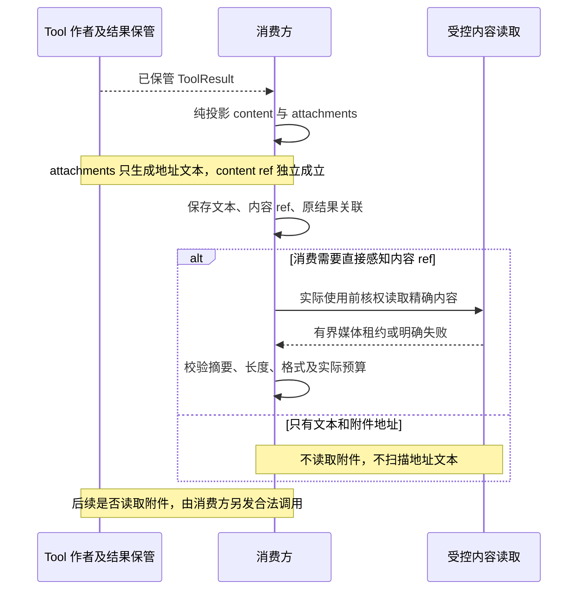

读取或转换失败时不进入图中的使用步骤，原结果继续保管。原身份、当前授权和取消检查沿 [P14](../SPEC.md#p14-附件引用与消费方交付)，图不表示实际实现已经完成。

## 作者调用 emit 和 wait

下面是作者使用方式的伪代码。emit 的回执可稍后等待，wait 的结果必须等到有效回应后才能使用。实际返回值含明确失败分支，不能把取消当成回答。公开签名见 [作者上下文](public-api.md#作者执行上下文)，完整约束见 [P11](../SPEC.md#p11-作者输出与等待原语)。

```text
执行工具(参数, 依赖, 本次执行):
    输出回执 = 本次执行.emit(追加文本("日志", "正在检查目标", 不封块))
    检查结果 = 等待 依赖.检查服务.检查(参数)
    核对成功(等待 输出回执)

    决定 = 核对成功(等待 本次执行.wait({
        kind: "ask", key: "确认发布",
        contract: 依赖.已采用确认协议,
        request: 按该协议编码的确认请求(检查结果)
    }))
    如果 决定是拒绝或没有回答:
        返回 "未发布"
    依赖.授权解释者.核对明确允许(决定)

    任务 = 等待 依赖.发布服务.按原操作身份提交(参数)
    回应 = 核对成功(等待 本次执行.wait({
        kind: "resource", key: "发布完成",
        contract: 依赖.已采用发布回应协议,
        request: 按该协议编码的任务关联(任务), deadline: null
    }))
    如果 回应是协议确认的到期:
        返回 "未取得完成回应"

    核对成功(等待 本次执行.emit(追加文本("日志", "发布已返回结果", 封块)))
    返回 依赖.发布回应协议.解码(回应.value)
```

“核对成功”必须区分容量拒绝、未知、取消及其他失败。例中外部任务提交的幂等与效果归发布服务，wait 只登记并等待原任务回应，不重新提交任务。真实工具按采用的协议解析回答，不根据自然语言猜授权。

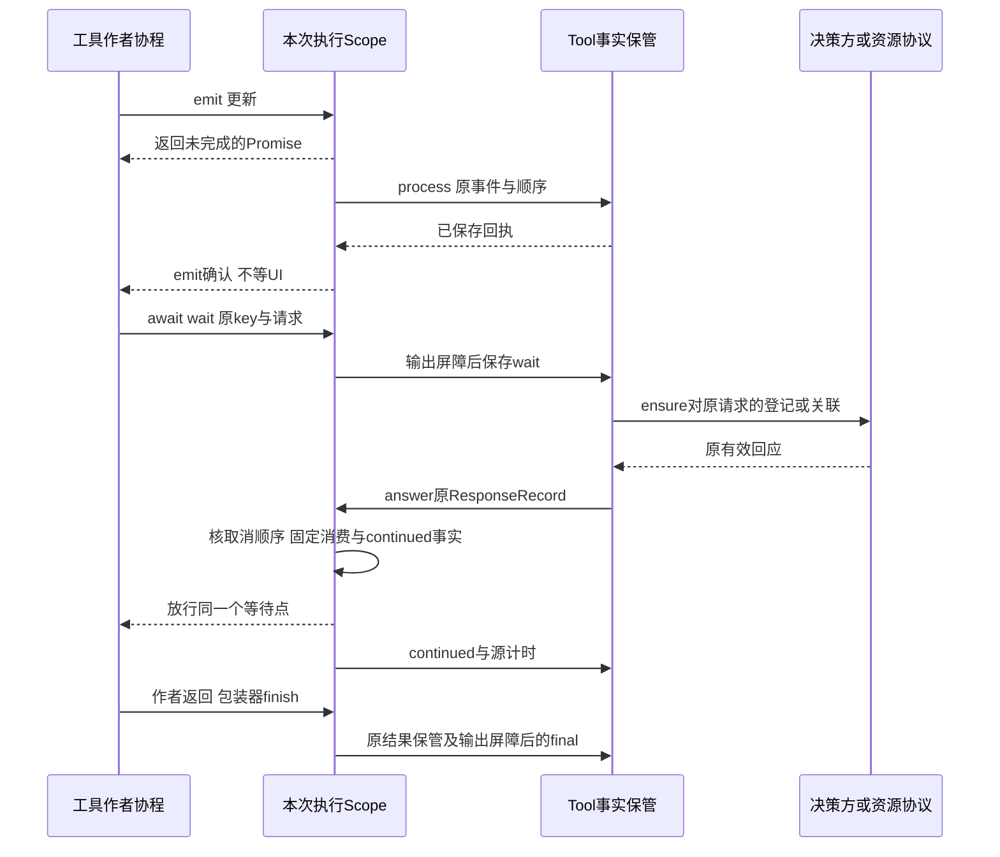

事实保管、外部回应和控制由独立宿主驱动，不能等待作者返回才开始读事实。取消时 wait 以 cancelled 结束；UI 断线只断观察。已有输出保存未知时，wait 不提前登记，正常 final 不越过屏障；取消仍可以受理。live-only 执行源丢失后，不从图中的等待箭头推断调用栈可恢复。

## 自定义等待协议与无效提交

工具作者先定义请求和响应形状，再把协议列入 ToolAuthor.waits。下面的“定义形状”表示由 schema-provider 支持的静态 schema，实际 TypeScript 入口见 [public-api](public-api.md#作者执行上下文)。等待期间采用固定版本，不跟随作者修改后的最新版。

```text
发布确认 = 定义等待协议(
    kind = ask,
    adoption = 发布确认的精确版本,
    request = 定义形状({目标环境: 枚举[测试, 生产], 摘要: 文本}, 大小上限),
    response = 定义形状({选择: 枚举[允许, 拒绝], 说明: 可选文本}, 大小上限),
    expiry = forbidden
)

决定 = 等待 本次执行.wait(
    kind = ask, key = 本次确认键,
    contract = 发布确认,
    request = 严格JSON编码({目标环境: 生产, 摘要: 本次变更})
)
```

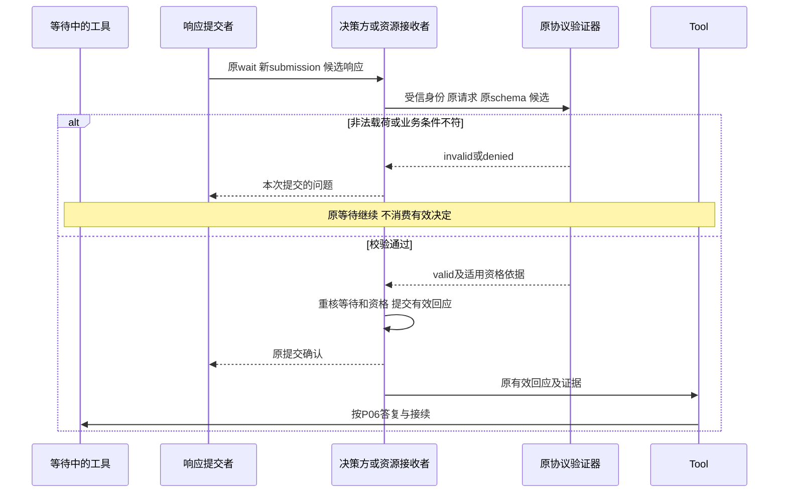

原 submission 重试认回结果；修正内容使用新 submission，wait 不变。校验服务不可用不是提交者填错，已失效等待不能因为后来有合法回应而重新开放。HTTP 是其中一种提交适配，不要求工具保持一条请求连接。

## 多命令函数与独立返回

下面是组合方式的伪代码，省略错误分支的展示，但每次构造都必须检查 Outcome。三个函数各自提供参数 codec、原值 codec、返回验证器及需要的程序编码。普通函数不必自己制造 ToolResult。精确签名归 [作者注册入口](public-api.md#定义作者适配与独立消费)。

```text
readFile(参数: {path}, 环境, 执行上下文):
    返回 {text: 读取内容, encoding: "utf-8"}

listFiles(参数: {directory}, 环境, 执行上下文):
    返回 {entries: [{name: "a.txt", kind: "file"}]}

writeFile(参数: {path, text}, 环境, 执行上下文):
    执行合法写入
    返回 ToolResult(
        content = [写入完成说明],
        data = 已声明写入回执({bytesWritten: 实际字节数}),
        original = none, attachments = []
    )

读取操作 = 核对成功(defineToolOperation(
    parameters = 已声明读取参数,
    returns = ordinary + 读取数据schema,
    author = 读取作者(readFile, 读取返回检查, 读取渲染, 读取程序编码)
))
列表操作 = 核对成功(defineToolOperation(
    parameters = 已声明列表参数,
    returns = ordinary + 目录数据schema,
    author = 列表作者(listFiles, 列表返回检查, 列表渲染, 列表程序编码)
))
写入操作 = 核对成功(defineToolOperation(
    parameters = 已声明写入参数,
    returns = structured + 写入回执schema,
    author = 写入作者(writeFile, 写入结果检查)
))

文件工具 = 核对成功(defineCommandTool(
    metadata = 文件工具的身份与许可,
    commands = {
        read: {summary: "读取文件", operation: 读取操作},
        list: {summary: "列出文件", operation: 列表操作},
        write: {summary: "写入文件", operation: 写入操作}
    }
))
```

注册生成三个命令的参数及 returns 投影，绑定提供者在装载阶段核实际 schema 和作者。调用 read 时，ToolBindings 选择读取操作；后续返回只能按读取契约检查。若 readFile 返回 `{bytesWritten: 10}`，即使写入 schema 接受它，读取调用仍失败。定义更新不改变原调用采用的 schema。

若只提供读取函数，可将同一个读取操作交给 defineFunctionTool，不必另建一种返回机制。同一个多命令工具的 FIFO、并发和 programmable 规则仍按原工具身份执行。程序执行方只经 ProgramTools 发起具名命令，示例中的注册对象不交给脚本。

## 两种返回在 settle 汇合

```text
普通作者执行(参数, 依赖, 本次执行):
    返回 {匹配数: 3, 文件名: ["a.ts", "b.ts", "c.ts"]}

普通作者绑定:
    output = 检查普通返回形状及匹配数与文件列表长度一致
    renderer = 生成给人和消费方的完整文本
    program = 按已声明schema编码同一返回值

结构化作者执行(参数, 依赖, 本次执行):
    返回 ToolResult(
        content = 作者组织的展示内容,
        data = 按已声明协议组织的程序数据或显式none,
        original = 无卸载原文或合法卸载引用,
        attachments = 合法附件
    )
```

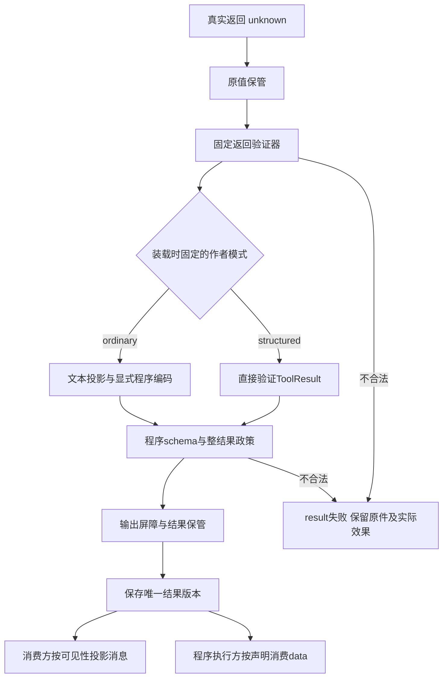

程序执行方若通过语言 SDK 把“搜索文件”绑定成普通函数，成功路径得到的是已核验程序值。它不是调用原 executor，也不是解析 content 文本。SDK 先处理真实 terminal、固定输出契约和可靠交接；明确失败、输出不合法或版本不匹配不能伪装为返回空数组。具体 SDK 语法与错误映射归程序执行提供者。

## 准入、准备与启动

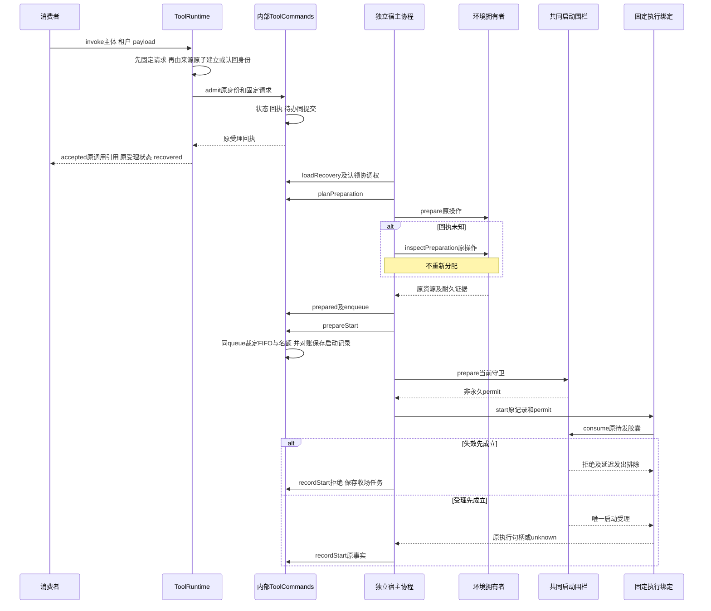

## 等待、答复与取消

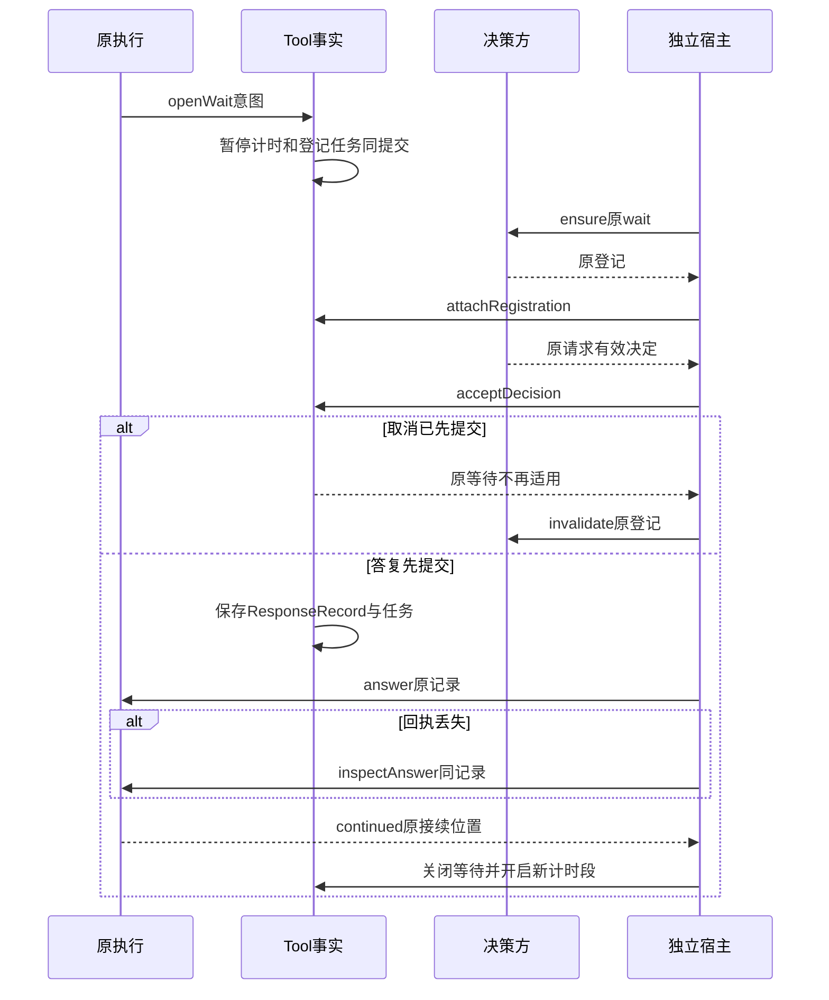

## 原输出与双路径交付

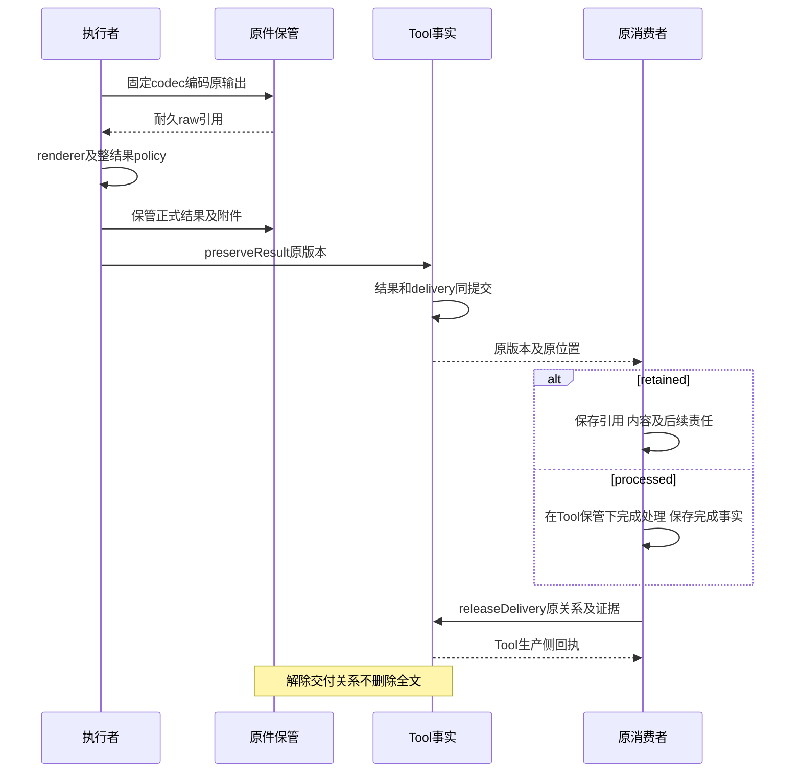

## 接手协调与物理执行分开

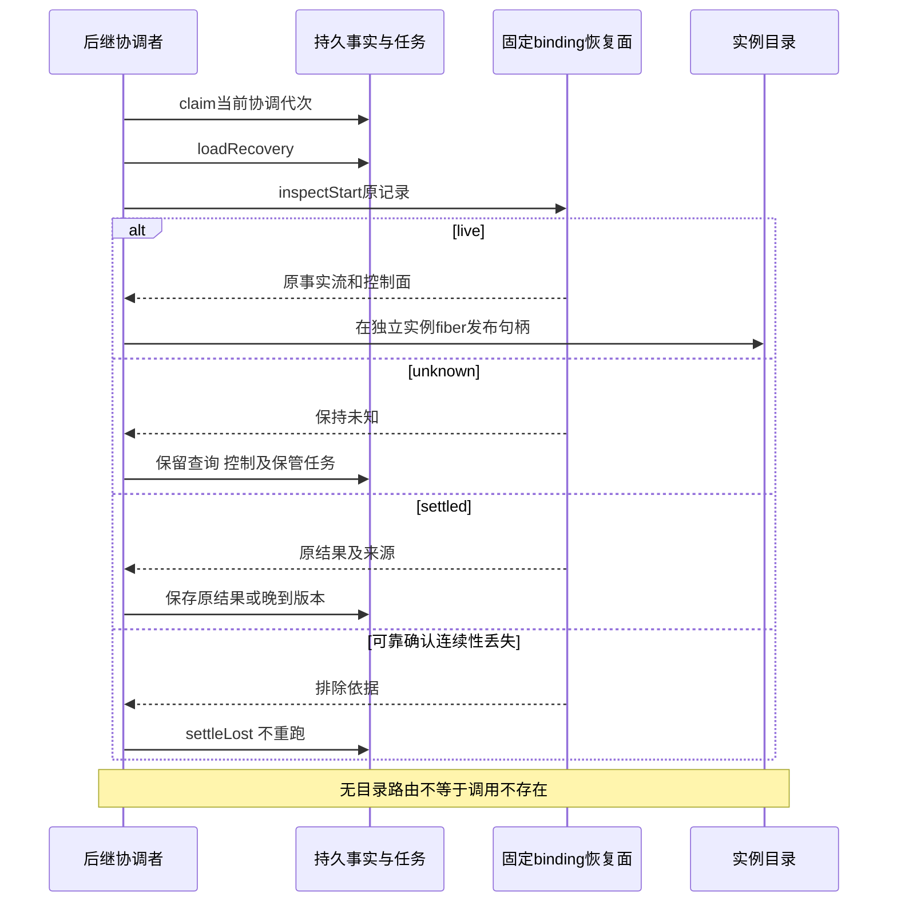

程序子调用见本页[父子调用时序](#程序子调用时序)。Cordis 换代次序见 tool-host-local 的 cordis（`tool-host-local/docs/cordis.md#阶段装配与换代`）。

## 程序子调用时序

前提：采用受信的程序执行宿主、原子调用身份和可靠结果保管。未知受理保留原身份；图中的保管确认不能由程序 Promise 替代。完整行为归 [C01](../SPEC.md#c01-子调用登记与发起)和 [C02](../SPEC.md#c02-返回等待与计时)。

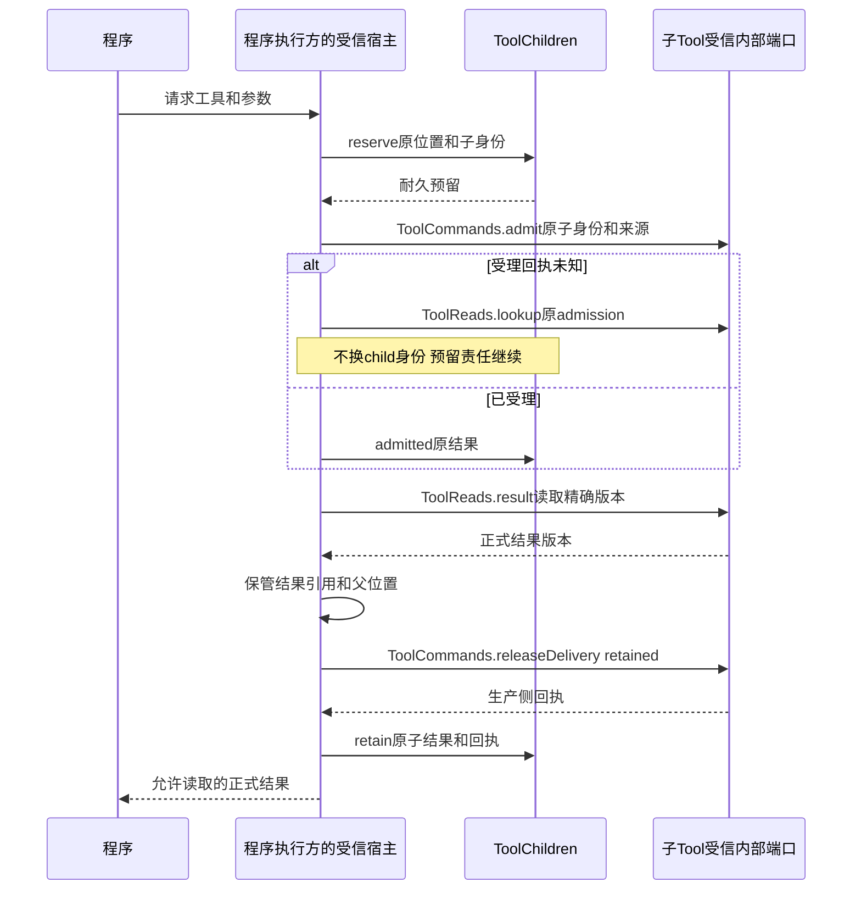

## 工具执行的关键协作流程

流程承接[产品旅程](../../../../.meta_harness/design/product/tool-execution/design.md#关键用户旅程)和[领域协作](../../../../docs/domains/tool-execution/architecture.md)。图表示逻辑角色、守卫及稳定关联，不代替公开 API、Schema、存储事务或提供者协议。异步请求、控制、结果事实和内容保管各有含义，不表示共同物理寿命。

### 责任、机制源与阅读边界

Tool 拥有逻辑调用、真实执行、内部等待、原结果、效果、账目和交付责任。发起协调者可以是任何调用方，独立消费无需外部工作对象。消费方拥有自己的逻辑工作，不能替 Tool 写物理停止；决策方拥有对原请求的登记和有效决定，身份与授权解释动作许可。装配、资产、设置、环境、内容保管和原消费者分别提供其事实。一次包装工具执行成功不表示被调用领域业务已完成。

工具专有行为及操作协议的唯一源为 [SPEC](../SPEC.md)，本节组织其协作。共同约束归[工具运行架构](../../../../docs/architecture/runtime/tool-runtime.md)、[流与消费](../../../../docs/architecture/runtime/streaming-and-consumption.md)、[控制与恢复](../../../../docs/architecture/runtime/control-and-recovery.md)和[身份与授权](../../../../docs/architecture/security/identity-and-authorization.md)。dummy 的归类见产品[定义、已知能力与一次执行](../../../../.meta_harness/design/product/tool-execution/design.md#定义已知能力与一次执行)。

| 产品旅程 | 流程 | Tool 的交接与成员依据 |
| --- | --- | --- |
| [TL-J01](../../../../.meta_harness/design/product/tool-execution/design.md#tl-j01) | [TL-F01](#tl-f01) | 合法定义、当前可用或已知不可用，见[定义专题](../SPEC.md#已知与可用的动态关系)。 |
| [TL-J02](../../../../.meta_harness/design/product/tool-execution/design.md#tl-j02) | [TL-F02](#tl-f02) | 完整输入、真实发起或 dummy 结果，见[发起前提](../SPEC.md#发起的完整前提)。 |
| [TL-J03](../../../../.meta_harness/design/product/tool-execution/design.md#tl-j03) | [TL-F03](#tl-f03) | 单向等待转换与最终结果，见[等待关系](../SPEC.md#前后台的关系边界)。 |
| [TL-J04](../../../../.meta_harness/design/product/tool-execution/design.md#tl-j04) | [TL-F04](#tl-f04) | 内部等待与原决定接续，见[答复行为](../SPEC.md#内部等待与有效答复)。 |
| [TL-J05](../../../../.meta_harness/design/product/tool-execution/design.md#tl-j05) | [TL-F05](#tl-f05) | 过程观察、原结果保管及采用，见[结果专题](../SPEC.md#先可靠承接再处理结果)。 |
| [TL-J06](../../../../.meta_harness/design/product/tool-execution/design.md#tl-j06) | [TL-F06](#tl-f06) | 卸载全文、分页及真实费用，见[全文读取](../SPEC.md#卸载与全文读取)。 |
| [TL-J07](../../../../.meta_harness/design/product/tool-execution/design.md#tl-j07) | [TL-F07](#tl-f07) | 控制与接续原调用，见[控制恢复专题](../SPEC.md#接续原调用与确认自身失联)。 |

<a id="tl-f01"></a>
### TL-F01 定义及动态可用性

作者按两种定义形态给完整说明和真实声明。常驻标记归装配引用，不归工具作者预算；多命令呈现始终紧凑，不熟命令先取得用法。已知与可用分别求值，合法新定义仅供后续采用。创作的授权、工作区或租户提交、提升、显式合法装载均按其拥有者承接，不默认组织写权或同标识覆盖。

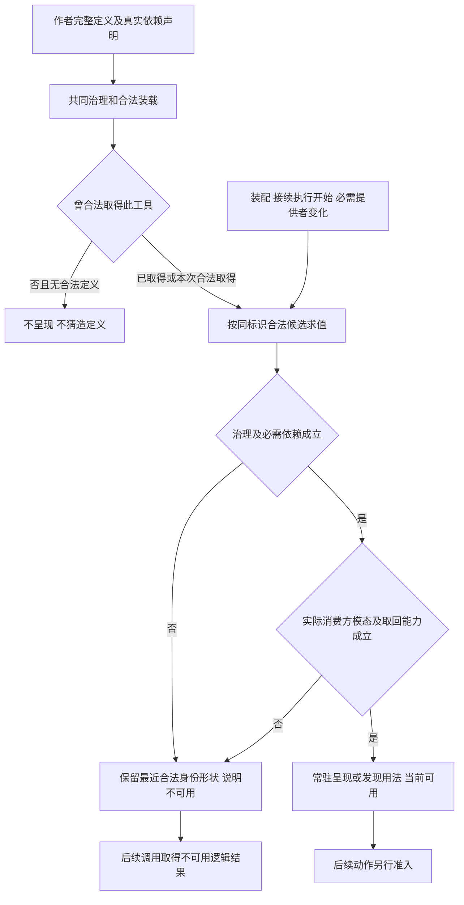

撤权不允许读取未授权新内容；同标识有合法候选时先选择，不直接走不可用。参数模态检查消费方的输出能力、结果模态检查消费方的输入能力或合法转换，每个消费方按自己的档案判断。必需合法定义从未取得或 runtime 必需依赖不能建立，是装配缺口，不能用 dummy 凑齐。

拒绝和恢复是定义可达性的变化，不等于已发执行中断。Tool 不替资产或装配制定创作冲突协议。缺项：TOOL-M01；验例：完整定义、help 一致、撤权后的已知与未知、合法候选替换、提供者恢复及两端模态。

<a id="tl-f02"></a>
### TL-F02 发起与普通或不可用逻辑结果

参与者 C 是真实发起协调者，可能是不依赖任何外部工作对象的程序。下图的前置拒绝和参数失败不表示真实执行启动，dummy 也没有原工具物理执行。调用身份不能只用调用方的外部关联代替同一步内不同动作。

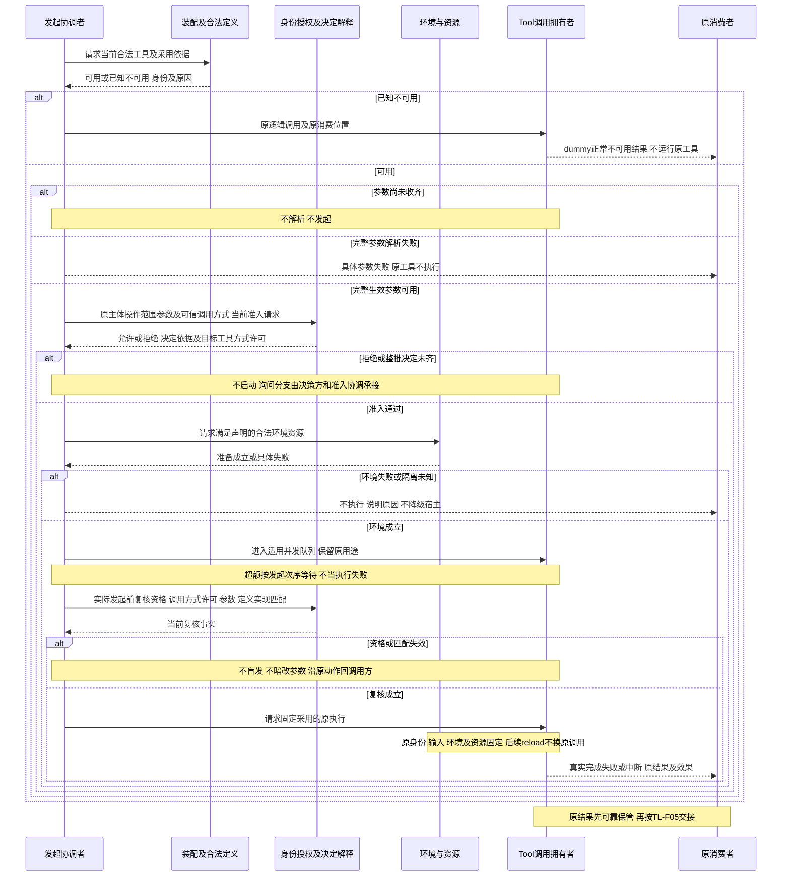

发起协调者交来的批准绑定具体动作或明确整批，当前权限可在排队期间收窄；无关 reload 不机械重问，有效依据变动不能借旧批准。程序消费方的资源读取与脚本执行分开、动作桥接方的认证与动作调用分开。原函数直接消费与运行时治理分层，独立程序按真实依赖使用，不能访问托管资源时漏身份检查。

发起、围栏、控制与未知对账的协议见 [protocols](../SPEC.md#tool-操作协议)。图中的请求和复核并不证明已有跨域原子提交，未知不直接重发有外部效果的动作。持续验证包括排队撤权、整批等待撤权、环境失败、半截参数和 dummy 无原执行用量。

脚本可调用集合与直接调用集合分别呈现。TL-F01 的发现阶段读取声明，TL-F02 的准入及启动阶段核对可信来源和目标许可，完整规则见[可编程调用](../SPEC.md#可编程调用的定义与准入)。通用调用入口和包装工具继续传递脚本来源，不借中转避开目标检查。

<a id="tl-f03"></a>
### TL-F03 单向转换等待关系

本图仅描述调用方关系，不是第二份真实执行状态机。真实执行可运行、内部等待或收场；同一原执行固定身份和外部效果。后台许可是工具作者声明，设置资格与上界归共同规则。

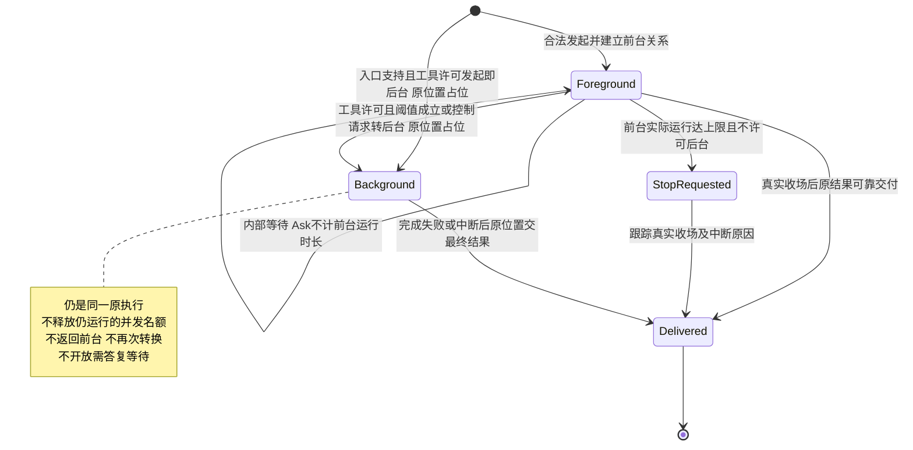

| 守卫或异常 | 可观察后果与边界 |
| --- | --- |
| 未声明后台许可 | 阈值、控制请求和前台上限都不能绕过，不能建立后台关系。 |
| 前台上限 | 只累计前台实际运行，内部等待不计，转后台后不继续计；无定义或合法配值不加限制。 |
| 并发满 | 同一并发范围同工具前后台及内部等待共同计数，超额顺序排队。 |
| 停止请求已受理 | 不证明物理已停，后续真实结果沿原身份保存；前台上限触发的停止（终局原因 foreground-limit）不自动重试。 |
| 后台结果到达 | 占位和最终结果相关联，后台不是新调用，不改消费方已有的终态。Tool 不为调用创建或推进任何外部工作对象，后续工作由消费方按其规则决定。撤回、撤投递资格或消费方否决不能凭迟到结果恢复任务资格。 |
| 调用方或句柄退出 | 认回同一关系和原结果位置，不取消工具、不重发。 |

时限、名额和控制协议见 [P02](../SPEC.md#p02-定义准入与队列) 与 [P07](../SPEC.md#p07-计时控制与检查点)，实际提供者仍待验证；图不选择计时器、线程或进程。验证同时覆盖关系单向、原输入不变、后台名额、前台实际计时和终态竞争。

<a id="tl-f04"></a>
### TL-F04 内部等待、异步登记与原答复

此路径已经处于前台 Tool 内部等待。它不是动作发起前的授权，也不是消费方自己的等待；需要授权解释时使用身份与授权的结论。Tool 只拥有原等待内容、有效性和接续位置，决策方拥有对原请求的登记与唯一有效决定。

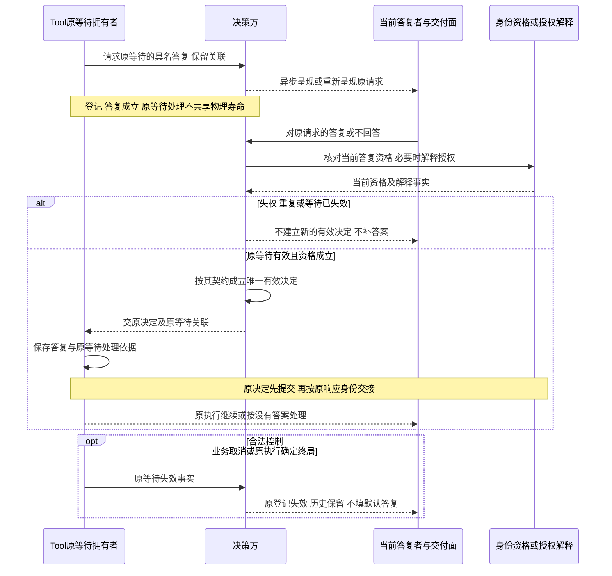

Ask 无超时和默认答案，不转后台，前台上限不计等待。普通消息不答原请求，普通输入仍可靠受理，其他调用可运行。失联查询、调用方退出、句柄或计算资源释放不终结原等待；仅工具自身连续性确认丢失的分支须原执行确定终局后使登记失效，合法控制和撤回不以失联为前提。

恢复先取得原等待、对原请求的决定和待处理责任，不生成另一有效决定。“不回答”是有资格的决策方的有效答复，不是批准或失败。其他确实占资源的等待可以依专有契约设时限，等不到应答不编造答复，该规则不适用 Ask。验证包括普通消息、长期等待、重复及失权答复、无答案、取消与答复竞争、调用方换代。

<a id="tl-f05"></a>
### TL-F05 过程观察、真实收场与采用

过程帧走[过程观察契约](../SPEC.md#过程帧的观察契约)，开块固定填充、封块给完整内容；重连快照不是完整增量历史。过程只给人，不进入消费方的请求内容。下图两条可靠交接路径均保留已确认内容及责任，Tool 的关系解除不是消费方确认清理。

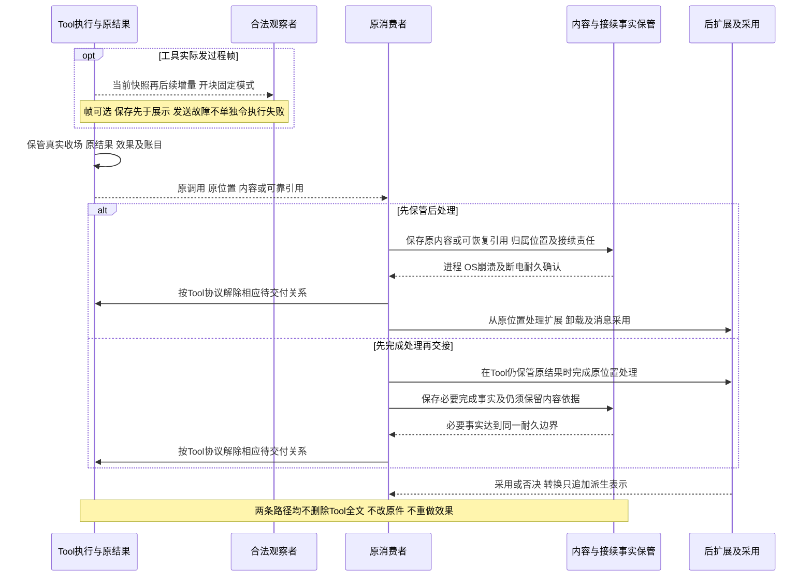

可靠保管先于执行后扩展。第二路径在处理前仍由 Tool 可靠保管，处理失败不解除交付责任，成功后也须保存完成事实；不能误读为先处理未保存内容。保存失败、确认丢失和提交未知按原身份核对，双方不能同时放弃责任。消费者替换从原保存位置继续。

消费方拒绝或实际可读模态不相容时，Tool 保留原结果及原因，不重跑；后台结果以及消费方工作已终态或已撤回的结果不改旧终态、不造后继、不恢复入队。未定旁路后果由实际消费者承担并继续细化。

内容 ref 与附件地址分流见 [P14](../SPEC.md#p14-附件引用与消费方交付)，共享值迁移与读取行为验证沿 TOOL-E01。已展示过程的保存和持久读取设计见 [P08](../SPEC.md#p08-过程分页与全文交接)，实际断电验证仍待 TOOL-M04，不宣称逐片同步落盘或允许丢失。验证覆盖两种填充、快照接续、保存失败、两种交接路径、确认未知、消费者替换和消息否决。

<a id="tl-f06"></a>
### TL-F06 全文卸载、取回与成本保管

单条结果卸载不是消费方的整体压缩，也不改变前后台关系或终局。全文保留沿 Tool 专有规则，内容存储承担字节耐久、引用有效和可取回，具体保管所在由实际机制确定。现行没有到期删除规则。

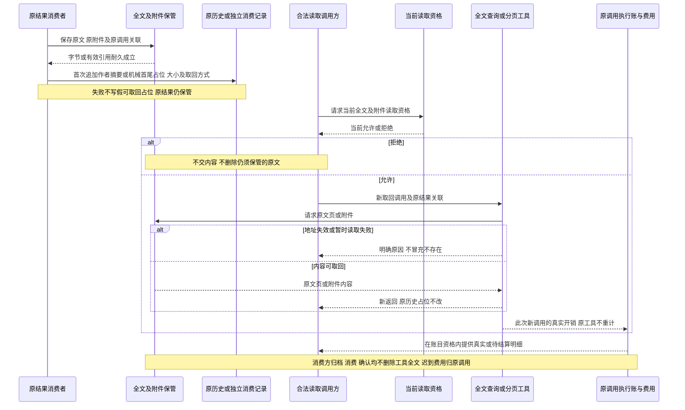

作者结构化返回提供原文时采用作者摘要；单条超限兜底只机械保首尾。没有满足保存前提不能声称已经卸载，存储失败和引用不可用继续保管责任。查询取回是新调用和新返回，不重做原工具效果、不回写旧占位。

账目读取独立核对原租户及组织范围，账目资格不能代内容权限。dummy 只记实际替换处理，原工具没有物理用量；原成本不因重通知、接续或读回重计，真正新调用成本保存，未知不填零。撤回及消费方归档后实际费用和迟到结果仍沿原调用追加保存。全文、附件、账目和诊断投影不可混为一个宽泛读权。

引用、分页、存储失败和成本设计协议见 [P08](../SPEC.md#p08-过程分页与全文交接) 与 [P09](../SPEC.md#p09-账目恢复与退出)，真实组合仍待 TOOL-M03 验证。验证覆盖作者摘要与机械截断、分页新返回、权限收窄、压缩或归档后读回、地址失败、原费用去重和新调用真实计量。

<a id="tl-f07"></a>
### TL-F07 单次控制、逻辑撤回和原调用恢复

控制参与者只对其控制责任范围内、当前资格内的具名目标负责。下图展示撤回的逻辑结果与真实收场可分别完成，withdraw 的 reach 区分前台范围与全部范围，同时限定目标调用本身：Tool 在控制提交时按目标当时的关系判断，目标是后台关系（已转后台或发起即后台）而 reach 为 foreground-and-unadmitted 时，控制结果为 rejected（out-of-reach）。这些撤回都不等待物理全停。控制提交路径尚未实现，图是契约的流程，不表示实现已具备。

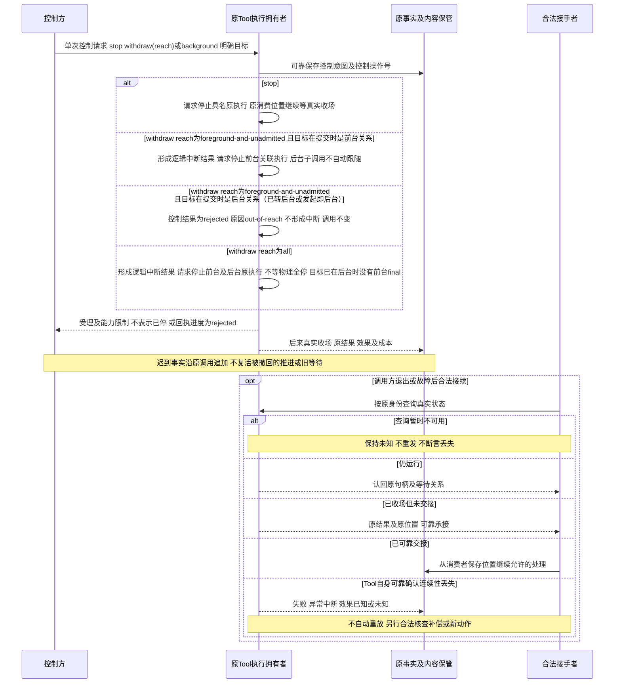

完成与停止竞争保留真实结果，不能把撤回后的成功伪报物理中断。单次控制不自动结束消费方的工作，控制方只控制其责任范围内的调用。释放句柄、disposer、断线或环境重建都不证明停止或效果回滚。控制方不重启旧调用，已终态工作仅处理允许的迟到结果和费用。

已确认原调用、答复、控制、结果、交接和账目须承受进程崩溃、OS 崩溃及断电，存储介质可读取及声明部署条件是前提。托管隔离域退出不丢宿主调用的迟到收场。存储和必要准入不可用阻止依赖允许或保存的新动作，仍跟踪原执行责任；灾后介质损毁与安全开放政策未定。

控制、连续性、围栏和交接协议已在 [protocols](../SPEC.md#tool-操作协议) 展开，实际提供者证据仍由 TOOL-M02、TOOL-M03 跟踪。验证须覆盖真实外部效果、取消完成竞争、撤回后迟到、查询未知、自身丢失、独立无外部工作对象的控制、消费者替换及真实断电边界，缺环境报告无法验证。

### 未细化与验证责任

[问题登记](../../../../.meta_harness/design/product/tool-execution/design.md#未决问题与待定事项)继续拥有 TOOL-M01 至 TOOL-M04 与 TOOL-E01 技术兑现。本页不生成新产品默认或另一套问题 JSON。精确 Schema/API、发起共同有效边界、认领围栏、控制传播与级联、未知提交、结果交接确认、连续等待资源、在途耐久、分页和性能分别由工具成员、发起或消费协调者、决策方、存储及提供者承担；图中语义路径可读不表示这些机制已兑现。

[成员持续验证义务](../SPEC.md#持续验证义务)与[旅程能力验证入口](../SPEC.md#旅程能力与验证入口)规定工具、存储、控制、模态、故障、外部效果及性能验证的范围。结构和图检查不证明这些运行保证。

## 普通调用丢答后的重入

调用方先保存原 consumer 与完整固定请求。来源 resolve 先核当前资格，再原子建立或认回原关联。来源、admission 与宿主各自拥有签发、受理及唤醒责任。accepted.state 是原回执，当前状态通过 lookup 读取。

association-unknown 时没有引用，继续提交原意图。commit-unknown 时已有原引用，仍沿原 invoke 续做来源或准入。请求冲突不替换关联，撤权不泄露原身份，settled 不重跑。每次公开 control 生成新 operation；旧 unknown 用旧引用独立查询，新 committed 不能替它收场。行为唯一正文见 [普通操作](../SPEC.md#342-普通操作与实例目录)。
