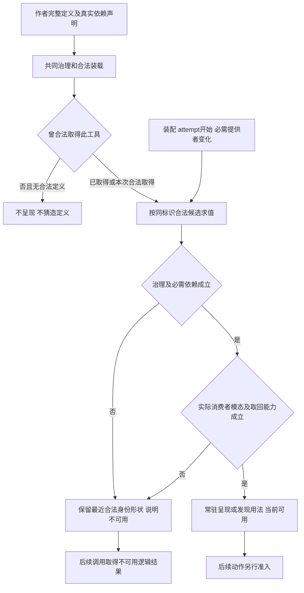
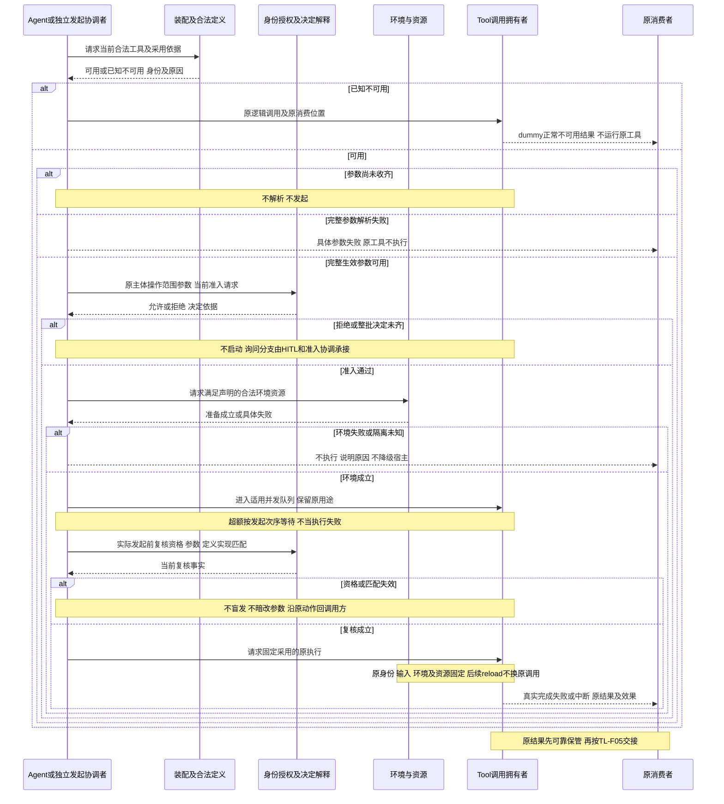
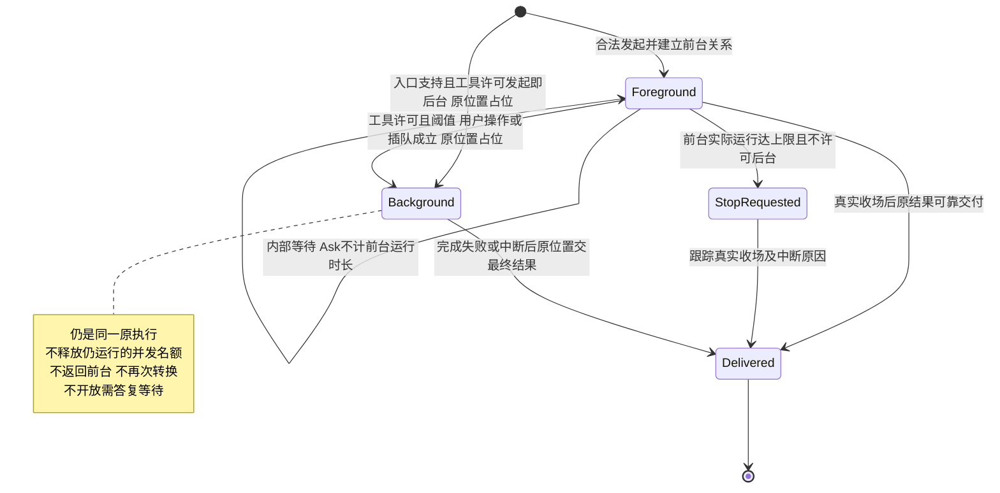
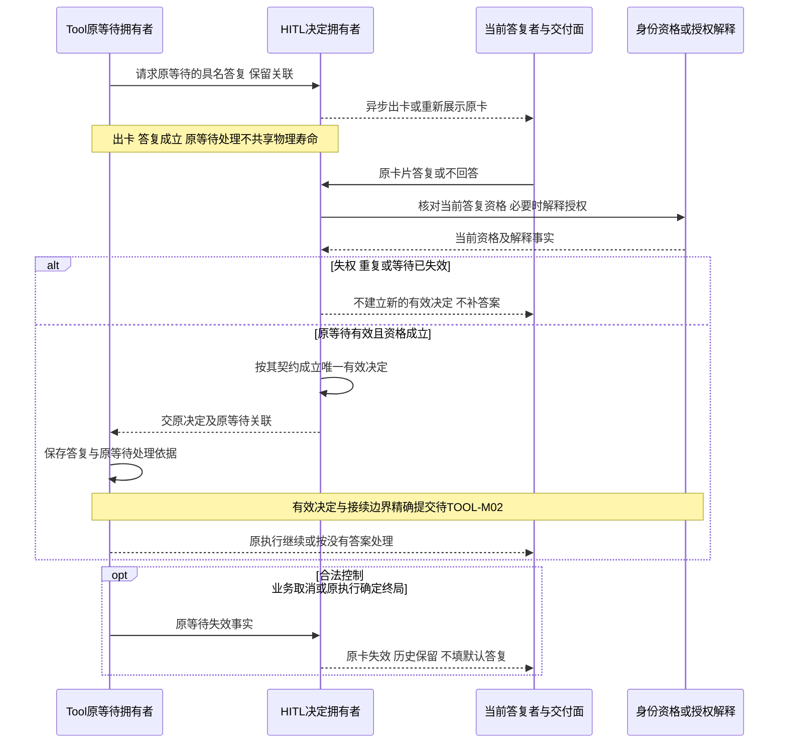
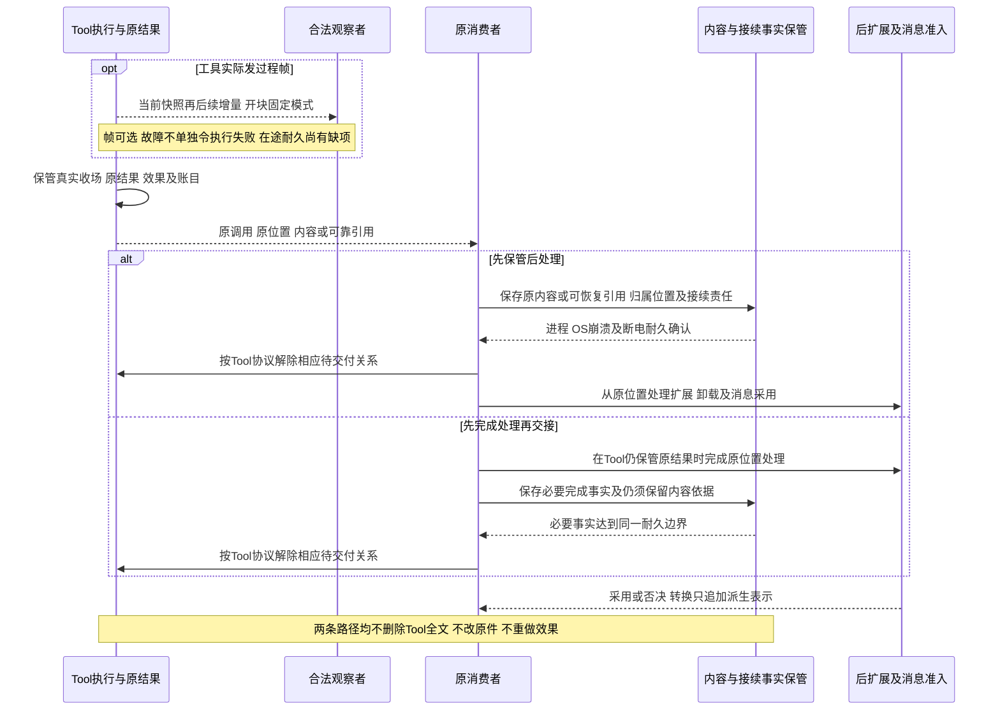
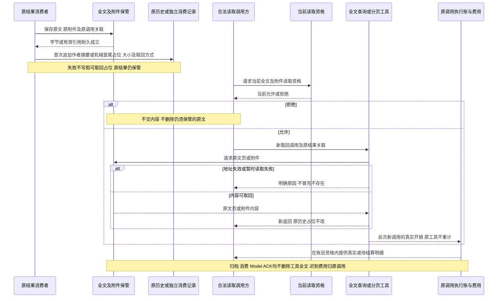
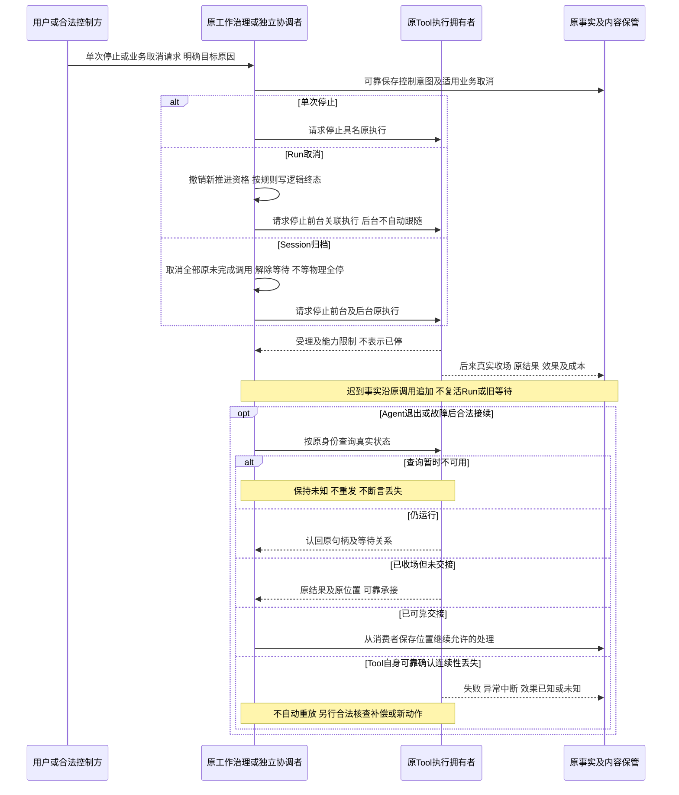

# 工具执行的关键协作流程

状态：候选、待用户确认。流程承接[产品旅程](../../../../.meta_harness/design/product/tool-execution/design.md#关键用户旅程)和[领域协作](../../../../docs/domains/tool-execution/architecture.md)，不定义公开 API、Schema、存储事务或提供者协议。图表示逻辑角色、守卫及稳定关联，异步请求、控制、结果事实和内容保管各有含义，不表示共同物理寿命。flowchart 是活动示意，不是严格 UML 或算法证明。

## 责任、机制源与阅读边界

Tool 拥有逻辑调用、真实执行、内部等待、原结果、效果、账目和交付责任。发起协调者可以是 Agent 或独立消费者，独立消费无需 Session。Session 拥有已有关联的逻辑工作及取消资格，不能替 Tool 写物理停止；HITL 拥有卡片和有效决定，身份与授权解释动作许可。装配、资产、设置、环境、内容保管和原消费者分别提供其事实。一次包装工具执行成功不表示被调用领域业务已完成。

工具专有机制的唯一源为 [SPEC](../SPEC.md)及三个必要专题，本页组织其协作。母检出现行 `docs/architecture/runtime/tool-runtime.md`、`streaming-and-consumption.md`、`control-and-recovery.md` 和 `security/identity-and-authorization.md` 拥有共同上层约束，旧 inputs 只定位既有来源；新明确决定优先。dummy 的归类见产品[定义、已知能力与一次执行](../../../../.meta_harness/design/product/tool-execution/design.md#定义已知能力与一次执行)。

| 产品旅程 | 流程 | Tool 的交接与成员依据 |
| --- | --- | --- |
| [TL-J01](../../../../.meta_harness/design/product/tool-execution/design.md#tl-j01) | [TL-F01](#tl-f01) | 合法定义、当前可用或已知不可用，见[定义专题](definition-and-invocation.md#已知与可用的动态关系)。 |
| [TL-J02](../../../../.meta_harness/design/product/tool-execution/design.md#tl-j02) | [TL-F02](#tl-f02) | 完整输入、真实发起或 dummy 结果，见[发起前提](definition-and-invocation.md#发起的完整前提)。 |
| [TL-J03](../../../../.meta_harness/design/product/tool-execution/design.md#tl-j03) | [TL-F03](#tl-f03) | 单向等待转换与最终结果，见[等待关系](wait-control-and-recovery.md#前后台的关系边界)。 |
| [TL-J04](../../../../.meta_harness/design/product/tool-execution/design.md#tl-j04) | [TL-F04](#tl-f04) | 内部等待与原决定接续，见[答复行为](wait-control-and-recovery.md#内部等待与有效答复)。 |
| [TL-J05](../../../../.meta_harness/design/product/tool-execution/design.md#tl-j05) | [TL-F05](#tl-f05) | 过程观察、原结果保管及采用，见[结果专题](results-and-retention.md#先可靠承接再处理结果)。 |
| [TL-J06](../../../../.meta_harness/design/product/tool-execution/design.md#tl-j06) | [TL-F06](#tl-f06) | 卸载全文、分页及真实费用，见[全文读取](results-and-retention.md#卸载与全文读取)。 |
| [TL-J07](../../../../.meta_harness/design/product/tool-execution/design.md#tl-j07) | [TL-F07](#tl-f07) | 控制与接续原调用，见[控制恢复专题](wait-control-and-recovery.md#接续原调用与确认自身失联)。 |

## TL-F01 定义及动态可用性

作者按两种定义形态给完整说明和真实声明。常驻标记归装配引用，不归工具作者预算；多命令模型呈现始终紧凑，不熟命令先取得用法。已知与可用分别求值，合法新定义仅供后续采用。Agent 创作的授权、工作区或租户提交、用户提升、显式合法装载均按其拥有者承接，不默认组织写权或同标识覆盖。

撤权不允许读取未授权新内容；同标识有合法候选时先选择，不直接走不可用。模型路径参数模态检查模型输出、结果模态检查模型输入或合法转换，独立消费按自身消费者判断。必需合法定义从未取得或 runtime 必需依赖不能建立，是装配缺口，不能用 dummy 凑齐。

拒绝和恢复是定义可达性的变化，不等于已发执行中断。Tool 不替资产或装配制定创作冲突协议。缺项：TOOL-M01；验例：完整定义、help 一致、撤权后的已知与未知、合法候选替换、提供者恢复及两端模态。

## TL-F02 发起与普通或不可用逻辑结果

参与者 C 是真实发起协调者，可能是无 Session 的程序。下图的前置拒绝和参数失败不表示真实执行启动，dummy 也没有原工具物理执行。调用身份不能只用 Session、Run、step 代替同一步内不同动作。

人工批准绑定所见动作或明确整批，当前权限可在排队期间收窄；无关 reload 不机械重问，有效依据变动不能借旧批准。Skill 读取与脚本执行分开、MCP 认证与动作调用分开。原函数直接消费与运行时治理分层，独立程序按真实依赖使用，不能访问托管资源时漏身份检查。

发起与资格共同成立、围栏、排队取消、控制传播和提交未知对账的精确协议待 TOOL-M02。图中的请求和复核并不证明已有跨域原子提交，未知不直接重发有外部效果的动作。持续验证包括排队撤权、整批等待撤权、环境失败、半截参数和 dummy 无原执行用量。

## TL-F03 单向转换等待关系

本图仅描述调用方关系，不是第二份真实执行状态机。真实执行可运行、内部等待或收场；同一原执行固定身份和外部效果。后台许可是工具作者声明，设置资格与上界归共同规则。

| 守卫或异常 | 可观察后果与边界 |
| --- | --- |
| 未声明后台许可 | 阈值、手动、插队和前台上限都不能绕过，不能建立后台关系。 |
| 前台上限 | 只累计前台实际运行，内部等待不计，转后台后不继续计；无定义或合法配值不加限制。 |
| 并发满 | 同 Session 同工具前后台及内部等待共同计数，超额顺序排队；独立范围由其契约明确。 |
| 停止请求已受理 | 不证明物理已停，后续真实结果沿原身份保存；前台超时不自动重试。 |
| 后台结果到达 | 占位和最终结果相关联，后台不是新调用，不改原 Run 终态。Tool 不自行建 Run；会话未归档且后续投递仍合法时，交 Session 按[工作治理](../../../session/session/docs/key-flows.md#f-sw03)接入当前工作或形成后继工作。归档、撤投递资格或准入否决不能凭迟到结果恢复任务资格。 |
| Agent或句柄退出 | 认回同一关系和原结果位置，不取消工具、不重发。 |

时限累计、恢复计时、名额获取释放和设置变更的具体兑现仍待 TOOL-M02；图不选择计时器、线程或进程。验证同时覆盖关系单向、原输入不变、后台名额、前台实际计时和终态竞争。

## TL-F04 内部等待、异步卡片与原答复

此路径已经处于前台 Tool 内部等待。它不是动作发起前 HITL 授权，也不是 Run 扩展等待；需要授权解释时使用身份与授权的结论。Tool 只拥有原等待内容、有效性和接续位置，HITL 拥有卡片与唯一有效决定。

Ask 无超时和默认答案，不转后台，前台上限不计等待。普通消息不答卡，当前会话可靠受理普通输入、其他会话可运行。失联查询、Agent 退出、句柄或计算资源释放不终结原等待；仅工具自身连续性确认丢失的分支须原执行确定终局后使卡失效，合法控制和业务取消不以失联为前提。

恢复先取得原等待、原卡决定和待处理责任，不生成另一有效决定。“不回答”是有资格人的有效答复，不是批准或失败。其他确实占资源的等待可以依专有契约设时限，等不到应答不编造答复，该规则不适用 Ask。验证包括普通消息、长期等待、重复及失权答复、无答案、取消与答复竞争、Agent 换代。

## TL-F05 过程观察、真实收场与采用

过程帧走[过程观察契约](results-and-retention.md#过程帧的观察契约)，开块固定填充、封块给完整内容；重连快照不是完整增量历史。过程只给人，不塞模型上下文。下图两条可靠交接路径均保留已确认内容及责任，Tool 的关系解除不是 Model ACK 清理。

可靠保管先于执行后扩展。第二路径在处理前仍由 Tool 可靠保管，处理失败不解除交付责任，成功后也须保存完成事实；不能误读为先处理未保存内容。保存失败、确认丢失和提交未知按原身份核对，双方不能同时放弃责任。消费者替换从原保存位置继续。

消息拒绝或实际可读模态不相容保留原结果及原因，不重跑。仅契约指定仍有效未终结 Run 的结果否决使该 Run 失败；后台、Run 外、原 Run 已终态或业务已取消的结果不改旧终态、不造后继、不恢复入队。未定旁路后果由实际消费者承担并继续细化。

最终块全集及嵌套投影仍待 TOOL-E01／MODEL-E01，实际文本、图片和可见性检查继续。已展示在途内容在 runtime 故障后的保留衔接仍待 TOOL-M04，不宣称逐片同步落盘或允许丢失。验证覆盖两种填充、快照接续、保存失败、两种交接路径、确认未知、消费者替换和消息否决。

## TL-F06 全文卸载、取回与成本保管

单条结果卸载不是会话压缩，也不改变前后台关系或终局。全文保留沿 Tool 专有规则，内容存储承担字节耐久、引用有效和可取回，具体保管所在由实际机制确定。现行没有到期删除规则。

作者结构化返回提供原文时采用作者摘要；单条超限兜底只机械保首尾。没有满足保存前提不能声称已经卸载，存储失败和引用不可用继续保管责任。查询取回是新调用和新返回，不重做原工具效果、不回写旧占位。

账目读取独立核对原租户及组织范围，账目资格不能代内容权限。dummy 只记实际替换处理，原工具没有物理用量；原成本不因重通知、接续或读回重计，真正新调用成本保存，未知不填零。取消及归档后实际费用和迟到结果仍沿原调用追加保存。全文、附件、账目和诊断投影不可混为一个宽泛读权。

引用确认、分页限额、存储失败处置和成本精确协议待 TOOL-M03。验证覆盖作者摘要与机械截断、分页新返回、权限收窄、压缩或归档后读回、地址失败、原费用去重和新调用真实计量。

## TL-F07 单次控制、逻辑取消和原调用恢复

控制参与者只对当前资格内的具名目标负责。下图展示业务取消与真实收场可分别完成，后台与前台在 Run 取消范围上有差异；Session 归档控制前后台但不等待物理全停，子会话级联仍归 Session。

完成与停止竞争保留真实结果，不能把归档后成功伪报物理中断。单次控制不自动结束模型或 Run，Agent 仅控制其既有范围内自己发起的后台执行。释放句柄、disposer、断线或环境重建都不证明停止或效果回滚。撤销归档不重启旧调用，已终态工作仅处理允许的迟到结果和费用。

已确认原调用、答复、控制、结果、交接和账目须承受进程崩溃、OS 崩溃及断电，存储介质可读取及声明部署条件是前提。托管隔离域退出不丢宿主调用的迟到收场。存储和必要准入不可用阻止依赖允许或保存的新动作，仍跟踪原执行责任；灾后介质损毁与安全开放政策未定。

控制确认、自身丢失判据、围栏和跨提供者有效边界待 TOOL-M02，持久交接待 TOOL-M03。验证须覆盖真实外部效果、取消完成竞争、归档迟到、查询未知、自身丢失、独立无 Session 控制、消费者替换及真实断电边界，缺环境报告无法验证。

## 未细化与验证责任

[问题登记](../../../../.meta_harness/design/product/tool-execution/design.md#未决问题与待定事项)继续拥有 TOOL-M01 至 TOOL-M04、TOOL-E01 与 MODEL-E01 来源定位。本页不生成新产品默认或另一套问题 JSON。精确 Schema/API、发起共同有效边界、认领围栏、控制传播与级联、未知提交、结果交接确认、连续等待资源、在途耐久、分页和性能分别由工具成员、发起或消费协调者、HITL、存储及提供者承担；图中语义路径可读不表示这些机制已兑现。

[成员持续验证义务](../SPEC.md#持续验证义务)与[旅程能力验证入口](../SPEC.md#旅程能力与验证入口)给未来证据范围。本次没有运行工具、存储、控制、模态、故障、外部效果或性能测试，结构和图检查不替代独立接受。
