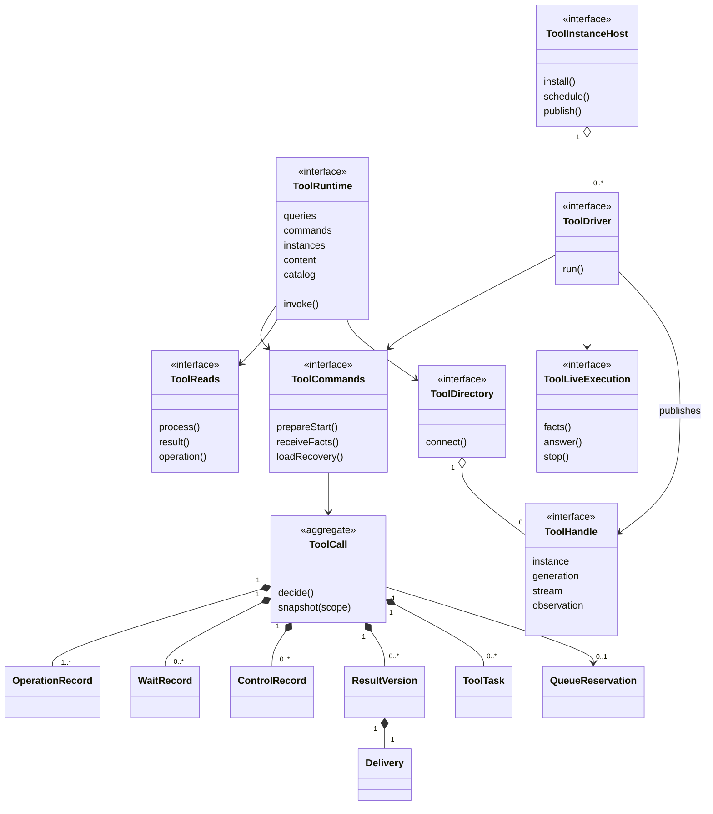
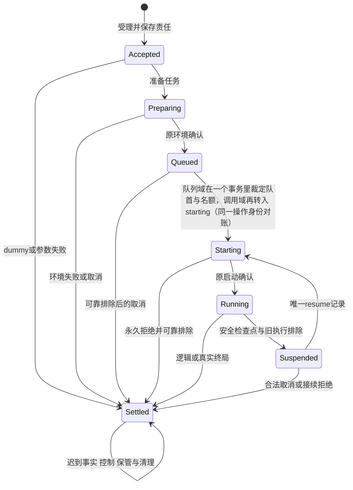
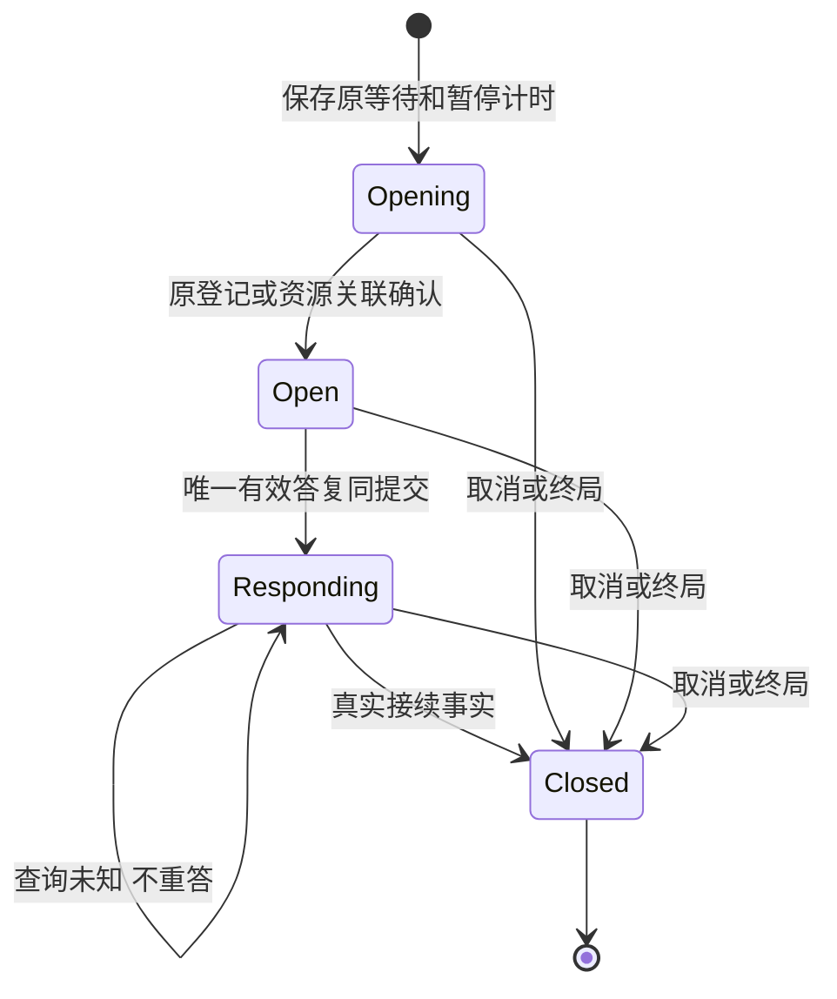
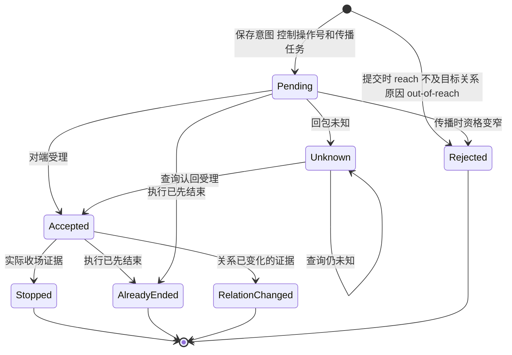
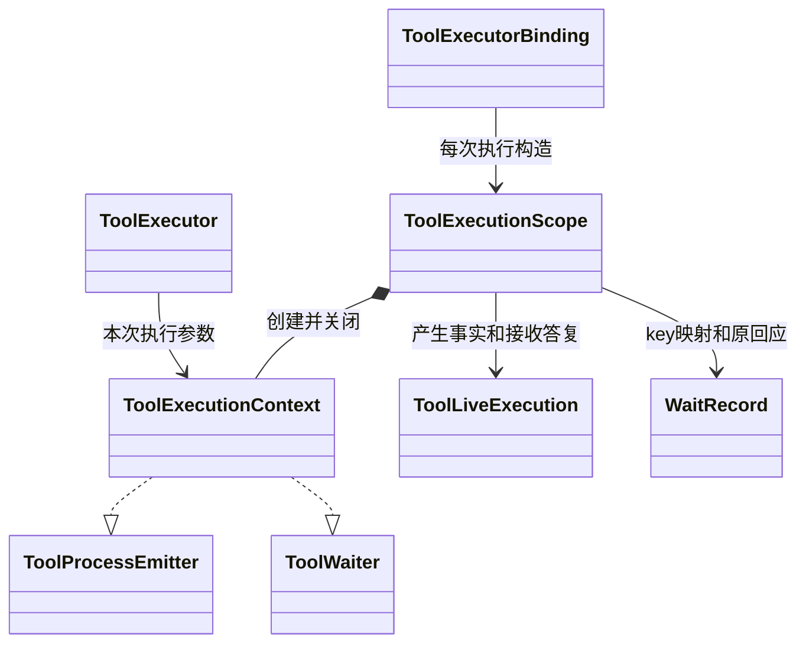

# Tool 对象模型

本页解释 [公开形状](public-api.md) 中对象的身份、职责、关联和寿命，不复制另一套类型。行为守卫归 [SPEC](../SPEC.md) 与 [操作协议](../SPEC.md#tool-操作协议)。OOP 在这里指封装责任和不变量，不要求每个值都写成 class。

本页只列契约对象。实现包 `tool` 自有的对象见 tool 对象模型（`tool/docs/object-model.md`）。

## 调用方怎样使用

下例是职责伪代码。每个操作都要处理成功、拒绝和未知三类结果。它不表示某个实现已经提供全部操作，实现范围见各实现包的 SPEC。

```text
装配者创建 ToolRuntime，固定配置和各受信端口的提供者；实例身份由 host 传给 driver
    缺必需端口是装配缺陷，构造时拒绝，不留到调用时
        必需与可选端口的分类见 SPEC 的输入与依赖表，配置的取值范围见实现包

普通调用方提交 invoke，带当前主体、租户和 payload
    受信来源 resolve 原子分配或认回 call/admission，并保存完整来源绑定
    成功：accepted 返回调用引用和原状态回执，随后推进准备、排队与启动
    同 tenant/完整 consumer/请求再次 invoke 认回原引用与原受理回执；新执行使用新 consumer
    拒绝：rejected 给出具名 failure
    未知：commit-unknown 带原调用引用；来源或准入尚未知时沿原 invoke 接续
        queries.lookup 查询当前准入状态，不能空读后换身份
        否定答案必须先排除该操作所有在途提交
        无引用的 association-unknown 仍以原 consumer 和固定请求重新 invoke

消费方读取已保存的内容
    queries.readProcess 取过程，queries.readResult 按版本分页取结果，content 读取原内容
    成功：无活体时仍可读已保存内容
    拒绝：读取资格不足时整次拒绝，不伪装为 data=none
    未知：读到内容不等于已承接，承接结果未知时不解除交付
    承接后调用 commands.releaseDelivery，带消费位置和交接证据
        只解除这一版的交付关系，不删除全文
        回执未知时用返回的操作引用经 queries.queryOperation 认回，不重新发送意图

控制方对原调用提交 commands.control：stop、withdraw（必须带 reach）或 background
    成功：committed 返回操作引用和 ControlReceipt，受理不等于执行已停止
        reach 不及目标调用当时的关系时（发起即后台的调用从受理起是后台关系），回执的进度为 rejected，原因 out-of-reach，调用不变
    拒绝：控制方不在其控制责任范围内、未许可的转后台、正在 Ask 时转后台、缺失或未知的 reach，rejected 返回 ToolFailure，各情形对应的失败种类与条件由 [SPEC P07](../SPEC.md#p07-计时控制与检查点) 拥有；reach 不及目标的关系不是拒绝，而是上面的 rejected 回执
    提交未知：commit-unknown 返回原操作引用，以 queries.queryOperation 查询是否提交
        此时不能声称已有 ControlReceipt 或其进度为 pending
    物理进度：取得 ControlReceipt 后按 progress 判断停止进度
        停止结果未确定时保留 progress 的 pending 或 unknown，不报告已停止

读取方用 lookup、queryOperation、readWait、readDiagnostics 和 account 读原调用的事实
    成功：返回当前权威状态、操作回执或执行账
    拒绝：无资格的主体得到 denied
    未知：围栏或存储结果未知时返回 unknown 或 unavailable，不给否定答案
```

等待的答复由决策方或资源接收者经受信内部 acceptDecision 和 acceptResource 提交，流程见 [flows](flows.md)。过程展示晚于保存。观察流断开或观察者变慢，不影响真实执行和控制。控制入口不依赖观察者在线。

## 跨域概念与内部可见范围

Tool 建模自己承担的责任：一次原调用的真实执行、等待、控制、效果、过程、结果、交付与费用事实。Tool 不为调用创建或推进任何外部工作对象，后续工作由消费方按其规则决定。只有履行这些责任所必需的外部事实进入模型。对方的原身份和契约含义保持不变，Tool 不复制对方的状态机。

| 分类 | Tool 内的表示 | 原拥有者保留的责任 |
| --- | --- | --- |
| 上游公开语言 | 直接依赖其公开入口：TenantId、ContentBlock、Outcome（operation-result）、json-text、资产身份 | 上游拥有值的定义和演进；Tool 不建立同义类型 |
| 本域定义的端口 | 契约声明、由外部实现的部分：启动资格（ToolStartAuthority，及其给外层调用方的视图 ToolStartFence）、结果接收（ToolResultReceiver）、决策桥（ToolDecisionBridge）与资源回应（ToolResourceResponses）、环境（ToolEnvironment）、执行者绑定（ToolBindings）、时钟（ToolClock）、实例宿主（ToolInstanceHost）、输出保管（ToolOutputCustody）、目录（ToolCatalog）、结果政策（ResultPolicy）、ToolChildren。每个端口的职责与失效见下文应用对象表。消费者能力档案 ToolConsumerProfile 是调用者交来的输入值 | 实现者对自己提供的事实负责，例如环境资源是否存在、决定是否唯一；端口按单一需要切分，没有为某个外部角色准备的字段 |
| 不建模 | 调用方的工作对象、调用方的推进动作、模型、决策方的界面、停止的业务原因 | 各自的拥有者；调用方用调用号、操作号和 ConsumerRef 与 Tool 的事实关联 |

记录仓与范围授予核验者是 `tool` 实现包自己的端口，不在契约里，见 tool 对象模型（`tool/docs/object-model.md#跨域概念与内部可见范围`）。契约只规定 `ResourceScope.grant` 是范围拥有者授予的耐久证据，核验者由装配按范围拥有者声明（[SPEC](../SPEC.md#342-值定义和固定请求)）。`ProgramTools` 不是外部实现的端口：Tool 把它交给程序，见下文应用对象表。

两条辅助判据帮助判断一个外部概念属于哪一行。第一，Tool 的行为是否按这个概念分支？第二，这个概念变化时 Tool 是否应该跟着变？两问的答案都是“否”时，Tool 不为它建模。

## 对象与生命周期

| 对象 | 分类与身份 | 负责什么 | 寿命与可见面 |
| --- | --- | --- | --- |
| ToolDefinition | 不可变值，工具资产身份和精确 adoption | 单函数/多命令、参数、真实依赖、模态、设置与许可 | 随采用保存；合法消费者可读，不含运行能力 |
| ToolInvocationRef / ToolOperationRef | 不可变定位值，编码原租户、call、admission；操作引用另带 operation | 保存与重建后查询原事实，不含 principal 或实例代次 | 每次使用核当前资格；放弃引用不取消执行 |
| FixedToolRequest | 不可变值，原调用与输入摘要 | 固定原始/生效参数、来源、消费位置、工作区身份、环境、限额 | 准入后不变；秘密按字段权限读取 |
| ToolCall | 持久聚合根，tenant + call | 原调用阶段、关系、真实执行确定性、效果、等待、控制、结果和责任 | Commands 唯一写；宿主退出后存在；不序列化活体对象 |
| OperationRecord | 聚合内实体，call + operation | 输入去重、原操作结果及提交未知认回 | 与状态和待办同提交；不能只存 revision |
| QueueReservation | 本域跨调用实体，tenant + scope（owner、key）+ 工具身份 | 持久 FIFO、并发占位、排除与释放 | 同 queue key 原子裁定；实现版本不是另一队列 |
| PreparationRecord / ReleaseRecord | 协议值，原 operation | 原环境分配及清理责任 | Tool 保存意图，环境拥有者保存资源真相 |
| ToolStartRecord / StartPermit | 协议值，start/resume operation | 原执行链、当前资格版本和受理关联 | permit 可失效；历史 start 不改；不是永久授权 |
| WaitRecord | 聚合内实体，call + wait | opening/open/responding/closed、原登记/资源应答、接续位置 | 可跨调用方和宿主换代；决策方的决定不归它写 |
| ControlRecord | 聚合内实体，原控制 operation | 意图（stop、withdraw 带 reach、background）、控制来源证据、发送结果和实际确认。withdraw 在提交时先把 reach 与目标调用当时的关系比较（发起即后台的调用从受理起是后台关系），不及则记 rejected（原因 out-of-reach） | 逻辑终局后仍可能 pending；受理不等于已停；状态见下图 |
| ClockSegment / ToolTiming | 值及累计记录，来源 + epoch + marker | 前台实际运行量、暂停点和未知 | 转换同提交；不会恢复归零 |
| Checkpoint / SuspensionRecord | 协议值，原暂停 operation | schema、已做效果、已消费答复、旧执行排除 | checkpoint 只供唯一后继 resume；普通函数没有它 |
| RawOutput / ToolResult | 不可变结果值，保管身份及 resultVersion | 原值无损保管、展示内容、具名程序数据和附件 | 独立于执行环境；renderer 或输出校验失败也保留原件 |
| Delivery | 聚合内实体，resultVersion + delivery + consumer | 待交付或已解除关系、生产侧回执 | 每个晚到版本各有一项；解除不删除全文 |
| ProcessProjection | 持久投影，call + cursor + block index | 已展示过程的快照和增量顺序 | 无活体仍能读取；不能进入消费方的请求内容 |
| AccountFact | 不可变来源事实，owner/event/start/revision | 原执行用量、未知和费用修订 | 调用终局后继续补录；读取账目不授正文权 |
| FactProgress | 持久源流记录，start + source | 已保存cursor、待确认FactReceipt | receiveFacts同提交，恢复经loadRecovery，不读私表 |
| ProgramScheduling | 可信调度事实，execution + source + sequence | 程序可运行/阻塞及真实计时边界 | 来自执行环境，不能脚本自报；状态和计时同提交 |
| ToolTask | 持久待办，operation + 协议种类 | 外域查询、控制、答复、交付及释放的下一责任 | 与变化同提交；ToolDriver 的认领租约不是执行资格 |
| ChildReservation / ChildState | 组合实体，parent + 程序 ordinal | 子身份、准入未知、结果承接及父退出后的责任 | 由 ToolChildren 保管，不能只存在程序内存 |

ToolCall 是内部领域对象，不是新增公开 class。ToolState 是它经过核权的读取投影，ToolRecovery 是受信协调者需要的完整恢复投影。实际存储可用当前状态、操作表和待办表，不要求事件溯源。它必须能解释每项确认过的事实和未完责任。



组合箭头表示事实拥有关系，不要求物理同表。一个逻辑调用同一时刻只有一个当前协调代次；历史代次可以有已发外部执行和迟到事实。原调用可以有多个 start/resume 记录，却不能由恢复过程产生第二次业务执行。QueueReservation 需要跨 ToolCall 排序，因此不是单对象内存锁能保证的关系。

## 无状态性与有状态性

本节说明哪些对象只做计算，哪些保存实例状态，哪些保存持久事实。

纯计算。契约函数不做 I/O，不读时钟，不产生随机值，不调度并发，也不持有状态。ParameterCodec、evaluateToolAvailability、presentTool 和 renderToolResult 属于此类。ToolCall 决定器也是纯计算：输入当前持久状态、具名命令和已核验的 guard 快照，输出拒绝，或变更与任务。它不读服务，不发通知，不运行工具。事务端在提交前再次核对 revision、队列和 guard。

实例状态。每次执行有一个独有的 ToolExecutionScope，它是输出顺序、容量、等待 key 和收尾状态的唯一写者。它创建的 ToolExecutionContext 只把受限的 emit、wait 和 signal 借给作者。上下文可处于接收、等待、收尾或关闭阶段。等待期间可以接收合法过程输出，但只能认回当前 key 的等待。收尾关闭新原语入口，输出屏障与等待清理继续。检查点保存的是协议数据和提供者明确支持的程序位置，不保存这个对象或 Promise。完整守卫与取消优先级归 [P11](../SPEC.md#p11-作者输出与等待原语)。ToolInstanceHost 的调度与目录、驱动协程、live execution、signal 和订阅也是实例状态，由获得它们的宿主持有。独立协程负责某一段推进；Cordis fiber 负责其服务贡献与可撤资源。它们退出都不能删除 ToolCall。

持久状态。本域有两个持久一致边界。调用域以 ToolCall 为持久聚合根，由 Commands 唯一写。队列域以 QueueReservation 跨调用持久，同 queue key 原子裁定。契约不要求两个边界共同事务，跨域转换的顺序见 tool 的 architecture（`tool/docs/architecture.md#队列域与跨域提交`）。协议记录、操作回执、待办和计时证据由存储承诺耐久，原输出和结果经 ToolOutputCustody 保管。从这些值重建协调器，不反序列化对象图。每次读取和变更都核当前资格及原归属。StartPermit 可失效，不是永久授权。

## 状态与转移





下图是 ControlRecord 的进度（`ControlProgress`）。提交时 withdraw 先比较 reach 与目标调用当时的关系（发起即后台的调用从受理起是后台关系，`foreground-and-unadmitted` 不及，只有 `all` 撤回它），不及则记 Rejected，原因 `out-of-reach`，不形成中断，调用不变。图中状态名与 `ControlProgress.kind` 一一对应，`out-of-reach` 是 Rejected 的原因文本。



Accepted 不是 Stopped，只有实际收场证据证明 Stopped。已保存的意图不因 Rejected 被擦除。

ToolCall 寿命不等于图中活体状态。逻辑 settled 后可以仍有 physical unknown、名额 held、控制 pending、delivery pending。执行结束后仍保留全文和账目。

关系、等待、执行、效果是受约束的多个维度。公开类型排除后台活动等待与终局活动等待；构造和提交守卫另排除后台真实 unavailable、Ask 超时、未排除执行却释放名额、旧代次推进、未保管却解除交付等跨记录非法组合。不能把 readonly 类型当作持久性或权限证明。

## 值、参数与依赖

| 类别 | 内容 | 固定点与校验 |
| --- | --- | --- |
| 作者定义 | 参数说明、声明、programmable、后台许可、设置 Schema/defaults | 资产正文解析及合法装载；许可不能由配置提高 |
| 一次调用参数 | 身份/tenant、call/operation、原始及生效参数、command、consumer、scope（含 grant）、采用、调用来源、限额 | admit 固定；恢复认回，不补造外部工作对象 |
| 一次控制或读取参数 | 控制种类（撤回带 reach）、原决定、resultVersion、cursor、读取预算 | 每次操作核当前资格及原归属 |
| 可序列化部署配置 | 实现包的 ToolConfiguration，字段与取值范围见 tool 的 public-api（`tool/docs/public-api.md`）与 tool 的 SPEC（`tool/SPEC.md`）。契约自有的部分是作者限额 ToolAuthorLimits | 构造时检查，不偷加工具默认时限 |
| 注入服务能力 | 下一节各端口、精确提供者采用 | 工厂或阶段装配取得；不能序列化到配置 |
| 短期资源 | E、live execution、driver、signal、订阅、目录 release token | 由获得它的宿主持有并显式交接/释放 |
| 持久恢复值 | 协议记录、操作回执、待办、原输出/结果、计时证据 | 存储承诺耐久；从这些值重建协调器，不反序列化对象图 |

### 作者调用的对象关系



A 表达要做什么，E 提供业务服务，context 提供本次执行的 emit、wait 和 signal。工具作者不取得 scope.finish。ToolExecutionScope 是输出顺序、容量、等待 key 和收尾状态的唯一写者，由执行包装器独占；托管时由执行绑定构造它。过程观察者不是该对象的父级。辅助函数借用窄端口，不取得关闭或持久恢复能力。

## 应用对象、端口和依赖方向

| 对象或端口 | 构造时注入 | 操作参数 | 失效与替换 |
| --- | --- | --- | --- |
| ToolRuntime 门面 | 内部 Commands、Reads、身份与来源端口，以及 Catalog/Directory 的稳定代理 | 当前主体/tenant、普通 payload 或调用/操作引用及具名意图 | 无本域事实私有副本；换门面不重执行 |
| ToolProvider | 一个 ToolRuntime，加恢复、静默与交接入口（recover、quiesce、inspectDrain、handover） | 受信恢复者的 Access；handover 另带 successor 与 inventory | 由实现包的 `createToolRuntime` 产生；它的构造依赖（commands、bindings、environments、decisions、instances、clock、resultPolicy、authority、resources、custody、catalog 等端口）属于实现包，见 tool 的 public-api（`tool/docs/public-api.md`） |
| ToolCommands 提供者 | 契约只规定接口和行为。提供者自己的存储、资格核验和队列守卫见 tool 对象模型（`tool/docs/object-model.md`） | WriteContext 或 Mutation、明确协议值 | 不可用返回 unavailable/commit-unknown；不能换内存实现冒称耐久 |
| ToolCall 决定器 | 无外部服务，只读已核 guard 快照 | 当前状态、具名命令 | 纯计算结果含变更与任务；事务端再次核 revision/queue/guard |
| ToolDriver | Commands、ToolBindings、ToolEnvironment、ToolStartAuthority、ToolDecisionBridge、ToolResourceResponses、ToolOutputCustody、ToolClock、ToolChildren 的阶段适配器 | tenant/call、host 提供的 instance、宿主取消 signal（`run`） | 从事实重建协调，不重放外部调用；查询未知仍能承担责任 |
| ToolLoader / ToolBindingRegistry | 设置快照适配器、schema、资格守卫 / 已核装载贡献 | load 输入 `{ asset, settings, module, services }` / ToolLoadedRegistration（带登记键、派生 definition 与 shape）与 ToolAuthority | C 为构造配置，A 为调用参数，E 为服务依赖；不互相替代。登记表按登记键查，不做层序；同键规则见 [G7](../SPEC.md#342-契约缺口决定) |
| ToolBindings | 资产/装配的合法采用解析、执行提供者映射 | 固定 adoption、原 start 或消费方档案 | resolve 新发起与 recover 原查询分面；不自动取最新实现 |
| ToolRecoveryBinding | `ToolBindings.recover` 按原启动记录交出的恢复面 | 原 start、事实回执、暂停记录、控制派发 | 只有原事实查询与控制（acknowledge、inspectStart、inspectSuspension、stop、inspectControl），没有 start；撤权后仍须有受权托管者处理原责任 |
| ToolEnvironment | 环境拥有者的准备与释放能力 | 原 PreparationRecord 或 ReleaseRecord | 按同一操作去重，inspect 认回原分配；缺条件拒绝，不降级到更宽松环境 |
| ToolStartAuthority | 受信的启动资格守卫 | prepare 的输入，consume 的 permit | permit 本身不授权；失效与 consume 在同一排序域；准入资料不可读时不受理新的 consume，回复 `unknown` 并保留原任务；consume 是授权许可的消费点，受理记录 ToolStartAcceptance 冻结所核守卫修订号并带 ToolPermitConsumption，撤权在这里再核，受理后的撤权留在残余窗口（[授权消费点与撤权再核](../SPEC.md#授权消费点与撤权再核)） |
| ToolStartFence | 同一启动排序域提供者给外层调用方的视图，只有 invalidate | 外层调用方自己的守卫资源、失效操作号与失效依据 | 与 ToolStartAuthority 共用排序域；证据返回后旧修订号的 permit 不再受理，已受理的启动不受影响，由外层调用方逐个 stop；证据由外层调用方写成独立的 `start-fence` 条目（[外层调用方的启动围栏](../SPEC.md#外层调用方的启动围栏)） |
| ToolClock | 持续时间来源，提供 now、begin、elapsed、waitUntil | 原操作与执行引用；一段计时的证据 | `begin` 只产生标记，没有提交的计时段没有效果，也不需要关闭；已用时间只累计已提交的计时段；跨 epoch 比较返回 unknown，不归零 |
| ResultPolicy | 具名结果政策，校验结果块的许可 | 一个 ToolResult 的块与附件 | 采用明确；缺对应政策不把任意 ContentBlock 当合法终局 |
| ToolExecutorBinding | 固定作者适配、限权环境、受信启动边界、事实保管 | 原 start/permit/request 和 E | live-only 或 checkpointed；原绑定消失须保留原恢复路由 |
| ToolExecutionScope | 原执行身份、事实接收器、等待适配、输出容量和停止信号 | finish 的作者退出种类 | 包装器独占；关闭受理后仍承担既存输出与等待清理，不等于停止实际效果 |
| ToolExecutionContext | Scope 构造时固定的受限能力 | 作者过程更新或具名等待请求 | 每次执行独有；不授予存储、容器、登记管理或启动权限 |
| ToolProcessEmitter / ToolWaiter | 同一上下文的窄接口 | 内容块更新 / key、协议采用、请求 | helper 只取所需能力；不为 helper 建另一调用或等待账 |
| ToolWaitContract / ToolWaitSchemaSnapshot | 业务拥有者的请求/响应 schema 与固定采用 / 耐久来源证据 | 作者 request / 接收方 candidate | 句柄含运行能力，快照只含可恢复值；提供者换代不改变原等待 schema |
| ToolWaitResponseValidator | 原请求、固定 schema、受信身份和业务守卫 | 原 wait/submission/source 与候选回应 | 反馈非法提交；valid 不等于有效决定已提交 |
| ToolReturnValidator / ToolProgramOutput | 精确输出采用、返回检查与程序编码规则 | 原 A 与真实 unknown 返回 / 已验证 R | 不以泛型或 codec 代替校验；程序值与展示内容属同一结果版本 |
| ToolOperation | 一个 ToolAuthor、参数说明与返回声明 | defineToolOperation 的完整输入 | 封闭单操作 A/R，保留 E/B 兼容性；不公开 executor；不代表已可用 |
| ToolImplementation | 实现侧事实（description、backgroundAllowed、declarations）、一个操作或命令名到操作的表 | 构造时给定命令 summary 与操作 | 不含 name、adoption 与治理字段；装载时与资产治理声明派生唯一 ToolDefinition；登记后由 ToolBindings 按登记键持有；不进入数据契约 |
| ToolImplementationModule | 实现包导出的 executor 与 createAuthor，与作者插件同包导出 | createAuthor 的 construction | 是 ToolLoader 的 load 输入；不是数据契约 |
| 换代协调者 toolGenerations | Tool 宿主的 Service，唯一持有 ctx.plugin 句柄；应用装配桥接的持有者引用读取端口 ToolResidencyReader | ensureLoaded 的 authority；unload 的登记键；sweep 无参数 | 每个动词向目标态收敛，可重复调用；有引用且无同形 serving 替代时不 dispose，契约见 [cordis](../../tool-cordis-contract/docs/cordis.md#换代协调者契约) |
| PreparedEnvironment | 环境拥有者产生受限 E 和持久资源身份 | 不接受任意重绑定 | E 不可序列化；清理通过环境协议，非对象销毁即业务完成 |
| ToolDecisionBridge | 决策方的 ensure/inspect/resolve/invalidate 适配 | 原 wait、请求登记、决定和终局依据 | 决定仍由决策方唯一拥有，不把普通消息当决定 |
| ToolResourceResponses | 各资源协议登记、认回、到期、失效及资格校验器 | 原等待、受信应答/到期证据 | 与决策方分开；没有默认资源超时 |
| ToolOutputCustody / ContentReader | 耐久内容与附件提供者、当前读取资格 | 原 operation、codec/bytes 或精确结果引用 | 返回耐久证据；临时 URL 不够；读取与删除权分开 |
| ToolCatalog | 合法定义选择、消费者能力与设置读取 | inspect/search/usage 的范围 | 同实例数据变化可重求值，不依赖 Cordis 重跑；常驻项的 name 与参数形状在持有者存续期间不变（[R1](../SPEC.md#会话常驻规则r1r5)） |
| ToolInstanceHost | 长期宿主上下文、调度器、目录及发布资格 | 安装 driver，按 call 唤醒 | 不挂在调用方下；同 call 提示归并；可从扫描补偿 |
| ToolDirectory / ToolHandle | 发布资格与贡献 token / 发布代次 `(instance, generation)`、该代次的过程流 `stream` 与只服务该引用的观察源 `observation` | connect（受信路由查找，只服务实例绑定）；普通观察经门面的 `instances.current` 与 `observation.observe({ ref, access, signal })`，没有 `after` | 只提供观察路由；已建立的观察在代次替换后以 `producer-ended`/`stale-instance` 结束，对非当前代次的新观察请求在门面层得到 `stale-stream`，不暗连后继。按 [SPEC D-10](../SPEC.md#公共流协议上的观察)；门面实现在 `tool/src/stream-facade.ts` |
| ToolChildren | 本域持久关联、受信来源签发、子调用门面 | parent/ordinal、子受理及保管回执 | 父程序退出后继续；程序拿不到此端口 |
| ProgramTools | Tool 交给程序的受控代理，由宿主闭包固定身份、父调用、来源、作用域和允许集合。它不是外部实现的端口 | 工具名/命令/参数、自己的结果引用 | 关闭后不发新子调用；不是 Context 或 executor |
| ToolResultReceiver | 消费拥有者实现的接收端口；Tool 宿主按冻结的 consumer.owner 取得它的方式由装配提供 | 代原租户行事的 access、一个冻结的 ToolDelivery、本次等待的 signal | 返回 saved 回执才释放 delivery；未知沿原 key 重投；按租户分开容量与背压；不点名接收方（[结果推送与保存](../SPEC.md#结果推送与保存)） |
| ToolAccounts / ToolOffloader | 账目/内容能力和资格 | 查询范围 / 原结果与显式预算 | 作为独立适配能力使用，不扩大 Runtime 的普通读权限 |

这些接口按消费者拆分。普通读取者不实现恢复命令，纯函数作者不依赖存储，环境提供者不负责消费方的工作，目录不负责队列。

## SOLID 与扩展边界

| 原则 | 具体选择 | 必须防止的反例 |
| --- | --- | --- |
| 单一职责 | ToolCall 聚合保管原调用事实，决定器只算变更，Commands 管边界与事务，ToolDriver 管推进，目录只给观察路由 | Runtime 兼管队列和目录；把目录当作业务收场依据 |
| 开闭原则 | 新执行者、环境、等待协议和结果政策沿 ExecutorBinding、Environment、WaitContract、ResultPolicy 接入 | 每种工具建一个子类；用一个通用 execute 压平各协议的准备、查询与未知 |
| 里氏替换 | 替换提供者保持同一协议的不变量、失败与未知语义 | 只验证“实现了接口”，不验证崩溃、未知和撤权；内存实现冒称耐久 |
| 接口隔离 | Runtime、Commands、Reads、Directory、Handle、Emitter、Waiter 按消费者分别授予 | 观察者能控制；helper 取得关闭或持久恢复能力；程序取得 Context 或 executor |
| 依赖倒置 | Tool 定义窄端口，由外部实现者适配 | 在 Tool 内复制域外的工作模型；为某个外部角色增加字段 |

替换提供者须保持同一协议的不变量、失败与未知语义，不能用“实现了接口”代替可替换性验证。新增执行者用组合接入，避免把每种工具 subclass 塞入一个继承层级。每种有外部效果的协议保留自己的准备记录、查询、排除与未知，不压成统一的 execute。取舍理由见 tool 的内部架构（`tool/docs/architecture.md#采用的机制与成本`）。

## 产品能力覆盖与验收

下表给出每项产品能力在对象模型中的落点，以及必须成立的性质。逐项反例、协议和证据归 [覆盖与验收规范](../verification/README.md#产品到成员的覆盖)，本页不复制。

| 能力 | 建模落点 | 必须验证 |
| --- | --- | --- |
| [CAP-TL01](../verification/README.md#产品到成员的覆盖) 定义呈现取用 | ToolDefinition、ToolGovernance、ToolImplementationFacts、ToolCatalog、ParameterCodec、ToolPresentation | 呈现与采用的定义一致，定义由资产治理与实现派生且 name 不一致即拒绝装载，包装来源不能洗白，未声明 programmable 即不可程序调用 |
| [CAP-TL02](../verification/README.md#产品到成员的覆盖) 动态可用及 dummy | ToolConsumerProfile、AvailabilityFacts、ToolAvailability（含 layer）、ToolBindingRegistry、换代协调者 | 可用性列出全部未满足条件；dummy 不解析参数、不分配环境、不启动；常驻项按 R1–R5 保持同形，冻结只在采用点且要耐久证据 |
| [CAP-TL03](../verification/README.md#产品到成员的覆盖) 当前准入固定发起 | FixedToolRequest、ToolStartRecord、StartPermit、ToolStartAuthority | 同身份异输入被拒；资格失效后旧请求不能再发起 |
| [CAP-TL04](../verification/README.md#产品到成员的覆盖) 设置限额队列 | QueueReservation、QueuePosition、ResourceScope（含 grant） | 同 key 的 FIFO 与名额原子裁定；授予缺失或属于他方即拒绝；不同租户不共队列 |
| [CAP-TL05](../verification/README.md#产品到成员的覆盖) 前后台关系 | ActiveRelation、ForegroundReturn、ControlRecord | 转后台须许可；重复转换只产生一个占位；不回前台 |
| [CAP-TL06](../verification/README.md#产品到成员的覆盖) 等待答复 | WaitIntent/WaitRecord、ResponseRecord、ToolDecisionBridge、ToolResourceResponses | 一次等待只有一个有效答复；登记或确认丢失后可认回；Ask 不用资源超时 |
| [CAP-TL07](../verification/README.md#产品到成员的覆盖) 结果及采用 | ToolAuthor、OutputCodec、ResultPolicy、RawOutput、ToolResult | 原件先于渲染与政策检查保管；失败不重跑，不假报耐久 |
| [CAP-TL08](../verification/README.md#产品到成员的覆盖) 过程观察 | ProcessBlock、公共 `StreamFrame` 上的 `ToolStreamSnapshot` / `ToolStreamDelta` / `ToolStreamEnd`、ProcessSnapshot、ProcessProjection | 保存先于展示；快照与增量无缝隙；人用内容不进入消费方的请求 |
| [CAP-TL09](../verification/README.md#产品到成员的覆盖) 保管全文取回 | RawOutput、ContentReader、ToolOffloader、Delivery | 回执丢失后可认回；每个晚到版本各有交付；解除不删除全文 |
| [CAP-TL10](../verification/README.md#产品到成员的覆盖) 控制与撤回 | ToolControl、ControlDispatch/Progress、PhysicalExecution | 受理不等于已停；拒绝或未知不假报停止；withdraw 的 reach 必填且范围分别生效；reach 不及目标当时的关系时回 rejected（out-of-reach），调用不变 |
| [CAP-TL11](../verification/README.md#产品到成员的覆盖) 原调用恢复 | ToolRecovery、ToolTask、RecoveryBinding、Checkpoint、DrainState | 响应丢失或查询未知时认回原操作；被围栏的旧协调者不再推进；恢复不产生第二次执行 |
| [CAP-TL12](../verification/README.md#产品到成员的覆盖) 执行账 | CallAccount、recordAccount、ToolAccounts | 同源事实不重计；修订替代原值；未知不当作零；读取账目不披露内容 |

本表只说明设计落点。文档检查不证明运行行为。

## 协作与反向检查

准入、启动、等待、结果和恢复时序见 [flows](flows.md)。每条端口在 [protocols](../SPEC.md#tool-操作协议) 有守卫、提交点、失败及未知处理；产品逐项映射见 [coverage](../verification/README.md)。

移除目录后仍可查询和控制原调用，只失去活体快速观察。移除当前 ToolDriver 后能从持久任务恢复。移除持久任务则无法保留外域回执未知责任，因此不能以 registry 的 Map 替代。移除程序执行方的程序内存后仍能列出子调用并保管迟到结果。上述反查是责任分离是否成立的最低判据。

来源事实以合法 tenant 与完整 consumer 定位，保存原请求、原主体、call/admission 和 reserved/issued 阶段。索引属于同一事实。控制 operation 独立于该关联，每次公开 control 是新提交；内部同 operation 的认回不等于公开重发。
