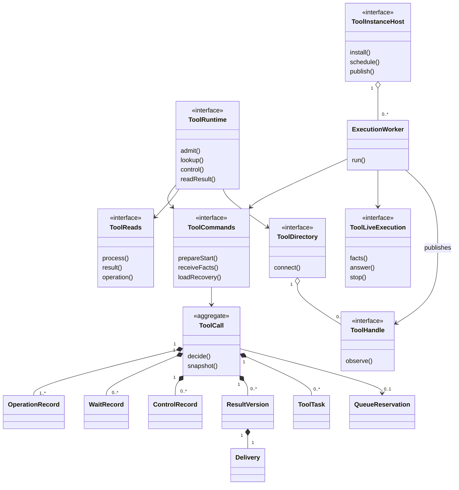
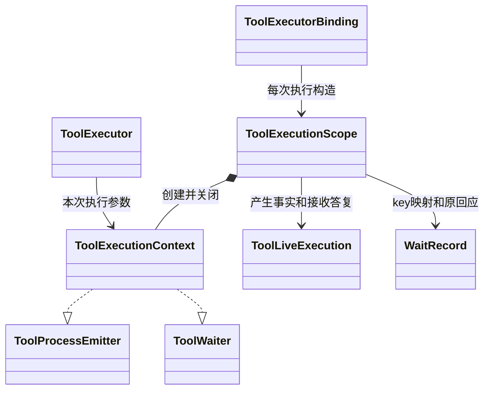
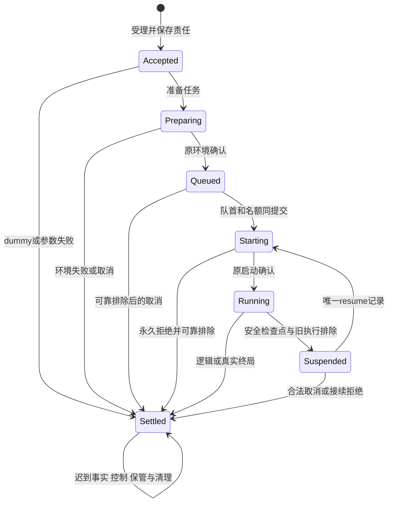
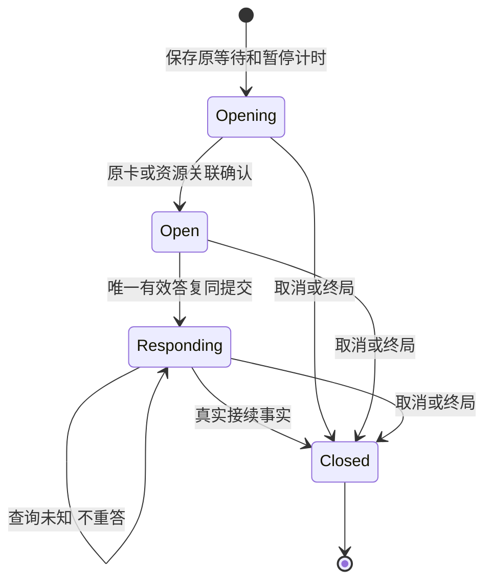

# Tool 对象模型

本页解释 [公开形状](public-api.md) 中对象的身份、职责、关联和寿命，不复制另一套类型。行为守卫归 [SPEC](../SPEC.md) 与 [操作协议](../SPEC.md#tool-操作协议)。OOP 在这里指封装责任和不变量，不要求每个值都写成 class。

## 对象分类与唯一写者

| 对象 | 分类与身份 | 负责什么 | 寿命与可见面 |
| --- | --- | --- | --- |
| ToolDefinition | 不可变值，工具资产身份和精确 adoption | 单函数/多命令、参数、真实依赖、模态、设置与许可 | 随采用保存；合法消费者可读，不含运行能力 |
| FixedToolRequest | 不可变值，原调用与输入摘要 | 固定原始/生效参数、来源、消费位置、环境、限额 | 准入后不变；秘密按字段权限读取 |
| ToolCall | 持久聚合根，tenant + call | 原调用阶段、关系、真实执行确定性、效果、等待、控制、结果和责任 | Commands 唯一写；宿主退出后存在；不序列化活体对象 |
| OperationRecord | 聚合内实体，call + operation | 输入去重、原操作结果及提交未知认回 | 与状态和待办同提交；不能只存 revision |
| QueueReservation | 本域跨调用实体，tenant + scope + 工具身份 | 持久 FIFO、并发占位、排除与释放 | 同 queue key 原子裁定；实现版本不是另一队列 |
| PreparationRecord / ReleaseRecord | 协议值，原 operation | 原环境分配及清理责任 | Tool 保存意图，环境拥有者保存资源真相 |
| ToolStartRecord / StartPermit | 协议值，start/resume operation | 原执行链、当前资格版本和受理关联 | permit 可失效；历史 start 不改；不是永久授权 |
| WaitRecord | 聚合内实体，call + wait | opening/open/responding/closed、原卡/资源应答、接续位置 | 可跨 Agent 和宿主换代；HITL 决定不归它写 |
| ControlRecord | 聚合内实体，原控制 operation | 意图、原因、发送结果和实际确认 | 逻辑终局后仍可能 pending；受理不等于已停 |
| ClockSegment / ToolTiming | 值及累计记录，来源 + epoch + marker | 前台实际运行量、暂停点和未知 | 转换同提交；不会恢复归零 |
| Checkpoint / SuspensionRecord | 协议值，原暂停 operation | schema、已做效果、已消费答复、旧执行排除 | checkpoint 只供唯一后继 resume；普通函数没有它 |
| RawOutput / ToolResult | 不可变结果值，保管身份及 resultVersion | 原值无损保管、展示内容、具名程序数据和附件 | 独立于执行环境；renderer 或输出校验失败也保留原件 |
| Delivery | 聚合内实体，resultVersion + delivery + consumer | 待交付或已解除关系、生产侧回执 | 每个晚到版本各有一项；解除不删除全文 |
| ProcessProjection | 持久投影，call + cursor + block index | 已展示过程的快照和增量顺序 | 无活体仍能读取；不能进入模型输入 |
| AccountFact | 不可变来源事实，owner/event/start/revision | 原执行用量、未知和费用修订 | 调用终局后继续补录；读取账目不授正文权 |
| FactProgress | 持久源流记录，start + source | 已保存cursor、待确认FactReceipt | receiveFacts同提交，恢复经loadRecovery，不读私表 |
| ProgramScheduling | 可信调度事实，execution + source + sequence | Code可运行/阻塞及真实计时边界 | 来自执行环境，不能脚本自报；状态和计时同提交 |
| ToolTask | 持久待办，operation + 协议种类 | 外域查询、控制、答复、交付及释放的下一责任 | 与变化同提交；worker 租约不是执行资格 |
| ChildReservation / ChildState | 组合实体，parent + 程序 ordinal | 子身份、准入未知、结果承接及父退出后的责任 | 由 ToolChildren 保管，不能只存在程序内存 |

ToolCall 是内部领域对象，不是新增公开 class。ToolState 是它经过核权的读取投影，ToolRecovery 是受信协调者需要的完整恢复投影。实际存储可用当前状态、操作表和待办表，不要求事件溯源。它必须能解释每项确认过的事实和未完责任。

## 类与关联 UML

组合箭头表示事实拥有关系，不要求物理同表。一个逻辑调用同一时刻只有一个当前协调代次；历史代次可以有已发外部执行和迟到事实。原调用可以有多个 start/resume 记录，却不能由恢复过程产生第二次业务执行。QueueReservation 需要跨 ToolCall 排序，因此不是单对象内存锁能保证的关系。

## 应用对象、端口和依赖方向

| 对象或端口 | 构造时注入 | 操作参数 | 失效与替换 |
| --- | --- | --- | --- |
| ToolRuntime 门面 | Commands、Reads，以及按次取当前 Catalog/Directory 的稳定代理 | 当前主体/tenant、call/operation、固定请求或具名意图 | 无本域事实私有副本；换门面不重执行 |
| ToolCommands 提供者 | 本域事务存储、当前资格核验、队列守卫、Clock、证据验证器 | WriteContext 或 Mutation、明确协议值 | 不可用返回 unavailable/commit-unknown；不能换内存实现冒称耐久 |
| ToolCall 决定器 | 无外部服务，只读已核 guard 快照 | 当前状态、具名命令 | 纯计算结果含变更与任务；事务端再次核 revision/queue/guard |
| ExecutionWorker | Commands、Bindings、Environment、Authority、DecisionBridge、ResourceResponses、Custody、Clock、Children阶段适配器 | tenant/call、宿主取消 signal | 从事实重建协调，不重放外部调用；查询未知仍能承担责任 |
| ToolLoader / ToolBindingRegistry | 合法定义/设置快照适配器、schema、作者工厂、资格守卫 / 已核装载贡献 | 精确 definition/executor/settings、来源 / ToolLoadedRegistration、登记依据 | C 为构造配置，A 为调用参数，E 为服务依赖；不互相替代 |
| ToolBindings | 资产/装配的合法采用解析、执行提供者映射 | 固定 adoption、原 start 或消费者 profile | resolve 新发起与 recover 原查询分面；不自动取最新实现 |
| ToolExecutorBinding | 固定作者适配、限权环境、受信启动边界、事实保管 | 原 start/permit/request 和 E | live-only 或 checkpointed；原绑定消失须保留原恢复路由 |
| ToolExecutionScope | 原执行身份、事实接收器、等待适配、输出容量和停止信号 | finish 的作者退出种类 | 包装器独占；关闭受理后仍承担既存输出与等待清理，不等于停止实际效果 |
| ToolExecutionContext | Scope 构造时固定的受限能力 | 作者过程更新或具名等待请求 | 每次执行独有；不授予存储、容器、卡片管理或启动权限 |
| ToolProcessEmitter / ToolWaiter | 同一上下文的窄接口 | 内容块更新 / key、协议采用、请求 | helper 只取所需能力；不为 helper 建另一调用或等待账 |
| ToolWaitContract / ToolWaitSchemaSnapshot | 业务拥有者的请求/响应 schema 与固定采用 / 耐久来源证据 | 作者 request / 接收方 candidate | 句柄含运行能力，快照只含可恢复值；提供者换代不改变原等待 schema |
| ToolWaitResponseValidator | 原请求、固定 schema、受信身份和业务守卫 | 原 wait/submission/source 与候选回应 | 反馈非法提交；valid 不等于有效决定已提交 |
| ToolReturnValidator / ToolProgramOutput | 精确输出采用、返回检查与程序编码规则 | 原 A 与真实 unknown 返回 / 已验证 R | 不以泛型或 codec 代替校验；程序值与展示内容属同一结果版本 |
| ToolOperation | 一个 ToolAuthor、参数说明与返回声明 | defineToolOperation 的完整输入 | 封闭单操作 A/R，保留 E/B 兼容性；不公开 executor；不代表已可用 |
| ToolAuthorRegistration | 工具元数据、一个操作或命令名到操作的表 | 构造时给定命令 summary 与操作 | 生成唯一 ToolDefinition；作为 ToolBindings 的依赖，按原采用保持；不进入数据契约 |
| PreparedEnvironment | 环境拥有者产生受限 E 和持久资源身份 | 不接受任意重绑定 | E 不可序列化；清理通过环境协议，非对象销毁即业务完成 |
| ToolDecisionBridge | HITL 的 ensure/inspect/resolve/invalidate 适配 | 原 wait、卡请求、决定和终局依据 | 决定仍由 HITL 唯一拥有，不把普通消息当决定 |
| ToolResourceResponses | 各资源协议登记、认回、到期、失效及资格校验器 | 原等待、受信应答/到期证据 | 与 HITL 分开；没有默认资源超时 |
| ToolOutputCustody / ContentReader | 耐久内容与附件提供者、当前读取资格 | 原 operation、codec/bytes 或精确结果引用 | 返回耐久证据；临时 URL 不够；读取与删除权分开 |
| ToolCatalog | 合法定义选择、消费者能力与设置读取 | inspect/search/usage 的范围 | 同实例数据变化可重求值，不依赖 Cordis 重跑 |
| ToolInstanceHost | 长期宿主上下文、调度器、目录及发布资格 | 安装 driver，按 call 唤醒 | 不挂在 Agent 下；同 call 提示归并；可从扫描补偿 |
| ToolDirectory / ToolHandle | 发布资格与贡献 token / 原实例投影源 | connect / after + signal | 只提供观察路由；旧 handle 不暗连后继 |
| ToolChildren | 本域持久关联、受信来源签发、子调用门面 | parent/ordinal、子受理及保管回执 | 父程序退出后继续；程序拿不到此端口 |
| ProgramTools | 由宿主闭包固定身份、父调用、来源、作用域和允许集合 | 工具名/命令/参数、自己的结果引用 | 受控代理，关闭后不发新子调用；不是 Context 或 executor |
| ToolAccounts / ToolOffloader | 账目/内容能力和资格 | 查询范围 / 原结果与显式预算 | 作为独立适配能力使用，不扩大 Runtime 的普通读权限 |

这些接口按消费者拆分。普通读取者不实现恢复命令，纯函数作者不依赖存储，环境提供者不负责 Run，目录不负责队列。替换提供者须保持同一协议的不变量、失败与未知语义，不能用“实现了接口”代替可替换性验证。新增执行者用组合接入，避免把每种工具 subclass 塞入一个继承层级。

## 参数、配置、依赖与运行期资源

| 类别 | 内容 | 固定点与校验 |
| --- | --- | --- |
| 作者定义 | 参数说明、声明、programmable、后台许可、设置 Schema/defaults | 资产正文解析及合法装载；许可不能由配置提高 |
| 一次调用参数 | 身份/tenant、call/operation、原始及生效参数、command、consumer、scope、采用、调用来源、限额 | admit 固定；恢复认回，不补造 Session/Run |
| 一次控制或读取参数 | 控制原因、原决定、resultVersion、cursor、读取预算 | 每次操作核当前资格及原归属 |
| 可序列化部署配置 | ToolAuthorLimits 的输出及等待历史上限、processBatchBytes/processBatchDelayMs/observerBufferBytes/resultPageBytes/reconciliationDelayMs | 装配 Schema 检查正容量与非负有限延迟；不偷加工具默认时限 |
| 注入服务能力 | 上表各端口、精确提供者采用 | 工厂或阶段装配取得；不能序列化到配置 |
| 短期资源 | E、live execution、driver、signal、订阅、目录 release token | 由获得它的宿主持有并显式交接/释放 |
| 持久恢复值 | 协议记录、操作回执、待办、原输出/结果、计时证据 | 存储承诺耐久；从这些值重建协调器，不反序列化对象图 |

### 作者调用的对象关系

A 表达要做什么，E 提供业务服务，context 提供本次执行的 emit、wait 和 signal。工具作者不取得 scope.finish。绑定作为唯一写者保存输出顺序、容量、等待 key 和收尾状态；过程观察者不是该对象的父级。辅助函数借用窄端口，不取得关闭或持久恢复能力。

上下文可处于接收、等待、收尾或关闭阶段。等待期间可以接收合法过程输出，但只能认回当前 key 的等待。收尾关闭新原语入口，输出屏障与等待清理继续。检查点保存的是协议数据和提供者明确支持的程序位置，不保存这个对象或 Promise。完整守卫与取消优先级归 [P11](../SPEC.md#p11-作者输出与等待原语)。

## 三种寿命与状态 UML

ToolCall 寿命不等于图中活体状态。逻辑 settled 后可以仍有 physical unknown、名额 held、控制 pending、delivery pending。执行结束后仍保留全文和账目。独立协程负责某一段推进；Cordis fiber 负责其服务贡献与可撤资源。它们退出都不能删除 ToolCall。

关系、等待、执行、效果是受约束的多个维度。公开类型排除后台活动等待与终局活动等待；构造和提交守卫另排除后台真实 unavailable、Ask 超时、未排除执行却释放名额、旧代次推进、未保管却解除交付等跨记录非法组合。不能把 readonly 类型当作持久性或权限证明。

## 协作与反向检查

准入、启动、等待、结果和恢复时序见 [flows](flows.md)。每条端口在 [protocols](../SPEC.md#tool-操作协议) 有守卫、提交点、失败及未知处理；产品逐项映射见 [coverage](../verification/coverage.md)。

移除目录后仍可查询和控制原调用，只失去活体快速观察。移除当前 worker 后能从持久任务恢复。移除持久任务则无法保留外域回执未知责任，因此不能以 registry 的 Map 替代。移除 Code 的程序内存后仍能列出子调用并保管迟到结果。上述反查是责任分离是否成立的最低判据。
