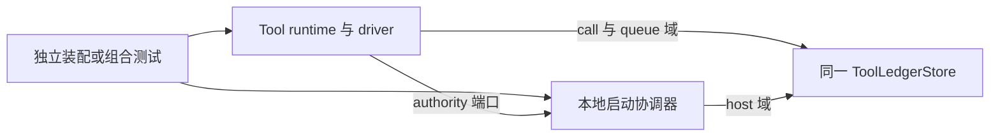

# tool-host-local 消费与系统定位

本包当前提供 `createLocalStartCoordinator`。独立装配用同一个 ToolLedgerStore 创建账本与协调器，再把协调器作为 `ToolDependencies.authority` 交给 `createToolRuntime`。端口和采用条件见 [public-api](public-api.md)，本地排序域的行为见 [SPEC](../SPEC.md#本地启动协调器g5)。

## 当前消费者

本包的 [start-composition 测试](../tests/start-composition.spec.ts)将真实协调器与 Tool runtime、账本、driver 组合。执行绑定、环境、身份签发与实例宿主由测试提供。[启动一致性测试](../tests/start-authority-conformance.spec.ts)通过公开 testing 协议消费协调器。

图中的应用接线是公开使用方式，不表示已有生产应用。本包没有交付生产实例宿主、来源签发器、绑定登记表或 Cordis 插件。它也不接管调用消费方的结果处理与 delivery 解除。

## 教学与组合证据

[Tool 教程](../../tool/examples/README.md)展示当前普通调用、结果分页与交付解除。教程使用公开内存 authority，不消费本包的本地协调器。真实本地协调器组合仍由本包 [tests/README](../tests/README.md)中的 start-composition 与启动一致性测试验证，不将教程运行视为本包的组合通过。

生产实例宿主、来源签发器、耐久记录仓与真实 Agent/Session 接入均未由教程补齐。本地协调器只验证单进程范围，跨进程或断电恢复没有证据。接入条件继续取本包 [SPEC](../SPEC.md#实例宿主与普通调用的边界)。

公共行为归契约包的 [SPEC](../../tool-contract/SPEC.md)。本页只维护消费关系，目录职责见 [README](README.md)。
