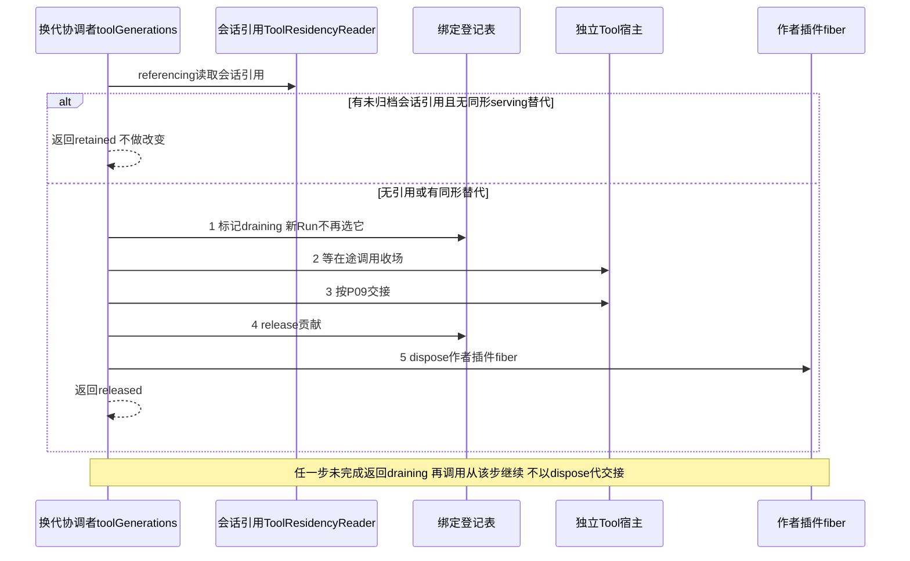

# tool-host-local 的 Cordis 集成

本页规定单机宿主 `./cordis` 插件的装配：作者原语、schema 阶段依赖、作者装载与贡献登记、阶段装配与换代。下列各节从 [Tool 的 Cordis 定义](../../tool-cordis-contract/docs/cordis.md)整段迁入，含义未改。服务定义、键、登记协议与通知仍归 `tool-cordis-contract`，本包插件继承这些定义，不重复提供服务键。插件尚未实现，当前包没有可用的 `./cordis` 入口。

装配 runtime 时显式提供 operationIdentities 与 sourceIssuer.resolve，来源核验器读取同一实际入口保存的完整绑定。生产提供者仍未实现。宿主创建实例时取得身份，并传给 driver.run；同一存活实例重复唤醒沿用。该传参不增加 claim 或接管保证。普通入口与受信 admission 的边界归[契约](../../tool-contract/SPEC.md#342-普通操作与实例目录)。

## 作者原语的装配

ToolExecutionContext 不是 Cordis Service。toolBindings 解析原作者后，由该执行绑定构造一次 ToolExecutionScope，固定原 start、限权 E 和执行停止信号。只把 scope.context 作为 execute 的第三个参数。Scope、Promise、回调和 signal 不进入插件配置或持久 JSON。helper 可取 ToolProcessEmitter 或 ToolWaiter，不能借它们访问 Context 或自行创建登记。

emit 使用已有事实保管与过程通路；wait 使用既有 Ask 或资源阶段适配器。ToolAuthorLimits 的四项上限只是容量配置，不新增服务键。等待响应接收、事实保存和控制由独立宿主继续推进，不能挂在被 wait 暂停的作者函数后面。资源或决策方提供者暂时缺席时保留原等待与任务，不能由 Cordis PENDING 推导业务等待已经开放。

emit 成功以 Tool 保管回执为准，不以 Cordis 通知发送成功为准。提供者突然撤除时未知仍按原身份查询；计划卸载先排空或交接 Scope 的未完输出、等待和控制。disposer 不能给 wait 填 cancelled 以外的默认答案，也不能将外部效果称为可逆。业务取消仍须原控制意图和 P06 的排序，单纯 UI 断开或目录撤除不会取消作者等待。

### Schema 与结果检查的阶段依赖

ToolAuthor.waits、返回模式、程序输出协议和验证器随 toolBindings 的精确采用固定。ToolWaitContract 和 SchemaRef 含加载能力，不是插件配置；可序列化部分只有声明和快照身份。响应接收适配器通过构造依赖取得 ToolWaitResponseValidator，并在确认有效决定前调用。无效候选留在提交边界，不能通过 Tool 通知广播成已回答。

实现包先构造逐操作 ToolOperation，再由 `createAuthor(construction)` 生成 ToolImplementation。作者插件 fiber 装载并登记它，它不是 toolBindings 提供者的构造依赖。注册与 schema 加载适配在作者插件 fiber 内管理，不为每个 command 新增全局 Cordis 服务键。Catalog 使用装载时派生的 definition；usage 按同一 command 取参数及返回声明。静态元数据和命令说明可序列化，作者函数、SchemaRef 和操作句柄不可序列化。注册构造成功后仍需异步核 schema 一致性，未完成时不公布对应操作可用。

resolve 固定原采用及 command 的操作，不能在 settle 时通过最新服务引用重新选 schema。reload 只影响后续合法采用；会话常驻项只路由到同形实现，见[会话常驻规则](../../tool-contract/SPEC.md#会话常驻规则r1r5)。旧执行及恢复继续使用原绑定或报告不可恢复的缺席。命令所需的额外服务按操作局部注入，不给所有命令并集权限，不向程序执行方暴露 ToolImplementation 或 executor。

SchemaProvider 归执行域已有提供者，具体等待/输出阶段适配器注入它并消费根接口。只有需要检查时取得短期 lease，释放 lease 不关闭业务等待；长等待保留原 schema 的可恢复采用。这里不在 Tool 新造 schema 编译缓存或全局服务键，也不将 schema 提供者提升成 Tool 门面的永久必需依赖。准入缺匹配协议时不可用；执行后失去校验能力则保管原返回与 settle 任务。

ToolResult 的 data 与 content 同属原结果保管，退出时一起交接。消息投影只取其获准字段，程序 SDK 不拿 schema 加载函数或 renderer。输出验证失败不触发 Cordis 重载来重新执行工具，真实 effect 保持原事实。上述依赖分配须由实际提供者验证，注册表或 disposer 不证明输出契约成立。

## 作者装载与贡献登记

工具作者的声明配置 C 与一次调用 A、环境能力 E 分开。一个工具实现在 Cordis 里是实现包导出的作者插件 fiber。它不 provide 服务键。它的 inject 是实现包里的静态字面量，含 toolBindings、toolGenerations 与实现需要的服务。它由换代协调者在长期宿主插件的 ctx 下装载，config 为 `{ authority, construction, settings }`。插件体只调用 `contributeTool(ctx, config, module)`：校验 config，经 `toolGenerations.loaderFor(config.authority)` 取得受信 `ToolLoader` 并调用 `load`，再调用 `toolBindings.register`；任一步失败就抛出，fiber 进入 FAILED，由协调者 dispose。ToolLoader 先由实现模块取得实现形状，再派生定义，校验允许配值路径、合法来源及逐命令契约。配置声明沿 [P15](../../tool-contract/SPEC.md#p15-配置声明与合法装载)，不把治理 settings 写成进程插件树的租户覆盖表。序列化插件配置仍按 IC-14 校验；实际服务、加载器和秘密解析能力通过构造或阶段 DI 注入。

ToolBindingsService.register 在当前资格下接收 ToolLoadedRegistration 与 ToolAuthority，输入见[绑定登记表的登记输入](../../tool-cordis-contract/docs/cordis.md#绑定登记表的登记输入)。`tool-cordis-contract/cordis` 拥有登记语义；具体实现保存调用方 ctx，验证当前加载及贡献资格后，用该 ctx.effect 配对登记和条件撤除。异步核验结束时再次检查调用方生命周期，不能在已撤除 fiber 下遗留贡献。每项回执只撤自己的 token，旧 release 不删除新贡献。根 Context 登记只限测试或装配入口，不能冒充插件贡献的自动归属。

登记提供者不重造资产优先级、持有或发布规则。它按登记键登记，不做候选选择或层序，同键冲突时明确返回 conflict，不默认覆盖。新配置/定义只有完整装载成功才进入后续候选；旧调用的采用及恢复能力由独立执行宿主持有，不能仅因贡献 effect 撤除就丢掉。计划卸载由换代协调者 `toolGenerations` 执行：先关新采用、排空或交接后撤资源，突然失依赖保留未知。

换代协调者是 `ctx.plugin` 句柄的唯一持有者。`ensureLoaded` 动态 import 实现包并装载作者插件。协调者按会话引用保留贡献：有未归档会话引用、且没有同形 serving 替代的贡献，协调者不 dispose。动词与返回见[换代协调者契约](../../tool-cordis-contract/docs/cordis.md#换代协调者契约)。register 的回执是运行期贡献，不是持久工具调用受理回执。

## 阶段装配与换代

各 key 的定义只在 `tool-cordis-contract/cordis`。表中组合作为具体插件的静态字面量 inject，不能使用运行期依赖名数组。跨领域实际提供者继承或适配原拥有者定义，不在 Tool 重造授权、环境、决策或存储服务。

| 插件职责 | 静态必需键 | 局部阶段能力及退出 |
| --- | --- | --- |
| 门面 | toolCommands、toolReads | Catalog/Directory 的窄代理逐次 ctx.get；按 P16 处理缺席，不缓存旧引用 |
| 长期执行宿主 | toolCommands、toolInstanceHost、toolClock | 捕获构造时 host Context，安装 driver；不捕获调用时 Service.this.ctx 作为长期父级 |
| 实例发布 | toolInstances、toolPublicationAuthority | 在 host 的实例 fiber 中 register；本 fiber 只持有自己的贡献 token |
| 准备/启动适配 | toolBindings、toolEnvironments、toolStartAuthority | 固定采用与资源租约，缺席立即返回 unavailable 并保留任务 |
| 等待适配 | toolDecisions 或 toolResourceResponses | 分别由 Ask/资源阶段插件静态声明；不能伪造可选 inject 数组 |
| 输出适配 | toolOutputCustody、toolResultPolicy | 原输出先保存，策略缺席不删除原件 |
| 程序执行方组合适配 | toolChildren、toolRuntime | 程序能力由独立环境提供者注入；仅暴露限权代理 |
| 作者插件 fiber | toolBindings、toolGenerations 与实现需要的服务，写在实现包的静态字面量里 | 不 provide 服务键；插件体只调用 contributeTool，登记以本 fiber 的 ctx.effect 配对；fiber 撤除时登记随 effect 撤除 |
| 换代协调者 | toolBindings、toolContributionAuthority、toolResidencyReader、toolResidencyActions | 提供 toolGenerations；唯一持有 ctx.plugin 句柄，作者插件挂在长期宿主 ctx 下，协调者重跑从 snapshot 重建句柄表；经 ToolResidencyReader 读会话引用，按保留义务决定是否 dispose |

Commands 提供者整体不能把 Catalog 设为静态必需依赖。新准入的定义核验在局部阶段完成；原操作认回、控制及持久事实提交不依赖最新发现。长期 ToolInstanceHost 也不静态依赖目录，实例发布在其独立子 fiber 中 inject 目录和发布资格。Catalog、Directory 与持久 Commands/Reads、长期宿主不得共用一个会连带卸载的提供者 fiber。目录换代只重建发布，不重启业务执行。

缺席、空目录和旧 handle 的精确结果归 [P16](../../tool-contract/SPEC.md#p16-目录与发现的故障隔离)。适配器用当前服务取得句柄后核其发布代次，提供者自有活性守卫使旧流和旧 handle 失效。不能声称 ctx.get 或 disposer 自动撤销所有已持引用。这一分解遵循 IC-8/9/13，仍须真实撤除及换代测试证明。

纯工厂拿到的是具有这些协议的阶段适配器，不是所有实际后端的永久引用。适配器在阶段开始检查必需提供者，缺席立即给 unavailable，不无限等待 Cordis PENDING。已进入阶段的提供者换代时，未完成操作返回可对账的 unavailable/commit-unknown；调用者按原 operation 查询。异常保留阶段和身份，不能吞成成功。

Service 方法的 this.ctx 是调用方上下文。host 构造时单独保存自己的长期 Context，所有 Tool 实例都在其下创建。调用方只读目录，调用门面不把实例变成调用方的子 fiber。目录的 caller-fiber effect 因而由 Tool 实例持有。发布资格的代次更新与 check/目录写入在同一本地排序域；异步外部资格不能被这个同步 check 冒称已最新。登记资格只保护路由，业务每次仍核当前权限。

持有原 E 或 binding 引用不证明提供者资源继续有效。工具实现的替换是对新版本调用 `ensureLoaded`，旧版本在引用归零后由 `unload` 或 `sweep` 收走，不存在原地替换。计划替换的拥有者必须先停止该提供者的新准入，排空或安全暂停并确认原责任承接，再撤原 provider。必须保留原 adoption 的 recovery 路由直到所有控制、结果及清理责任有接手方。突然失依赖则保持 unknown，不能换最新实现继续原执行。

程序执行方的桥接退出先关闭程序新发起并记录 child 责任，再释放执行域。子 Tool 实例仍属于独立宿主。具体顺序由显式协调等待完成；Cordis effect 的并发释放不保证这个次序。完整根协议见 [P09](../../tool-contract/SPEC.md#p09-账目恢复与退出)。

## 验证义务

本包插件至少验证必需/局部/可选依赖的实际撤除范围、旧引用拒绝及当前身份核验。当前真实4.0.4探针仅支持共同页所列机制。根已 ACTIVE 后动态装载并撤除带登记的作者插件，由 basis 条目 [late-plugin-load-unload-does-not-rerun-others](../../../../.meta_harness/design/basis/cordis/late-plugin-load-unload-does-not-rerun-others.md) 及其在 `kernel-basis` 的探针证明，对应 [RFC-0012](../../../../docs/rfcs/RFC-0012-tool-dynamics.md#问题与有效输入) 的第 6 项。根操作的持久性、跨进程、外部效果和业务接受须另由实际提供者证明。定义入口自身的验证义务归 [tool-cordis-contract](../../tool-cordis-contract/docs/cordis.md#验证义务)。

普通来源按 tenant/完整 consumer 原子 resolve，配对 guard 必须复核稳定主体与原绑定。宿主 schedule 继续合并同 tenant/call 的唤醒，不以重复 invoke 建立新执行。当前生产来源和实例宿主仍未实现。
