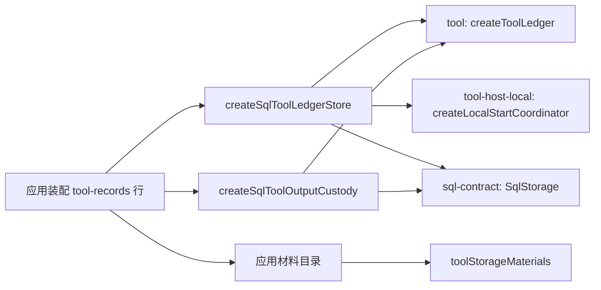

# 使用与定位

本文件说明消费侧怎样使用本包、具名上层消费者、典型调用关系，以及本包在 Tool 组中的位置。

## 使用方式

最小用法见 [README_ZH.md 的使用一节](../README_ZH.md#使用)。必要依赖是一个 `SqlStorage`、一个 `TenantDomainLookup` 与为租户作用域登记的组合。组合须列出参加者 `tool`，其材料来自 `toolStorageMaterials()`。没有初始化与释放步骤。

## 消费者与定位

具名消费者：`tool-records` 行（装配页，波 B 接线）与应用的材料目录（L-APP）。依赖方向是 `tool-storage-sql → {tool, tool-contract, sql-contract}`。`tool-host-local` 只在本包测试里作为 devDependency 使用（D2 决策记录 U8），本包不在生产路径上依赖它。
