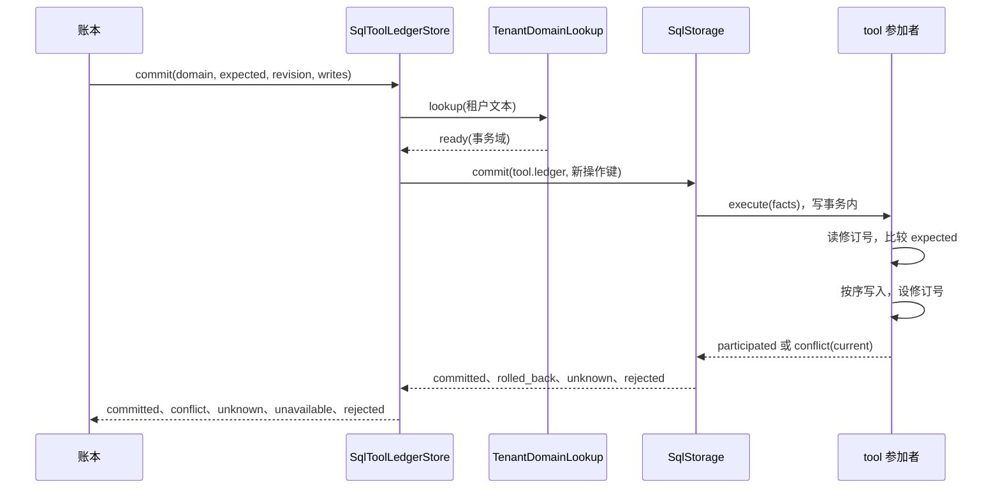
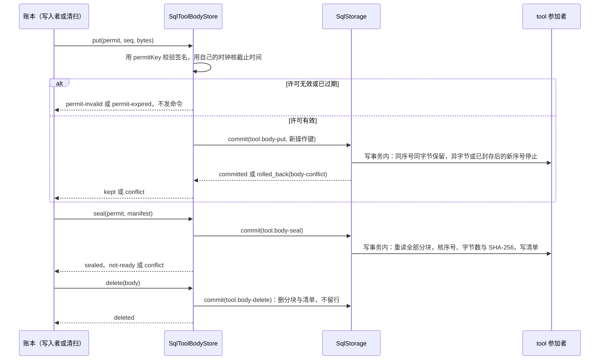

# 关键流程

本文件描述本包的关键流程：参与者、调用时序、状态变化、失败分支与生命周期。条款归 [SPEC.md](../SPEC.md)。

## 流程

### 账本提交

### 正文写入、封存与删除

状态变化：没有行 → 有分块（读取答 `absent`）→ 有清单（读取答 `found`）→ 删除后没有行。清单写入后分块不再改变。

## 失败与生命周期

- 提交答 `unknown` 或暂时被拒：端口答 `unavailable`，带诊断。写入者以同一许可与序号重送；同序号同字节答 `kept`，同清单答 `sealed`，删除幂等。
- 进程在封存之前停止：分块留在库里，读取答 `absent`。账本在调用结算时把该正文标为孤儿，宽限期后清扫删除它。
- 提交被拒绝（例如 `queue_full`）：答 `unavailable`，没有写入。
- SQL 提供者以 reject 报告结果：异常原样交给调用方。
- 适配器不持有资源。连接与 Worker 的关闭归 SQL 提供者，已提交的写入与正文不因关闭而撤销。
