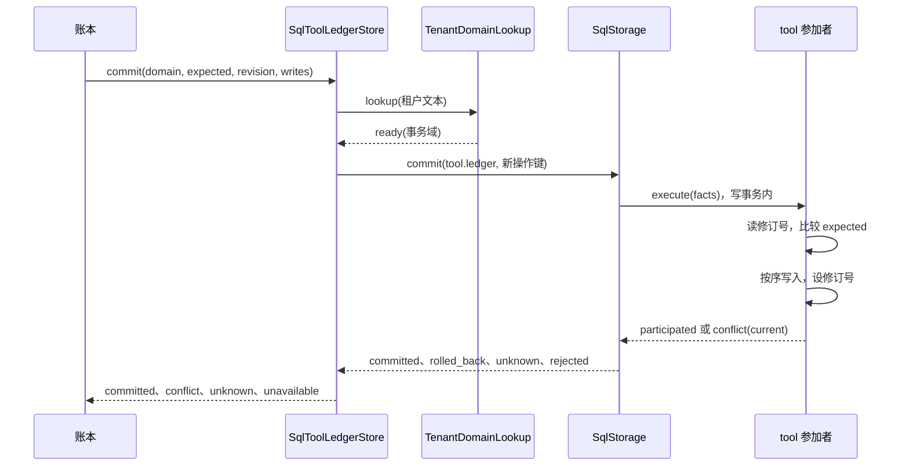
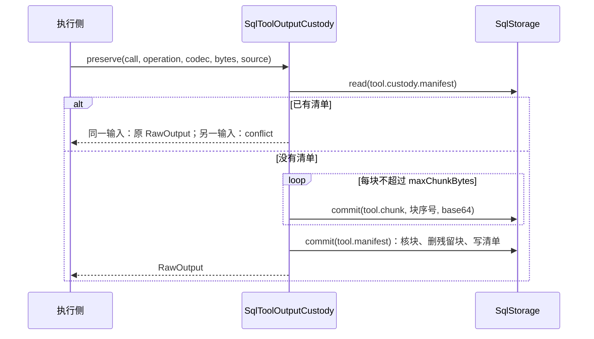

# 关键流程

本文件描述本包的关键流程：参与者、调用时序、状态变化、失败分支与生命周期。条款归 [SPEC.md](../SPEC.md)。

## 流程

### 账本提交

### 原件保管

状态变化：没有行 → 有部分块（不可见）→ 有清单（`retained`）。清单写入后不再改变。

## 失败与生命周期

- 块或清单的提交答 `unknown`：`preserve` 答 `commit-unknown`。执行侧以同一操作重送，重送按键覆盖块，然后认回或封存清单。
- 进程在清单之前停止：块留在库里，`inspect` 答 `unknown`。重送覆盖它们，多出的块在清单提交时删除。
- 提交被拒绝（例如 `queue_full`）：答 `unavailable`，没有写入。
- SQL 提供者以 reject 报告结果：异常原样交给调用方。
- 适配器不持有资源。连接与 Worker 的关闭归 SQL 提供者，已提交的写入与保管不因关闭而撤销。
