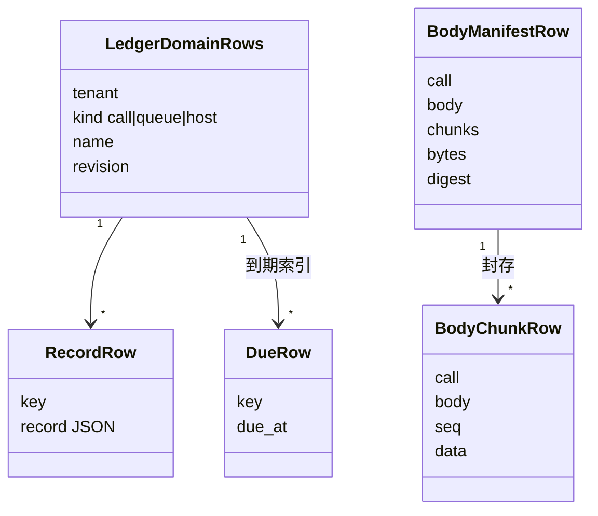

# 对象模型

本文件描述本包内部对象的职责、身份、状态与生命周期。本包没有类：两个工厂返回由函数组成的端口对象，数据库行是唯一的状态。

## 对象与关系

- 账本域由（租户，种类，名）识别，修订号是账本给出的文本。记录由账本域内的键识别，键由 `recordKey` 算出。到期条目由（租户，种类，名，键）识别，同键再次排期替换时刻。
- 正文由（租户，调用，正文）识别。分块由正文与序号识别，清单每个正文至多一份。正文表不属于任何账本域。

## 生命周期

- 账本行与到期条目由账本的提交创建、替换与删除。账本的整域删除一次去掉一个账本域的记录行、到期条目与修订号行，之后该域与从未提交的域相同（[TS-15](../SPEC.md#ts-15-整域删除)）。本包不自行删除账本行，也不压缩回执。
- 分块在 `put` 时创建，同序号只写一次。清单在 `seal` 时写入，之后分块不再改变。`delete` 删除该正文的全部分块与清单，不留行。正文期限与回收时机归 Tool 账本，本包不判断，见 [正文存储与到期索引的实现映射](../SPEC.md#正文存储与到期索引的实现映射)。
- 端口对象没有关闭方法，丢弃即可。
