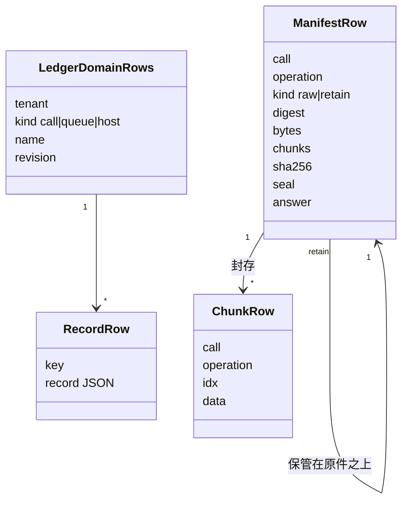

# 对象模型

本文件描述本包内部对象的职责、身份、状态与生命周期。本包没有类：两个工厂返回由函数组成的端口对象，数据库行是唯一的状态。

## 对象与关系

- 账本域由（租户，种类，名）识别，修订号是账本给出的文本。记录由账本域内的键识别，键由 `recordKey` 算出。
- 保管操作由（租户，调用，操作）识别。输入摘要识别「同一输入」。封印是原件的 `custody.digest`，或投影证据的摘要。
- 投影的清单记录它所依据的原件操作与封印。

## 生命周期

- 账本行由账本的提交创建、替换与删除。本包不删除账本行，也不压缩回执。
- 块在保管时创建，在同一操作的清单提交时删除多出的部分。清单写入后，块与清单都不再改变，也没有到期删除（[已知限制](../SPEC.md#已知限制)第 3 条）。
- 端口对象没有关闭方法，丢弃即可。
