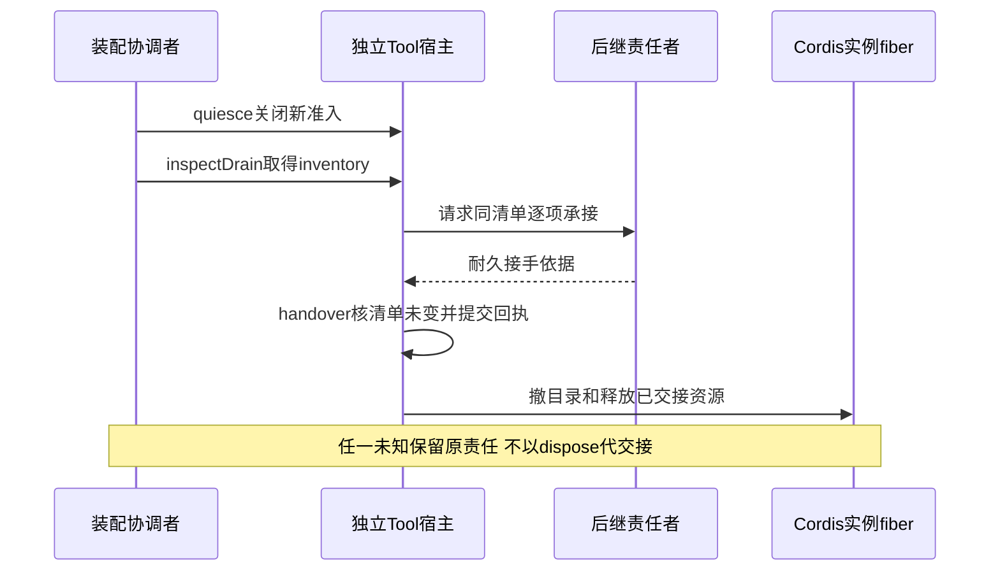

# Tool 的 Cordis 集成

本页消费[根操作契约](public-api.md)，规定 Tool 独有的服务定义、依赖及生命周期。设计已接受，提供者尚未实现。共同约束归 [IC 约定](../../../../docs/architecture/cordis-integration-conventions.md)，加载成功不表示业务就绪。

## 服务定义与入口

`./cordis-definition` 唯一拥有下列抽象门面及表中本域接缝的服务定义，`./cordis` 的限定名具体提供者继承它。根接口尚未导出，因此代码是未来声明形状，不是当前可导入示例。实现不得复制方法形状，索引类型随根契约同步。

```ts
import { Context, Service } from '@deepseek-ai/cordis'
import type { ContentBlock } from '@omne-harness/content-block'
import type { ToolRuntime, ToolDirectory, ToolInstanceHost, DurableEvidence, ToolBindings, ToolBindingRegistry } from '../index.js'
import type { Outcome } from '@omne-harness/kernel-basis'

/** @owner packages/tool/tool */
export abstract class ToolRuntimeService<P, B extends ContentBlock> extends Service implements ToolRuntime<P, B> {
  static readonly provide = 'toolRuntime'
  constructor(ctx: Context) { super(ctx, ToolRuntimeService.provide) }
  abstract readonly inspect: ToolRuntime<P, B>['inspect']
  abstract readonly admit: ToolRuntime<P, B>['admit']
  abstract readonly lookup: ToolRuntime<P, B>['lookup']
  abstract readonly queryOperation: ToolRuntime<P, B>['queryOperation']
  abstract readonly control: ToolRuntime<P, B>['control']
  abstract readonly acceptDecision: ToolRuntime<P, B>['acceptDecision']
  abstract readonly acceptResource: ToolRuntime<P, B>['acceptResource']
  abstract readonly readProcess: ToolRuntime<P, B>['readProcess']
  abstract readonly readWait: ToolRuntime<P, B>['readWait']
  abstract readonly readDiagnostics: ToolRuntime<P, B>['readDiagnostics']
  abstract readonly catalog: ToolRuntime<P, B>['catalog']
  abstract readonly content: ToolRuntime<P, B>['content']
  abstract readonly readResult: ToolRuntime<P, B>['readResult']
  abstract readonly releaseDelivery: ToolRuntime<P, B>['releaseDelivery']
  abstract readonly account: ToolRuntime<P, B>['account']
  abstract readonly instances: ToolRuntime<P, B>['instances']
}
export const toolRuntimeKey = ToolRuntimeService.provide

export type ToolPublication = Extract<Awaited<ReturnType<ToolInstanceHost<never>['publish']>>, { ok: unknown }>['ok']
export type ToolRegistrationInput<P> = Readonly<{
  publication: Parameters<ToolInstanceHost<P>['publish']>
  authority: DurableEvidence
}>
export type ToolRegistrationFailure =
  | Readonly<{ kind: 'denied' | 'stale-publication' | 'conflict' }>
  | Readonly<{ kind: 'invalid'; reason: string }>
  | Readonly<{ kind: 'unavailable'; diagnostic: string }>
export type ToolRegistration = Readonly<{
  receipt: ToolPublication
  release(): Promise<Readonly<{ removed: boolean }>>
}>
export interface ToolPublicationAuthority<P> {
  check(input: ToolRegistrationInput<P>): Outcome<void, ToolRegistrationFailure>
}
/** @owner packages/tool/tool */
export declare class ToolInstancesService<P> extends Service implements ToolDirectory<P> {
  static readonly provide = 'toolInstances'
  constructor(ctx: Context, authority: ToolPublicationAuthority<P>)
  readonly connect: ToolDirectory<P>['connect']
  register(input: ToolRegistrationInput<P>): Promise<Outcome<ToolRegistration, ToolRegistrationFailure>>
}
export const toolInstancesKey = ToolInstancesService.provide

/** @owner packages/tool/tool */
export abstract class ToolBindingsService<P, B extends ContentBlock, E> extends Service implements ToolBindings<P, B, E>, ToolBindingRegistry<P, E, B> {
  static readonly provide = 'toolBindings'
  constructor(ctx: Context) { super(ctx, ToolBindingsService.provide) }
  abstract readonly inspect: ToolBindings<P, B, E>['inspect']
  abstract readonly resolve: ToolBindings<P, B, E>['resolve']
  abstract readonly recover: ToolBindings<P, B, E>['recover']
  abstract readonly register: ToolBindingRegistry<P, E, B>['register']
}
export const toolBindingsKey = ToolBindingsService.provide
```

定义入口将 Context 的 `toolRuntime` 增补为这一抽象类，主体类型由装配的可信身份适配器专化，运行时仍核验输入。接口同形不证明授权。具体插件不得再次ctx.provide这个键。消费者导入定义入口的键常量，提供者选择归应用装配。

## 登记输入与撤除协议

ToolInstancesService 是包含 register 实现的具体服务，上面只给其声明。提供者插件静态 inject `toolPublicationAuthority`，用当前 Context 和该能力构造服务。PublicationAuthority 属于本域消费接缝，具体适配器核原领域权威；不是任意调用者可实现后传入的准入回调。authority 是当前受信宿主取得的原实例资格证据，含租户、工作身份、实例和代次，不能仅以 token 或 handle.instance 自证。

register 的 publication 逐项复用根 publish 参数。authority.check 核证据来源、当前发布资格、handle 身份及调用 fiber 所属宿主；核权失败返回 denied，原实例已被替换返回 stale-publication，不能取得源返回 unavailable。check 是同步最终核验，与 effect 内目录写入在同一不可让出的本地动作中完成；当前资格变更沿同一排序域生效。需要异步获取的证明由宿主提前准备，但此处仍核当前发布代次。不能提供同步当前核验的适配器返回 unavailable，不先放行再异步补核。调用 fiber 已退出时不再登记。根操作仍逐次核业务权限，登记从不授发起权。

目录在成功的 caller-fiber effect 内生成不可猜测的 registration token，回执复用本域 publish 结果。相同 fiber、相同原实例和同一 handle 对象重复登记认回同一 receipt/release；同身份但 handle 或资格内容不同返回 conflict。其他 fiber 不共享原贡献，未撤的原绑定与新登记冲突。只有旧贡献已撤且新发布资格成立时才登记后继，不以覆盖 Map 的方式接管。键为显式租户与原工作身份；Agent 额外包含 Session/Run，来自核验的 authority，不从 Context 推导。

宿主 publish 在对应实例 fiber 内调用 register，成功后向根消费者返回 receipt。宿主 withdraw 按 receipt.registration 定位自己持有的原贡献，调用 release；它不接受另一个宿主的 token。release 只条件撤除自己的目录项，不取消原工作，重复调用 removed=false；fiber 自动 disposer 使用同一幂等撤除。晚到旧 release 比较 token，不能删除后继。宿主内部持有这一个原 contribution 的释放资源，不另建需要用户手动清理的贡献者清单。纯根宿主的其他失败沿原 Reply；登记 conflict 映射 invalid(field='publication')，stale-publication 映射 stale-instance，denied/unavailable 保留原类别和安全诊断。

## 依赖与定义拥有者

表中每个本域键对应根契约中同名操作端口的唯一抽象Service定义，类命名为端口名加Service；静态provide只在定义类声明，导出键取自它。目录采用含register逻辑的具体Service，不用抽象接口冒充登记机制。跨域行引用原定义拥有者，不在本成员再声明同键。后继实现需逐项生成服务/依赖图核对这一设计，当前表不冒称源码事实。

| 服务键 | 根操作形状 | 定义拥有者 | 必需性及责任 |
| --- | --- | --- | --- |
| toolCommands | ToolCommands | Tool | 必需，原调用/队列/交付权威；失败不变空队列或未执行 |
| toolBindings | ToolBindings | Tool | 准备/执行局部必需；固定原executor，不把当前新版替换已启动调用 |
| toolEnvironments | ToolEnvironment | Tool | 准备及安全resume局部必需；环境失败不降为宿主直接执行 |
| toolDecisions | ToolDecisionBridge | Tool | 原等待答复阶段局部必需；缺失保持等待，不造默认答案 |
| toolInstances | ToolInstancesService | Tool | 具体目录Service；本Tool实例贡献fiber拥有登记 |
| toolPublicationAuthority | ToolPublicationAuthority | Tool 定义入口 | 目录必需；核当前宿主、原实例资格及authority来源，不能只核字符串相同 |
| toolInstanceHost | ToolInstanceHost | Tool | 独立宿主必需；原事实/控制可经门面处理，无活体仍可查 |
| toolClock | ToolClock | Tool | 计时执行段必需；恢复沿具名持续时间来源，不能重新计满 |
| toolResultPolicy | ResultPolicy | Tool | 结果处理必需；固定B及版本，缺失保留原输出与明确失败，不重做效果 |
| toolReads | ToolReads | Tool | 持久读取，门面必需；无活体也可查 |
| toolCatalog | ToolCatalog | Tool | 定义及用法；当前消费者profile必须核验 |
| toolStartAuthority | ToolStartAuthority | Tool | 启动阶段必需；跨拥有者失效共排序 |
| toolResourceResponses | ToolResourceResponses | Tool | 资源应答阶段局部必需 |
| toolOutputCustody | ToolOutputCustody | Tool | 原输出与附件保管阶段必需 |
| toolChildren | ToolChildren | Tool | Code组合阶段必需；父程序退出后由scanPending/loadRecovery驱动child和program-fence待办 |
| toolAccounts | ToolAccounts | Tool | 按组织或租户读取执行账，独立授权 |
| toolOffloader | ToolOffloader | Tool | 单结果卸载适配，不覆盖原结果 |

Tool 门面只把 Commands/Reads 作为持久操作的静态必需依赖。Catalog 与 Directory 由稳定窄代理在每次调用时 ctx.get 当前服务，接受缺席并返回明确 unavailable；不把取得的服务缓存进门面或长期宿主。根工厂仍消费非空的具名端口，不知道 Cordis Context。准备、环境、Ask 决定与结果策略在各自阶段取得，持续执行保持原合法绑定直到原收场或安全交接。Agent 退出不撤这些资源，提供者失效不自动再次 start/resume。

每个实际插件的inject使用定义键常量数组字面量。局部阶段适配器由本域提供者实现，方法在所需子fiber内取能力，等待依赖与业务等人分开；阶段结束释放该子fiber。公开纯工厂不接收Cordis Context，适配器负责把阶段失败变为根契约的精确结果。服务换代不能把旧在途对象悄悄换成新对象。

`programmable` 属于每个工具的定义，`invocation` 属于每次调用的固定输入，两者都不是 ToolConfiguration 或 Cordis 插件配置。toolBindings 保留合法定义上的原声明，toolCommands 的准入适配器核验可信调用来源及当前许可。脚本桥接只暴露经该准入边界的窄调用能力，不向脚本注入 ToolCommands、executor、来源签发能力或 Cordis Context。外部脚本环境及 MCP 桥接接入时也须兑现此边界，具体提供者未验证前不能声称防绕过已成立。

## 配置、通知和撤除

### 调用许可变化与 Cordis 效应撤除

脚本桥接的可调用入口属于可撤除的运行期贡献。注册表服务沿 IC-13 用调用方 fiber 的 effect 配对登记与条件撤除，不另建手动维护的贡献者清单。提供者撤除或换代时，局部 inject 可以结束相应桥接资源；重新装配只重建合法入口，不重放原工具调用。Tool 的执行宿主保持独立，不能为了关闭某个脚本入口而卸载整个 Tool runtime。

`programmable` 是定义数据。同一服务实例内的数据变化不自动触发 Cordis inject 重跑，声明变化由原定义采用与准入路径处理。桥接同步更新可调用集合，已取得的旧入口仍须经过当前准入。不能把“注册表已删除”当作全部旧句柄失效或全部排队动作已停止的证明。

Cordis 撤除的是登记、监听和具名可释放资源。`startRejection`、启动是否发生、结果交付与释放责任是跨重启仍须成立的 Tool 事实，按 [SPEC](../SPEC.md#342-值定义和固定请求)保存，不放进 effect 闭包，也不让 disposer 改写业务终局。需要先停止准入、结清或交接、再撤资源时，由具名协调者显式等待；多个 effect 的卸载不提供这种完成顺序。外部操作已发出或结果未知时，撤除不能声称回滚。

上述机制沿固定采用的 Cordis 4.0.4 核对。[调用方 effect 归属](../../../../.meta_harness/design/basis/cordis/service-method-ctx-is-caller.md)、[提供者换代与插件重跑](../../../../.meta_harness/design/basis/cordis/plugin-body-reruns-on-provider-change.md)及[释放顺序与持久事实的边界](../../../../.meta_harness/design/basis/cordis/effect-disposal-concurrent-not-ordered.md)分别拥有机制依据；业务兑现仍须由本成员提供者验证。

### 配置与变更通知

authorBufferBytes、authorBufferItems、authorWaitHistoryBytes、authorWaitHistoryItems、processBatchBytes、observerBufferBytes、resultPageBytes 为正安全整数；processBatchDelayMs、reconciliationDelayMs 为非负安全整数。作者输出容量覆盖 P11 的在途内容、累计状态及记录数量，不能只限制观察者缓冲。并发、前台时限、转后台偏好来自每次固定请求及治理设置，不从插件树中的租户推导，不在此私配一套覆盖值。

定义入口唯一声明 `tool/call-changed`，载荷为tenant、ToolCallId、ToolRevision。JSDoc写`@mode parallel`及每项`@param`。通知不带消息正文、凭据或附件地址；发送者捕获监听失败，保留原提交结果，由权威扫描恢复通知遗漏。会话事件先按显式身份过滤，数据动作再核权。

等待、前后台、名额及全文保留均属Tool业务事实，不以Fiber状态判断。register撤除不会释放并发名额、给Ask填答案或删除delivery。迟到全文沿recordLateResult产生独立结果版本。

运行实例登记的贡献权限只交受信宿主。目录register验证原实例资格和token，在调用方fiber的effect中增加并条件撤除；connect不授发布权。计划卸载先完成业务交接再dispose；依赖突然消失时保留未知，不用自动撤登记声称外部效果被撤回。

## 作者原语的装配

ToolExecutionContext 不是 Cordis Service。toolBindings 解析原作者后，由该执行绑定构造一次 ToolExecutionScope，固定原 start、限权 E 和执行停止信号。只把 scope.context 作为 execute 的第三个参数。Scope、Promise、回调和 signal 不进入插件配置或持久 JSON。helper 可取 ToolProcessEmitter 或 ToolWaiter，不能借它们访问 Context 或自行创建卡片。

emit 使用已有事实保管与过程通路；wait 使用既有 Ask 或资源阶段适配器。ToolAuthorLimits 的四项上限只是容量配置，不新增服务键。等待响应接收、事实保存和控制由独立宿主继续推进，不能挂在被 wait 暂停的作者函数后面。资源或 HITL 提供者暂时缺席时保留原等待与任务，不能由 Cordis PENDING 推导业务等待已经开放。

emit 成功以 Tool 保管回执为准，不以 Cordis 通知发送成功为准。提供者突然撤除时未知仍按原身份查询；计划卸载先排空或交接 Scope 的未完输出、等待和控制。disposer 不能给 wait 填 cancelled 以外的默认答案，也不能将外部效果称为可逆。业务取消仍须原控制意图和 P06 的排序，单纯 UI 断开或目录撤除不会取消作者等待。

### Schema 与结果检查的阶段依赖

ToolAuthor.waits、返回模式、程序输出协议和验证器随 toolBindings 的精确采用固定。ToolWaitContract 和 SchemaRef 含加载能力，不是插件配置；可序列化部分只有声明和快照身份。响应接收适配器通过构造依赖取得 ToolWaitResponseValidator，并在确认有效决定前调用。无效候选留在提交边界，不能通过 Tool 通知广播成已回答。

实际工具先构造逐操作 ToolOperation，再生成 ToolAuthorRegistration，作为 toolBindings 提供者的构造依赖。注册与 schema 加载适配在实际工具的 fiber 内管理，不为每个 command 新增全局 Cordis 服务键。Catalog 使用注册生成的 definition；usage 按同一 command 取参数及返回声明。静态元数据和命令说明可序列化，作者函数、SchemaRef 和操作句柄不可序列化。注册构造成功后仍需异步核 schema 一致性，未完成时不公布对应操作可用。

resolve 固定原采用及 command 的操作，不能在 settle 时通过最新服务引用重新选 schema。reload 只影响后续合法采用；旧执行及恢复继续使用原绑定或报告不可恢复的缺席。命令所需的额外服务按操作局部注入，不给所有命令并集权限，不向 Code 暴露 ToolAuthorRegistration 或 executor。

SchemaProvider 归执行域已有提供者，具体等待/输出阶段适配器注入它并消费根接口。只有需要检查时取得短期 lease，释放 lease 不关闭业务等待；长等待保留原 schema 的可恢复采用。这里不在 Tool 新造 schema 编译缓存或全局服务键，也不将 schema 提供者提升成 Tool 门面的永久必需依赖。准入缺匹配协议时不可用；执行后失去校验能力则保管原返回与 settle 任务。

ToolResult 的 data 与 content 同属原结果保管，退出时一起交接。消息投影只取其获准字段，程序 SDK 不拿 schema 加载函数或 renderer。输出验证失败不触发 Cordis 重载来重新执行工具，真实 effect 保持原事实。上述依赖分配须由实际提供者验证，注册表或 disposer 不证明输出契约成立。

## 验证义务

本成员实现至少验证根入口无Cordis、定义入口不引具体提供者、静态键唯一、必需/局部/可选依赖的实际撤除范围、旧引用拒绝及当前身份核验。当前真实4.0.4探针仅支持共同页所列机制，根操作的持久性、跨进程、外部效果和业务接受须另由实际提供者证明。


## 作者装载与贡献登记

工具作者的声明配置 C 与一次调用 A、环境能力 E 分开。实际工具插件经受信 ToolLoader 取得固定定义、执行器和设置采用，校验允许配值路径、合法来源及逐命令契约，再构造作者注册。配置声明沿 [P15](../SPEC.md#p15-配置声明与合法装载)，不把治理 settings 写成进程插件树的租户覆盖表。序列化插件配置仍按 IC-14 校验；实际服务、加载器和秘密解析能力通过构造或阶段 DI 注入。

ToolBindingsService.register 在当前资格下接收 ToolLoadedRegistration。定义入口拥有登记语义；具体实现保存调用方 ctx，验证当前加载及贡献资格后，用该 ctx.effect 配对登记和条件撤除。异步核验结束时再次检查调用方生命周期，不能在已撤除 fiber 下遗留贡献。每项回执只撤自己的 token，旧 release 不删除新贡献。根 Context 登记只限测试或装配入口，不能冒充插件贡献的自动归属。

登记提供者不重造资产优先级、持有或发布规则。它消费合法候选选择，冲突时明确拒绝，不默认覆盖。新配置/定义只有完整装载成功才进入后续候选；旧调用的采用及恢复能力由独立执行宿主持有，不能仅因贡献 effect 撤除就丢掉。计划卸载先关新采用、排空或交接后撤资源，突然失依赖保留未知。register 的回执是运行期贡献，不是持久工具调用受理回执。

## 阶段装配与换代

各 key 的定义只在本包 cordis-definition；表中组合作为具体插件的静态字面量 inject，不能使用运行期依赖名数组。跨领域实际提供者继承或适配原拥有者定义，不在 Tool 重造授权、环境、HITL 或存储服务。

| 插件职责 | 静态必需键 | 局部阶段能力及退出 |
| --- | --- | --- |
| 门面 | toolCommands、toolReads | Catalog/Directory 的窄代理逐次 ctx.get；按 P16 处理缺席，不缓存旧引用 |
| 长期执行宿主 | toolCommands、toolInstanceHost、toolClock | 捕获构造时 host Context，安装 driver；不捕获调用时 Service.this.ctx 作为长期父级 |
| 实例发布 | toolInstances、toolPublicationAuthority | 在 host 的实例 fiber 中 register；本 fiber 只持有自己的贡献 token |
| 准备/启动适配 | toolBindings、toolEnvironments、toolStartAuthority | 固定采用与资源租约，缺席立即返回 unavailable 并保留任务 |
| 等待适配 | toolDecisions 或 toolResourceResponses | 分别由 Ask/资源阶段插件静态声明；不能伪造可选 inject 数组 |
| 输出适配 | toolOutputCustody、toolResultPolicy | 原输出先保存，策略缺席不删除原件 |
| Code组合适配 | toolChildren、toolRuntime | 程序能力由独立环境提供者注入；仅暴露限权代理 |

Commands 提供者整体不能把 Catalog 设为静态必需依赖。新准入的定义核验在局部阶段完成；原操作认回、控制及持久事实提交不依赖最新发现。长期 ToolInstanceHost 也不静态依赖目录，实例发布在其独立子 fiber 中 inject 目录和发布资格。Catalog、Directory 与持久 Commands/Reads、长期宿主不得共用一个会连带卸载的提供者 fiber。目录换代只重建发布，不重启业务执行。

缺席、空目录和旧 handle 的精确结果归 [P16](../SPEC.md#p16-目录与发现的故障隔离)。适配器用当前服务取得句柄后核其发布代次，提供者自有活性守卫使旧流和旧 handle 失效。不能声称 ctx.get 或 disposer 自动撤销所有已持引用。这一分解遵循 IC-8/9/13，仍须真实撤除及换代测试证明。

纯工厂拿到的是具有这些协议的阶段适配器，不是所有实际后端的永久引用。适配器在阶段开始检查必需提供者，缺席立即给 unavailable，不无限等待 Cordis PENDING。已进入阶段的提供者换代时，未完成操作返回可对账的 unavailable/commit-unknown；调用者按原 operation 查询。异常保留阶段和身份，不能吞成成功。

Service 方法的 this.ctx 是调用方上下文。host 构造时单独保存自己的长期 Context，所有 Tool 实例都在其下创建。Agent 只读目录，调用门面不把实例变成 Agent 的子 fiber。目录的 caller-fiber effect 因而由 Tool 实例持有。发布资格的代次更新与 check/目录写入在同一本地排序域；异步外部资格不能被这个同步 check 冒称已最新。登记资格只保护路由，业务每次仍核当前权限。

持有原 E 或 binding 引用不证明提供者资源继续有效。计划替换的拥有者必须先停止该提供者的新准入，排空或安全暂停并确认原责任承接，再撤原 provider。必须保留原 adoption 的 recovery 路由直到所有控制、结果及清理责任有接手方。突然失依赖则保持 unknown，不能换最新实现继续原执行。



Code 桥接退出先关闭程序新发起并记录 child 责任，再释放执行域。子 Tool 实例仍属于独立宿主。具体顺序由显式协调等待完成；Cordis effect 的并发释放不保证这个次序。完整根协议见 [P09](../SPEC.md#p09-账目恢复与退出)。
