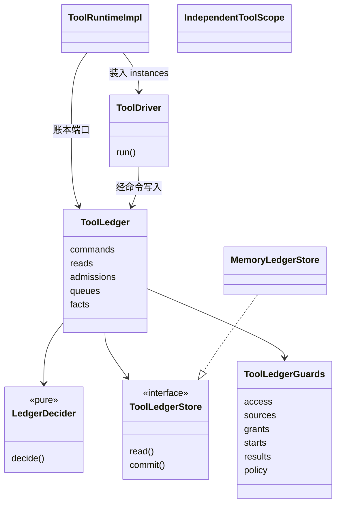
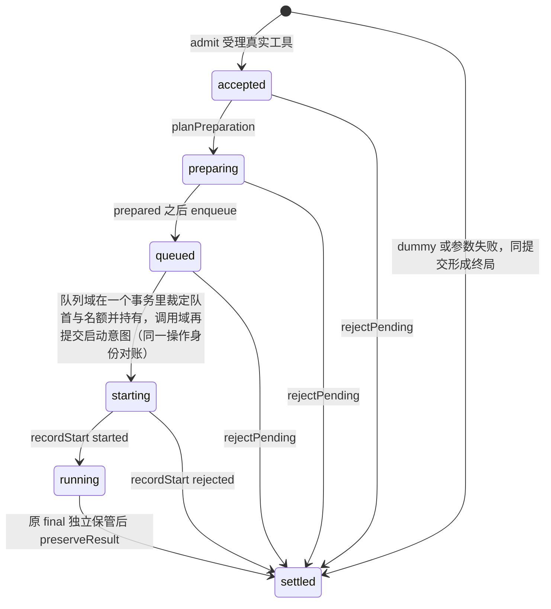
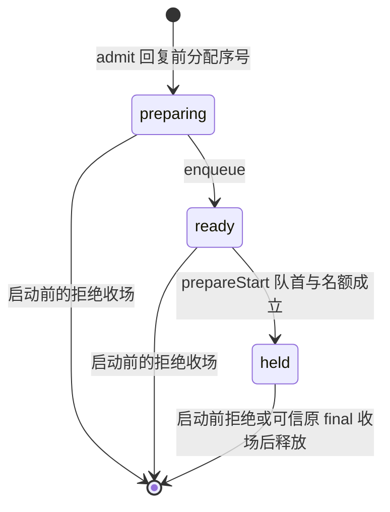

# tool 对象模型

本页说明 `tool` 包自有对象的职责、身份、状态、关联及生命周期：账本、决定器、记录仓端口与记录、推进协程、runtime、独立执行作用域、守卫，以及队列域与宿主域。契约对象（ToolCall、QueueReservation、ToolTask 等）见 [契约对象模型](../../tool-contract/docs/object-model.md)，本页不重复。内部机制见 [architecture](architecture.md)，当前支持范围见 [SPEC](../SPEC.md#当前范围)。

## 调用方怎样使用

下例是职责伪代码。每个操作都要处理成功、拒绝和未知三类结果。它只覆盖本包已实现的路径。

```text
装配者构造账本：createToolLedger(store, guards, clock, configuration, settlementPorts)
装配者构造 runtime：createToolRuntime(dependencies, configuration)
    缺端口或配置越界抛 TypeError，这是装配缺陷
    构造时把推进协程装入 instances.install，装入不受理业务，也不读写记录仓

普通调用方调用 runtime.invoke；来源 resolve 原子分配或认回原身份与来源
    成功：回复 accepted，runtime 调用 instances.schedule 唤醒推进协程，唤醒只是提示
    再次 invoke：同键同请求返回原回执与 recovered；accepted/preparing/queued/starting 待启动时补 wake，running/settled 不再唤醒
    拒绝：denied、invalid、conflict、stale-revision、unsupported、unavailable（`tool-queue` 容量满，提交之前拒绝）
    未知：association-unknown 没有确定引用，保留原完整意图再次 invoke
        commit-unknown 带原引用，可能是来源签发或 admission 尚未知；沿原 invoke 继续对账
        queries.lookup 查询当前准入状态，not-accepted 不排除来源尚待签发，不能因此换身份
        交付未知时用原操作引用调用 queries.queryOperation，释放成功直接返回原回执
        记录仓读取失败回复 unavailable，不冒充调用不存在

推进协程被唤醒后读 loadRecovery，按阶段与待办做一步，再重读，每次最多 `driverStepsPerRun` 步（缺省 16）
    成功：环境准备、排队、启动意图、启动围栏、记录启动、原事实保管、原结果收场及名额释放，依次推进
    拒绝：环境或启动被拒时先取排除证据，再以原操作号收场
    未知：端口不能回答、队首未到或围栏未知时停下，待办保留，不换操作号
    再推进：步数用尽且有已提交的步骤时立即重调度自己，整轮没有进展则按 `driverRetryDelayMs`；记录仓或端口失败、环境答 pending 或 unknown 同样按 `driverRetryDelayMs` 重调度；排队等待者对本 key 对账一次，并请宿主运行排在它前面或持有名额、仍欠队列一步的调用

独立消费方不经账本
    createIndependentToolScope 产生作用域，executeTool 运行作者并收尾
    成功：finish('returned') 成功后交出 R
    拒绝：作用域不匹配时回复 not-started，不调用作者
    未知：收尾失败时 effect 为 unknown

前台启动通过 ToolClock.begin 开启计时段
真实环境自动释放、完整计时、控制、等待、恢复扫描与退出尚未实现，未交付分支回复具名 unsupported
```

## 跨域概念与内部可见范围

外部概念的分类沿 [契约页的跨域表](../../tool-contract/docs/object-model.md#跨域概念与内部可见范围)。本包只增加它自己的两项：

| 分类 | tool 内的表示 | 原拥有者保留的责任 |
| --- | --- | --- |
| 上游公开语言 | 契约包的公开类型、ContentBlock（content-block）、Outcome（operation-result）。租户取契约的类型，账本不导入租户身份包 | 上游拥有值的定义；账本只检查租户的形状，由资格守卫证明它是铸造的值 |
| 本包定义的端口 | 记录仓 ToolLedgerStore、账本受信快照 ToolLedgerGuards、runtime 的构造形状 ToolDependencies | 记录仓不解释记录内容，也不做业务判断；守卫没有答案时回复 unavailable，从不当作允许 |

## 对象与生命周期

| 对象 | 分类与身份 | 负责什么 | 寿命与可见面 |
| --- | --- | --- | --- |
| ToolLedger | 冻结的工厂产物 `{ commands, reads, admissions, queues, facts }`，构造时固定 store、guards、clock、configuration、settlementPorts | 每个入口依次做边界检查、资格、读取、决定和按修订号提交 | 无调用事实的私有副本；构造后不改 |
| 决定器 | 纯函数，输入快照、一条命令、已核验的 guard 事实和本次铸造的修订号 | 输出“只回复不写”或“写入一组记录并回复” | 不读端口，不发通知，不运行工具 |
| ToolLedgerStore | 端口，两个操作 read 与 commit，声明 durability | read 返回一个事务域的全部记录和域修订号；commit 在 expected 相符时原子写入 | 提供者拥有耐久；`none` 只出现在 `./testing` |
| 事务域 | 判别联合：call（tenant + call）、queue（tenant + FIFO key）、host（tenant + key） | call 域拥有一次原调用的全部记录；queue 域拥有同 key 的顺序与名额；host 域供宿主保存自己的耐久记录 | 域修订号每次提交加一；本包不解释 host 域内容 |
| call / operation / result / environment-release / account / task 记录 | 判别联合记录，各有唯一键 | 原调用、已提交操作及其回执、结果版本及交付关系、账目修订、待办 | 与状态变化同提交；字段见 [architecture](architecture.md#本包的记录仓与决定器g1) |
| exclusion 记录 | `exclusion:<operation>`，值是操作号与围栏提交的域修订号 | 否定答案的排除围栏，使按旧修订号准备的在途提交失败 | 该操作的提交删除它；只由否定答案写入 |
| queue-entry / queue-counter / queue-release 记录 | queue 域内，`entry:<call>`、`counter` 与 `released:<call>` | 一个调用在该 key 下的序号、阶段、最后移动它的操作和固定的并发上限；下一个序号；已释放调用的墓碑与释放依据 | 条目删除即释放名额，删除与墓碑同提交；墓碑在 0.0.x 不剪枝，有墓碑的调用不再得到条目 |
| host 记录 | host 域内，`host:<key>` | 宿主提供者的一条记录 | 值由提供者自己校验 |
| ToolLedgerGuards | 受信快照：access、sources、factAcknowledgements、grants、starts、results、policy、budgets | 资格、来源、范围授予、启动资格、文本结果、结果政策与参数解析预算 | 构造时由宿主固定；决定器只消费它们的结论 |
| 证据铸造 | 每种证据各自铸造：state、result、delivery、operation、account | `record` 是种类加定位值的规范 JSON，`digest` 覆盖种类、定位值与内容 | 定位值总含租户与调用，两个租户的同号调用不共享证据 |
| 读取投影 | 快照上的纯投影：lookup、操作认回、结果分页、账目 | 否定答案先经排除围栏，结果按完整内容块分页 | 无状态 |
| ToolDriver | 推进协程，由 runtime 装入 instances | 读 loadRecovery，做一步，重读；操作号由受理操作号派生 | 同进程内同一调用串行；跨进程的唯一写者由修订号裁定 |
| ToolRuntime 实现 | `createToolRuntime` 的冻结产物 | 逻辑终局、启动、原事实保管与收场操作接账本端口；其余回复具名 unsupported | 不持有调用事实 |
| IndependentToolScope | 一次执行一个作用域，作者只拿 context | 输出账、等待历史、收尾 | 随一次执行；不耐久，回执只说明接收者已接管 |
| 内存记录仓 | `createMemoryToolLedgerStore`，durability 为 none | 按域修订号条件提交，可注入读取与提交故障 | 只在 `./testing`；进程退出即丢失 |



账本的三个入口按调用身份和操作号定键，所有写入经决定器与条件提交。队列域与调用域没有共同事务，跨域转换的顺序见 [architecture](architecture.md#队列域与跨域提交)。

## 无状态性与有状态性

决定器和读取投影是纯计算。账本和 runtime 都是冻结对象，构造后不改。调用事实全部在记录仓里。

推进协程有实例状态：本进程准备的环境值留在内存里，没有时调用 inspectPreparation 重新连接。这个状态丢失不影响调用，下一次唤醒从持久事实重建。独立作用域有三组实例状态：输出账、等待历史和收尾记录。它们随一次执行存在，不写入记录仓。

持久状态是各域的记录。域修订号是记录仓按域比对的并发令牌，状态修订号是 `ToolState.revision`，等于写入该状态的那次提交的域修订号。排除围栏推进域修订号而不改状态，所以持有当前状态的写者不会因为别人的查询而失效。

## 状态与转移

本包已实现的调用阶段包括原 final 收场与 slot 释放。完整环境资源释放驱动仍未交付。



队列条目的阶段独立于调用阶段：



已启动调用从本域原 final 收场，确认独立保管后同提交原结果、delivery、ended 与全部后继责任。queue 删除 entry 与墓碑独立提交，call 最后关闭原 queue duty。环境资源释放另有 canonical 计划与核验，不由 slot 状态代替。`not-started` 与 `unknown` 的启动回执保存后，启动记录与 `start` 待办保留。名额只在条目删除时释放。

## 值、参数与依赖

| 类别 | 内容 | 固定点与校验 |
| --- | --- | --- |
| 构造配置 | ToolConfiguration：作者限额、processBatchBytes、processBatchDelayMs、observerBufferBytes、resultPageBytes、reconciliationDelayMs、ledgerCommitAttempts、queueCapacity、可选的 driverStepsPerRun 与 driverRetryDelayMs | runtime 检查全部字段，账本只检查它读取的 resultPageBytes、ledgerCommitAttempts、queueCapacity；容量与 driverStepsPerRun 为正安全整数（driverStepsPerRun 缺省 16），处理延迟为非负安全整数，driverRetryDelayMs 缺省 1000、给出时是 1 到 2147483647 的整数；超出抛 `TypeError` |
| 构造依赖 | ToolDependencies：显式依赖端口（含同账本的 `admissions`、`queues` 与 `facts`，以及来源 resolve） | 缺端口或配置不合法抛 `TypeError` |
| 受信快照 | ToolLedgerGuards | 构造时固定；缺答复是 unavailable |
| 一次操作参数 | 契约的 WriteContext 或 Mutation；写命令的主体放在同一输入的 `principal` | 每个命令先查形状，再问资格，然后读记录仓 |
| 短期资源 | 本进程的环境值、作用域的中止监听器 | 作用域在 finish 结束或取消后移除监听器 |
| 持久值 | 各域记录 | 记录仓承诺耐久；`none` 的记录仓不得冒称耐久 |

## 应用对象、端口和依赖方向

契约端口的依赖方向见 [契约页](../../tool-contract/docs/object-model.md#应用对象端口和依赖方向)。下表只列本包自有的对象。

| 对象或端口 | 构造时注入 | 操作参数 | 失效与替换 |
| --- | --- | --- | --- |
| createToolLedger | store、guards、clock、configuration、settlementPorts | 命令与读取的输入 | 记录仓不可用回复 unavailable（`ledger-store`），不冒充调用不存在 |
| ToolLedgerStore | 无 | read(domain)、commit({ domain, expected, revision, writes }) | 结果不确定回复 unknown；替换提供者须保持条件提交与 durability 声明 |
| ToolAccessGuard | 宿主 | principal、tenant、call、action | 须证明租户是铸造的值；伪造回复 denied |
| ToolSourceGuard | 宿主 | 调用来源、消费位置、范围 | 伪造回复 denied，不可读回复 unavailable |
| ToolGrantVerifier | 每个接受的范围拥有者一个，装配声明 | principal、tenant、call、范围的授予证据 | 缺失、伪造或属于他方回复 denied；没有核验器的拥有者同样拒绝 |
| ToolStartGuard | 宿主，由当前定义与许可事实构成 | 已固定的请求 | 不可读回复 unavailable，从不当作允许 |
| ToolDriver | ToolDependencies | 租户与调用 | 崩溃后以同一操作号重做；已受理的原执行不重放 |
| createToolRuntime | ToolDependencies、ToolConfiguration | 契约 ToolRuntime 的操作 | 未实现操作回复 unsupported（采用为 tool-runtime 或 tool-ledger） |
| createIndependentToolScope | IndependentToolScopeInput：limits、signal、process、waits | emit、wait、finish | process 或 waits 为 null 时对应原语回复 unsupported |
| executeTool | 一个作用域、作者、E | 作者参数 | 作用域不匹配回复 not-started |

## SOLID 与扩展边界

| 原则 | 具体选择 | 必须防止的反例 |
| --- | --- | --- |
| 单一职责 | 账本入口管边界与提交，决定器只算，记录仓只做原子读写，驱动协程只推进一步 | 决定器读端口；记录仓解释记录；驱动协程裁定顺序或名额，裁定归队列域 |
| 开闭原则 | 新记录种类和新命令沿判别联合与决定器扩展，后继操作先以具名 unsupported 占位 | 未实现操作抛异常或回复空成功 |
| 里氏替换 | 任何记录仓提供者保持条件提交、unknown 与 durability 声明 | 非耐久记录仓混入非测试路径；只验证接口形状 |
| 接口隔离 | 守卫按需要拆成 access、sources、grants、starts；账本只取三项配置 | 一个大守卫对象；账本读取全部配置 |
| 依赖倒置 | 本包依赖契约端口，不导入 Cordis，也不导入租户身份包 | 在实现里复制契约端口或域外模型 |

## 产品能力覆盖与验收

本包当前承担的能力范围如下。逐项证据归 [覆盖与验收规范](../../tool-contract/verification/README.md#产品到成员的覆盖) 和 [tests/README](../tests/README.md)。

| 能力 | 建模落点 | 必须验证 |
| --- | --- | --- |
| CAP-TL02 dummy | 决定器的逻辑终局 | dummy 不解析参数、不查队列、不占条目 |
| CAP-TL03 准入与启动 | 账本、ToolDriver、启动守卫、启动围栏 | 同身份异输入被拒；`recordStart` 回复丢失后执行者不被调用第二次 |
| CAP-TL04 队列 | queue 域、queue-entry、ToolGrantVerifier | 同 key FIFO 与名额由一个队列事务裁定；两租户同 owner 同 key 不共队列 |
| CAP-TL06、CAP-TL08 作者入口 | IndependentToolScope、executeTool | emit 按受理顺序到达；wait 的 key、容量与取消按 P11 处理 |
| CAP-TL07 原结果 | ledger-settlement、ledger-environment-release、driver | 独立 retain 确认后原结果及后继责任同提交，queue 墓碑与清理计划分别保留原身份 |
| CAP-TL09 交付 | 读取投影、releaseDelivery 决定 | 结果按完整块分页；解除后全文仍可读 |
| CAP-TL12 账目 | 账目记录 | 逻辑终局账目取 SPEC 第 11 条列出的值。这是本包的读法，待契约拥有者确认，见 [SPEC](../SPEC.md#11-操作幂等p01) |

其余能力（前后台关系、控制、等待、恢复与退出）尚未实现。本页不证明它们。

## 协作与反向检查

移除内存环境值后，推进协程调用 inspectPreparation 重新连接，不重新准备。移除 `queue` 待办则启动拒绝的释放无法重做，所以待办不能用内存标记代替。驱动协程在受理回复丢失后被再次唤醒，从 loadRecovery 重做，不产生第二个队列条目。没有 `exclusion` 记录，被围栏排除的在途命令无法得知否定答案已经给出，也就不能停止重试。这些反查是责任分离是否成立的最低判据。
