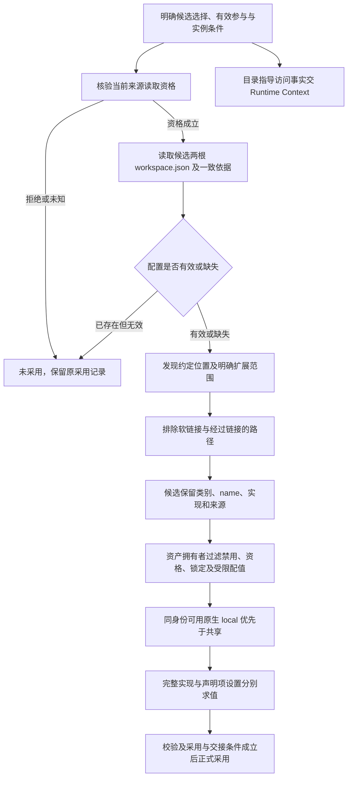

# 工作区成员机制流程

状态：技术机制草案。流程没有真实运行证据；跨领域交接另见[领域流程](../../../../docs/domains/workspaces/key-flows.md)。

## F-WS04 两根来源发现与材料求值

对应 J-WS04；守护 INV-WS02、INV-WS03、INV-WS06、INV-WS07、INV-WS08、INV-WS10、INV-WS11。

来源缺失是空，配置缺失不是格式错误。候选读取无须先完成装配，未经校验及采用与交接不生效；首次没有原采用时，失败后工作区层仍为空。被过滤 local 不遮蔽共享；显式 false 不按 OR 合并；替换实现不拼接共享文件或继承其凭据。此流程只读取和求值，实际启动由相应能力准入控制，规范文本不进入设置合并。

## F-WS05 第三方兼容贡献

对应 J-WS05；守护 INV-WS06、INV-WS07、INV-WS08、INV-WS09、INV-WS10、INV-WS11。

读取有效的各 harness 准入配置，确认格式支持后，从同工作区约定位置取得 Skill/MCP/hook 材料。未知版本或字段明确报告且保留原件，不扩展到家目录、整体权限政策、Agent Definition 或指令文本。转换候选经过正常过滤；合法原生优先，第三方同能力不同内容冲突显式选择，重复来源去重。工作区读取成功不代表命令启动获准。变更只在实际装配或显式 reload 采用。
