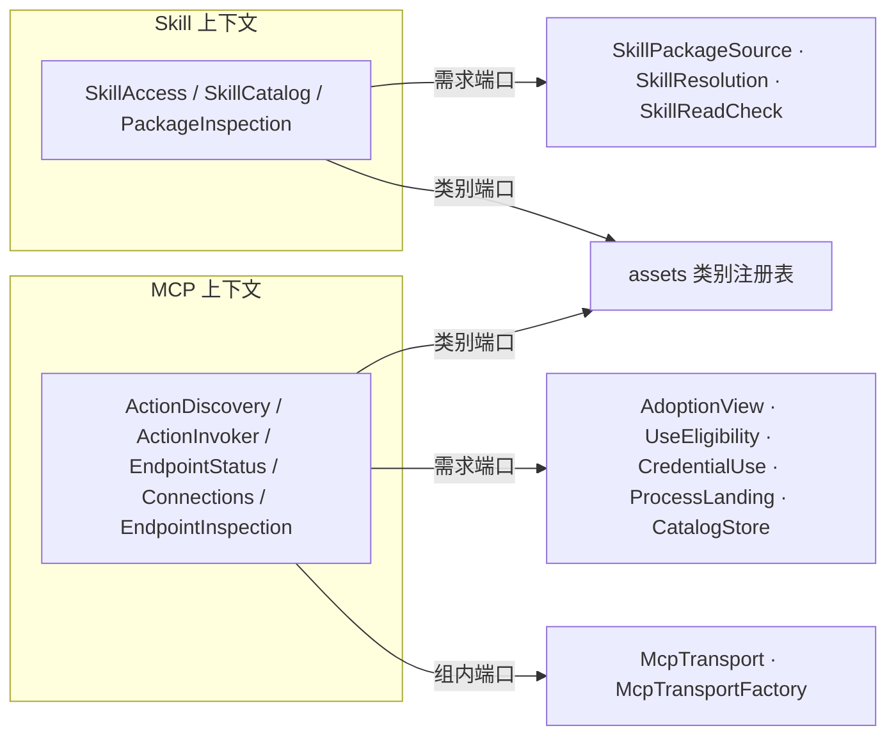

# Skill 与 MCP：正式 DDD 与 SOLID 建模

本目录是任务过程材料，不是正文。它为两个领域的实施打下设计规格的基础。正文仍以组页 `packages/skills/docs/architecture.md`、`packages/mcp/docs/architecture.md` 和领域页为准。本目录发现的、需要写回正文的差异列在[建模发现](#建模发现)。

范围：只建模领域内部，以及用本领域的词表达的对外契约。调用方怎样接入归调用方。

## 怎样核对

```bash
cd tmp/skill-mcp-domain/model
../../../packages/skills/skill-contract/node_modules/.bin/tsc -p tsconfig.json
node --experimental-strip-types checks/run.ts
```

- `tsc` 用仓库的严格配置（`exactOptionalPropertyTypes`、`noUncheckedIndexedAccess`、`verbatimModuleSyntax`）。公共值从仓库源码直接导入，所以按真实形状核对。
- `checks/run.ts` 执行 19 项性质核对，覆盖草图里已写出实现的部分。它不是成员的测试。实施时改写成 vitest，按行为断言。
- 最近一次运行（2026-11-03）：`tsc` 无输出，19 项通过。

## 文件

| 文件 | 内容 | 实施时落到 |
| --- | --- | --- |
| `shared.ts` | 两个上下文共用的公共值，全部取自现有公共成员 | 不落地，各成员直接依赖公共值成员 |
| `skill/values.ts` | 值对象与品牌类型 | skill-contract 公开根 |
| `skill/ports.ts` | 三个需求端口 | skill-contract 的 `./provider` |
| `skill/failures.ts` | 失败总表与按操作收窄的失败 | skill-contract 公开根 |
| `skill/services.ts` | 三个应用服务接口与结果值，工厂签名 | 接口在 skill-contract，工厂在 skill |
| `skill/functions.ts` | 纯函数，品牌的唯一授予处 | skill-contract（`sealSnapshot` 在 `./provider`） |
| `skill/access.ts` | `SkillAccess` 的参考实现（读取 11 步） | skill 的 `src/access.ts` |
| `mcp/values.ts` | 值对象与品牌类型 | mcp-contract 公开根 |
| `mcp/ports.ts` | 五个需求端口，组内的 `McpTransport` 与 `McpTransportFactory` | mcp-contract 的 `./provider` |
| `mcp/outcomes.ts` | 调用结局、未发出原因、读面拒绝 | mcp-contract 公开根 |
| `mcp/catalog.ts` | MCP 动作清单聚合：不可变记录加纯转移函数 | 类型在 mcp-contract，`mergeListing` 在 mcp-contract（穷举测试入口） |
| `mcp/connection.ts` | MCP 连接聚合：类 | mcp |
| `mcp/in-flight.ts` | 在途表聚合：类 | mcp |
| `mcp/gate.ts` | 采用与资格关口，能力令牌 `AdmittedEndpoint` | mcp |
| `mcp/functions.ts` | 纯函数 | mcp-contract |
| `mcp/services.ts` | 五个应用服务接口、装配工厂签名 | 接口在 mcp-contract，工厂在 mcp |
| `checks/run.ts` | 可执行的性质核对 | 改写成各成员的 vitest |

## 限界上下文与上下文映射

两个领域各是一个限界上下文。它们彼此不依赖，不共用模型。

| 上下文 | 核心问题 | 本上下文拥有的事实 | 不拥有 |
| --- | --- | --- | --- |
| Skill（方法与资源取用） | 一份合法的 Skill 包是什么；怎样按读取权与材料依据取出它的声明、正文、资源与包字节 | 包格式规则、Skill 包快照的一致性、读取的版本语义、失败语义 | 持有、选择、采用、读取权、可用性、设置值、脚本执行 |
| MCP（接入点、连接、发现与动作） | 怎样为一个已采用的接入点建立隔离的连接，合法取得动作清单，发出调用并如实报告结局 | MCP 连接的生命周期与代际、MCP 动作清单与已知动作、在途调用、结局分类 | 采用、使用资格、凭据保管与授权流程、进程落点、动作权限判定、原调用的保存 |

上下文之间的关系都经端口，本上下文是端口的声明方（客户方—供应方中的客户方，端口由供应方实现，符合性套件由本方导出）：



两个上下文对资产都是同一种关系：实现 assets 的 `BodyContract`，登记自己的类别。资产治理（持有、层序、配值）不进入两个模型，只以不透明值出现：Skill 的来源层、资产版本；MCP 的接入点持有、采用修订、凭据配值。

## 建模手法（两个上下文共用）

1. 品牌类型。语义不同的字符串和数字都有品牌，例如 `SkillName`、`PackagePath`、`PackageDigest`、`Generation`、`CorrelationKey`。品牌只由校验函数授予，草图里每个 `as` 都在校验之后，并标了「唯一授予处」。
2. 构造即一致。`SkillPackageSnapshot` 只能经 `sealSnapshot` 构造，所以「内容摘要由条目算出」「路径唯一」「无前缀冲突」不靠调用方记得。`CompleteListing` 只能经 `completeListing` 构造，所以 `mergeListing` 拿不到半份清单。
3. 判别联合代替可选字段袋。例如 `MaterialState` 是「钉住」或「没有可读的包」，不是一个可选的依据字段；`CatalogState` 是「未取得」或「已取得」，不用空数组表示未取得。
4. 诚实签名。每个上下文有一张失败总表，再按操作用 `Extract` 收窄。例如 `export` 必须带依据，它的失败类型里就没有 `adopted-material-changed`，`checks/run.ts` 在类型层核对这一点。
5. 不可信的值单独标出。MCP 的 `Untrusted<T>` 包住对端自报的内容（`serverInfo`、`instructions`、通知），它不能被当作可信值使用。
6. 能力令牌。MCP 的 `AdmittedEndpoint` 只能由 `admit()` 产出。要动连接或清单的内部函数只收它，所以「先核采用，再核资格」由类型保证，不靠纪律。`cancel` 与 `cancelTask` 不经关口，与组页一致。
7. 穷尽检查。端口答复到服务失败的映射用 `switch` 加 `assertNever`，新增答复种类而漏处理时编译失败。
8. 仓库风格。值是只读类型；无状态的服务是工厂函数加闭包；类只用于有状态的内存聚合（`Connection`、`InFlightCalls`）。依赖用对象参数注入。

## Skill 上下文

### 值对象

Skill 没有有状态的聚合。全部值不可变。

| 值 | 不变式 | 授予处 |
| --- | --- | --- |
| `SkillName` | 1–64 位小写字母、数字、连字符；不以连字符开头或结尾；不含连续连字符 | `toSkillName` |
| `PackagePath` | 规范化的包内相对路径；无绝对路径、`..` 段、反斜杠、空段 | `toPackagePath` |
| `SkillPackageSnapshot` | 路径唯一；无文件与目录的前缀冲突；内容摘要由排序后的路径与条目摘要算出，不含包根目录名 | `sealSnapshot` |
| `SkillMaterialBasis` | 不含包定位；同一材料由能力标识、来源层、内容摘要判定；工作区来源没有资产版本 | `SkillAccess` 结果 |
| `SkillRef` | 只在 Skill 与 `SkillResolution` 之间传递；内容摘要缺席表示没有可读的包 | `SkillResolution.resolve` |
| `StandIn` | 合法已知、此刻不可用的身份；带最后合法的 name、说明与安全原因 | 由 `known-unavailable` 组装 |

`SkillRef` 与 `SkillMaterialBasis` 是两个值，不是一个值的两种视图：前者能找字节，后者只能指明材料。调用方拿不到包定位，所以不能借依据指定位置。

### 端口

三个需求端口在 skill-contract 的 `./provider` 子路径。消费者从公开根拿不到 `SkillRef` 与 `sealSnapshot`。

- `SkillPackageSource`：只交字节。失败集合封闭（五种）。
- `SkillResolution<P, S>`：`resolve` 的答复次序固定；`adopted` 只交两种身份（`CatalogResolution`）。
- `SkillReadCheck<P, S>`：只按能力标识判定，答 `granted`、`refused` 或 `unknown`。

`P`（主体）与 `S`（作用域）是类型参数，Skill 不解释，只原样交给端口。

### 应用服务

| 服务 | 操作 | 带 `access` | 结果 |
| --- | --- | --- | --- |
| `PackageInspection` | `inspect(locator, { expectedName? })` | 否，只看字节 | `SkillDefinition`，或 `rejected`（按次序的第一个原因）、`source-unavailable`、`version-changed` |
| `SkillCatalog<P, S>` | `summaries`、`search` | 是 | `CatalogEntry[]`（`adopted` 或 `stand-in`），或 `unknown` |
| `SkillAccess<P, S>` | `describe`、`read`、`list`、`export` | 是 | 各自的结果值，或各自收窄后的失败 |

读取 11 步在 `skill/access.ts` 写成可编译的参考实现。结构是三段，各段的失败类型逐段扩大：

1. `gate`（第 1–3 步）：依据身份、读取权、对应。失败是 `DescribeFailure`。`describe` 到此结束。
2. `pin`（第 5、7 步）：钉住内容摘要，取快照比较。失败是 `PinFailure`。`list` 到此结束。
3. `verifiedBytes`（第 10 步）：按条目内容摘要核对字节。失败是 `ByteFailure`。`read` 与 `export` 在此之后截取或汇总。

### 纯函数

`toSkillName`、`toPackagePath`、`computeDigest`、`sealSnapshot`、`inferMediaType`、`parseSkillPackage`、`projectAssetBody`、`isControlFile`。`parseSkillPackage` 收一个已经取好的快照和控制文件字节，不收端口，所以可以穷举测试。

## MCP 上下文

### 值对象

| 值 | 要点 |
| --- | --- |
| `EndpointRef` | 接入点 name 加持有；不含租户与对端账号 |
| `EndpointDefinition` | 传输声明（`stdio` 带启动声明，`streamable-http` 不带地址）与认证方式 |
| `PeerAccount` | `anonymous`，或由凭据配值确定的账号。只由 `peerAccountOf` 派生 |
| `ConnectionKey` | 租户、持有、采用修订、对端账号。采用修订一变就换新连接 |
| `CatalogKey` | 租户、对端账号、持有。不含协议版本与采用修订，所以已知动作不随它们离开清单 |
| `PeerIdentity` | 协议版本与能力可信；`serverInfo`、`instructions` 用 `Untrusted` 包住 |
| `ActionDefinition` | 原样保存（仓库的 `JsonValue` 保留数字字面量，不丢精度），只读出 name 与 `taskSupport` |

### 聚合

| 聚合 | 形态 | 一致性边界 | 不变式（草图中由代码或类型保证的打 ✓） |
| --- | --- | --- | --- |
| `ActionCatalog`（含实体 `KnownAction`） | 不可变记录加纯函数 `mergeListing`、`markUnavailable` | 一份记录，一次按修订条件的整份写入（`CatalogStore.write`） | ✓ 只有完整清单能加入动作；✓ 已知动作不静默消失；✓ 基于旧修订的结果被拒；✓ 整份产出，修订加一；✓ 未取得不等于零个动作 |
| `Connection` | 类，只做状态转移，不做 IO | 一条连接的状态与代际 | ✓ 代际按策略加一（`on-attempt` 用于 stdio，`on-negotiation` 用于 HTTP）；✓ `degraded` 只由 `ready` 进入；✓ 关闭后不能重建；✓ 旧代际的响应不被接受 |
| `InFlightCalls` | 类 | 一次运行内的在途表 | ✓ 查重与占位一步；✓ 只有同租户、同主体能取消；✓ 不在表里的键答 `unknown`；✓ 代际已换答 `unknown`；✓ 占位后发出前被取消则不发出 |

`ActionCatalog` 不用类，因为它的生命在存储里：每次 `refresh` 读出、合并、按修订条件写回。`Connection` 和 `InFlightCalls` 只活在一次运行的内存里，所以用类。

### 端口

| 端口 | 一侧 | 草图中的形状变化 |
| --- | --- | --- |
| `AdoptionView<P, S>` | 组外 | 新增 `endpoint(access, ref)`，见 F1 |
| `UseEligibility<P>` | 组外 | 答复写成判别联合：`not-eligible` 与被设置挡下的两种原因分开 |
| `CredentialUse<P>` | 组外 | 只答句柄，不再另答对端账号，见 F2 |
| `ProcessLanding<P>` | 组外 | 句柄的 `stop()` 报告实际确认的停止范围 |
| `CatalogStore` | 本组（第一波内存实现） | 期望修订用 `'absent'` 表示从未写入 |
| `McpTransport` | 组内（mcp-host-local） | 失败只分「未发出」与「已发出无应答」 |
| `McpTransportFactory` | 组内（mcp-host-local） | 新增，见 F3 |

### 应用服务

五个应用服务与组页一致：`EndpointInspection`（类别端口）、`ActionDiscovery`（读口）、`ActionInvoker`（调用口加状态口，写成 `ActionCalls & TaskControl` 两个窄接口）、`EndpointStatus`、`Connections`。装配工厂 `createMcp(ports, config)` 一次交出五个服务，它们共享同一张连接表和在途表。

`invoke` 的次序（实施规格的骨架）：

1. `InFlightCalls.reserve`。重复时答「未发出：关联键重复」。
2. `admit`。拒绝时撤销占位，答「未发出」带拒绝原因。
3. 读清单，核动作可用性、定义的内容摘要、方式是否受支持。不符时撤销占位，答「未发出」。
4. `Connections.ensure`：`peerAccountOf` → `connectionKeyOf` → 取或建连接（凭据、落点、传输工厂）。失败时撤销占位，答「未发出」。
5. `McpTransport.call`，拿到请求号后 `InFlightCalls.markSent`。若已被取消，答「未发出：已取消」。
6. 等结局。`signal` 触发或 `cancel` 时发出取消请求，结局是 `unknown`（本地放弃）。最后 `markEnded`。

### 纯函数

`parseEndpointBody`、`digestDefinition`、`toContentBlocks`、`classifyOutcome`、`mergeListing`、`completeListing`、`peerAccountOf`、`catalogKeyOf`、`connectionKeyOf`、`launchesLocalCommand`、`actionPermissionItems`。

## 成员与模块布局

按 pkg-init 的改名，三个能力组的成员命名一致：`<组>-contract` 是纯契约，`<组>` 是通用实现。

| 成员 | 子路径 | 内容 |
| --- | --- | --- |
| `@omne-harness/skill-contract` | `.` | 值、失败、应用服务接口、纯函数、`skillBodyContract` |
| | `./provider` | 三个需求端口、`SkillRef`、`sealSnapshot` |
| | `./testing` | 三个端口与 `SkillAccess` 的符合性套件、内存来源 |
| `@omne-harness/skill` | `.` | `createPackageInspection`、`createSkillCatalog`、`createSkillAccess` |
| `@omne-harness/skill-host-local` | `.` | `DirectorySource` |
| `@omne-harness/mcp-contract` | `.` | 值、结局、应用服务接口、纯函数（含 `mergeListing`、`classifyOutcome`） |
| | `./provider` | 五个需求端口、`McpTransport`、`McpTransportFactory` |
| | `./testing` | 五个需求端口与传输的符合性套件、本地真实服务端夹具、穷举测试入口 |
| `@omne-harness/mcp` | `.` | `createMcp`、`createInMemoryCatalogStore`；内部是 `Connection`、`InFlightCalls`、`admit` |
| `@omne-harness/mcp-host-local` | `.` | stdio 与 Streamable HTTP 的 `McpTransportFactory` 实现（官方 client 2.3.1） |

`./provider` 子路径沿 `tool-contract` 的先例。它把「给实现方的」和「给消费者的」分开（接口隔离）。

## 测试接缝

| 接缝 | 谁用 | 核对什么 |
| --- | --- | --- |
| 端口符合性套件（`./testing`） | 端口的实现方 | 答复与失败的形状；对无权主体答复不随身份是否存在而变；来源的内容摘要相同则内容相同 |
| 纯函数穷举 | 本组 | 包格式规则与拒绝次序、`toPackagePath`、`sealSnapshot`、`mergeListing`、`classifyOutcome`、`toContentBlocks` |
| 聚合状态机 | 本组 | `Connection` 的每个转移与非法转移；`InFlightCalls` 的占位、取消与代际 |
| 应用服务 + 内存端口 | 本组 | 读取 11 步的每个分支；`refresh` 的条件写入与竞争；`invoke` 的六步与「未发出」原因 |
| 真实服务端夹具 | mcp-host-local | 两种传输共用一份契约测试（里氏替换） |

## SOLID 落点

| 原则 | Skill | MCP |
| --- | --- | --- |
| 单一职责 | 来源只交字节；解析只解释；`gate`、`pin`、`verifiedBytes` 各管一段 | 传输只讲协议；`Connection` 只管生命周期；`ActionCatalog` 只管采用；`InFlightCalls` 只管在途；`admit` 只管关口 |
| 开闭 | 加来源就加 `SkillPackageSource` 实现；加方言就加解析分支 | 加传输就加 `McpTransportFactory` 实现与 `GenerationPolicy` 一种取值 |
| 里氏替换 | 所有来源共用符合性套件 | 两种传输共用一份契约测试 |
| 接口隔离 | 公开根与 `./provider` 分开；三个服务分开；失败按操作收窄 | 读口、调用口、状态口、类别端口分开；`ActionCalls` 与 `TaskControl` 分开 |
| 依赖倒置 | 服务只依赖端口；`DirectorySource` 在 skill-host-local | 服务只依赖端口；官方 SDK 只在 mcp-host-local；传输由工厂端口创建 |

## 建模发现

建模过程中发现的差异。每条都在本领域内，由本领域负责人决定。2026-11-03 已全部写回组页、领域页与关键流程页。

| 编号 | 位置 | 发现 | 建模中的处理 |
| --- | --- | --- | --- |
| F1 | MCP `AdoptionView` | 组页只有 `endpoints(access, scope)`，但调用口、读口只收 `EndpointRef`，没有作用域，无法取一个接入点的采用 | 增加 `endpoint(access, ref)`。持有本身带层与作用域，由端口实现方解析 |
| F2 | MCP `CredentialUse` | 对端账号有两个来源：`current` 用凭据配值派生，`Connections` 用 `acquire` 的答复。两者不一致时没有规则 | 只由 `peerAccountOf(auth, binding)` 派生；`acquire` 只答句柄（一个事实一个来源） |
| F3 | MCP `Connections` | 组页没有说 `Connections` 怎样在不认识 SDK 的前提下创建传输 | 增加组内端口 `McpTransportFactory`，由 mcp-host-local 实现 |
| F4 | MCP `mergeListing` | 不变式 3 要求带上连接代际。但代际属于一条连接，采用修订一变就换新连接，跨连接比较代际没有意义 | `mergeListing` 只按清单修订做条件判断；「产出清单的那代连接仍是当前连接」放在发布边界（`refresh` 第 6 步）核对 |
| F5 | MCP `cancel` | 组页没有覆盖「已占位、尚未发出」时的取消 | `cancel` 答「已发出取消信号」，`invoke` 答「未发出：已取消」，没有对端效果 |
| F6 | Skill `SkillResolution.adopted` | 答复类型是整个 `Resolution[]`，但当前合法集合里只会有 `adopted` 与 `known-unavailable` | 收窄为 `CatalogResolution[]`，`SkillCatalog` 不必处理不可能的种类 |
| F7 | Skill `read` 正文 | 正文是闭合定界行之后的字符，字节范围应当相对正文起点；内容摘要核对的是整个 `SKILL.md` 条目 | 草图只标注，留给 skill-contract 的 SPEC：先核整条目摘要，再按正文起点截取 |
| F8 | Skill `SkillPackageSnapshot` | 组页说快照由来源交出，没有说一致性由谁保证 | 快照只能经 `sealSnapshot` 构造，导出在 `./provider`，来源实现必须用它 |
| F9 | 两组的成员子路径 | 组页没有区分「给实现方的」与「给消费者的」入口 | 两个契约成员都设 `./provider`，沿 `tool-contract` 先例 |

## 假设与未决

- 内容摘要算法：草图用 SHA-256 十六进制，带 `sha256:` 前缀。精确算法归 skill-contract 的 SPEC。
- 中止结果：草图用失败种类 `aborted`。组页说「中止结果的表示归 SPEC」，这里是提议。
- `ReadContent`：草图把文本与二进制分开，没有映射到 `ContentBlock`。二进制条目在 `ContentBlock` 中的表示仍归 SPEC。
- MCP 的 `peer()` 在没有连接时答 `not-connected`。组页没有写这个情形，按「`current` 不连接」的同一原则处理：读口不为了回答而建连接。
- `EndpointStatusView` 的字段只列了组页提到的几项，精确字段归 mcp-contract 的 SPEC。
