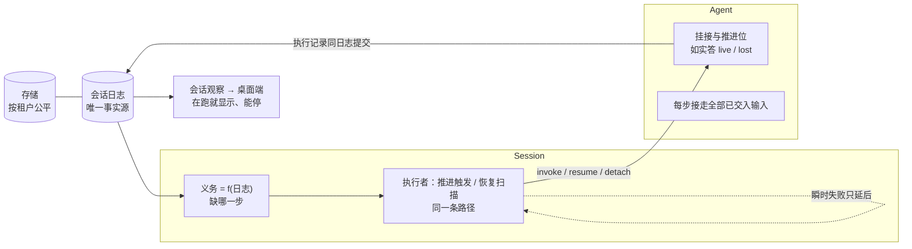

# 会话受理、消费、推进 · 领域影响

> **更正（2026-11-26，原会话按后来的证据写；负责人没有逐条认可。领域分级与总边界没有改）**
>
> 下面这些句子作废，以 `as-is.md` 的更正节与状态表、`totalization.md` 修订 2 为准：
>
> 1. 维度分解表第 1 行与耦合检查 2「义务放在内存重试循环里，用完即弃」「循环 return 义务就没了」：不成立。`check` 每次被叫醒都从日志现算，重试用完之后由周期扫描接上。
> 2. 第 2 行「`checkedRun` 对未受理的一轮返回空，什么都不做」：未受理的一轮由推进的 `replay` 负责，不是缺口。
> 3. 第 3 行、耦合检查 1、组合保证里的「live（附进展证据）」、不变式落点 I-5 里的「Session（等待有上限）」：这是 `as-is.md` 的 R3，没有任何现场证据，不做。第 1 程对 `contact` 的改动是另一格：执行槽空着或被别的 execution 占着时答失联。
> 4. 第 4 行「直到 60 秒空闲回收」：错。停下的执行使实例从不报 idle，不会被回收，要重启；第 1 程已修成停下就让出执行槽。
> 5. 第 7 行「F11 根因未定位」：已定位，见 `f11/report.md`。
> 6. 最后一行「放弃改为暂停」、领域分级里的「改 SE-8 与恢复表」、会话诊断列为连带：没有定，见 `requirement.md` 的更正 3。
> 7. 顶层设计里 Session 一句的「补不上只延后、不放弃」：今天是有界重试加扫描，已经够；改成不设上限的延后是可选的改进。
> 8. 不变式落点表缺 I-10：Session（读取与观察）、Agent（每步取上下文）、客户端；用性能设施的计数门度量。
> 9. 连带普查最后一行提到的 #1649 的反例：#1649 的归因已更正，见它的评论。

依据：需求与不变式单（`requirement.md`，2026-11-25 认可）；#1649；#1640；0.1.0 实测 F1、F11、F36。

## 维度分解

剥掉表面：问题里的词是「卡住」「重试」「停止按钮」，真正在变的量是**一轮 Run 的推进义务由谁持有、持有多久、靠什么被再次执行**。必须不变的是：一轮至多一个有效推进者、终态不可反转、一条输入至多一次有效承接。

| 事实或决定 | 轴 | 拥有者 | 现行正文怎么说 | 结论 |
| --- | --- | --- | --- | --- |
| 一轮开着时「还缺哪一步」（交给 Agent、补交输入、交回事实、收场） | 工作 | Session | `packages/session/SPEC.md`「接手与恢复」有恢复表；「协调器与调度器」写协调器无状态、恢复扫描启动与周期执行 | 已有拥有者。实然偏离：advance.ts 的 invoke / handOver / startRun 把义务放在内存重试循环里，用完即弃（SE-8 允许「放弃并诊断」） |
| 恢复扫描对「已开 Run、Agent 尚未受理」与「挂接仍活着」两类怎么做 | 工作 | Session | 恢复表：前者「以同一身份重放发起」；后者「等 Agent 推进」 | 已有拥有者。实然偏离：`recover.ts` 的 `checkedRun` 对未受理的一轮返回空，什么都不做；「等 Agent」没有上限，依赖 Agent 报告的真实性 |
| 一次执行的挂接是否还在推进（live / lost / unknown） | 寿命 | Agent（agent-host） | Agent 契约有 `contact`；SPEC 写「挂接仍活着时只有持接管资格并有宿主的失联判断才接管」 | 已有拥有者。实然偏离：`agent-host-local/src/host.ts` 的 `contact` 以「内存里有运行体」答 live，不问它是否还会被调度 |
| 被取消一轮的推进位何时让出 | 寿命 | Agent（agent-host）与 Session 的交接边界 | SPEC：「新 attempt 生效后旧 attempt 不能追加……」；取消收束只允许取消前最后授予的 attempt | 已有拥有者。实然：旧实例 `stale-advance` 停下后仍占位，直到 60 秒空闲回收；Session invoke 的三档重试（1s、5s、30s）先用完 |
| 同日志解释遇到瞬时失败怎样重试 | 工作 | Session（session-adapters 的日志解释） | SPEC：「瞬时失败……不设次数上限，直到成功、确定答复或插件停止」 | 已有拥有者。实然：0 ms 紧贴重试；把永久性失败（`required original material is missing`）当瞬时失败，每 5 秒重试至今 |
| 一轮开始时接走哪些输入（批界） | 工作 | Session（受理与批次）、Agent（每步取当时已交入的输入） | SPEC「新 Run 分两次提交……带首条输入」；产品 CAP-SW05「一并接走，不漏不拆」；CAP-AG03「当前已收到的输入全部接走」 | 已有拥有者，正文之间有张力：两次提交只带首条输入，其余经续入在后续步骤取走，造成 F1 的拆分。交细化设计判定是改实现还是改正文 |
| 归档、撤销归档与后台调用 | 工作 | Session（归档与级联协调） | SPEC「归档与作用域释放」 | 已有拥有者；F11 根因未定位，待第 4 步建模时一并覆盖 |
| 界面上「这一轮在跑吗」「能不能停」 | 观察 | Session（会话观察的投影）、桌面端（session-ui） | SE-17、SE-20：观察第一帧是状态帧、历史是权威流是投影 | 已有拥有者。实然：日志有未终结 Run 时界面显示空闲、无停止按钮 |
| 存储读写队列的跨租户份额 | 落点与装配 | 存储（sqlite-provider） | 存储的配置只有全局与每领域队列长度，没有按租户的份额或公平 | 新设计（落在已有拥有者存储里，不是新领域） |
| 「放弃」诊断的语义 | 观察 | Session（诊断）、会话诊断协议 | SE-8「每次放弃都留下具名诊断」 | 改承诺：放弃改为暂停，义务不结束；读者同步 |

耦合检查（命中三处，均要拆开）：

1. **Agent 实例的寿命决定了 Session 工作的寿命**：内存运行体在就答 live，Session 就无限等。拆法：「挂接是否在推进」由 Agent 以可证的进展事实回答（有在途的调度或在途的调用、或最近的进展时刻），而不是以对象存在回答；Session 的等待有上限、到时按失联处理。
2. **调用方（推进器循环）的寿命决定了义务的寿命**：循环 return 义务就没了。拆法：义务是日志的函数，循环只是执行者之一，恢复扫描是另一个，同一条路径。
3. **一条轴的瞬时故障（存储队列满）决定了另一条轴的终局（推进放弃）**：拆法：瞬时故障只改变「何时再做」，不改变「要不要做」。

## 领域分级

| 领域 | 级 | 理由 | 本程要做的 |
| --- | --- | --- | --- |
| Session（`packages/session/session`、`session-contract`、`session-adapters` 的日志解释与驱动适配、`session-cordis` 的策略配置） | 重点 | I-1 到 I-6、I-8 主要由它守：推进义务、恢复扫描、批界、归档与撤销、重试策略 | 完整走全化、建模、细化、落盘；改 SE-8 与恢复表 |
| Agent（`packages/agent/agent-host-local`、`agent-contract` 的执行恢复与 contact、`agent` 的推进调度） | 重点 | I-5 与 I-1 的另一半：挂接真实性、推进位让渡、每步接走全部已交入输入（批界的 Agent 一侧） | 全化 contact / detach / 取消后的让位；与 Session 的接缝建组合模型 |
| 存储（`packages/storage/sqlite-provider`、`sql-contract` 的排队与配额） | 重点（最后一程） | I-9 只能由它守 | 按租户公平排队与配额的设计与证明 |
| 会话观察与桌面端（`packages/session/session-observation`、`session-ui`、`apps/desktop`） | 次要 | I-7：投影要反映日志里未终结的一轮，并给出停止 | 只建到「在跑就显示在跑、能停」；改投影契约要同步桌面端 |
| 会话诊断（`session-diagnostics-access`、`session-diagnostics-protocol`、CLI 诊断渲染） | 连带 | SE-8 语义从「放弃」改为「暂停」，读者的文字与判定要跟 | 接口与回归 |
| Tool（后台调用的撤销与结局投递） | 连带 | F11 涉及归档撤销后台调用；本程不改 Tool 的承诺 | 回归验证归档、撤销归档路径 |
| 桌面端失败展示（F33：失败只显示「这一轮失败了」） | 圈外 | 与本程改动无关的展示缺陷 | 记圈外发现，不做 |

新领域：无。存储公平是存储领域内的新设计。

## 连带普查

| 被影响的 | 怎样被影响 | 证明方式 |
| --- | --- | --- |
| `session-adapters/src/cordis/agent-drive.ts`（`AgentDrivePort` 唯一实现，`inspect` 由 contact 推出 lost） | contact 语义变化直接改变 `inspect` 结果 | 读码：`statusOf(loaded.ok, lost)`，`lost` 只在 contact 答 lost 时非空（第 380 行） |
| `session/src/{advance,recover,control,command,cascade,direct-control}.ts`（策略与 C2 诊断的全部使用处） | 义务现算与重试策略改动的直接对象 | `git grep SchedulingPolicy / owner 'C2'` 普查结果 |
| `session-cordis/src/config.ts` 与 `apps/harness-server` 的策略注入 | 策略字段变化 | 同上 |
| `agent/src/loop/{coordinator,coordinator-steps,model-result,recovery-route,nodes,compaction-nodes}.ts` | 产出执行状态与恢复路由；批界与让位改动可能落在这里 | `git grep "lost:"` 与 C2 普查 |
| 会话诊断协议、CLI `read-session-diagnostics`、桌面端诊断读者 | 诊断原因词变化 | 普查待第 5 步按字段核 |
| 真实部署的三次卡死 | 改动前的反例，改动后的回归场景 | 2026-11-25 服务端日志（`tmp/skins-three/logs/server.log`）与 #1649 的 TLA+ 反例 |

## 顶层设计

- 参与的领域与一句话责任：
  - Session：从日志算出每一轮还缺哪一步，并保证总有人去补；补的时机由叫醒（提交、依赖恢复、周期扫描）决定，补不上只延后、不放弃。
  - Agent：如实回答一次执行的挂接是否还在推进；被取消或失联的推进者让出推进位；每一步接走当时已交入的全部输入。
  - 存储：按租户公平地服务读写，单个租户的压力不饿死别的租户。
  - 会话观察与桌面端：把日志里「有一轮没收场」如实投影给人，并给出停止。

- 不变式落点：

| 不变式 | 守它的领域或接缝 |
| --- | --- |
| I-1 开着的一轮最终收场 | Session 与 Agent 的接缝（组合保证） |
| I-2 推进义务从日志现算 | Session |
| I-3 瞬时失败不变终局也不悬置 | Session（推进与日志解释），存储的失败分类 |
| I-4 至多一次承接、批界确定 | Session（批界）与 Agent（每步取输入）的接缝 |
| I-5 单活跃且推进位可让渡 | Agent（让位与真实 contact），Session（等待有上限） |
| I-6 终态不可反转、撤销归档恢复资格 | Session |
| I-7 人总有出路 | 会话观察与桌面端 |
| I-8 重试有界有退避 | Session 的策略对象 |
| I-9 租户互不饿死 | 存储 |

- 组合保证：I-1 由 Session 承担组合：只要 Agent 对每次 `inspect` 在有界时间内给出 live（附进展证据）、lost 或 ended 之一，存储最终可用，Session 就保证每轮最终收场。失败归属：Agent 答 live 却无进展超过上限，归 Agent 的 contact 契约；Session 在依赖可用时仍不补，归 Session。

## 总边界

本程线只在 Session 的推进、恢复、批界、归档协调、日志解释与重试策略，Agent 的执行恢复（contact、detach、取消后的让位）与每步取输入，会话观察与桌面端的「在跑与停止」，以及最后一程的存储排队与配额之内动。不动：Model、Tool 的承诺（只做回归）、Runtime Context、受理的访问裁定与来源登记、会话日志的存储格式（除非建模证明必须）、桌面端失败展示（F33，圈外）。
